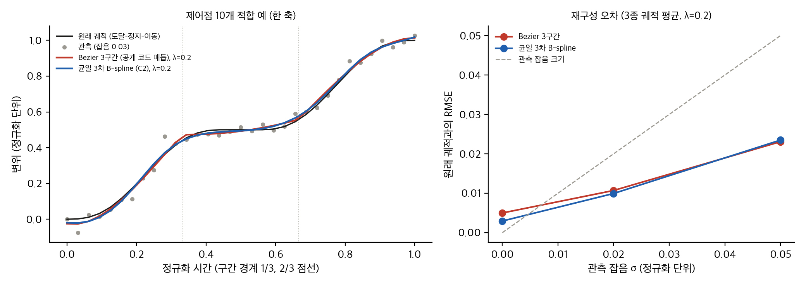
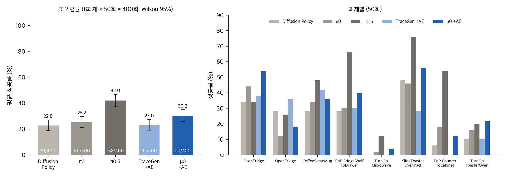
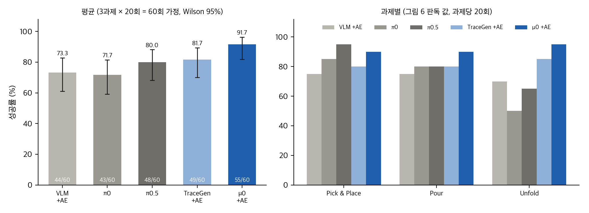
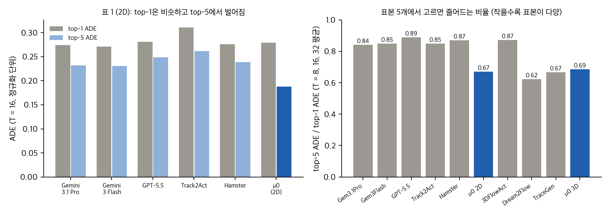
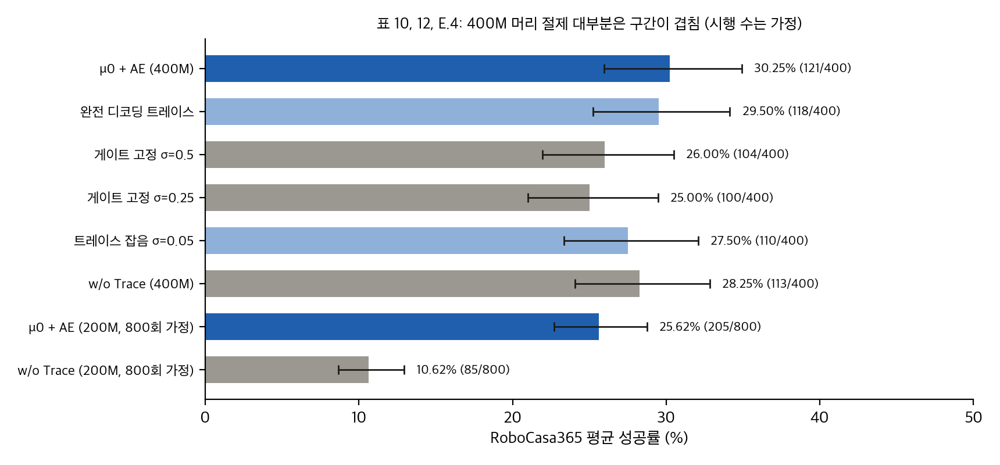

# 03. 수치 재계산과 일관성 검사

논문 v3의 표와 본문 수치를 다시 계산하고, 표끼리·본문과 표 사이의 일관성을 확인했습니다. 스크립트는 `analysis/recompute.py`(수 초, scipy)와 `analysis/code_arithmetic.py`(산술), `analysis/toy_bspline.py`(수 초)입니다. 검사 라벨은 V1–V20(재계산), C1–C14(주장 판정)입니다. 코드 대조의 D 항목은 `04`에 있습니다.

## 0. 가정

- **시뮬레이션(표 2):** 과제당 50 롤아웃(부록 D.5), 8과제라서 방법당 400회로 봅니다. 표의 모든 값이 2의 배수 퍼센트라서 과제당 정수 성공 수와 맞습니다(V1).
- **실로봇(그림 6):** 과제당 20 롤아웃(§4.2)이라고 하고 방법당 3과제 60회로 풀링합니다(시행 수 n = 60 가정). 막대 값은 그림에서 읽은 값입니다(그림 판독 값). 모든 값이 5의 배수라서 20회 정수 성공 수와 맞습니다(V3). 과제 안에 "여러 물체"가 있고(그림 5의 물체 7개와 6개) 물체별 시행 수는 본문에 없으므로, 과제당 20회가 물체를 합친 수라고 가정했습니다.
- **궤적 예측(표 1, 4, 9, 11):** 129 슬롯의 평균이며 표준편차, 시드, 신뢰구간이 없어 검정은 하지 않았습니다. 표 안 관계(최고 칸, 비율, 불변식)만 확인했습니다.
- **통계:** Wilson 95%, Fisher 정확 검정, Mantel–Haenszel 층화 검정(과제 층), 정확 부호 검정, 쌍체 Wilcoxon(정확), 모수 부트스트랩(과제별 이항 재표집 20,000회, 시드 0)을 씁니다. 과제 난이도 차이가 크므로 풀링 검정은 참고이고 층화 검정과 과제 단위 검정을 함께 봅니다.

## 1. 재계산 결과

### 1.1 표 2 평균과 해석 (V1, V2)

표 2의 평균 행은 8과제 값의 산술평균과 모두 일치합니다(Diffusion Policy 22.75, π0 25.25, π0.5 42.0, TraceGen 23.0, μ0 30.25). 성공 수로는 91, 101, 168, 92, 121 / 400입니다.

| μ0 대 | 평균 차 (pp) | 부트스트랩 95% 구간 | 과제 승/패 | 부호 검정 p | Wilcoxon p | 풀링 Fisher p (400 대 400) | MH 층화 p | 과제별 Fisher p < 0.05 |
|---|---|---|---|---|---|---|---|---|
| Diffusion Policy | +7.50 | [+1.75, +13.25] | 7/1 | 0.070 | 0.078 | 0.020 | 0.010 | 0/8 |
| π0 | +5.00 | [−0.75, +10.75] | 7/1 | 0.070 | 0.055 | 0.134 | 0.092 | 0/8 |
| π0.5 | −11.75 | [−17.75, −5.50] | 2/6 | 0.289 | 0.109 | 0.0007 | 0.0002 | 2/8 |
| TraceGen + 행동 전문가 | +7.25 | [+1.75, +13.00] | 6/2 | 0.289 | 0.250 | 0.025 | 0.014 | 2/8 |

- Wilson 95% (400회): Diffusion Policy 18.9–27.1, π0 21.2–29.7, π0.5 37.3–46.9, TraceGen 19.1–27.4, μ0 26.0–34.9.
- **π0 대비 +5.0 포인트**는 구간이 0을 포함하고(−0.75 ~ +10.75), 과제 8개 중 7개에서 앞서고(진 과제는 PickPlaceCounterToCabinet, 12 대 18) 부호 검정 p = 0.07입니다. π0.5 대비 −11.75는 두 과제(PickPlaceFridgeShelfToDrawer p = 0.016, PickPlaceCounterToCabinet p < 0.001)에서 개별로도 유의합니다.
- TraceGen 대비 +7.25는 풀링 p = 0.025, 과제 단위로는 SlideToasterOvenRack(56 대 28, p = 0.008), PickPlaceCounterToCabinet(12 대 0, p = 0.027)에서 개별 유의하고 OpenFridge는 반대 방향입니다(18 대 36, p = 0.07).
- 검정력(V17): π0와의 5.0포인트 차를 80% 검정력으로 검출하려면 방법당 약 1,258회가 필요한데 표 2는 400회입니다. 30% 근처 성공률의 표준오차는 ±2.3포인트입니다.

### 1.2 실로봇 (그림 6, V3–V5)

막대 평균은 모두 맞습니다: 73.33, 71.67, 80.00, 81.67, 91.67. 본문 격차 18.4, 20.0, 11.7, 10.0은 재계산값 18.33, 20.00, 11.67, 10.00과 반올림 안에서 일치합니다. 서론의 "π0의 120–130%, π0.5의 70–115%"는 시뮬레이션 119.8%, 실로봇 127.9%(π0), 시뮬레이션 72.0%, 실로봇 114.6%(π0.5)로 일치합니다(V5).

| μ0 대 (60회 풀링, n = 60 가정) | 성공 수 | 풀링 Fisher p | MH 층화 p | Wilson 95% (상대 방법) | 과제별 Fisher p (P&P, Pour, Unfold) |
|---|---|---|---|---|---|
| VLM + 행동 전문가 | 55 대 44 | 0.015 | 0.009 | 61.0–82.9 | 0.41, 0.41, 0.092 |
| π0 | 55 대 43 | 0.008 | 0.005 | 59.2–81.5 | 1.0, 0.66, 0.003 |
| π0.5 | 55 대 48 | 0.114 | 0.067 | 68.2–88.2 | 1.0, 0.66, 0.044 |
| TraceGen + 행동 전문가 | 55 대 49 | 0.178 | 0.111 | 70.1–89.4 | 0.66, 0.66, 0.61 |

- μ0의 Wilson 95%는 81.9–96.4입니다. 평균 기준 우위는 π0와 VLM 기준선에 대해서만 p < 0.05이고, π0.5, TraceGen에 대해서는 방향만 같습니다.
- 과제별로 보면 Pick & Place에서 π0.5(95)가 μ0(90)보다 높고, 평균 우위는 Unfold(μ0 95, π0 50, π0.5 65)에서 가장 큽니다. 서술 "all baselines across the three tasks on average"는 평균 기준 문장입니다.
- 검출 한계(V17): μ0 91.7 대 π0.5 80의 차를 80% 검정력으로 검출하려면 방법당 약 139회, TraceGen과는 약 181회입니다(시행 60회 사용).

### 1.3 표 1과 표 4: 궤적 예측 (V6–V9)

| 확인 | 결과 |
|---|---|
| 2D에서 μ0가 가장 좋은 칸 (표 1, 18칸) | 10칸. top-5 9칸(ADE, FDE, DTW × 3 지평) 모두, top-1은 DTW T = 16 한 칸 |
| 2D top-1에서 다른 방법이 앞서는 칸 | 8칸: Gemini 3 Flash(ADE 8, 16), Hamster(ADE 32, FDE 16, DTW 32), Gemini 3.1 Pro(FDE 8, DTW 8), GPT-5.5(FDE 32). μ0와의 차이는 0.001–0.043 |
| 3D에서 μ0가 가장 좋은 칸 | 18 / 18 |
| 본문 서술 (1) "2D에서 top-5 ADE, FDE, DTW 모든 지평 최고" | 일치 |
| 본문 서술 (2) "3D 모든 보고 지표 최고" | 일치 |
| 본문 서술 (3) "2.9배 빠름" | 0.85 / 0.29 = 2.93 |
| 표 4 (Fréchet), 2D에서 μ0가 최고가 아닌 칸 | top-1 FD, T = 32: Gemini 3 Flash 0.504, μ0 0.517. 나머지 11칸은 최고 |
| 부록 D.3의 "FD에서 가장 강한 전반 성능" | 위 한 칸을 빼고 일치 |

- **표본 다양성(V7):** top-5 ADE / top-1 ADE의 평균은 μ0 2D 0.67, Gemini 0.84–0.85, GPT-5.5 0.89, Track2Act 0.85, Hamster 0.87입니다. μ0의 2D top-5 우위는 top-1 오차의 차이보다 다섯 표본 사이의 분산에서 오는 몫이 큽니다. 3D 쪽 TraceGen 0.67, Dream2Flow 0.62도 비슷한 비율이라, 이 현상은 흐름·확산류 생성 모델의 공통 성질로 보입니다. VLM API 기준선의 다섯 표본은 독립 API 호출이며(공개 문서 EVALUATION.md), 추론 설정(추론 노력 low)은 논문 본문에 적혀 있지 않습니다.
- **2D와 3D의 μ0 값(V6):** 같은 모델인데 2D 행이 3D 행보다 약간 낮습니다(top-5 ADE T = 8: 0.124 대 0.132). z 오차가 3D 지표에 더해지는 차이로 읽힙니다.
- **지연 비교(V10):** μ0 0.29 s는 A6000(D.1), 기준선 하드웨어와 정밀도는 표 설명에 없습니다. VLM 기준선은 API 지연입니다(표 1의 †).

### 1.4 표 1 대 표 4 일관성: 불변식 검사 (V8)

- 모든 방법과 지평에서 top-5 ≤ top-1(ADE, FDE, DTW, FD), DTW ≤ ADE가 성립합니다.
- 같은 예측에서 이산 Fréchet 거리는 마지막 스텝 오차 이상이어야 합니다(곡선 쌍 맞춤에 끝점 쌍이 포함되므로). 표 1의 top-1 FDE와 표 4의 top-1 FD를 비교하면 60쌍 중 3쌍에서 FD가 FDE보다 작습니다: μ0 2D T = 8(FDE 0.322, FD 0.314), TraceGen T = 8(0.478, 0.450), μ0 3D T = 8(0.331, 0.329). 두 지표가 다른 슬롯 집합이나 유효 스텝 마스크를 쓸 가능성이 있습니다(D.1은 "유효한 미래 스텝의 평균"이라고만 씁니다). 저자 확인이 필요합니다.

### 1.5 비용과 규모 산술 (V10, V11, V12, V19)

| 항목 | 논문 값 | 재계산 | 판정 |
|---|---|---|---|
| 총 파라미터 (표 5) | π0 4.03B, π0.5 4.14B, μ0 + AE 3.04B | 3.45 + 0.578 = 4.028, 3.45 + 0.6934 = 4.143, 2.59 + 0.457 = 3.047 | 일치 |
| 머리 합 | 457.0M (436.4M + 20.6M) | 457.0 | 일치 |
| 지연 증가 (D.4) | 약 16% | 200.8 / 173.0 = 1.161 | 일치 |
| 사전학습 규모 비 | 69.5배 | 903M / 13.0M = 69.46 | 일치 |
| 표 3 합계 | 203.6K, 13.0M, 15.7 TB | 51.8 + 3.4 + 123 + 25.4 = 203.6, 4.1 + 2.7 + 3.7 + 2.5 = 13.0, 4 + 2.7 + 8 + 1 = 15.7 | 일치 |
| 사람 프레임 비율 | 약 52% | 6.8 / 13.0 = 52.3% | 일치 |
| 영상 길이 (A.7) | 사람 5 fps에서 약 16일, 로봇 10 fps에서 약 7일 | 15.7일, 7.2일 | 일치 |
| 추출 비용 (A.6) | 약 1.2K GPU 시간 | 13M / (2.4–3.3 fps) = 1,094–1,505 시간 | 범위 안 |
| 평가 슬롯 (D.2) | 129 | 30 × 4 + 9 | 일치. "약 28% 양손"은 36슬롯(27.9%) |
| 사전학습 예산 (B.1) | 2×10⁵ 스텝, 유효 배치 24 | 480만 표본, 13M 프레임 대비 0.37회전 | 참고 |

- **프레임률 서술(V11).** A.7은 5 fps(사람)와 10 fps(로봇)를 말합니다. 공개 TraceExtract의 데이터셋별 실행 스크립트 프리셋은 EgoDex 10, EgoVerse 10, Agibot 5, DROID 5(15 Hz에서 3프레임 간격)입니다(`04` D16). 프리셋 값으로 표 3의 프레임 수를 환산하면 사람 7.9일, 로봇 14.4일(합계 22.3일)이고, 논문 서술은 16일과 7일(합계 23일)입니다. 합계는 비슷하고 사람과 로봇의 비중이 반대입니다. 실제 사전학습에 쓴 값이 프리셋과 같은지는 확인할 수 없습니다. 표 3에서 에피소드당 프레임은 EgoDex 79, EgoVerse 794, Agibot 30, DROID 98입니다.

### 1.6 절제와 규모 (표 9, 11, 12, 10, V13–V16)

- **표 9 "Full μ0" = 깊이·이력 모두 없음 = 표 1의 3D μ0(0.127/0.187/0.223).** 표 1의 μ0 행은 입력이 가장 적은 설정입니다. 깊이와 이력을 쓰면 0.107/0.160/0.203입니다. 공개 평가 문서의 대표 명령도 `--use_depth_from=none --no_provide_history=true`입니다(`04` D12).
- **요소별 이득(top-5 DTW, T = 8/16/32):** B-spline 0.029/0.035/0.035, DINO 특징 0.012/0.006/0.007, 강성 손실 0.011/0.006/0.004. 이력 0.015/0.019/0.016(깊이 없이), 깊이 0.005/0.008/0.004(이력 있을 때). 시드와 구간이 없어서 강성 손실과 DINO의 0.004–0.012 크기가 평가 세트 변동 안인지 알 수 없습니다.
- **규모(표 11):** 모델 342M → 568M → 2.59B는 세 지평 모두 단조 감소(T = 32에서 0.240 → 0.227 → 0.223). 데이터 5% → 20% → 100%는 T = 16, 32에서 단조이고 T = 8에서 5% 대 20%가 0.134 → 0.138로 반대입니다. 데이터 20배 증가에 대한 총 이득은 0.007/0.013/0.012로, 모델 7.6배 증가의 이득 0.016/0.018/0.017보다 작습니다. 본문 "더 많은 데이터로 일관되게 개선"은 T = 16, 32에 해당합니다.
- **표 12와 정수 가능성(V14):** 400회(8과제 × 50)에서 성공률은 0.25%의 배수입니다. 28.25, 30.25는 가능하지만 25.625와 10.625(=42.5/400)는 불가능합니다. 800회(두 시드)에서는 0.125%의 배수라 25.625(205/800)와 10.625(85/800)가 가능합니다. E.2가 시드 두 개(RoboCasa 게이트 0.483, 0.481)를 언급하므로 200M 머리 값은 두 시드 평균으로 읽힙니다. 같은 이유로 v1의 10.675%는 어떤 400, 800, 1,200회 구성에서도 정수가 아닙니다. v3에서 10.625%로 바뀌었습니다.
- **표 10과 E.4의 비교(n = 400 가정, 시드 수 불명):** 학습 게이트 30.25 대 σ = 0.5 고정 26.0, Fisher p = 0.21. 대 σ = 0.25 고정 25.0, p = 0.11. 완전 디코딩 트레이스 29.5, p = 0.88. 정책 트레이스에 σ = 0.05 잡음 27.5, p = 0.44. 400M 머리에서 트레이스 있음 30.25 대 없음 28.25, p = 0.59(800회로 보면 0.41). 200M 머리 25.625 대 10.625는 n = 800 가정에서 p ≈ 5e-15입니다. 정책 쪽 점추정의 일부 차이(2.75–5.25 포인트)는 400회의 표준오차 ±2.3포인트와 같은 크기입니다.
- **게이트(V14):** 게이트 σ(g)는 g = 0에서 0.5로 시작하고(식 11 아래 서술, 공개 코드 `04` D3), 보고된 수렴값은 0.481–0.500입니다. 초기값에서 최대 0.019 움직였습니다. 고정 게이트 0.5와 학습 게이트(≈ 0.48–0.50)의 성공률 차(26.0 대 30.25)는 게이트 값 차이가 0.02 이내이므로 게이트 값의 차이만으로 설명하기 어렵습니다. 시드별 변동 등 다른 요인이 섞였을 가능성이 있습니다(시드 간 표준편차는 보고되지 않음).
- **표 7 (장기 과제, 50 롤아웃):** 모든 값이 짝수. 본문 "μ0가 π0와 같거나 높은 부분과제 5/7"(재계산 5), "대부분 π0.5에 뒤짐"(5개에서 낮고 2개 동률) 일치.
- **E.4:** 정책 입력 트레이스 잡음에서 30.25 → 27.5(−2.75 포인트, 상대 9.1%).

### 1.7 이력과 깊이 드롭아웃 (V18)

학습에서 이력은 확률 0.5로 전체 삭제, 확률 0.3으로 키포인트별 삭제(C.1)이고, 공개 코드는 둘을 합집합으로 적용해 키포인트당 이력이 사라질 확률이 0.5 + 0.5 × 0.3 = 0.65입니다. 깊이는 0.7로 생략합니다. 따라서 "깊이 없음 + 이력 없음"은 한 키포인트 기준 학습 표본의 약 45.5%에서 일어나는 가장 흔한 조건입니다. 표 1이 이 조건으로 평가된 것은 학습 분포의 중심과 맞습니다.

### 1.8 코드 상수로 다시 계산한 파라미터 (V20, `analysis/code_arithmetic.py`)

| 항목 | 논문 값 | 코드 상수에서 계산 | 판정 |
|---|---|---|---|
| 행동 전문가 | 436.4M | Gemma 300M 변형(폭 1024, 18층, mlp 4096, 헤드 8, KV 1, adaRMS) 427.9M + 투영과 시간 MLP 8.5M = 436.42M | 일치 |
| 특징 혼합기 | 20.6M | 게이트 교차 주의 18.89M + 그리퍼 DINO 투영 1.58M + 위치 임베딩 0.13M = 20.60M | 일치 (그리퍼 투영 포함) |
| 학습 머리 합 | 457.0M | 457.02M | 일치 |
| 트레이스 백본 (동결) | 2.59B | 2.58B (lm_head 포함 개산, 가정 있음) | 근사 일치 |

백본 개산은 SmolVLM2-2.2B의 `config.json`(hidden 2048, 어휘 49,280, 비전 27층)과 transformers 기본값(비전 hidden 1152, 텍스트 헤드 32)을 가정했고 깊이용 LoRA와 스템은 뺐습니다. 표 5의 "특징 혼합기 20.6M"이 게이트 교차 주의 모듈 하나가 아니라 그리퍼 투영과 위치 임베딩을 포함한다는 것은 이 계산에서 드러난 사실입니다.

## 2. 일관성 검사 요약 (위치 포함)

| 번호 | 항목 | 위치 | 결과 |
|---|---|---|---|
| V1 | 표 2 평균 행 | 표 2 | 5개 모두 일치 |
| V3 | 그림 6 평균과 본문 격차 | 그림 6, §4.2 | 일치(그림 판독 값) |
| V5 | 서론 비율 120–130%, 70–115% | §1 | 일치 |
| V6 | "top-5 모든 지평 최고(2D)", "3D 모든 지표 최고" | §4.1 | 일치. top-1은 2D 18칸 중 8칸에서 다른 방법이 앞섬(본문 "경쟁적") |
| V8 | FD ≥ FDE | 표 1 대 표 4 | 60쌍 중 3쌍에서 FD < FDE (모두 T = 8, top-1) |
| V9 | "FD 전반 최고" | 부록 D.3, 표 4 | top-1 FD T = 32(2D) 한 칸 예외 |
| V10 | 파라미터 합, 지연 증가율, 규모 비 | 부록 D.4, 표 5 | 일치 |
| V11 | 데이터 합계, 영상 길이, 추출 시간 | 부록 A.6, A.7 | 합계 일치. 사람/로봇 프레임률 서술은 공개 프리셋과 다름 |
| V12 | 평가 슬롯 수 | 부록 D.2 | 일치 |
| V13 | 표 9 "Full μ0" | 표 9, 표 1 | 표 1의 3D μ0 행과 같고 "깊이·이력 없음" 행과 같음 |
| V14 | 표 12 정수 가능성 | 표 12, E.3 | v3 값은 800회에서 가능, v1 값은 불가. 표 12의 시행 수는 본문에 없음 |
| V15 | 표 7 서술 | 부록 D.6 | 일치 |
| V20 | 표 5 파라미터 | 부록 D.4 | 코드 상수와 일치 |

## 3. 토이: B-spline 표현이 허용하는 오차 (`analysis/toy_bspline.py`, 약 1초)

**묻는 것.** 부록 B.2는 제어점 10개의 3차 B-spline이 간결(96 → 30 출력), 매끄러움, 쉬운 디노이징을 준다고 하고, D.2는 B-spline 적합 재구성 오차가 약 0.02 DTW라고 씁니다. 공개 코드의 매듭 벡터는 내부 매듭 중복도 3(3구간 Bézier, C0 연결)입니다(`04` D8). 합성 궤적(정규화 단위로 전체 변위 약 1; 도달, 도달-정지-이동, 진동)에서 이 표현의 오차와 C2 균일 B-spline을 비교했습니다. 궤적 300개, 잡음 σ = 0, 0.02, 0.05(정규화 단위). 실제 데이터 오차는 아니고 표현이 허용하는 크기의 감입니다.



*그래프: 우리가 그린 그래프. 합성 궤적에 대한 제어점 10개 적합 예(왼쪽)와 잡음별 재구성 오차(오른쪽).*

| 궤적 | 잡음 σ | 기저 | λ | 원래 궤적과의 RMSE | 이웃 속도 점프 (제어점 간격 대비) |
|---|---|---|---|---|---|
| 도달 | 0 | Bézier 3구간 | 0.2 | 0.0011 | 0.20 |
| 도달-정지-이동 | 0 | Bézier 3구간 | 0.2 | 0.0040 | 1.28 |
| 도달-정지-이동 | 0 | C2 균일 | 0.2 | 0.0026 | 0 |
| 진동 | 0 | Bézier 3구간 | 0.2 | 0.0098 | 0.03 |
| 진동 | 0 | C2 균일 | 0.2 | 0.0056 | 0 |
| 도달-정지-이동 | 0.02 | Bézier 3구간 | 0.2 | 0.0098 | 1.26 |
| 도달-정지-이동 | 0.02 | C2 균일 | 0.2 | 0.0097 | 0 |

- 잡음이 없을 때 모든 설정의 재구성 RMSE는 0.011 이하로, 논문의 약 0.02(DTW) 안에 들어갑니다. 단위와 정의(DTW 대 RMSE)가 달라 직접 비교는 아닙니다.
- 잡음 σ = 0.02–0.05에서 적합 곡선은 원래 궤적에 관측보다 가깝게 맞고(σ = 0.02에서 0.010, σ = 0.05에서 0.023–0.027), 잡음 제거 효과가 있습니다. λ = 0.2는 σ = 0.05에서 오차를 0.026 → 0.023 줄입니다.
- Bézier 3구간 기저는 진동 궤적에서 C2 기저보다 오차가 큽니다(0.0098 대 0.0056, 잡음 없음). 내부 매듭 두 곳(t = 1/3, 2/3)에서 속도가 연속이 되도록 강제하지 않으므로 적합된 곡선에 접선 불연속이 생길 수 있습니다(잡음 있는 궤적에서 궤적 종류와 λ에 따라 제어점 간격의 0.2–1.4배). 보고서의 표현 "smooth"는 구간 안에서의 매끄러움으로 읽는 것이 정확합니다.
- 한계: 합성 궤적 3종, 한 시드입니다. 앵커 행(t = 0)은 가중 1의 일반 행으로 넣었고, 공개 코드의 적합(`trace_dataset.py`)도 앵커 행을 같은 방식으로 포함합니다.

## 4. 주장 판정 (C 항목)

| 번호 | 주장 (위치) | 재계산 근거 | 판정 |
|---|---|---|---|
| C1 | 2D와 3D 궤적 예측에서 기준선을 능가 (초록, §4.1) | 3D 18/18, 2D top-5 9/9, 2D top-1 1/9 (V6) | 3D와 2D top-5에서 지지, 2D top-1은 경쟁 수준 |
| C2 | 다음으로 빠른 2D 기준선보다 2.9배 빠름 (§4.1) | 0.85 / 0.29 = 2.93 (V10) | 산술 일치. 하드웨어 비교 조건은 본문에 없음 |
| C3 | μ0가 RoboCasa365에서 π0를 5.0포인트 앞섬 (§4.2) | 평균 차 +5.00, 구간 [−0.75, +10.75], 풀링 p = 0.13, 7/8 과제(부호 p = 0.07) (V2) | 방향 지지, 400회 규모에서 통계적 확정은 아님 |
| C4 | TraceGen + 행동 전문가보다 7.25포인트 높음 (§4.2) | 풀링 p = 0.025, MH p = 0.014, 6/8 과제 (V2) | 지지 (구간 하한 +1.75) |
| C5 | 실로봇 평균이 모든 기준선보다 높음, π0 대비 +20.0, π0.5 대비 +11.7 (§4.2) | 평균 일치. 60회 가정: π0 p = 0.008, π0.5 p = 0.11, TraceGen p = 0.18 (V3, V4) | 평균 기준 일치. π0와는 확실, π0.5, TraceGen과는 방향만 |
| C6 | 동결 트레이스 특징이 일반 VLM 표현 이상의 모션 안내를 줌 (실로봇 +18.4) | 실로봇 p = 0.015 (V4). 시뮬 400M 머리 +2.0포인트 p = 0.59, 200M 머리 +15.0포인트 (V14) | 지지. 이득은 머리 용량이 작을 때 큼 |
| C7 | 모델·데이터가 클수록 궤적 예측 개선 (§4.2 규모 분석) | 모델 단조, 데이터는 T = 8에서 5% 대 20%가 반대, 총 이득 0.007–0.013 (V13) | 모델 규모는 지지, 데이터는 부분 지지(시드·구간 없음) |
| C8 | 절제가 모든 주요 선택을 검증 (§4.2, E.1) | 이득 0.004–0.035, 표 1 μ0 행은 깊이·이력 없음 설정 (V13) | B-spline 이득은 가장 큼. DINO와 강성 손실은 크기가 작고 구간 없음 |
| C9 | 학습 게이트가 고정 게이트보다 낫다 (E.2) | 30.25 대 26.0 (p = 0.21), 25.0 (p = 0.11), 학습 게이트가 초기값 0.5 근처 (V14) | 방향만. 게이트가 약한 주입에서 시작해 강해진다는 서술과 초기값 0.5는 어긋남 |
| C10 | μ0 + 행동 전문가의 추론 파라미터가 π0, π0.5보다 적고 지연 약 16% 높음 (D.4) | 3.04B 대 4.03B, 4.14B. 지연 +16.1% (V10) | 일치 |
| C11 | 사전학습 데이터는 π0의 903M 프레임보다 69.5배 작음 (D.4) | 903 / 13.0 = 69.46 | 산술 일치. 프레임률이 다를 수 있어 규모 비교는 근사 |
| C12 | 캡션 41% 교란 시 2.9–3.3%, 키포인트 30% 교란 시 1.2–4.1% 악화 (E.4) | 평가 세트 없이 재계산 불가 | 확인 불가 |
| C13 | 약 1.2K GPU 시간으로 13M 프레임 추출 (A.6) | 1,094–1,505 시간 범위 안 (V11) | 일치 |
| C14 | TraceGen 대비 약 8배 데이터 규모 (§1) | 비교 대상 크기가 본문에 없음 | 확인 불가 |

## 5. 재실행

```bash
python3 analysis/recompute.py        # recompute_results.json (scipy, 수 초)
python3 analysis/code_arithmetic.py  # code_arithmetic_results.json
python3 analysis/toy_bspline.py      # toy_bspline_results.json (numpy, 약 1초)
python3 analysis/plot_figures.py     # report/figures/own_*.png (matplotlib)
```



*그래프: 우리가 그린 그래프. 표 2의 값을 다시 그렸고 Wilson 95% 구간은 방법당 400회로 계산했습니다.*



*그래프: 우리가 그린 그래프. 그림 6에서 읽은 값(그림 판독 값)이며 구간은 방법당 60회(시행 수 가정)로 계산했습니다.*



*그래프: 우리가 그린 그래프. 표 1의 값으로 그렸습니다.*



*그래프: 우리가 그린 그래프. 시행 수는 400회 또는 800회로 가정했습니다.*
