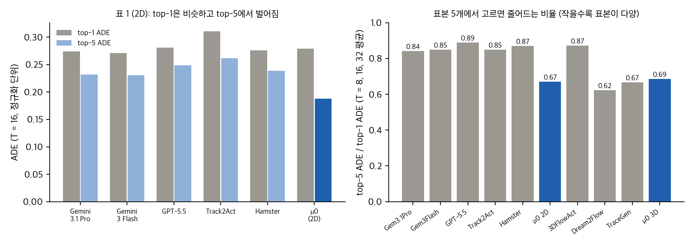
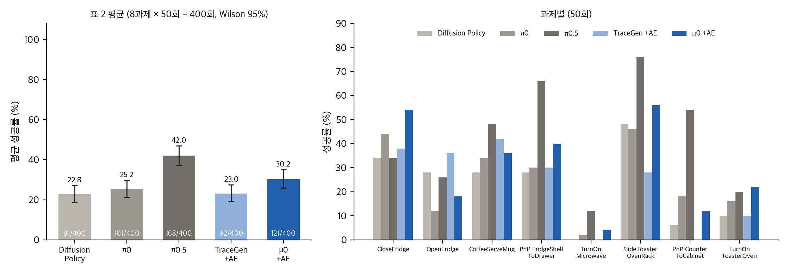
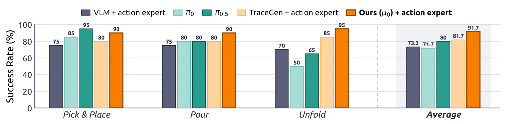
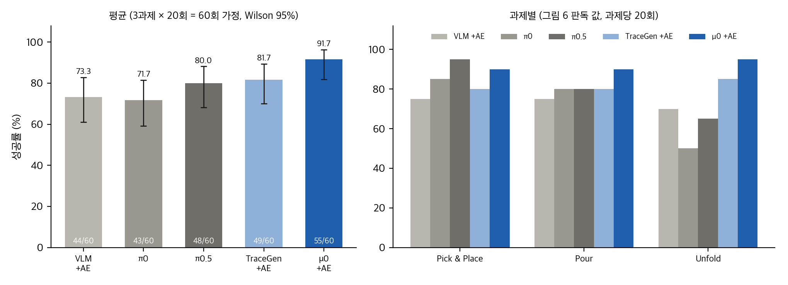
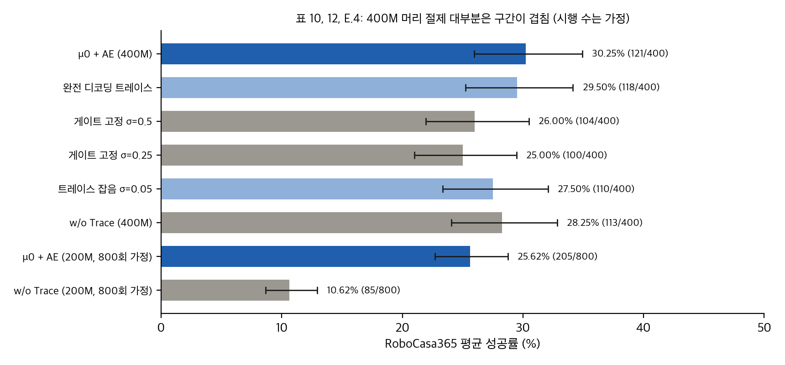
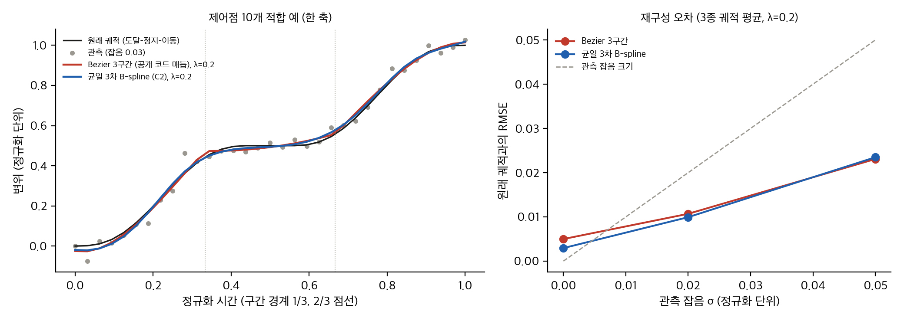

> **논문:** Seungjae Lee, Yoonkyo Jung, Jusuk Lee, Jonghun Shin, Amir Hossein Shahidzadeh, Yao-Chih Lee, H. Jin Kim, Jia-Bin Huang, Furong Huang. *μ0: A Scalable 3D Interaction-Trace World Model.* CoRL 2026 포스터, arXiv:2606.13769 (v3, 2026-10-20).
> 공식 코드는 GitHub Yoonkyo/mu0(학습, 평가, 정책)와 Yoonkyo/TraceExtract(데이터 엔진)에 있고 둘 다 Apache-2.0입니다. 이 글의 그림은 논문 그림 한 장(출처 표기)과 우리가 그린 그래프입니다. 수치는 논문 v3의 표와 본문에서 옮겨 다시 계산했습니다.

## 논문이 묻는 것

로봇 학습에는 행동 라벨이 붙은 데이터가 적고 영상은 많습니다. 영상을 쓰는 세계 모델은 두 갈래입니다. 픽셀을 예측하면 외형 복원에 용량을 쓰고, 행동을 예측하면 로봇마다 라벨이 다릅니다. μ0는 그 중간에 **물체, 도구, 손, 접촉 부위 같은 상호작용 지점의 미래 3D 궤적**을 둡니다. 로봇이 달라도 "무엇이 어떻게 움직여야 하는가"는 비슷하다는 가정입니다.

구성은 세 부분입니다. TraceExtract는 사람과 로봇 영상(13.0M 프레임)에서 DINOv2 군집으로 키포인트를 고르고, VGGT와 TAPIP3D로 전역 정렬된 3D 궤적을 만들고, 가속도로 영상을 사건 단위로 잘라 VLM 캡션을 붙입니다. μ0는 동결한 SmolVLM2-2.2B 앞 20층 위에 20층 트레이스 전문가를 얹은 2.59B 모델로, 질의 키포인트마다 제어점 10개짜리 B-spline 궤적을 flow matching으로 생성합니다. 마지막으로 μ0 전체를 동결하고, 4스텝 중 1스텝만 디노이징한 은닉 상태를 게이트 교차 주의로 행동 전문가에 넣어 로봇 행동을 만듭니다.

## 이 글에서 확인한 것

**1. 궤적 예측의 이득은 top-5에서 큽니다.** 표 1의 2D 비교에서 top-5(표본 다섯 개 중 최소 오차) 아홉 칸은 모두 μ0가 가장 낮고, top-1 아홉 칸 중 여덟 칸은 다른 방법이 더 낮습니다(차이 0.001–0.043). 3D 비교에서는 열여덟 칸 모두 μ0가 가장 낮습니다. top-5 대 top-1 ADE 비율은 μ0 2D가 0.67, VLM 기준선이 0.84–0.89라서, top-5의 이득에는 표본 사이의 분산이 큰 몫을 하는 것으로 보입니다. 3D 기준선인 TraceGen(0.67), Dream2Flow(0.62)도 비슷한 비율이라 생성 모델류에 공통인 성질일 가능성이 있습니다.

*그래프: 우리가 그린 그래프. 표 1(2D, T = 16)의 값과 세 지평 평균 비율입니다.*

**2. 표 1의 μ0는 깊이와 이력이 없는 설정입니다.** 표 9의 "Full μ0" 행(0.127/0.187/0.223)은 표 1의 3D μ0 행, 그리고 "깊이·이력 없음" 행과 같은 값입니다. 깊이와 이력을 함께 쓰면 top-5 DTW가 0.107/0.160/0.203으로 더 낮습니다. 공개 평가 문서의 대표 명령도 깊이와 이력을 끈 설정입니다.

**3. 시뮬레이션에서 π0보다 5.0포인트 높고 구간은 0을 포함합니다.** RoboCasa365 8과제에서 평균 성공률은 μ0 30.25%, π0 25.25%, π0.5 42.0%입니다. 과제당 50회(방법당 400회)로 보면 π0와의 차이는 부트스트랩 95% 구간 [−0.75, +10.75], 풀링 Fisher p = 0.13입니다. 과제 8개 중 7개에서 앞서지만 부호 검정 p = 0.07입니다. TraceGen + 행동 전문가와의 7.25포인트 차이는 p = 0.025이고, π0.5는 11.75포인트 높습니다(p = 0.0007). 논문도 π0.5가 평균에서 강하다는 점을 밝힙니다. 5포인트 차를 80% 검정력으로 구분하려면 방법당 약 1,258회가 필요합니다.

*그래프: 우리가 그린 그래프. 표 2의 값이고 Wilson 95% 구간은 방법당 400회로 계산했습니다.*

**4. 실로봇 평균 91.7%는 π0와 VLM 기준선에 대해서는 p < 0.05이고 나머지는 방향만 같습니다.** 논문 그림 6의 막대 값(그림 판독 값)을 과제당 20회, 방법당 60회(시행 수 60 가정)로 보면 π0 대비 p = 0.008, VLM + 행동 전문가 대비 p = 0.015, π0.5 대비 p = 0.11, TraceGen 대비 p = 0.18입니다. 평균 우위는 Unfold 과제(μ0 95, π0 50, π0.5 65)에서 가장 크고, Pick & Place에서는 π0.5(95)가 μ0(90)보다 높습니다.

*그림 6 (논문 원문). © 저자, CC BY 4.0, 출처 arXiv:2606.13769 (v3).*

*그래프: 우리가 그린 그래프. 그림 6에서 읽은 값이고 구간은 방법당 60회(시행 수 가정)로 계산했습니다.*

**5. 게이트는 초기값 근처에 머뭅니다.** 식 11의 게이트 σ(g)는 g = 0으로 시작하므로 초기값이 0.5이고, 부록 E.2가 보고한 수렴값은 0.481–0.500입니다. 부록 B.4는 "약한 주입 영역에서 시작해 필요할 때 강해진다"고 설명하는데, 초기값이 이미 중간값입니다. 게이트를 0.5와 0.25로 고정한 조건(26.0%, 25.0%)과 학습 게이트(30.25%)의 차이는 시행 수 400 가정에서 p = 0.21, 0.11이라서, 게이트 설계 효과와 시드 변동을 구분하기 어렵습니다. 트레이스 특징의 이득은 행동 머리 크기에 따라 달라집니다. 400M 머리에서는 30.25 대 28.25(p ≈ 0.4–0.6), 200M 머리에서는 25.6 대 10.6입니다(시행 수 800 가정).

*그래프: 우리가 그린 그래프. 표 10, 12와 E.4의 값이고 시행 수는 400회 또는 800회로 가정했습니다.*

**6. 공개 코드의 정책은 고정 20×20 격자를 질의로 씁니다.** 논문은 서론에서 고정 격자 트레이스의 한계(작은 부위 과소 표집)를 지적하고 사전학습에는 의미 키포인트를 씁니다. 공개 코드의 정책 경로(`mu0_policy.py`)는 균일 20×20 = 400개 점을 질의로 두고 키포인트당 마지막 토큰을 2×2로 풀링해 100개 토큰을 게이트 교차 주의에 넣습니다. 본문에는 그림 3의 "Fixed query Point" 라벨 외에 설명이 없으므로 정책 평가에서 쓴 질의 설정은 저자 확인이 필요합니다. 그 밖에 정책 학습 스텝은 스크립트 60,000, 표 6은 50,000이고, 기준선(π0, π0.5, Diffusion Policy, TraceGen)을 돌리는 코드는 저장소에 없습니다.

**7. 표 사이 일관성은 대체로 좋고 확인할 칸이 몇 개 있습니다.** 표 2 평균 행, 그림 6 평균, 파라미터 합(표 5)은 모두 맞고, 표 5의 행동 전문가 436.4M과 혼합기 20.6M은 공개 코드의 상수로 계산해도 일치합니다(혼합기에는 그리퍼 투영이 포함됩니다). 예외 두 가지입니다. v1의 표 8에는 200M 머리 w/o Trace 값이 10.675%였는데, 400회나 800회의 정수 성공 수로는 나올 수 없는 값이고 v3에서 10.625%로 바뀌었습니다. 또 표 1의 top-1 FDE보다 표 4의 top-1 Fréchet 값이 작은 칸이 세 곳(T = 8)입니다. Fréchet 거리는 마지막 스텝 오차 이상이어야 하므로 두 표가 다른 슬롯 집합이나 유효 스텝 마스크를 쓸 가능성이 있고, 저자 확인이 필요합니다.

## B-spline 표현이 허용하는 오차 (토이)

μ0는 미래 궤적 32스텝을 제어점 10개의 B-spline으로 줄입니다(96 → 30 출력). 공개 코드의 매듭 벡터는 내부 매듭 중복도가 3인 세 구간 Bézier(C0 연결)입니다. 합성 궤적(도달, 도달-정지-이동, 진동, 300개)으로 균일 3차 B-spline(C2)과 비교했습니다. 잡음이 없을 때 재구성 RMSE는 0.0003–0.0098(정규화 단위)이고, 잡음 σ = 0.05에서는 적합 곡선이 관측보다 원래 궤적에 더 가깝습니다(0.023–0.027). 진동 궤적에서는 Bézier 기저의 오차가 더 큽니다(0.0098 대 0.0056). 내부 매듭 두 곳에서 속도 연속이 강제되지 않으므로 "smooth"는 구간 안에서의 매끄러움으로 읽는 것이 정확합니다. 논문 D.2의 재구성 오차 약 0.02 DTW와는 단위가 달라 직접 비교하지 않았습니다.

*그래프: 우리가 그린 그래프. 합성 궤적 300개, 한 시드. 왼쪽은 적합 예, 오른쪽은 잡음별 오차입니다.*

## 구현 가능성

- **전체 재현은 개인 장비로는 어렵습니다.** 사전학습(2.59B, 2×10⁵ 스텝)은 GPU 2장 이상과 전체 데이터(원본 15.7 TB)가 필요하고, TraceExtract는 CUDA 확장과 약 1.2K GPU 시간이 필요하며, 정책 학습은 4 × L40S를 가정합니다.
- **공개 체크포인트(5.62 GB)와 평가 세트(4.51 GB)로 궤적 예측 추론은 가능성이 있습니다.** 코드의 기본 장치가 `cuda`이고 `transformers == 5.3.0` 등 새 환경이 필요해서 CUDA가 없는 장비에서는 장치 수정이 필요하고 속도는 측정하지 못했습니다.
- **축소 구현은 가능합니다.** 합성 이동 점 영상과 B-spline 제어점, flow matching으로 작은 트레이스 전문가를 만드는 데 며칠(추정)이 듭니다.

## 한계와 확인하지 못한 것

- 궤적 예측 표는 129 슬롯의 평균이고 시드와 구간이 없어 검정을 하지 못했습니다.
- 표 12와 실로봇의 시행 수는 본문에 없어 가정했고(400 또는 800회, 60회), 실로봇 막대 값은 그림에서 읽었습니다.
- 체크포인트 설정 파일과 평가 세트를 받지 않아 학습 설정(추론 스텝 수, 학습률 스케줄)과 코드 기본값의 일치, 129 슬롯과 영상 수의 대응은 확인하지 못했습니다.
- 공개 코드는 정적으로 읽었을 뿐 실행하지 않았습니다.
- 논문 그림 중 영상 프레임이나 사진이 들어 있는 그림은 쓰지 않았습니다.

## 자료

- [통합 리포트 PDF](report/report_public.pdf)
- [01. 논문 분석: μ0 (arXiv:2606.13769)](analysis/01_paper_analysis.md)
- [02. 선행연구와 관련 저장소](analysis/02_prior_work.md)
- [03. 수치 재계산과 일관성 검사](analysis/03_analysis.md)
- [04. 공식 코드 대조와 구현 가능성](analysis/04_code_verification.md)
