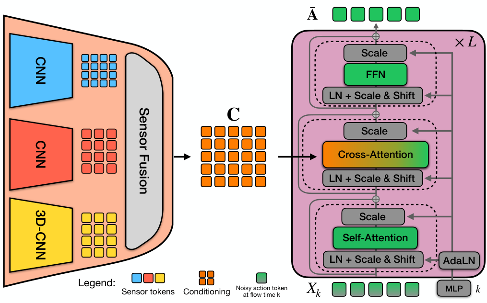
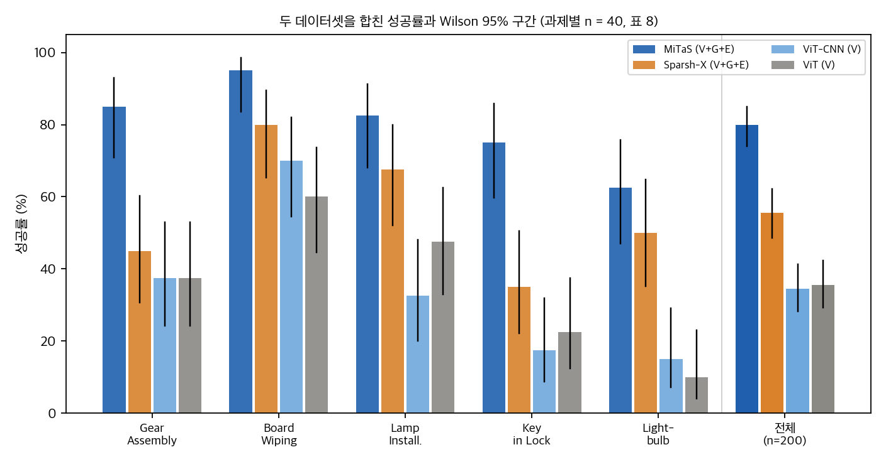
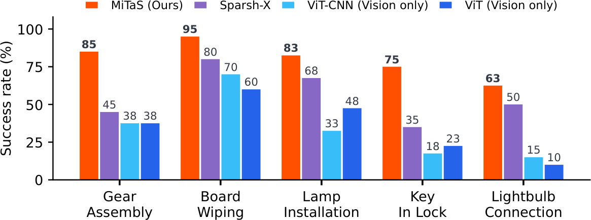
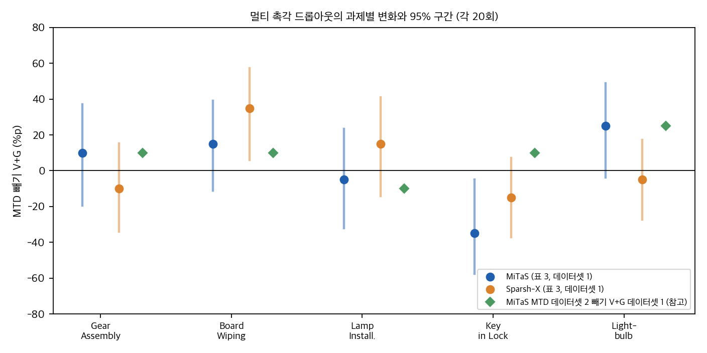
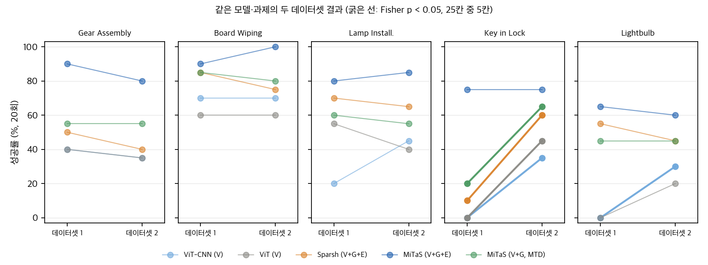
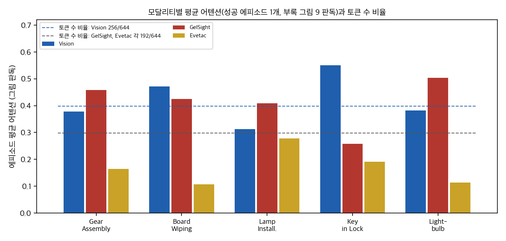

> **논문:** Rickmer Krohn, Erik Helmut, Niklas Funk, Jan Peters, Vignesh Prasad, Georgia Chalvatzaki. *Multi-Resolution Tactile Imitation Learning for Contact-Rich Robotic Manipulation.* CoRL 2026 포스터, arXiv:2606.06281 (v2, 2026-10-21. v1은 2026-06-04).
> 논문은 arXiv에서 CC BY 4.0으로 공개되어 있어 그림 2와 4를 저자 표기와 함께 실었고, 나머지는 우리가 다시 그린 그래프입니다. 논문에 없는 값을 그림에서 읽은 곳은 "(그림 판독 값)"으로, 시뮬레이션은 "(합성)"으로 표시했습니다. 공식 코드는 공개되어 있지 않아(프로젝트 페이지 "Coming Soon") 코드 대조는 하지 않았고 표와 본문 수치를 재계산했습니다.

## 논문이 하는 것

Franka 팔의 손목에 RGB 카메라, GelSight Mini(프레임 방식, 25 Hz), Evetac(이벤트 방식, 200 Hz)을 달고, 세 센서를 각각의 합성곱 스템으로 토큰(총 644개)으로 바꿔 트랜스포머로 융합한 뒤 플로 매칭 DiT 정책을 조건화합니다. 로봇 상태는 입력에 없고 4자유도 델타 행동만 냅니다. 과제 5개(Gear, Board Wiping, Lamp, Key in Lock, Lightbulb)에서 과제당 시연 30개로 학습하고, 모델·과제당 20회씩 평가합니다. 두 개의 독립 수집 데이터셋 결과를 합쳐 MiTaS가 평균 80%, Sparsh-X 55.5%, 시각 전용 34.5–35.5%라고 보고합니다. 학습 때만 Evetac를 쓰는 멀티 촉각 드롭아웃(MTD)도 제안합니다.

*그림 1. 논문 그림 2의 구조 도식(센서 영상 열은 제외). © 저자, CC BY 4.0, 출처 arXiv:2606.06281 (v2).*

## 이 글에서 확인한 것

**1. MiTaS가 Sparsh-X보다 높다는 결론은 유지됩니다.** 합계 160/200 대 111/200(+24.5%p)은 Fisher p = 2×10⁻⁷이고, (과제, 데이터셋) 10칸을 층화해도 p = 6×10⁻⁸입니다. 10칸이 모두 양의 차이여서 칸을 정책 하나로 보는 쌍 검정도 p = 0.002입니다. 칸마다 학습이 한 번이라는 점을 반영해 칸의 참 성공률에 변동(SD 9.4%p, 두 데이터셋 차이에서 추정한 상한 감각의 값)을 더한 합성 시뮬레이션에서도 같은 모델 사이의 우연으로 이 차이가 나올 확률은 0.01% 수준입니다(합성). 과제별로 개별 구분되는 것은 Gear와 Key입니다(합친 40회, p = 3×10⁻⁴, 6×10⁻⁴). Board, Lamp, Lightbulb는 구분되지 않습니다.

*그림 2. 우리가 그린 그래프. 표 8의 성공 수로 만든 과제별 성공률과 Wilson 95% 구간입니다(합친 40회, 전체 200회).*

*그림 3. 논문 그림 4(두 데이터셋을 합친 과제별 성공률). © 저자, CC BY 4.0, 출처 arXiv:2606.06281 (v2).*

**2. 초록의 기준선 수치는 모집단이 다릅니다.** "visuotactile (55.5 %, 63 %)"에서 55.5%는 Sparsh-X의 두 데이터셋 합 200회, 63%는 Q-Former의 두 번째 데이터셋 100회입니다. 같은 두 번째 데이터셋에서 MiTaS 80%, Q-Former 63%, PolyTouch 58%, Sparsh-X 57%이고, MiTaS와의 차이는 각각 p = 0.012, 0.001, 0.0007입니다. 세 기준선은 서로 구분되지 않습니다. Sparsh-X도 조건 토큰이 640개이므로 "토큰이 많아서"만으로는 차이를 설명하기 어렵습니다.

**3. Evetac를 더한 효과는 데이터셋 1에서 확실합니다.** 비전 + GelSight 51%에서 세 센서 80%로 올라(p = 3×10⁻⁵), 과제별로는 Gear와 Lightbulb에서 구분됩니다. 비전 + Evetac는 Gear에서 0/20으로, 같은 스템의 시각 전용(8/20)보다 낮습니다.

**4. 멀티 촉각 드롭아웃의 효과는 구분되지 않습니다.** 표 3의 합계 변화는 MiTaS +2%p(p = 0.89), Sparsh-X +4%p(p = 0.66)입니다. 과제별로 개별 구분되는 칸은 모델마다 하나이고, MiTaS에서는 그 칸이 Key in Lock의 하락(−35%p, p = 0.048)입니다. 두 번째 데이터셋의 같은 모델은 Key에서 65%(13/20)로, 첫 번째 데이터셋의 20%(4/20)와 p = 0.0095로 다릅니다. Key에서 하락한 이유로 제시된 "GelSight의 손 안 위치 특징을 교란한다"는 설명은 시험되지 않았습니다.

*그림 4. 우리가 그린 그래프. MTD 전후 성공률 차이와 95% 구간(Newcombe, 각 20회). 다이아몬드는 두 번째 데이터셋의 MiTaS MTD V+G와 첫 번째 데이터셋 V+G의 차이(참고)입니다.*

**5. 두 데이터셋의 같은 칸이 Key in Lock에서 크게 다릅니다.** 두 데이터셋에서 모두 평가된 5개 모델 × 5과제 = 25칸 중 5칸이 Fisher p < 0.05이고(차이가 없어도 25칸을 검정하면 약 1.25칸은 p < 0.05가 나옵니다), 그중 4칸이 Key입니다. 시각 전용은 첫 번째 데이터셋에서 0%, 두 번째에서 35–45%입니다. v1은 "시각 전용은 Key와 Lightbulb에서 0%"라고 적었고 v2는 "일관되게 풀지 못한다"로 바뀌었는데, 이 차이와 맞습니다. 두 데이터셋을 합친 40회는 이항 구간(그림 2)보다 넓은 불확실성을 가진 값으로 읽는 것이 맞습니다.

*그림 5. 우리가 그린 그래프. 같은 모델·과제의 두 데이터셋 성공률입니다(굵은 선은 Fisher p < 0.05).*

**6. 어텐션 판독에서 Evetac의 평균 몫은 토큰 비율보다 낮았습니다.** 부록 그림 9의 곡선을 색으로 분리해 읽으면(그림 판독 값) 세 모달리티 어텐션의 합은 시간 단계마다 약 1(0.976–1.035)이고, Evetac의 에피소드 평균은 0.11–0.28입니다. 토큰 수에 비례한 균등 몫은 0.30(192/644)입니다. 본문의 "Evetac가 표현을 주도하지는 않는다"와 같은 방향이고, 접촉 구간에서 일시적으로 올라가는 양상은 부록 그림 10과 일치합니다. 어텐션은 입력 중요도의 인과 지표가 아니고 성공 에피소드 1개라서, 센서 제거 절제(3번)가 더 직접적인 증거입니다.

*그림 6. 우리가 그린 그래프. 부록 그림 9를 판독한 모달리티별 평균 어텐션(그림 판독 값)과 토큰 수 비율(점선)입니다.*

## 그 밖에 확인한 것

- 표 8의 12행(성공 수)은 표 9, 10에서 정확히 다시 만들어지고, 그림 4의 20개 막대 라벨도 표 8에서 나옵니다(0.5는 올림). 총 평가 횟수 1700회도 맞습니다. v1의 데이터셋 1 값은 v2에서 한 칸도 바뀌지 않았습니다.
- 표 5의 파라미터는 인코더 + 머리 13,701,508 = 총합이 9행 모두 맞고, MiTaS 인코더는 시각 + GelSight 스템 + Evetac 스템의 합과 정확히 같습니다. 반면 Hz 열은 1000/ms의 약 7.9–8.4배이고, 토큰 수에는 센서 토큰 합(640) 외에 설명 없는 4개(644)가 있으며, Evetac 16프레임(200 Hz)은 0.06 s 표본화 창(12프레임)과 맞물림이 서술되어 있지 않습니다. 저자 확인이 필요한 항목입니다.
- "Sparsh-X는 키를 여러 번 넣었지만 한 번도 완료하지 못했다"는 문장 옆의 표 값은 Key 14/40(데이터셋별 2/20, 12/20)입니다. 어느 모델·세션을 가리키는지 확인이 필요합니다.
- 20회 칸은 검출력이 낮습니다. 참 성공률 0.50 대 0.75(25%p 차이)를 Fisher로 5%에서 구분할 확률은 20회에서 27%, 40회에서 56%, 100회에서 95%입니다(합성).
- 데이터셋은 Hugging Face에 있고(63.6 GB, 카드 CC BY 4.0), 논문의 "30개 시연"과 달리 과제·세션마다 파일이 31–33개이며 논문에 서술이 없는 세션 폴더도 있습니다. 어느 세션이 논문의 데이터셋 1, 2인지 확인이 필요합니다. 이 글은 데이터를 받지 않았습니다.

## 구현 가능성

공식 코드와 체크포인트가 공개되어 있지 않고 실로봇(Franka, GelSight Mini, Evetac, 과제 장치 5종)이 필요해 **논문의 성공률 재현은 공개 자료만으로는 할 수 없습니다.** 구조는 표 5와 표 7이 크기를 거의 정해 주어(DiT 머리는 서술에서 추정하면 0.28% 안으로 맞음) 24.5 M 모델의 재구현과 파라미터·지연 측정은 일반 노트북급에서 가능해 보입니다. 공개 데이터로 한 오프라인 학습은 다운로드가 필요하고 폐루프 성공률의 대리 지표로는 약합니다. 이번 글에서는 어느 쪽도 실행하지 않았습니다.

## 맺음

MiTaS의 핵심 비교(세 센서 정책이 Sparsh-X와 시각 전용보다 높다)는 칸마다 한 번의 학습이라는 불확실성을 더해도 유지됩니다. 읽을 때 구분해 둘 것은 과제별 순위(Gear와 Key만 개별 구분), MTD의 효과(구분되지 않음), 두 데이터셋을 합친 40회의 의미(Key in Lock에서 체계적 차이), 어텐션의 해석 범위입니다. 표 5의 Hz, 토큰 +4, 프레임 대 창, 세션 대응은 저자에게 확인이 필요한 항목입니다. 재계산 스크립트와 결과는 이 글과 함께 공개되어 있습니다.

## 자료

- [통합 리포트 PDF](report/report_public.pdf)
- [01. 논문 분석: MiTaS (Multi-Resolution Tactile Imitation Learning)](analysis/01_paper_analysis.md)
- [02. 선행연구와 관련 저장소](analysis/02_prior_work.md)
- [03. 수치 재계산, 일관성 검사, 작은 계산 실험](analysis/03_analysis.md)
- [04. 주장 검증과 구현 가능성](analysis/04_claim_verification.md)
