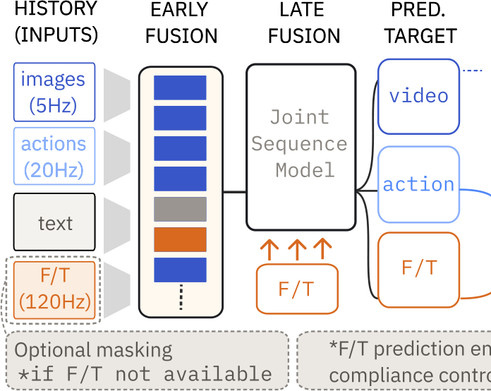
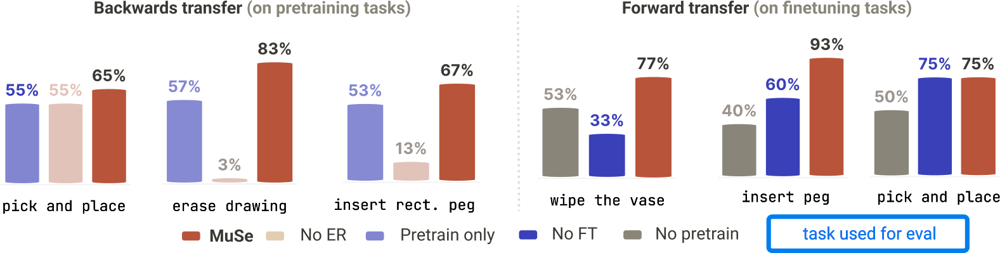
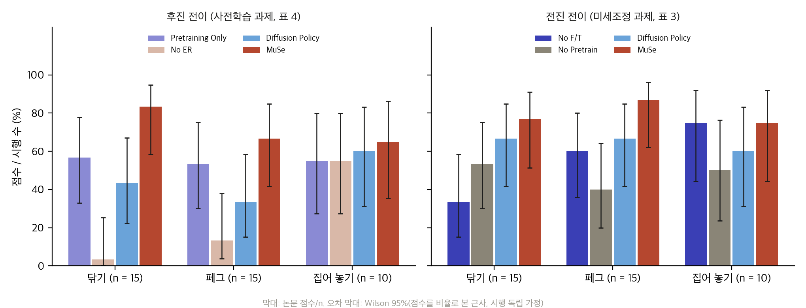
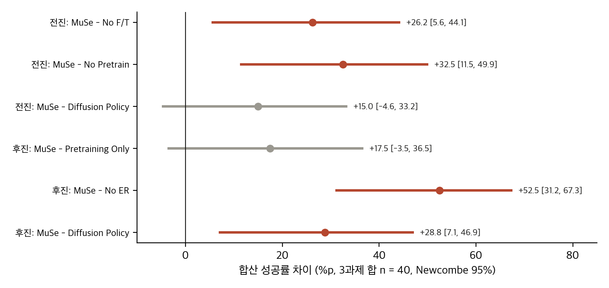
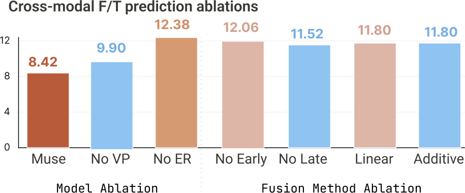
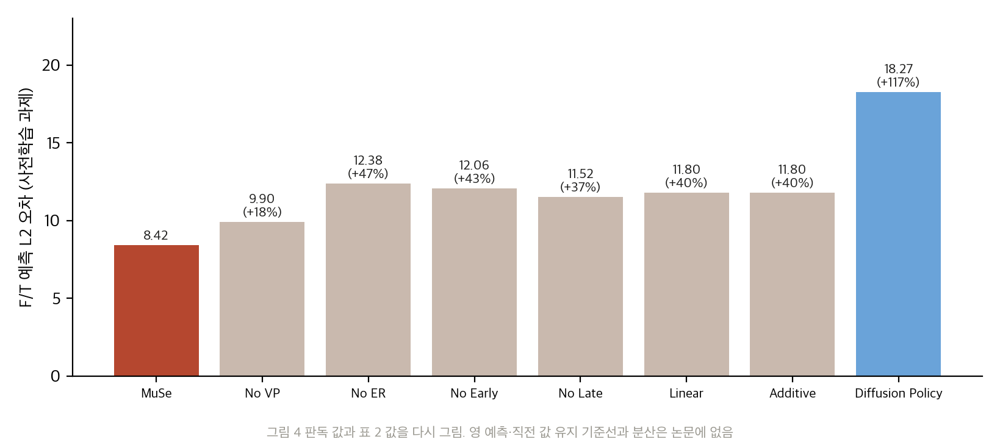

> **논문:** Jaden Clark, Changhao Wang, Yihuai Gao, Seongheon Hong, Hojung Choi, Mark Cutkosky, Yifan Hou, Shuran Song. *Multisensory Continual Learning: Adapting Pretrained Visuomotor Policies to Force.* CoRL 2026 포스터, arXiv:2606.30988 (v4, 2026-10-06).
> 프로젝트 페이지는 있지만 공식 코드는 아직 없습니다(Code 링크의 README가 "Code to be released"). 이 글의 그림은 논문 그림 세 장(도식과 그래프 부분만, 출처 표기)과 우리가 그린 그래프입니다.

## 논문이 묻는 것

비전-행동 데이터로 사전학습한 정책에 힘-토크(F/T) 같은 새 센서를 나중에 붙이고 싶습니다. 새 센서 데이터는 적고, 새 과제로 미세조정하면 원래 과제 성능이 떨어지기 쉽습니다. 논문은 이를 "다중 감각 연속 학습"이라 부르고 세 가지를 목표로 둡니다. 새 과제에서의 **전진 전이**, 원래 과제에서의 **후진 전이**, 센서가 한 번도 지도되지 않은 과제에서 센서 값을 이해하는 **교차 모달 일반화**입니다.

방법 MuSe는 영상-행동 모델 UVA(MAR-Large, 479M)에 세 가지를 더합니다. F/T 이력을 토큰으로 앞에 붙이는 **초기 융합**과 마지막 블록에 교차 어텐션 어댑터로 넣는 **후기 융합**, 행동·영상·F/T 미래를 함께 예측하는 **다중 감각 예측 목적**, 사전학습 데이터를 섞어 쓰는 **경험 재생**입니다. 예측한 F/T는 어드미턴스 제어의 강성과 가상 목표를 정하는 데도 쓰입니다.

*그림 2 (논문 원문, 오른쪽 실로봇 사진 패널은 뺌). © 저자, CC BY 4.0, 출처 arXiv:2606.30988.*

실험은 UMI-FT 그리퍼(UR5e, 손가락마다 CoinFT)로 모은 실로봇 데이터입니다. 사전학습은 21개 과제 1,271 에피소드(F/T는 기록했으나 학습에서 가림), 미세조정은 5개 과제 434 에피소드입니다. 평가는 닦기(15회), 페그 삽입(15회), 집어 놓기(10회)이고 부분 점수(0, 0.5, 1)를 씁니다.

*그림 3 (논문 원문, 위쪽 과제 사진 패널은 뺌). 전진 전이 insert peg의 MuSe 막대는 93%이고, 표 3과 본문은 13/15(86.7%)입니다. © 저자, CC BY 4.0, 출처 arXiv:2606.30988.*

## 이 글에서 확인한 것

시행 수 n은 부록 6.5의 값(15, 15, 10)을 쓰고 시행은 독립이라고 가정했습니다. 점수가 0.5 단위라 Fisher 검정은 점수를 내림한 경우와 올림한 경우의 p값 범위로 적습니다(시행 수 n 가정).

**1. 경험 재생의 효과가 가장 뚜렷합니다.** 재생을 뺀 모델(No ER)은 사전학습 과제에서 닦기 0.5/15, 페그 2/15로 거의 무너집니다. 세 과제 합산(n = 40)으로 MuSe 72.5%, No ER 20%이고 차이는 +52.5 %p, 95% 구간 [31.2, 67.3]입니다. 18개 비교를 Holm으로 보정해도 후진 닦기의 이 비교(p = 0.002)는 남습니다. 비교 대상이 "원 데이터를 전혀 쓰지 않는" 극단 조건 하나라서, 재생 비율에 대한 민감도는 이 글에서 알 수 없습니다.

**2. 사전학습 과제 개선(+17.5 %p)은 이 시행 수로는 구분되지 않습니다.** 그림 1의 "+17.5% success"는 합산 점수(72.5% 대 55%)로 맞게 계산됩니다. 같은 합산의 95% 구간은 [-3.5, +36.5] %p이고 Fisher p = 0.16입니다. 과제별로는 닦기 12.5 대 8.5(p 0.11–0.43), 페그 10 대 8(p = 0.71), 집어 놓기 6.5 대 5.5(p 0.65–1.0)입니다. 관측된 차이를 80% 검정력으로 구분하려면 과제당 46–376회가 필요합니다.

*그래프 (우리가 그림). 표 3·4의 점수/시행 수와 Wilson 95% 구간(점수를 비율로 본 근사)입니다.*

*그래프 (우리가 그림). 3과제 합산(n = 40) 차이입니다. 붉은 선은 구간이 0을 포함하지 않는 비교입니다.*

**3. 전진 전이는 합산으로 구분되고, 과제별로는 대부분 구분되지 않습니다.** 합산으로 MuSe 80%는 No F/T 53.8%(p 0.017–0.031), No Pretrain 47.5%(p = 0.005)보다 높습니다. Diffusion Policy 65%와는 p = 0.21입니다. 과제별로 단독으로 구분되는 것은 페그 대 No Pretrain(13 대 6, p = 0.021) 하나입니다. 가장 크게 개선되었다고 서술된 닦기(11.5 대 5)는 p 0.025–0.066입니다.

**4. 보상 제어를 끄면 전진 이득이 줄어듭니다.** 부록 6.1의 표 1에서 예측 F/T를 강성 조절에 쓰지 않으면 닦기가 11.5에서 8/15로 내려가 No Pretrain(8/15)과 같아집니다. 페그는 13에서 11입니다. 전체 이득 중 보상 제어의 몫은 닦기 약 54%, 페그 50%입니다. 어느 비교도 n = 15로는 구분되지 않습니다(p 0.14–1.0). 후진 평가에는 이런 분리 조건이 없어, 사전학습 과제 개선에서 F/T 입력, 보상 제어, 미세조정에 들어간 관련 과제 데이터(닦기 160, 페그 144 에피소드)의 몫을 나눌 수 없습니다.

**5. 표와 그림 사이에 다른 값이 두 곳 있습니다.** (a) 그림 3의 전진 전이 insert peg MuSe 막대는 93%인데 표 3과 본문은 13/15(86.7%)입니다. 93%는 14/15에 해당합니다. v1 그림은 87%였고 v2부터 93%입니다. 그림 1의 합산 80%는 13/15와 맞습니다. (b) 본문 4.1절의 "Linear Fusion 11.518"은 그림 4에서 No Late 막대의 값(11.52)이고, 그림의 Linear 막대는 11.80입니다(그림 판독 값). 저자 확인이 필요합니다.

**6. F/T 예측 오차는 기준 없이 읽기 어렵습니다.** MuSe 8.42, 절제 일곱 개는 9.90–12.38(+18% ~ +47%), Diffusion Policy 18.27입니다. 6D 렌치의 L2 노름이라 N과 Nm이 섞여 있고, 영 예측이나 직전 값 유지 같은 단순 기준선, 반복 실행의 분산, 평가 궤적 수는 본문에 없습니다. DP는 영상 예측 외에 후기 융합과 구조가 다를 수 있어(부록 6.2) 표 2를 영상 예측만의 효과로 읽기는 어렵습니다.

*그림 4 (논문 원문). © 저자, CC BY 4.0, 출처 arXiv:2606.30988.*

*그래프 (우리가 그림). 그림 4 판독 값과 표 2의 값입니다.*

## 코드와 재현 정보

프로젝트 페이지의 Code 링크가 가리키는 저장소는 README 한 줄("Code to be released")뿐이고, 체크포인트와 데이터 링크는 찾지 못했습니다(2026-11-24). 그래서 코드 대조 대신 주장별 검증을 했습니다. 논문에 없는 정보는 손실 가중치 λ, 총 학습 스텝, 시드 수, 재생 샘플링 방식, F/T 정규화, 어댑터를 넣는 블록 수, 강성 복원 함수와 필터 길이입니다. 백본(UVA, MAR), 제어 스택(ACP), 센서 장치(UMI-FT)의 코드는 각각 공개되어 있습니다.

## 구현 가능성 (Apple M4 Pro, CUDA 없음)

- **실로봇 결과 재현: 불가.** UR5e와 UMI-FT 장치, 비공개 데이터가 필요합니다.
- **MuSe 학습: 불가.** MAR-Large 479M을 RTX Pro 6000 8장으로 학습했고, 스텝 수가 적혀 있지 않습니다.
- **구조 개념의 작은 토이(어댑터, 마스크 토큰, 재생): 가능.** 논문 수치의 검증은 아닙니다.

이 글은 재현 실험을 하지 않았습니다.

## 한계

- 과제당 시행 수가 10–15이고 부분 점수를 써서 대부분 비교가 단독으로 구분되지 않습니다. 시행 간 독립은 가정입니다.
- 힘-토크 한 모달리티, 로봇 한 대, 과제군 세 개의 사례입니다. 논문도 촉각·오디오·깊이는 향후 과제로 둡니다.
- 후진 전이 평가의 원인 분해는 이 글에서 하지 못했습니다(보상 제어, 관련 과제 데이터 미분리).
- 점수의 시행별 분포와 원자료가 없어 짝지은 검정이나 시드 분산은 계산하지 못했습니다.

## 출처와 라이선스

- 논문: arXiv:2606.30988, CC BY 4.0(arXiv 라이선스 페이지 확인). 원문 PDF에서 상충하는 권리 고지를 찾지 못했습니다.
- 그림 2, 3, 4는 논문 원문에서 도식과 그래프 부분만 잘라 실었습니다(© 저자, CC BY 4.0). 실로봇·과제 사진은 싣지 않았습니다.
- 표 값은 인용과 재계산을 위해 옮겼습니다. 그래프, 분석 문서와 스크립트는 이 저장소 작성자가 만들었습니다.
- 코드와 데이터는 받거나 실행하지 않았습니다.

## 자료

- [통합 리포트 PDF](report/report_public.pdf)
- [01. 논문 분석: Multisensory Continual Learning (MuSe)](analysis/01_paper_analysis.md)
- [02. 선행연구와 관련 저장소](analysis/02_prior_work.md)
- [03. 수치 재계산과 일관성 검사](analysis/03_analysis.md)
- [04. 주장 검증과 구현 가능성](analysis/04_claim_verification.md)
