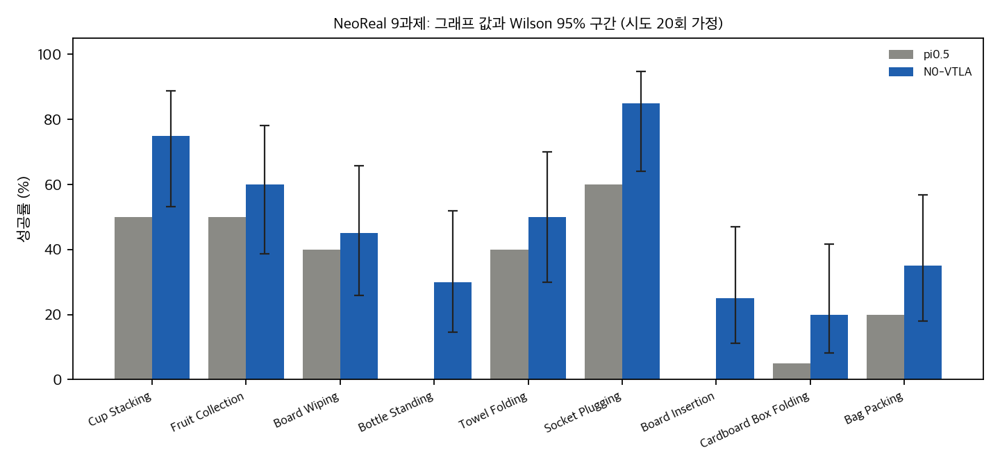
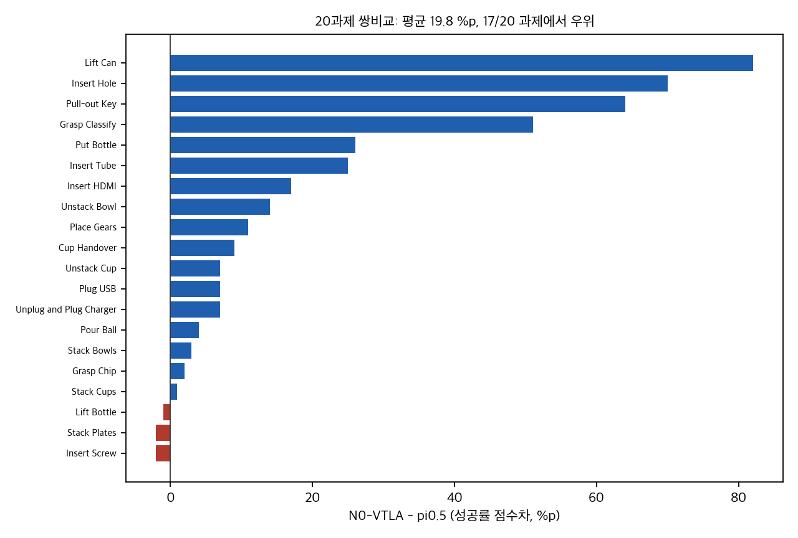
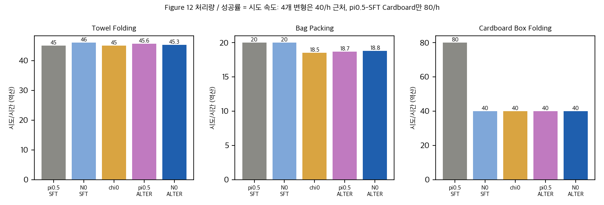

> **논문:** NeoteAI Team, Fudan TEAI Team. *N₀-VTLA: Scaling Vision-Tactile-Language-Action Model with Latent Tactile Tokens.* arXiv:2607.23782 (v1, 2026-07-26). 기술 보고서이며 학회 표기는 없습니다.
> 논문 라이선스는 CC BY-NC-SA 4.0이라 논문 그림은 싣지 않았습니다. 아래 그래프는 모두 저희가 논문 표와 그래프 값으로 다시 그린 것입니다.

## 논문이 묻는 것

접촉이 결과를 정하는 조작에서는 촉각이 필요합니다. 촉각 프레임은 대부분 비어 있고, 접촉이 생기거나 바뀌는 짧은 순간에만 정보가 있습니다. 기존 방식은 두 가지입니다. 촉각 토큰을 시각-언어 prefix에 카메라처럼 이어 붙이거나, 현재 촉각 판독을 행동 경로에 주입합니다. 이 논문은 셋째 길을 택합니다. **다음 50스텝 동안 촉각이 어떻게 바뀔지를 예측한 잠재 토큰 z**를 action expert에 줍니다. 촉각을 관찰이 아니라 예측 목표로 다루는 방식입니다.

학습은 세 단계입니다. 먼저 예측기만 미래 촉각 목표에 맞추고(InfoNCE와 재구성), 다음에 expert를 z에 맞추고, 마지막으로 전체를 공동 학습합니다. 사후 학습에는 ALTER를 씁니다. 진행도 모델로 단계 안에서 상위 30%에 positive 라벨을 붙여 오프라인 정책을 학습합니다.

## 이 글에서 확인한 것

**1. 표 평균은 모두 맞습니다.** 시뮬 20과제 평균은 N0-VTLA 63.75%, π0.5 44.0%로 초록과 일치합니다. 과제 쌍비교 평균 차는 +19.75 %p(95% CI 7.7–31.9, p = 0.003)입니다. 실로봇 NeoReal 9과제에서는 9개 모두 우위입니다(부호검정 p = 0.002).

**2. 과제별 차이는 대부분 확실하지 않습니다.** 논문은 시도 수를 밝히지 않습니다. 그래프 값이 모두 5%의 배수여서 시도 20회를 가정하고 다시 계산했습니다. Socket Plugging의 85 대 60은 Fisher p = 0.16입니다. 유의한 것은 Bottle Standing(0 대 6/20, p = 0.02)과 Board Insertion(0 대 5/20, p = 0.05)뿐입니다.

*그래프: 저희가 그린 것입니다. NeoReal 9과제의 성공률(그래프 값)과 Wilson 95% 구간(시도 20회 가정).*

**3. 시뮬 평균은 강하지만 최고 기록은 적습니다.** UniVTAC 8과제에서 N0-VTLA가 최고거나 동률인 과제는 3개입니다. Lift Bottle, Lift Can, Put Bottle, Insert Hole, Insert HDMI에서는 다른 기준선이 더 높습니다.

*그래프: 저희가 그린 것입니다. 20과제에서 N0-VTLA와 π0.5의 점수 차. 17과제에서 N0-VTLA가 높습니다.*

**4. 촉각 기여를 분리한 실험이 없습니다.** 논문은 "촉각을 끄면 기반 정책과 같아지므로 차이는 촉각 때문"이라고 씁니다. 그러나 촉각을 끈 결과, 촉각을 prefix에 붙이거나 expert에 직접 붙이는 기준선, 예측 없이 공동 학습한 변형의 결과는 보고되지 않았습니다. 비교 대상 π0.5는 NeoData로 사전 학습하지 않았습니다. 그래서 "예측형 잠재가 낫다"는 가설은 보고된 표로는 검증되지 않습니다.

**5. 처리량 그래프에 불일치가 있습니다.** 처리량을 성공률로 나누면 시간당 시도 수가 나옵니다. Towel과 Bag에서는 변형마다 값이 일정합니다. 그런데 Cardboard Box Folding의 π0.5 SFT만 시간당 80회로, 나머지 40회의 두 배입니다. 성공률 5%와 처리량 4/h 중 하나가 잘못되었을 가능성이 있습니다.

*그래프: 저희가 그린 것입니다. 논문 Figure 12의 처리량을 성공률로 나눈 값.*

**6. 잠재 표현의 증거는 견고합니다.** 378개 질의에서 예측 잠재가 미래 촉각 목표를 찾는 정확도는 92.3%(Wilson 95% 89.2–94.6%)입니다. 무작위 기준은 약 3%입니다. 현재 촉각만으로는 57%입니다. 다만 풀 크기에 따라 결과가 달라집니다.

## 공식 코드로 할 수 있는 것

GitHub `neoteai/N0-VTLA`(커밋 2026-08-18 기준)는 사후 학습과 추론 도구를 제공합니다. 대규모 사전 학습과 논문의 감독형 1단계는 없습니다. 코드를 읽어 보니 다음 차이가 있었습니다.

- 예측기는 action 손실만으로 학습됩니다. 논문의 z* 회귀 단계는 없습니다. 논문의 "자유 잠재" 변형과 같습니다.
- 잠재 토큰 수는 5개입니다(논문 10개).
- 공개 시뮬 체크포인트에는 게이트가 없습니다. 기본 설정에는 0으로 시작하는 게이트가 있습니다.
- 이중 팔 시뮬 설정의 행동 청크는 16스텝입니다(논문 50스텝).

촉각 인코더, 기준선 재설정 규칙, 청크 전체 실행, Euler 10스텝은 논문과 같습니다.

라이선스는 저장소 LICENSE가 CC BY-SA 4.0입니다. 가중치는 Gemma 이용 약관을 따릅니다.

## 이 맥에서 재현할 수 있는가

**전체 재현은 불가능합니다.**

- 사전 학습: 불가. 데이터와 자원 수치가 공개되지 않았습니다.
- 감독형 1단계와 ALTER: 불가. 코드가 없습니다.
- 사후 학습: 불가. CUDA를 전제합니다.
- 시뮬과 실로봇 평가: 미확인 또는 불가.
- 추론 한 번: 조건부입니다. 체크포인트는 8.25 GB이고 MPS 포팅과 패치가 필요합니다. 추정 1–3일입니다(측정 전).

## 정리

N0-VTLA는 촉각을 예측 목표로 다루는 방향이 흥미롭고, 표 수치는 재현 가능한 수준으로 맞습니다. 그러나 주장의 핵심인 "예측이 반응보다 낫다"는 촉각 기여를 분리한 실험 없이는 확인되지 않습니다. 공식 코드도 그 부분을 빼고 있습니다. 작은 데이터에서 촉각 끔, 직접 주입, 예측 잠재를 같은 시도 수로 비교하는 실험이 이 보고서가 남긴 빈칸입니다.

## 분석 자료

이 글은 다음 자료를 바탕으로 합니다. 재계산 스크립트와 결과, 그래프 스크립트는 `analysis/` 아래에 있습니다.

- `analysis/01_paper_analysis.md`: 논문 구조, 방법, 실험, 라이선스
- `analysis/02_prior_work.md`: 선행 계보와 공식 저장소 표
- `analysis/03_analysis.md`: 재계산, 검정, 일관성 검사, 주장 판정
- `analysis/04_code_verification.md`: 공식 코드 대조와 구현 가능성
- `analysis/recompute.py`: 표 평균과 검정 (numpy, scipy, 수 초)

## 자료

- [통합 리포트 PDF](report/report_public.pdf)
- [01. 논문 분석: N0-VTLA (arXiv:2607.23782)](analysis/01_paper_analysis.md)
- [02. 선행연구, 공식 저장소, 관련 분석](analysis/02_prior_work.md)
- [03. 재계산, 검정, 일관성 검사, 주장 판정](analysis/03_analysis.md)
- [04. 공식 코드 대조와 구현 가능성](analysis/04_code_verification.md)
