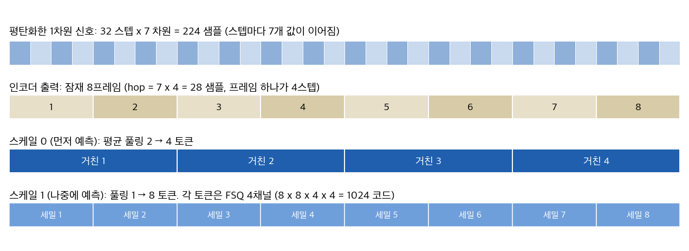
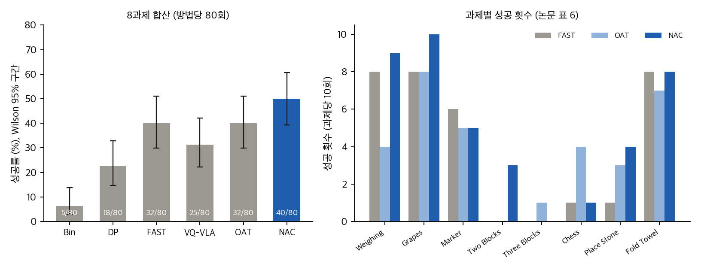
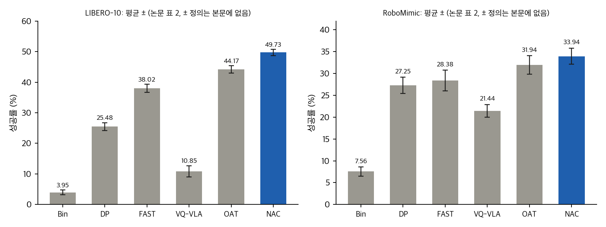

# 01. NAC 논문 분석

*NAC: Neural Action Codec for Vision-Language-Action Models*, Ahad Jawaid, Yu Xiang (The University of Texas at Dallas). arXiv:2606.21372, cs.RO. 분석 대상은 **v2 (2026-09-25, 16쪽)**입니다. 쪽·절·표 번호는 v2 기준이고, `paper/paper.txt`가 `pdftotext -layout` 결과입니다.

## 0. 메타와 버전 차이

| 항목 | 내용 |
|---|---|
| 학회 | CoRL 2026 포스터. corl.org 공식 채택 목록(https://www.corl.org/program/accepted-papers, 2026-11-26 확인)에 있고, 2026-11-14에 수집한 같은 목록에서도 포스터 번호 9, 세션 "Poster post-p1"(11월 9일)입니다. arXiv 주석 칸은 비어 있고, 프로젝트 페이지는 "Conference on Robot Learning (2026)"로 표기합니다 |
| 라이선스 | arXiv abs 페이지의 license 링크가 `http://creativecommons.org/licenses/by/4.0/`입니다(CC BY 4.0). PDF 본문에서 ©, copyright, All rights reserved, 회사 고지를 찾지 못했습니다 |
| 코드·프로젝트 | GitHub `ahadjawaid/nac`(Apache-2.0), 프로젝트 페이지 https://ahadjawaid.com/nac (자세한 표는 `02` §2) |
| 버전 | v1 2026-06-19(15쪽), v2 2026-09-25(16쪽). 두 판의 PDF를 모두 받아 본문을 비교했습니다 |

**v1 → v2에서 바뀐 것** (표 2, 표 3, 표 6의 수치는 두 판이 같습니다)

| 위치 | v1 | v2 |
|---|---|---|
| 초록 | "mel-스펙트로그램 목적은 운동 신호에 맞지 않고, 이를 시간 영역·비멜 스펙트럼 손실로 바꾸면 …", "**더 낮은 재구성 오차**와 더 높은 성공률(비닝, FAST, VQ 계열 대비)" | 멜 손실 문장을 "행동 표현, 압축률, 재구성 목적의 적응"으로 바꾸고, 재구성 오차 비교 문구를 "높은 재구성 충실도"로 바꿈 |
| 기여 (§1) | "mel 손실을 버리는 것이 핵심", "**행동 토큰화에 적대적 손실을 처음 적용**" | 두 항목을 삭제하고 "샘플링 주파수·채널 구조가 표현·다운샘플링을 이끈다"는 항목을 추가 |
| §3.2 판별기·손실 | "DAC 판별기가 가장 강한 적대 신호"라고 서술. 손실식 (5)에 λ가 없음. 커밋 손실을 1000배로 키운다고 본문에 적음 | "우리는 DAC를 쓰고 MPD, MRD, 판별기 없음과 §4.2에서 비교". 식 (5)에 λrec, λcommit, λadv가 생기고 값은 표 4에 있음(45, 10³, 1) |
| §4.2 결론 | "판별기를 빼면 성공률이 0이 된다. 적대적 학습이 세밀한 시간 정보를 보존한다. ISTFT 헤드는 상세 궤적에 유익" | "**MSE에서는 판별기가 없어도 50.1%이므로 적대적 학습이 꼭 필요하지 않다.** 크기만 맞추는 스펙트로그램 손실에서만 판별기가 없을 때 0이 된다" |
| 표 1 | 6+4+2행 | (a)에 "Mel (no log) 44.6" 행, (b)에 "None (MSE) 50.1" 행이 추가되고 "None"이 "None (Spec.)"으로 바뀜 |
| 부록 | 표 5 캡션이 Diffusion Policy까지 "공유"라고 적음 | 표 4에 λ 값 추가, 표 5에 행동 지평 32 추가, 캡션을 "Bin, FAST, VQ-VLA, OAT, NAC 공유"로 바꿈. **B.2 재구성 진단과 그림 5(그리퍼 명령, 코드북 사용 빈도)가 새로 생김** |
| §5 한계·향후 | 한계 두 가지(나누어떨어짐, 차원 정보) | "평탄화는 시간과 채널을 묶는다", "상속한 RVQ 설정과 손실 가중치에 대한 민감도는 연구되지 않았다"가 추가되고 향후 작업의 "우월한 압축률", "대규모 말뭉치로 스케일링 이득" 표현이 줄어듦 |

v2는 v1의 핵심 서술 둘(판별기 필수, 멜 제거가 핵심)을 자기 표로 고쳐 쓴 판입니다. 이 문서의 평가는 v2 기준이며, 프로젝트 페이지의 초록은 2026-11-26 시점에 v1 문장 그대로입니다.

## 1. 한 문단 요약

로봇 행동 청크(32스텝 × 7차원 = 224개 값)를 **1채널 1차원 "의사 파형"으로 이어 붙여서**, 오디오 코덱(SNAC 계열 다중 스케일 RVQGAN)의 SEANet 인코더 + 다중 스케일 양자화 + Vocos식 ISTFT 디코더 + 판별기를 거의 그대로 써서 12개 이산 토큰으로 압축하는 학습형 행동 토크나이저입니다(그림 2, §3.2). 토큰은 거친 스케일 4개, 세밀한 스케일 8개 순서로 "오프셋 코드북" 어휘(2 × 1024 + BOS)에 놓이고, 작은 인과 트랜스포머(d = 256, 4층)가 이를 자기회귀로 예측합니다(§3.3). LIBERO-10에서 49.73%, RoboMimic에서 33.94%, 실로봇 8과제 평균 50%로 Bin, Diffusion Policy, FAST, VQ-VLA, OAT보다 평균이 높다고 보고합니다(표 2).

## 2. 방법

### 2.1 토크나이저 (§3.2)

1. **평탄화.** 행동 청크 a ∈ R^(B×Ha×Da)를 (Ha·Da)개 샘플의 1채널 파형으로 펴 줍니다. 순서는 시간 우선(스텝마다 Da개 값이 이어짐)이며, 샘플 위치가 시간과 차원을 동시에 가리킵니다. 선택적으로 차원별 선형 정규화를 합니다.
2. **SEANet 인코더.** 합성곱 스택, 보폭 R = [r1, …, rk]인 다운샘플링, ELU, 가중치 정규화, 반사 패딩. 총 다운샘플링 ∏R은 오디오 설정보다 줄였고, 출력은 z ∈ R^(B×512×T′), T′ = L/∏R입니다.
3. **다중 스케일 RVQ (MRVQ, 식 3).** 단계 s마다 잔차 zs를 시간 평균 풀링한 뒤 코드북(1024개)에서 가장 가까운 코드를 고릅니다. 풀링 폭이 큰 앞 단계가 거친 전역 구조를, 뒤 단계가 세밀한 잔차를 담습니다. 코드북은 첫 배치 k-means 초기화 뒤 EMA로 갱신하고, 잔차는 업샘플한 임베딩을 빼서 다음 단계로 넘깁니다.
4. **커밋 손실 (식 4).** ‖z − sg(e_c)‖²₂.
5. **디코더.** Conv1D 임베딩, 어텐션이 있는 ResNet 블록, ConvNeXt 블록 스택의 Vocos식 백본 뒤에 ISTFT 헤드가 크기와 위상을 예측해 파형을 복원합니다. ISTFT hop은 인코더 hop과 맞춥니다.
6. **판별기·손실 (식 5).** DAC 판별기를 씁니다. 생성기 손실 L_gen = λrec·L_rec + λcommit·L_commit + λadv·L_adv이며 표 4의 값은 λrec = 45, λcommit = 10³, λadv = 1입니다. L_rec는 기본이 MSE입니다.

### 2.2 정책 (§3.3, 부록 A.1)

- 어휘 |V| = nq × Vbins + 1, 스케일 s의 토큰 ID는 [s·Vbins, (s+1)·Vbins)입니다(식 6). 시퀀스는 [BOS, 스케일 0의 모든 토큰, 스케일 1의 모든 토큰, …] 순서이고, 손실은 일반 교차 엔트로피입니다.
- 추론은 고정 배치(스케일별 길이가 정해져 있음)로 토큰을 샘플한 뒤, 스케일별로 나눠 Vbins로 나머지 연산을 해 코드 인덱스를 되찾고 디토크나이저에 넣습니다. 청크의 앞 nsteps = 16개를 후퇴 지평 방식으로 실행합니다(표 5).
- 정책은 d = 256, 4층, 헤드 4, 드롭아웃 0.1, 정책 학습률 5e-5, 비전 인코더 1e-5, top-k 10, 온도 1.0입니다. **VLM을 쓰지 않습니다.** 관측 인코더 + 작업 UID(또는 언어)를 조건으로 하는 작은 트랜스포머이며, 논문이 말하는 "VLA"는 이 소형 정책 틀입니다(§3.1, §4.1, 표 5).

### 2.3 한 청크의 토큰 배치 (공식 설정에서 읽은 값)

표 3의 "12 토큰, 120 비트"는 공식 코드의 기본 설정과 맞습니다. 224샘플 → hop 28(= 7 × 4) → 잠재 8프레임 → 거친 스케일(풀링 2) 4토큰 + 세밀 스케일(풀링 1) 8토큰입니다. 토큰당 1024개 코드이므로 10비트 × 12 = 120비트입니다(`03` V5, `04` D1).

그림: 우리가 그린 그림. 공식 저장소 기본 설정(`04` D1)의 값으로 청크 하나의 토큰 배치를 보인 것입니다.

## 3. 실험과 수치 (재계산은 `03`)

### 3.1 설정 (§4.1, 부록 B.1)

- 비교 대상: Bin, Diffusion Policy, FAST, VQ-VLA, OAT, NAC. Bin, FAST, VQ-VLA, OAT, NAC는 같은 정책 구조, 관측 인코더, 행동 지평 32, 배치 256, 학습 일정을 쓰고 토크나이저와 어휘만 다릅니다(§4.1).
- 벤치마크: LIBERO-10과 RoboMimic. 시뮬 결과는 "시드 8개, 과제당 시도 50회"(표 2 캡션)입니다. 모든 실험이 "500개 학습 시연"을 쓴다고 합니다(B.1).
- 실로봇: 8과제 × 방법당 10회(표 2, 표 6, B.3). **로봇 기종, 카메라, 시연 개수, 학습 데이터 양은 논문에 적혀 있지 않습니다.**

### 3.2 표 1: 재구성 목적, 판별기, 디코더 헤드 (LIBERO-10)

| (a) 재구성 손실 | 성공률 (%) | MSE | (b) 판별기 | 성공률 (%) | MSE |
|---|---|---|---|---|---|
| L1 | 44.78 ± 2.48 | 0.002 ± 0.005 | DAC | 49.45 ± 2.02 | 0.0005 ± 0.0018 |
| MSE | 49.2 ± 1.54 | 0.0008 ± 0.0007 | MPD | 46.28 ± 1.48 | 0.0005 ± 0.0007 |
| DCT | 47.85 ± 1.18 | 0.0007 ± 0.0008 | MRD | 45.68 ± 1.72 | 0.0004 ± 0.0006 |
| Log-Mel Spec. | 0 ± 0.11 | 0.038 ± 0.026 | None (Spec.) | 0 | 0.35 ± 0.12 |
| Mel (no log) | 44.6 ± 2.0 | 0.0006 | None (MSE) | 50.1 ± 1.7 | 0.0010 |
| Spectrogram | 48.3 ± 2.92 | 0.0002 ± 0.001 | | | |

(c) 디코더 헤드: ISTFT 48.3 ± 2.92 / 0.0002 ± 0.001, Linear 42.1 ± 1.54 / 0.0006 ± 0.001. 재구성 MSE는 "검증 행동 청크 14,000개"에서 잰 값입니다(캡션). 본문 서술: 시간 영역 목적(MSE)이 가장 높은 성공률을, 스펙트로그램 손실이 가장 낮은 MSE를 보이고, 로그 멜은 성공률이 0에 가깝습니다. 로그만 빼면 44.6%로 오르고 코드북 사용이 회복됩니다(그림 5). 판별기는 크기만 맞추는 손실에서만 필수이고 MSE에서는 필수가 아닙니다(§4.2).

### 3.3 표 2: 전체 성공률 (%)

| 환경 | Bin | Diffusion Policy | FAST | VQ-VLA | OAT | NAC |
|---|---|---|---|---|---|---|
| LIBERO-10 | 3.95 ± 0.8 | 25.48 ± 1.3 | 38.02 ± 1.3 | 10.85 ± 1.85 | 44.17 ± 1.2 | 49.73 ± 1.0 |
| RoboMimic | 7.56 ± 1.05 | 27.25 ± 1.87 | 28.38 ± 2.37 | 21.44 ± 1.45 | 31.94 ± 2.15 | 33.94 ± 1.86 |
| 실로봇 | 6.25 | 22.5 | 40.0 | 31.25 | 40.0 | 50.0 |

"±"가 표준편차인지 표준오차인지 논문에 적혀 있지 않습니다(`03` V2). 본문은 LIBERO-10에서 NAC가 FAST보다 11.71점, OAT보다 5.56점 높다고 쓰고 RoboMimic은 "비슷한 경향"이라고만 씁니다(§4.3).

### 3.4 표 3: 압축과 지연 (RTX 4090 한 장)

| 방법 | 파라미터(M) | 토큰 | 비트 | Enc (ms) | Dec (ms) | Recon (ms) |
|---|---|---|---|---|---|---|
| Bin | 0.002 | 224 | 2240 | 0.045 | 0.039 | 0.079 |
| OAT | 65.207 | 12 | 120 | 0.931 | 2.392 | 3.347 |
| VQ-VLA | 65.556 | 12 | 120 | 7.086 | 4.045 | 11.049 |
| FAST | 0.000 | 36 | 360 | 0.170 | 0.110 | 0.290 |
| NAC | 63.006 | 12 | 120 | 1.270 | 2.183 | 3.536 |

본문은 NAC가 청크를 12토큰으로 줄여 Bin의 거의 19배, FAST의 3배로 토큰 수를 줄이고, VQ-VLA보다 훨씬 빠르며, FAST보다는 느리지만 실시간 제어 범위 안이라고 씁니다(§4.5).

### 3.5 표 6: 실로봇 과제별 성공률 (%, 과제당 10회)

| 과제 | Bin | DP | FAST | VQ-VLA | OAT | NAC |
|---|---|---|---|---|---|---|
| Weighing | 50 | 40 | 80 | 90 | 40 | 90 |
| Grapes | 0 | 30 | 80 | 30 | 80 | 100 |
| Marker | 0 | 30 | 60 | 30 | 50 | 50 |
| Two Blocks | 0 | 0 | 0 | 0 | 0 | 30 |
| Three Blocks | 0 | 0 | 0 | 0 | 10 | 0 |
| Chess | 0 | 0 | 10 | 0 | 40 | 10 |
| Place Stone | 0 | 0 | 10 | 50 | 30 | 40 |
| Fold Towel | 0 | 80 | 80 | 50 | 70 | 80 |
| 평균 | 6.25 | 22.5 | 40 | 31.25 | 40 | 50 |

그래프: 우리가 그린 그래프. 표 6을 다시 그렸고, 구간은 Wilson 95%(방법당 80회)입니다.

그래프: 우리가 그린 그래프. 표 2의 평균과 ±입니다. ±의 정의는 논문에 없습니다.

## 4. 논문이 스스로 적은 한계 (§5)

- 평탄 길이 Ha·Da가 (다운샘플링 비 × 스케일 수)로 나누어떨어져야 합니다.
- 디토크나이저가 행동 차원을 미리 알아야 합니다.
- 평탄화는 시간과 채널 구조를 묶습니다(채널별, 어텐션 기반 인코더는 대안).
- 상속한 RVQ 설정과 손실 가중치에 대한 민감도는 연구되지 않았습니다(표 4 캡션은 "손실 가중치는 오디오 코덱 레시피를 따르며 행동에 맞춰 조정하지 않았다"고 적음).
- 향후: 여러 로봇이 공유하는 토큰 공간, 더 크고 다양한 행동 데이터, 고주파 제어.

## 5. 주장과 근거 사이의 간격 (요약, 자세한 판정은 `03` §6)

1. **VLA라는 이름과 실험 설정.** 실험 정책은 VLM이 없는 4층 소형 트랜스포머이고 학습 데이터는 LIBERO-10 시연 500개 정도입니다. "VLA에서의 토크나이저"라는 틀을 직접 시험한 것은 아닙니다(§3.3, 표 5).
2. **적대적 학습.** 초록과 그림 2는 판별기를 구성 요소로 내세우지만, v2 §4.2는 MSE에서는 판별기가 없어도 50.1%라고 인정합니다. v1의 "판별기가 필수"라는 서술이 사라졌습니다.
3. **실로봇 우위.** NAC 50% 대 FAST·OAT 40%는 방법당 80회에서 Fisher p = 0.27입니다(`03` V4). 과제별로 NAC가 단독 최고인 것은 8개 중 2개입니다.
4. **재구성 충실도.** 표 1은 NAC 변형끼리의 MSE만 보이고 Bin, FAST, OAT, VQ-VLA의 재구성 MSE는 없습니다. v1 초록의 "더 낮은 재구성 오차" 비교는 v2에서 빠졌습니다.
5. **재구성과 정책 성능의 관계.** 표 1 행 11개에서 재구성 MSE와 성공률의 순위 상관은 약 0입니다(`03` V6). 논문이 말한 "두 지표 모두 봐야 한다"와 같은 방향입니다.
6. **구성 요소의 기여.** 다중 스케일, 오프셋 코드북, 거친→세밀 순서의 효과를 따로 떼어 본 ablation은 없습니다. 비교 대상 OAT와의 차이(합성곱 + 다중 스케일 vs 레지스터 트랜스포머)가 어느 요소에서 오는지는 논문 안에서 분리되지 않습니다.
