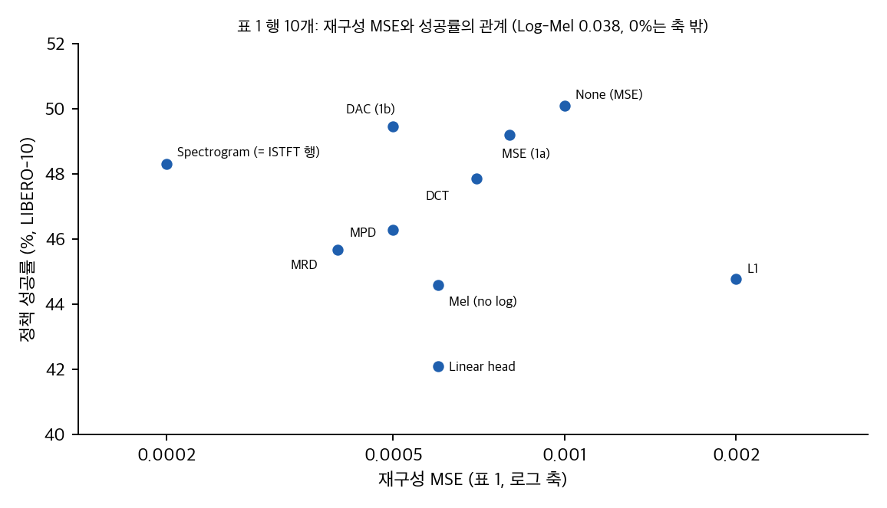

# 03. 수치 재계산, 일관성 검사, 토이, 주장 판정

원문 v2의 표 1, 2, 3, 6 값을 `analysis/recompute.py`에 옮겨 다시 계산했습니다(수 초, 결과 `analysis/recompute_results.json`). 새 학습이나 평가는 하지 않았습니다. 번호 체계: **V**는 재계산 항목, **K**는 논문 안의 일관성 검사, **T**는 토이, **C**는 주장 판정입니다. 논문에 없는 시행 수를 가정한 계산은 문장 안에 "(시행 수 n 가정)"이라고 적었습니다.

## 1. 시뮬레이션: 표 2

### V1. 평균이 정수 시도 수로 만들어지는가 (LIBERO 4000회, RoboMimic 1600회 가정)

시드 8개 × (LIBERO-10 10과제 × 50회 = 500회, RoboMimic 4과제 × 50회 = 200회)를 가정했습니다. 이 시행 수는 논문 캡션("8 seeds with 50 trials per task")과 공식 코드의 `n_test`(500, 200)에서 나온 값이고, 논문 본문에 총 시행 수와 RoboMimic 과제 수는 없습니다(`04` D8).

- **RoboMimic 6개 평균은 모두 1600회 정수 비율로 만들어집니다.** 예: 33.94 = 543/1600 = 33.9375, 28.38 = 454/1600 = 28.375, 7.56 = 121/1600 = 7.5625.
- **LIBERO-10 6개 평균은 모두 4000회 정수 비율의 ±0.005 안**입니다. 3.95 = 158/4000, 10.85 = 434/4000은 정확히 맞고, 25.48 = 1019/4000(25.475), 38.02 = 1521/4000(38.025), 44.17 = 1767/4000(44.175), 49.73 = 1989/4000(49.725)는 소수 셋째 자리가 5로 끝나는 경계값입니다. 하나의 반올림 규칙으로 여섯 값을 모두 낼 수는 없습니다(5를 올리면 FAST 38.02와 OAT 44.17이, 짝수 규칙이면 OAT 44.17과 NAC 49.73이 걸리고, OAT 44.17은 두 규칙 모두에서 1767/4000 = 44.175를 44.17로 만들지 못합니다). 표 값이 소수 둘째 자리에서 반올림된 평균이라면 시행 수나 평균 방식(시드별 값을 먼저 반올림하는 등)이 가정과 다를 가능성이 있습니다. 판단 보류입니다.

### V2. "±"의 정의 후보와 이항 하한

표 2와 표 1의 "±"는 정의가 본문에 없습니다. 시드마다 같은 정책을 다른 환경 시드로 평가한다고 보면(공식 평가 스크립트의 흐름, `04` D8), 시드 하나의 성공률 표준편차는 이항 분포 하한 √(p(1−p)/n)보다 작을 수 없습니다.

| 환경 | 방법 | ± | 이항 하한 (n = 500 또는 200) | ±가 표준편차라면 (± ÷ 하한) | ±가 표준오차라면 암시되는 표준편차 ÷ 하한 |
|---|---|---|---|---|---|
| LIBERO-10 | Bin | 0.8 | 0.87 | 0.92 | 2.6 |
| LIBERO-10 | FAST | 1.3 | 2.17 | 0.60 | 1.7 |
| LIBERO-10 | OAT | 1.2 | 2.22 | 0.54 | 1.5 |
| LIBERO-10 | NAC | 1.0 | 2.24 | 0.45 | 1.3 |
| RoboMimic | OAT | 2.15 | 3.30 | 0.65 | 1.8 |
| RoboMimic | NAC | 1.86 | 3.35 | 0.56 | 1.6 |

해석: 12개 값 중 ±를 표준편차로 읽으면 11개가 이항 하한보다 작고, 표준오차(8개 시드의 평균에 대한)로 읽으면 12개 모두 하한 이상입니다. 그래서 ±는 표준오차일 가능성이 높아 보이지만, 정의는 논문에 없으므로 저자 확인이 필요합니다. 표 1의 ±도 같은 문제를 가집니다. 이하 검정은 두 해석을 모두 적습니다.

### V3. 표 2 쌍별 비교 (NAC 대 각 방법)

| 환경 | 상대 | 차이 (점) | p: ±가 표준오차일 때 | p: ±가 시드 간 표준편차일 때 | p: 시도 합산 이항 검정 (n = 4000 또는 1600 가정) |
|---|---|---|---|---|---|
| LIBERO-10 | FAST | 11.71 | 9e-13 | 1e-90 | 2e-26 |
| LIBERO-10 | **OAT** | **5.56** | **4e-4** | 8e-24 | 6e-7 |
| RoboMimic | VQ-VLA | 12.50 | 1e-7 | 8e-51 | 1e-15 |
| RoboMimic | Diffusion Policy | 6.69 | 0.011 | 7e-13 | 4e-5 |
| RoboMimic | **FAST** | **5.56** | **0.065** | 2e-7 | 7e-4 |
| RoboMimic | **OAT** | **2.00** | **0.48** | 0.047 | 0.23 |

- LIBERO-10에서 NAC가 OAT보다 높다는 결론은 세 가지 읽기 모두에서 유의합니다. 다만 세 계산 모두 **같은 학습된 정책을 여러 환경 시드로 평가한 변동**을 기준으로 한 것이어서, 학습 시드가 다를 때의 변동은 들어 있지 않습니다. 공식 설정은 정책 시드 42, 토크나이저 시드 3407로 한 번만 학습하는 구성입니다(`04` D8). 학습 시드 반복이 없다면 5.56점의 신뢰 구간은 여기서 계산한 값보다 넓을 수 있습니다.
- RoboMimic에서 NAC 대 OAT의 2.00점은 어느 읽기에서도 분명하지 않고(표준오차 읽기 p = 0.48, 합산 이항 p = 0.23), 대 FAST 5.56점은 표준오차 읽기에서 p = 0.065입니다.
- 두 환경에서 "NAC가 가장 높다"는 평균 순서는 맞지만, RoboMimic의 상위 세 방법(NAC, OAT, FAST)은 ±를 표준오차로 읽으면 서로 구분되지 않습니다.

## 2. 실로봇: 표 6 (방법당 80회)

### V4. 평균, 검정, 검출 가능한 차이

- **평균 재계산.** 여섯 방법 모두 표 6의 과제별 값 8개의 평균이 "평균" 행과 일치합니다(6.25, 22.5, 40, 31.25, 40, 50). 과제당 10회이므로 합산 성공 횟수는 Bin 5, DP 18, FAST 32, VQ-VLA 25, OAT 32, NAC 40입니다(80회 중). 모든 값이 10의 배수라 정수 비율 조건은 만족합니다.
- **Wilson 95% 구간(80회).** NAC 39.3–60.7%, FAST와 OAT는 모두 30.0–51.0%로 구간이 많이 겹칩니다.
- **Fisher 정확 검정(양측).** NAC 40/80 대 FAST 32/80: **p = 0.27**(단측 0.13). 대 OAT 32/80: p = 0.27. 대 VQ-VLA 25/80: p = 0.024. 대 Diffusion Policy 18/80: p = 5e-4. 대 Bin: p < 1e-9.
- **과제 단위 쌍 검정(8과제).** NAC가 FAST보다 높은 과제 4개, 낮은 과제 1개, 같은 과제 3개(부호 검정 p = 0.38, Wilcoxon p = 0.10). OAT 대비 5승 2패 1무(부호 p = 0.45, Wilcoxon p = 0.27). 과제당 10회씩이라 과제 내 개별 검정(NAC 9/10 대 OAT 4/10 Weighing의 Fisher p = 0.057 등)은 모두 p > 0.05입니다.
- **과제별 최고.** NAC가 단독 최고인 과제는 Grapes(100)와 Two Blocks(30) 두 개이고, 동률 최고까지 세면 Weighing(90, VQ-VLA와 동률), Fold Towel(80, FAST, DP와 동률)을 더해 4개입니다. Marker는 FAST(60), Three Blocks와 Chess는 OAT(10, 40), Place Stone은 VQ-VLA(50)가 최고입니다.
- **검출 가능한 차이.** 방법당 80회, 기준 성공률 40%, 양측 5%, 검정력 80%에서 최소 검출 차이는 약 **22점**입니다. NAC 대 FAST·OAT의 관측 차이는 10점이라 이 시험 규모에서 구분되지 않습니다. 50% 대 40%를 80% 검정력으로 가려내려면 방법당 약 387회(시행 수 가정: 독립 시행)가 필요합니다.

그림은 `01` §3.5와 같습니다(own_real_ci).

## 3. 표 3: 압축과 지연

### V5. 비트, 토큰 비, 시간

- **비트 = 토큰 수 × log2(1024)**: Bin 224 × 10 = 2240, OAT·VQ-VLA·NAC 12 × 10 = 120, FAST 36 × 10 = 360. 다섯 행 모두 일치합니다.
- **토큰 비.** 224/12 = 18.7(본문 "nearly 19×"), 36/12 = 3.0(본문 "3×")으로 맞습니다. 행동 청크 하나의 원시 float32 크기(32 × 7 × 32비트 = 7168비트) 대비 120비트는 약 60배 압축입니다(우리 계산).
- **Recon 열 ≠ Enc + Dec.** Enc + Dec 합과 Recon의 차이는 Bin −0.005 ms(−6%), OAT +0.024, VQ-VLA −0.082, FAST +0.010, NAC +0.083 ms(+2.4%)입니다. Recon이 Enc와 Dec의 합이어야 한다면 값 하나가 다른 시점이나 측정으로 얻어졌을 수 있습니다(측정 방식은 논문에 없음). 결론에는 영향이 작습니다.
- **NAC 대 OAT.** 파라미터 63.0M 대 65.2M(0.97배)은 비슷하고, 재구성 시간은 NAC 3.54 ms 대 OAT 3.35 ms로 NAC가 5.6% 깁니다. 본문 "matching top learned tokenizers"와 같은 12토큰입니다. NAC는 VQ-VLA(11.05 ms)보다 3.1배 빠르고 FAST(0.29 ms)보다 12배 느립니다. 배치 크기, 입력, 워밍업, 측정 횟수는 논문에 없습니다. 공식 저장소에도 이 측정 스크립트가 없습니다(`04` D12).
- **FAST 36 토큰.** FAST는 가변 길이 토큰을 내는데 표 3의 36이 평균인지 최대인지 적혀 있지 않습니다. 공식 정책 코드는 최대 시퀀스 길이 128을 기본으로 둡니다(`04` D9).

## 4. 표 1과 토이

### V6. 표 1 ablation

- **재구성 MSE와 성공률의 순위 상관.** 표 1(a)에서 로그 멜을 뺀 5행의 스피어만 ρ = 0.00(p = 1.0). 표 1(a)+(b)+(c)에서 실패 행(성공률 10 미만)을 뺀 11행 전체 ρ = −0.02(p = 0.95). 재구성 MSE가 낮은 설정이 정책 성공률이 높은 설정과 연결되지 않았습니다. 상관 계산에 쓴 표본이 작은 것도 감안해야 합니다.
- **차이는 대부분 ±의 몇 배 안**입니다(±를 표준오차로 읽은 z, 두 행 독립 가정): MSE 대 스펙트로그램 +0.9점(z = 0.27), MSE 대 L1 +4.4점(z = 1.51), MSE 대 Mel(no log) +4.6점(z = 1.82), DAC 대 MPD +3.2점(z = 1.27), DAC 대 MRD +3.8점(z = 1.42), **DAC 대 판별기 없음(MSE) −0.65점(z = −0.25)**, ISTFT 대 Linear +6.2점(z = 1.88, p = 0.06). 로그 멜 0%와 판별기 없음(스펙트로그램) 0%만 분명하게 다릅니다.
- **같은 이름의 설정이 여러 값.** 기본 구성(MSE + DAC + ISTFT)이어야 하는 행은 표 1(a) MSE 49.2, 표 1(b) DAC 49.45, 표 2의 NAC LIBERO-10 49.73으로 세 값이 있습니다(범위 0.53점, ±를 표준오차로 읽으면 z = 0.29). 재구성 MSE도 표 1(a)는 0.0008 ± 0.0007, (b)는 0.0005 ± 0.0018입니다. 같은 설정의 반복 실행이거나 다른 시드일 수 있고, 어느 쪽이든 이 정도가 설정이 같을 때의 변동 크기로 읽힙니다.
- **표 1(c)의 ISTFT 행은 표 1(a)의 Spectrogram 행과 숫자가 같습니다**(48.3 ± 2.92, 0.0002 ± 0.001). 헤드 ablation이 기본 MSE가 아니라 스펙트로그램 손실에서 이루어졌다는 뜻이고, ISTFT 헤드의 효과는 MSE에서는 시험되지 않았습니다.

그래프: 우리가 그린 그래프. 표 1의 행 10개(로그 멜은 축 밖)를 점으로 찍은 것입니다. 숫자는 논문 값 그대로입니다.

### V7. 본문 문장의 수치

- "NAC outperforms FAST by 11.71 points and OAT by 5.56 points"(LIBERO-10): 49.73 − 38.02 = 11.71, 49.73 − 44.17 = 5.56으로 맞습니다. RoboMimic는 33.94 − 28.38 = 5.56(FAST), 33.94 − 31.94 = 2.00(OAT)입니다. 두 환경의 NAC 대 FAST와 NAC 대 OAT(LIBERO)가 같은 5.56입니다(우연으로 보이며 결론과 무관).
- 그림 5: 코드북 사용 725, 745, 907, 108개는 1024 중 70.8%, 72.8%, 88.6%, 10.5%입니다(우리 계산). 13,757청크 × 거친 스케일 4토큰은 55,028개 토큰입니다.

### T1. 토이: 재구성 손실은 어떤 어긋남에 민감한가

논문 §4.2와 부록 B.2의 설명(크기만 맞추는 스펙트로그램 손실은 위상을 맞추지 않아서 평탄화한 행동에서 채널이 어긋나고 그리퍼가 사라진다)이 **손실 함수의 성질로 설명되는지**를 합성 청크 200개(32 × 7, 위치 3차원은 진폭 0.3 정도의 저주파 사인 합, 회전 3차원은 진폭 0.05, 그리퍼는 ±1 한 번 전환; 시행 수와 데이터는 모두 우리 가정)에 오류를 넣어 확인했습니다(`analysis/toy_loss_sensitivity.py`, 약 1초). 스펙트로그램은 공식 설정처럼 n_fft 194, hop 64의 크기(power 1)이고 멜 필터는 쓰지 않았습니다.

| 넣은 오류 | MSE | L1 | DCT L1 | 스펙트로그램 L1 | 로그 스펙트로그램 L1(로그 멜 대용) |
|---|---|---|---|---|---|
| 위치 +0.3 (기준) | 0.0129 | 0.0429 | 0.0385 | 0.0032 | 0.220 |
| 그리퍼 +0.3 | 0.0129 | 0.0429 | 0.0385 | 0.0038 | 0.162 |
| **그리퍼 부호 뒤집기** | 0.571 | 0.286 | 0.402 | 0.0055 | 0.351 |
| **전체 부호 뒤집기** | 0.608 | 0.409 | 0.411 | **0.0000** | **0.0000** |
| 평탄 신호 1샘플 밀기 (채널 어긋남) | 0.303 | 0.359 | 0.280 | 0.0070 | 0.655 |
| 평탄 신호 7샘플 밀기 (1스텝) | 0.036 | 0.035 | 0.154 | 0.0052 | 0.478 |

- 그리퍼 부호 뒤집기(−1 ↔ +1)는 MSE에서 위치 오프셋의 44배 손실이지만 스펙트로그램 L1에서는 1.75배입니다. 전체 부호 뒤집기는 크기 스펙트로그램 손실이 0이므로 이 손실만으로는 구분되지 않습니다. 이런 성질은 논문이 설명한 "위상을 맞추지 않으므로 그리퍼 명령이 사라진다"와 같은 방향입니다. 다만 이것은 손실 함수의 감도 검사이고, 그리퍼가 사라진 원인이 이것이라는 것은 NAC 학습 없이는 확인되지 않습니다.
- 로그 스펙트로그램(멜 필터 없음)의 감도는 저에너지 구간에 크게 반응하는 경향(위치 오프셋 0.22, 1샘플 밀기 0.66)이 보입니다. 논문이 지목한 "로그가 저에너지 대역을 과도하게 키운다"는 설명과 양립하지만 직접 검증은 아닙니다.

## 5. 일관성 검사 (K)

| 번호 | 위치 | 내용 |
|---|---|---|
| K1 | 표 1(a), 1(b), 표 2 | 기본 구성의 LIBERO-10 성공률이 49.2, 49.45, 49.73으로 세 번 나옴 (V6) |
| K2 | 표 1(a), 1(c) | ISTFT 행과 Spectrogram 행의 숫자가 같음 (V6). 헤드 ablation이 기본 손실에서 이뤄진 것은 아님 |
| K3 | 표 1 캡션, 그림 5 | 재구성 MSE의 검증 청크가 14,000개(표 1)와 13,757개(그림 5)로 다름. 14,000이 13,757의 반올림이라면 일치합니다(추정) |
| K4 | 그림 1, 그림 2, 표 3, 표 4 | 그림 2의 토큰 도식은 스케일 3개(4, 2, 1토큰, 합 7)이고 표 4는 "2-scale RVQ", 표 3은 12토큰입니다. 도식은 개념도일 수 있으나 실험 설정(2스케일, 4 + 8)과 다릅니다 |
| K5 | 표 3 | Recon이 Enc + Dec와 다름 (V5) |
| K6 | 그림 3 캡션, §4.1 | 그림 3은 "LIBERO-10 subset", §4.1과 표 1은 LIBERO-10으로 적음. 공식 코드는 10과제 전체(과제당 50 시연 = 500, `04` D8)를 씀 |
| K7 | 초록, §4.2, 표 1(b) | 초록은 "adversarial discriminators"를 구성에 넣고, §4.2는 MSE에서 판별기가 필요 없다고 함(50.1 대 49.45). 모순이라기보다 서술의 무게 차이 |
| K8 | §4.4 | "best on grapes and stacking two blocks"는 맞음. 단 NAC의 4개 최고 과제 중 2개(Weighing, Fold Towel)는 다른 방법과 동률(V4) |
| K9 | §4.2 "MSE yields highest success" | 표 1(a) 안에서는 맞으나 표 1(b)의 None (MSE) 50.1이 더 높음 (차이 작음) |
| K10 | 표 4 FAST 열 | "pretrained FAST"라고 적었으나 공식 코드는 학습 행동 데이터로 BPE를 다시 맞춤 (`04` D9) |

## 6. 주장 판정 (C)

| 번호 | 논문의 주장 | 위치 | 근거 | 판정 |
|---|---|---|---|---|
| C1 | NAC가 LIBERO-10에서 Bin, DP, FAST, VQ-VLA, OAT보다 평균 성공률이 높다 | §4.3, 표 2 | V3: 모든 상대와 p < 1e-3(±를 표준오차로 읽을 때, 평가 시드 변동 기준) | **지지** (학습 시드 변동은 미포함) |
| C2 | RoboMimic에서도 같은 경향 | §4.3 | V3: 대 OAT 2.0점 p = 0.48, 대 FAST 5.56점 p = 0.065 | **방향만** (OAT와 구분되지 않음) |
| C3 | 실로봇 평균이 가장 높다 (50% 대 40%) | §4.4, 표 6 | V4: Fisher p = 0.27, 최소 검출 차이 약 22점 | **방향만** (검정력 부족) |
| C4 | 그레이프와 투블록에서 가장 좋다 | §4.4 | V4: Grapes 100(OAT·FAST 80, p = 0.47), Two Blocks 30(p = 0.21) | 수치는 맞음, 개별 과제 차이는 유의하지 않음 |
| C5 | 압축률: 12토큰, Bin의 19배, FAST의 3배 | §4.5, 표 3 | V5 | **지지** (FAST 36은 평균·최대 불명) |
| C6 | VQ-VLA보다 크게 빠르고 실시간 범위 | §4.5, 표 3 | V5: 3.1배. 배치, 입력 등 측정 방식 불명, 코드 없음 | **부분 지지** (측정 방식 확인 불가) |
| C7 | MSE 목적이 가장 높은 정책 성공률, 스펙트로그램이 가장 낮은 MSE | §4.2, 표 1(a) | V6: 값은 맞으나 차이는 ±의 1–2배 안 | 수치는 맞음, 차이는 작음 |
| C8 | 로그만 빼면 성공률 44.6%로 복구, 로그가 실패의 원인 | §4.2, 그림 5 | 표 1(a), 그림 5. 로그 유무 외 변수는 같다고 적음. "저에너지 대역 강조" 메커니즘은 직접 시험하지 않음 | **부분 지지** (현상은 지지, 메커니즘은 가설) |
| C9 | 판별기 없이 크기 스펙트로그램만 쓰면 채널이 어긋나 성공률 0 | §4.2, 그림 5 | 표 1(b) 0%, 그림 5. T1: 크기 손실은 부호, 밀림에 둔감 | **지지** (손실 성질과 일치) |
| C10 | MSE에서는 판별기가 필요 없다 (50.1 대 DAC 49.45) | §4.2 | V6: 차이 −0.65점, z = −0.25 | **지지** (v1의 "판별기 필수"와 반대) |
| C11 | ISTFT 헤드가 Linear보다 낫다 | 표 1(c) | V6: +6.2점, z = 1.88, 스펙트로그램 손실에서만 시험 | **부분 지지** (기본 MSE 구성에서는 미시험) |
| C12 | 높은 재구성 충실도를 가진다 | 초록 | 표 1의 MSE 0.0002–0.001(행동 단위). 기준선의 재구성 MSE가 논문에 없어 비교 불가. v1 초록의 "더 낮은 재구성 오차"는 v2에서 삭제 | **확인 불가** (비교 대상 없음) |
| C13 | "VLA용 토크나이저" 틀에서 검증됨 | 제목, 서론 | 실험 정책은 VLM 없는 d = 256, 4층 트랜스포머, 시연 500개 (표 5, B.1) | **직접 시험 안 됨** (VLM 기반 VLA, 사전 학습 규모 미시험) |
| C14 | 다중 스케일 + 오프셋 코드북이 순서 있는 구조적 토큰 공간을 줘서 AR 정책에 유리하다 | 초록, §3.3, §4.3 | 단일 스케일, 거친-먼저 대 세밀-먼저, 스케일 수 ablation 없음 | **확인 불가** (구성 요소 분리 없음) |
| C15 | 코덱 레시피가 행동에 "수정 없이도" 통한다 | 초록 | 멜 손실 교체, 평탄화, hop 축소, FSQ/RVQ 선택 등 변경이 여러 개 (`04` D1) | 서술의 범위 문제. 변경 목록은 논문 §3.2에 일부만 있음 |
| C16 | 손실 가중치는 오디오 레시피를 따랐고 행동에 맞춰 조정하지 않았다 | 표 4 캡션 | 공식 설정의 λ는 논문과 같으나 DAC 특징 매칭 항이 추가(`04` D3) | 대체로 지지 |

## 7. 이 문서가 확인하지 않은 것

- 논문의 모든 표 값은 PDF에서 옮긴 것입니다. 원자료(시드별 성공률, 과제별 시도)가 없어 시드 분산과 학습 시드 변동은 다시 계산하지 못했습니다.
- 표 3의 파라미터 수와 지연은 코드를 실행하지 않았으므로 확인하지 않았습니다.
- 표 1의 ± 정의, 표 2의 시행 수와 시드 구성, 실로봇의 로봇과 데이터는 저자 확인이 필요합니다.
