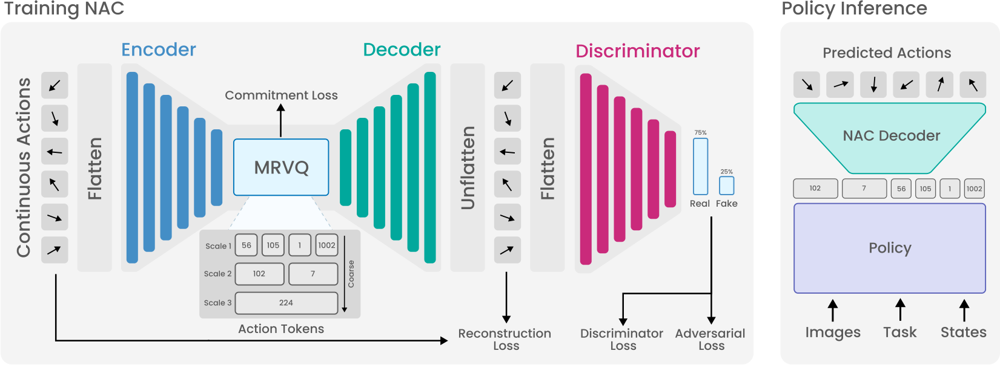
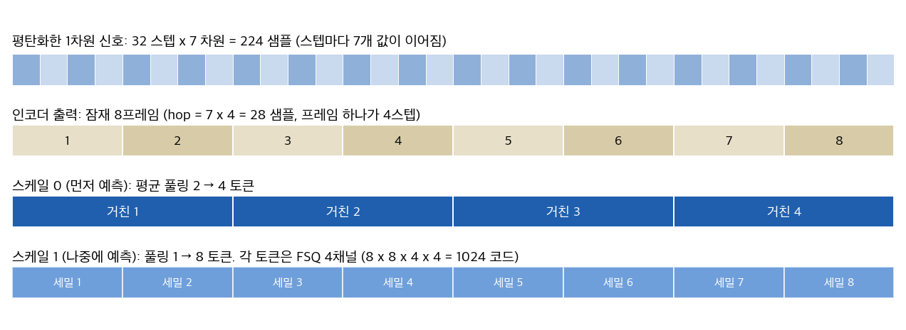
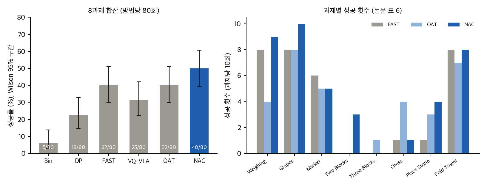
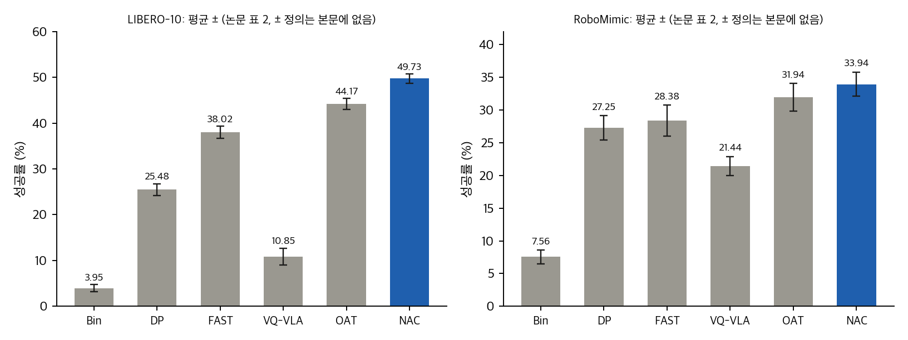
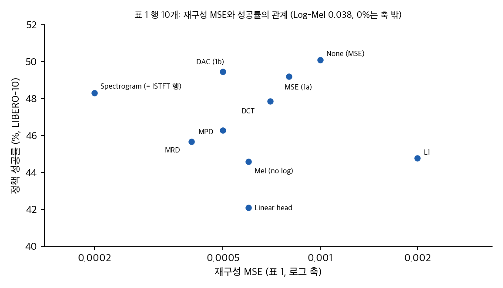
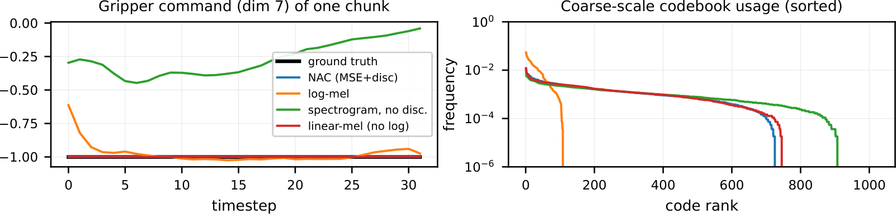

> **논문:** Ahad Jawaid, Yu Xiang. *NAC: Neural Action Codec for Vision-Language-Action Models.* CoRL 2026 포스터, arXiv:2606.21372 (v2, 2026-09-25).
> 공식 코드는 GitHub ahadjawaid/nac(Apache-2.0)에 있습니다. 이 글의 그림은 논문 그림 두 장(출처 표기)과 우리가 그린 그래프입니다. 수치는 논문 표에서 옮겨 다시 계산한 것이고, 논문에 없는 시행 수를 가정한 계산은 문장 안에 가정을 적었습니다.

## 논문이 하는 일

VLA가 행동을 자기회귀로 예측하려면 연속 행동을 이산 토큰으로 바꾸는 토크나이저가 필요합니다. 차원별 구간(Bin)은 토큰이 너무 길고, FAST는 DCT와 BPE로 짧게 만들지만 손으로 설계한 주파수 prior를 씁니다. NAC는 **오디오 코덱이 하던 일을 행동에 시킵니다.** 행동 청크(32스텝 × 7차원 = 224개 값)를 한 줄의 의사 파형으로 이어 붙이고, 합성곱 인코더와 다중 스케일 양자화, ISTFT 디코더, 판별기로 12개 토큰으로 압축합니다.

*그림 2 (논문 원문). © 저자, CC BY 4.0, 출처 arXiv:2606.21372. 도식의 토큰 칸은 스케일 3개로 그려져 있지만 표 3과 표 4의 설정은 2개 스케일, 12토큰입니다.*

토큰은 거친 스케일 4개를 먼저, 세밀한 스케일 8개를 나중에 놓은 "오프셋 코드북" 어휘(2 × 1024 + BOS)로 정책이 예측합니다. 공식 코드의 기본 설정에서 읽으면 배치는 아래와 같습니다. 토큰당 1024개 코드이므로 청크 하나가 120비트입니다.

*그림: 우리가 그린 그림. 공식 저장소 기본 설정의 값으로 청크 하나의 토큰 배치를 보였습니다.*

## 이 글에서 확인한 것

**1. LIBERO-10의 NAC 우위는 평가 시드 기준으로 분명합니다.** 표 2에서 NAC 49.73%, OAT 44.17%, FAST 38.02%입니다. 표의 "±"를 표준오차로 읽으면 대 OAT 5.56점은 p = 4e-4, 대 FAST 11.71점은 p < 1e-11입니다. 다만 "±"의 정의는 논문에 없고, 표준편차로 읽으면 12개 값 중 11개가 시드 하나(시행 500회 가정)의 이항 분포 하한보다 작아져서 표준오차일 가능성이 더 커 보입니다. 공식 설정은 학습 시드가 하나이고 평가 시드만 반복하는 구성이라, 학습 시드가 다를 때의 변동은 이 계산에 들어 있지 않습니다. 저자 확인이 필요합니다.

**2. RoboMimic과 실로봇에서는 차이가 분명하지 않습니다.** RoboMimic에서 NAC 33.94%와 OAT 31.94%의 2.00점은 p = 0.48(± 표준오차 읽기, 시도 합산 이항 검정 p = 0.23, 시행 수 1600 가정)입니다. 실로봇은 8과제 × 10회 = 방법당 80회에서 NAC 40/80, FAST와 OAT 32/80이라 Fisher 정확 검정 p = 0.27입니다. 이 시험 규모에서 80% 검정력으로 가려낼 수 있는 최소 차이는 약 22점이고, 50% 대 40%를 가려내려면 방법당 약 390회(독립 시행 가정)가 필요합니다. 과제별로 NAC가 단독으로 가장 높은 것은 8개 중 Grapes와 Two Blocks 두 개입니다.

*그래프: 우리가 그린 그래프. 논문 표 6을 다시 그렸고, 구간은 Wilson 95%(방법당 80회)입니다.*

*그래프: 우리가 그린 그래프. 논문 표 2의 평균과 ±입니다. ±의 정의는 논문에 없습니다.*

**3. v2는 적대적 학습의 역할을 줄여 썼습니다.** v1은 "판별기를 빼면 성공률이 0이 된다"고 서술했습니다. v2는 판별기 없는 MSE 구성이 50.1%로 DAC 판별기 구성(49.45%)과 구분되지 않는다고 적습니다(차이 −0.65점, ± 표준오차 읽기 z = −0.25). 판별기가 필요한 것은 크기만 맞추는 스펙트로그램 손실에서뿐입니다. v1 초록의 "더 낮은 재구성 오차" 비교 문구와 "적대적 손실을 처음 적용"한 기여 항목은 v2에서 빠졌습니다.

**4. 재구성 MSE와 정책 성공률은 같은 방향으로 움직이지 않았습니다.** 표 1의 행 11개(성공률이 0인 행 제외)에서 두 값의 순위 상관은 약 −0.02입니다. 논문도 "두 지표를 모두 봐야 한다"고 적습니다. 같은 기본 구성이 표 1(a) 49.2, 표 1(b) 49.45, 표 2 49.73으로 세 번 나오는데, 그 폭(0.53점)은 MSE 대 스펙트로그램(0.9점), 판별기 있음 대 없음(0.65점) 같은 ablation 차이와 비슷한 크기입니다. 표 1(c)의 ISTFT 행은 표 1(a)의 스펙트로그램 행과 같은 숫자여서, 헤드 비교가 기본 MSE 구성이 아니라 스펙트로그램 손실에서 이루어졌다고 읽힙니다.

*그래프: 우리가 그린 그래프. 표 1의 행 10개(로그 멜 0%는 축 밖)를 논문 값 그대로 점으로 찍었습니다.*

**5. 크기만 맞추는 스펙트로그램 손실은 부호와 밀림에 둔감합니다(합성 청크 토이).** 논문 §4.2와 부록 B.2는 크기만 맞추는 손실이 위상을 맞추지 않아 그리퍼 명령이 사라진다고 설명합니다. 이 설명이 손실 함수의 성질로 이해되는지 합성 청크 200개(32 × 7, 우리가 정한 가정)에 오류를 넣어 봤습니다. 그리퍼 부호 뒤집기는 MSE에서 위치 오프셋의 44배 손실인데 스펙트로그램 L1에서는 1.75배이고, 청크 전체의 부호를 뒤집으면 크기 스펙트로그램 손실이 0입니다. 논문의 설명과 같은 방향의 결과입니다. 이것은 손실 함수만의 검사이고, 실제 NAC 학습에서 그리퍼가 사라지는 원인이 이것이라는 것은 이 검사만으로는 확인되지 않습니다.

*그림 5 (논문 원문). © 저자, CC BY 4.0, 출처 arXiv:2606.21372. 왼쪽은 청크 하나의 그리퍼 명령, 오른쪽은 거친 스케일 코드북 사용 빈도입니다.*

**6. 공개 설정의 양자화기는 논문 서술과 다릅니다.** 논문 §3.2와 표 4는 k-means 초기화와 EMA로 갱신하는 RVQ와 커밋 손실 10³을 설명합니다. 공개 저장소(커밋 2e2d9db, 2026-06-28)의 `train_nactok.yaml`은 FSQ(레벨 8, 8, 4, 4 = 1024코드)를 쓰고, 이 구현은 커밋 손실로 0을 돌려줍니다. 인코더에는 LSTM 2층이 있어 "완전 합성곱 SEANet"이라는 서술과 다르고, 생성기 손실에는 DAC 특징 매칭 항이 더해져 있습니다. 같은 설정 폴더의 OAT 기준선도 FSQ(8, 8, 4, 4)입니다. 코드의 마지막 커밋이 논문 v2보다 약 3개월 앞서므로 논문과 코드의 시점 차이일 수 있고, 어느 구성으로 표 수치를 냈는지는 저장소만으로는 알 수 없습니다. RoboMimic 설정도 시연 800개, 토크나이저 25,000스텝으로 논문 부록의 "500개, 50k"와 다릅니다.

## 한계와 아직 모르는 것

- **VLA라는 이름과 실험 설정.** 실험 정책은 VLM이 없는 4층 소형 트랜스포머이고 학습 데이터는 시연 500개 규모입니다. VLM 기반 VLA나 사전 학습 규모에서의 효과는 시험되지 않았습니다.
- **구성 요소의 기여가 분리되지 않았습니다.** 다중 스케일, 오프셋 코드북, 거친-먼저 순서의 효과를 따로 떼어 본 ablation이 없어서, OAT와의 차이가 어느 요소에서 오는지 논문 안에서 나눌 수 없습니다.
- **재구성 충실도 비교가 없습니다.** 표 1은 NAC 변형끼리의 재구성 MSE만 보이고 Bin, FAST, OAT, VQ-VLA의 재구성 MSE는 없습니다.
- **표 3의 지연(RTX 4090)** 은 측정 방식이 논문에 없고 공식 저장소에도 측정 스크립트가 없습니다. 압축 수치(12토큰, 120비트, Bin의 약 19배, FAST의 3배)는 다시 계산해서 맞았습니다.
- **실로봇 설정.** 로봇 기종, 카메라, 시연 수가 논문에 적혀 있지 않습니다.
- 정수 시도 수 검사(LIBERO 4000, RoboMimic 1600 가정)에서 RoboMimic의 평균 6개는 모두 정수 비율이고, LIBERO 평균 6개는 반올림 경계에 걸리는 값(예: 44.17 = 1767/4000 = 44.175)이 있어 시행 수나 평균 방식은 저자 확인이 필요합니다.

## 구현 가능성

논문 수치의 재현은 개인 맥(Apple M4 Pro, 약 24 GiB, CUDA 없음)에서는 사실상 어렵습니다. 정책 학습과 500 롤아웃 평가는 GPU를 전제한 규모이고, 실로봇은 코드와 데이터가 없습니다. 토큰 배치와 다중 스케일 양자화의 소형 재구현, 손실 함수의 성질 검사는 CPU로 가능합니다. 이 글의 재계산과 토이 스크립트는 분석 노트 저장소에 있습니다. 가중치와 데이터는 받지 않았고 공식 코드는 정적으로만 읽었습니다.

## 자료

- [통합 리포트 PDF](report/report_public.pdf)
- [01. NAC 논문 분석](analysis/01_paper_analysis.md)
- [02. 선행연구, 관련 저장소](analysis/02_prior_work.md)
- [03. 수치 재계산, 일관성 검사, 토이, 주장 판정](analysis/03_analysis.md)
- [04. 공식 코드와 논문 대조](analysis/04_code_verification.md)
