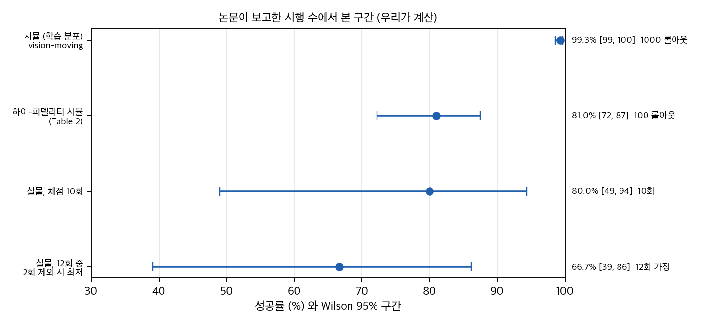
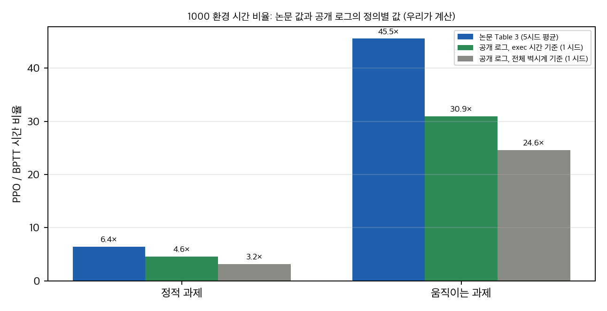
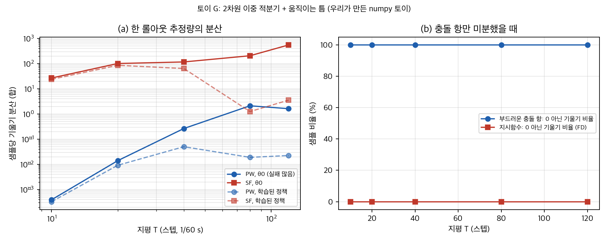
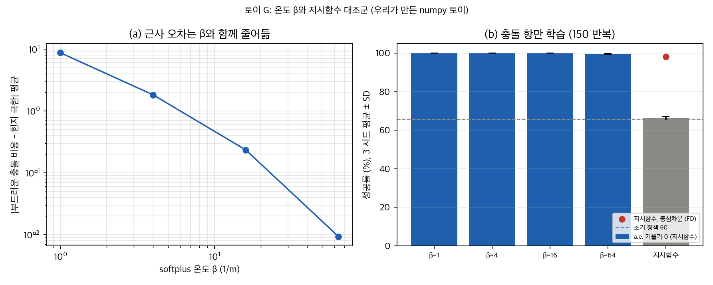

# 03. 수치 재계산, 일관성 검사, 토이 G

재계산 스크립트는 `analysis/recompute.py`(결과 `analysis/recompute_results.json`), 토이는 `analysis/toy_gap_pathwise.py`(결과 `analysis/toy_gap_pathwise_results.json`)입니다. 공개 학습 로그는 `repo/runs/*/paper_data/`의 CSV와 `evaluate_all.out`을 읽기만 했습니다. 모든 계산은 CPU이고, 토이는 약 80초입니다.

**가정과 한계 (먼저 읽을 것).**
- 논문은 **시행 수를 대부분 적지 않았습니다.** 1000 롤아웃 최종 평가는 공식 저장소의 `evaluate_all.out`(seed 0)과 맞춰 확인했습니다(100.00, 98.90, 100.00, 99.30%, 같은 값). 하이-피델리티 100회와 Table 4의 1000회는 가정입니다.
- 쌍체 자료가 없어서 McNemar 검정은 쓰지 못했습니다. 독립 표본 Fisher 정확 검정만 씁니다.
- 클리어런스(교차 오차, cm)는 평균만 있고 분산이 없어서 구간을 만들 수 없습니다.
- 공개 로그의 평가는 100롤아웃 단위이고 1000롤아웃이 아닙니다. 수렴 정의(Table 1)에는 100롤아웃을 씁니다.

## 1. 논문 수치 재계산

### 1.1 최종 시뮬레이션 성공률 (Table 1, 1000 롤아웃)

| 과제 | 성공 / 시행 | 성공률 | Wilson 95% | 출처 |
|---|---|---|---|---|
| 상태, 정적 | 1000 / 1000 | 100.0% | [99.6, 100.0] | Table 1, evaluate_all.out |
| 시각, 정적 | 989 / 1000 | 98.9% | [98.0, 99.4] | 같음 |
| 상태, 움직임 | 1000 / 1000 | 100.0% | [99.6, 100.0] | 같음 |
| 시각, 움직임 | 993 / 1000 | 99.3% | [98.6, 99.7] | 같음 (초록의 99.3%) |

- evaluate_all.out은 "Gap crossing rate 99.90%"도 보고합니다. 움직임 시각 과제에서 1회는 틈 개구부 안을 통과하지 못했습니다. 코드 기준 성공은 "틈 개구부 안을 통과하고, 교차 시점에 충돌이 없는 경우"입니다(`train_bptt_gap_crossing.py`, 교차 판정 블록).
- 교차 오차 1.0, 2.4, 2.4, 2.3 cm(Table 1)는 evaluate_all.out의 "Average crossing distance from gap center"와 같습니다. 재현 확인 완료.

그래프: 시뮬 993/1000, 하이-피델리티 81/100, 실물 8/10과 12회 가정의 Wilson 95% 구간. 우리가 계산한 값입니다.

### 1.2 유의성 (Fisher 정확 검정, 양측)

| 비교 | 값 | p |
|---|---|---|
| 시각 움직임 시뮬 (993/1000) 대 하이-피델리티 (81/100) | 99.3% 대 81% | 1.2×10⁻¹⁵ |
| 시각 움직임 시뮬 (993/1000) 대 실물 채점 (8/10) | 99.3% 대 80% | 0.0031 |
| 같은 비교, 제외 2회가 모두 성공이라고 가정 (10/12) | 99.3% 대 83% | 0.0044 |
| 같은 비교, 제외 2회가 모두 실패라고 가정 (8/12) | 99.3% 대 67% | 3.6×10⁻⁶ |
| 상태 정적 (1000/1000) 대 시각 정적 (989/1000) | 100% 대 98.9% | 0.00095 |
| 상태 움직임 학습 (1000/1000) 대 정적 학습 전이 (315/1000) | 100% 대 31.5% | 6.6×10⁻²⁸⁸ |
| 시각 움직임 학습 (993/1000) 대 정적 학습 전이 (66/1000) | 99.3% 대 6.6% | 0 (부동소수점 하한에서 0) |
| Table 4: K = 1 (995) 대 K = 8 (989) | 99.5% 대 98.9% | 0.21 |
| Table 4: K = 4 (993) 대 K = 8 (989) | 99.3% 대 98.9% | 0.48 |

해석.
- 정적 시각 과제의 1.1pt 차이(p ≈ 0.001)는 통계적으로 유의하지만, 두 과제는 다른 틈 분포를 쓰므로 "시각이 약하다"는 결론은 과장입니다.
- **K 변화는 유의하지 않습니다(p ≥ 0.2).** 논문은 K = 4를 골랐고 그 근거는 수렴 속도입니다(Table 4의 수렴 에폭 6500, 4500, 4000, 3500). 본문의 "0.7점 차이"는 맞지만 해석은 신중해야 합니다.

### 1.3 실물 (Table 2, 본문 §4)

- 채점 10회, 성공 8회. Wilson 95% [49.0, 94.3]%, Clopper–Pearson [44.4, 97.5]%. 논문의 구간 49–94%와 맞습니다.
- 기록 12회 중 2회 제외. 제외한 2회가 모두 성공이면 10/12 = 83.3%, Wilson [55.2, 95.3]%. 모두 실패면 8/12 = 66.7%, Wilson [39.1, 86.2]%.
- **결론.** 제외 규칙이 결과를 크게 바꿉니다. 80%는 채점 10회의 값이고, 2회의 처리에 따라 67–83%입니다. 실패 2회는 모두 기록에 있습니다.
- 하이-피델리티 81/100의 Wilson 구간은 [72.2, 87.5]%입니다.

### 1.4 파라미터 전이 (본문 §4 Static-to-Moving)

- 상태 정적 체크포인트의 움직임 롤아웃 성공률 315/1000 = 31.5%, Wilson [28.7, 34.5]%.
- 시각 정적 체크포인트 66/1000 = 6.6%, Wilson [5.2, 8.3]%.
- 본문이 말한 대로 틈 자세 분포가 다르므로 시간 효과를 분리하지 못합니다.

### 1.5 Table 3 산술과 단위

| 항목 | 정적 (BPTT / PPO) | 움직임 (BPTT / PPO) | 논문 값 | 재계산 |
|---|---|---|---|---|
| 전이 비율 | 75 M / 210 M | 135 M / 2.57 B | 2.8×, 19.0× | 2.80×, 19.04× ✓ |
| 업데이트 비율 | 500 / 1.12 M | 900 / 13.7 M | 2.24×10³, 15.2×10³ | 2240×, 15,222× ✓ |
| 시간 비율 | 38.3 s / 246 s | 67.5 s / 3073 s | 6.4×, 45.5× | 6.42×, 45.53× ✓ |

- 에폭당 전이 150,000 (1000 환경 × 150 스텝). BPTT 정적 75 M → 500 에폭 (공개 로그의 1000 환경 정적 수렴 에폭 500과 일치). BPTT 움직임 135 M → 900 에폭 (Table 3 평균 900과 일치).
- PPO 미니배치 750 → 에폭당 200개 × 업데이트 4회 = 800. 계산한 업데이트 수 13.7 M / (2.57 B / 150k) = 799.6/에폭 ✓.
- **업데이트 비율은 속도가 아닙니다.** BPTT는 에폭당 업데이트 1회, PPO는 800회입니다. 업데이트 비율 2240×와 15,222×는 에폭 정의의 차이를 세는 값입니다.

### 1.6 Table 3의 시간 정의 (공개 로그와 대조, 단일 시드)

공개 로그의 1000 환경 실행 두 쌍으로 시간 정의를 맞춰 봤습니다. 시드가 하나뿐이므로 방향만 봅니다.

| 쌍 | 실행(exec) 누적 (수렴까지) | 전체 벽시계 (수렴까지) | 전이 비율 (실행 기준) | 전이 비율 (벽시계 기준) | Table 3 시간 비율 |
|---|---|---|---|---|---|
| 정적 (수렴 500 / 1000 에폭) | BPTT 39.2 s, PPO 180.4 s | BPTT 77.0 s, PPO 245.0 s | 4.6× | 3.2× | 6.4× |
| 움직임 (수렴 1000 / 13000 에폭) | BPTT 76.5 s, PPO 2366 s | BPTT 127.1 s, PPO 3122 s | 30.9× | 24.6× | 45.5× |

- BPTT의 Table 3 값(38.3 s, 67.5 s)은 **실행 시간**과 맞습니다(처음 500 에폭 실행 39.2 s, 900 에폭 환산 약 69 s). 전체 벽시계(77 s)와는 다릅니다.
- PPO의 Table 3 값(246 s, 3073 s)은 **전체 벽시계**와 맞습니다(245 s, 3122 s). 실행 시간(180 s, 2366 s)과는 다릅니다.
- 이 방향이 맞다면 6.4×와 45.5×는 방법마다 다른 시간을 나눈 값입니다. 같은 기준이면 비율은 3.2×와 24.6×(벽시계) 또는 4.6×와 30.9×(실행)입니다. 논문에는 시간 정의가 없습니다. 단일 시드라서 단정할 수 없고, 저자에게 확인을 요청합니다(`01` §5 항목 10, Q6).

그래프: Table 3의 시간 비율(6.4×, 45.5×)과 공개 로그 단일 시드의 비율(실행 기준, 벽시계 기준). 우리가 계산한 값입니다.

### 1.7 "0.4–5.6분 학습" 주장 대조

공개 로그에서 Table 1 정의로 수렴한 실행의 벽시계(JIT 컴파일과 평가 포함):

| 실행 | 수렴 에폭 | 벽시계 (분) |
|---|---|---|
| 상태 정적, 100 환경 | 500 | 1.05 |
| 상태 정적, 1000 환경 | 500 | 1.28 |
| 상태 움직임, 100 환경 | 1500 | 2.38 |
| 상태 움직임, 1000 환경 | 1000 | 2.12 |
| 시각 정적, 100 환경 | 3500 | 7.64 |
| 시각 정적, 1000 환경 | 5000 | 14.68 |
| 시각 움직임, 100 환경 | 4000 | 8.82 |
| 시각 움직임, 1000 환경 | 3000 | 9.21 |

- 상태 과제는 1.0–2.4분, 시각 과제는 7.6–14.7분입니다. 실행 시간만 쓰면 상태 정적은 0.44분까지 내려갑니다.
- **"0.4–5.6분"은 공개 로그의 어떤 조합과도 맞지 않습니다.** 상한 5.6분은 확인하지 못했습니다. 초록의 "몇 분"은 시각 움직임 과제(99.3%)를 말하며, 로그에서는 8.8–9.2분입니다.
- 공개 로그의 PPO 움직임 1000 환경은 13000 에폭에서 수렴하며 52분입니다. Table 3의 3073 s와 맞습니다.

### 1.8 수렴 에폭 재현 (Table 1)

- 공개 로그(100 환경, 500 에폭마다 100롤아웃 평가)에서 "3회 연속 95% 이상이 시작되는 첫 체크포인트"를 찾았습니다. 상태 정적 500, 시각 정적 3500, 상태 움직임 1500, 시각 움직임 4000. **Table 1의 네 값과 모두 일치합니다.**
- 이 규칙은 100롤아웃 평가의 잡음에 민감합니다. 성공률 95%에서 100롤아웃 평가의 표준오차는 약 2.2pt입니다. 체크포인트 한두 개의 차이는 해석하기 어렵습니다.
- PPO는 같은 규칙으로 정적 100 환경(2000 에폭), 정적 1000 환경(1000 에폭), 움직임 1000 환경(13000 에폭)에서 수렴합니다. 정적 10 환경(최고 87%)과 움직임 10·100 환경은 수렴하지 않습니다. Fig. 7의 "no convergence" 표시와 맞습니다.

### 1.9 부록 A.3 분산 비율과 기하

- A.3의 표준편차 27.93과 2.38에서 분산 비율 (27.93 / 2.38)² = 137.7. 본문 "약 140×"와 맞습니다.
- **기하 점검.** 드론 반축 0.19 m(수평), 0.05 m(수직), 틈 반폭 0.40 m, 반높이 0.125 m이면 중심에서 허용 치우침은 수평 ±0.21 m, 수직 ±0.075 m입니다. 본문의 실물 관통 4.6 cm와 9.3 cm는 정의가 없어서 이 여유와 직접 비교할 수 없습니다. 관통이 "드론 가장자리가 틈 모서리를 넘은 거리"라면 9.3 cm는 수직 여유 7.5 cm보다 큽니다. 그 경우 수직 방향 오차가 여유를 넘었다는 뜻입니다.

### 1.10 절단된 PPO 시드 (Table 3 하한)

- Table 3의 움직임 PPO 값은 4개 수렴 시드 평균입니다. 시드 2는 30k 에폭에서 절단되었고 4.5 B 전이, 24 M 업데이트, 5377 s였습니다.
- 절단 값을 5시드 평균에 넣으면 전이 비율 ≥ 21.9×, 시간 비율 ≥ 52.4×입니다. 논문 19×, 45.5×는 절단 시드를 뺀 값입니다. 절단 시드의 실제 값은 이보다 클 수 있으므로, 논문의 수치는 보수적입니다. 다만 이 계산은 PPO 평균이 공개 로그가 아닌 논문 값이라는 점에 기대고 있습니다.

## 2. 토이 G: 틈 통과 기울기의 품질 (우리가 만든 numpy 토이)

**모형.** 2차원 횡방향 이중 적분기(y, z), dt = 1/60 s, 전진 속도 1 m/s로 틈 평면을 지남. 틈은 y 방향 진자 c(t) = 0.3 sin(2π·0.5 t + φ). 틈 80 × 25 cm, 드론 반축 0.19 m(y)와 0.05 m(z). 정책은 y축 PD + 피드포워드 (θ = k_p, k_d, k_f), z축은 고정 PD. 행동 노이즈 σ = 0.5 m/s². 비용은 중심 추적 0.5(y−c)² + 충돌 18·exp(−6d²)·침범 (논문과 코드의 λ = 6 사용). 침범은 softplus_β 또는 지시함수. 성공은 틈 통과 시점에 침범 없음. **이 토이는 논문 코드가 아닙니다.** 공식 코드의 JAX 파이프라인을 쓰지 않고 같은 구조만 옮겼습니다.

**질문.** 논문 주장 셋을 봅니다. (1) 한 롤아웃 PW 추정량은 SF 추정량보다 분산이 작다. (2) 부드러운 충돌 항은 기울기를 주고, 지시함수는 주지 않는다. (3) 온도 β는 근사 오차와 학습을 바꾼다.

### 2.1 A: 지평 T에 따른 분산 (θ0 = (1.5, 1.0, 0), 2048 샘플)

| T (스텝) | PW 분산 | SF 분산 (한 롤아웃) | 비율 SF/PW | PW 기울기 크기 평균 | 실패율 (%) | PW−SF 편향 z (3성분) |
|---|---|---|---|---|---|---|
| 10 | 3.9×10⁻⁴ | 26.9 | 6.9×10⁴ | 0.021 | 49.6 | −0.4, −2.4, 0.5 |
| 20 | 1.4×10⁻² | 101 | 7.2×10³ | 0.109 | 42.9 | −0.7, 2.2, 0.8 |
| 40 | 0.264 | 117 | 441 | 0.428 | 26.3 | −1.6, 0.4, 1.9 |
| 80 | 2.11 | 205 | 97 | 1.87 | 64.4 | 0.6, 0.1, 0.1 |
| 120 | 1.62 | 552 | 340 | 2.05 | 66.4 | −0.5, −0.4, 0.0 |

- 로그-로그 기울기: PW 분산 대 T는 3.5, SF 분산 대 T는 1.0.
- 편향 점검(8192 샘플): PW와 SF의 평균 기울기 차이는 15개 성분 검정에서 |z| ≤ 2.4입니다. 두 추정량은 같은 기대값을 추정하고, 편향은 보이지 않습니다.
- SF에는 독립 배치의 평균 비용을 기준선으로 씁니다(leave-one-out보다 SF에 유리하지 않지만 단순합니다).

**학습된 정책 (θ = (6.03, 2.70, 0.44), 중심 추적 + 충돌, β = 16으로 60 스텝 학습).** 같은 스윕:

| T | PW 분산 | SF 분산 | 비율 | 성공률 (%) |
|---|---|---|---|---|
| 10 | 3.3×10⁻⁴ | 23.8 | 7.3×10⁴ | 52.0 |
| 20 | 9.2×10⁻³ | 85.7 | 9.4×10³ | 64.0 |
| 40 | 0.050 | 63.9 | 1.3×10³ | 100 |
| 80 | 0.019 | 1.25 | 66 | 100 |
| 120 | 0.022 | 3.55 | 158 | 100 |

**해석.**
- **주장 (1)은 이 토이에서 확인됩니다.** 샘플당 분산 비율은 66배에서 7×10⁴배입니다. 같은 한 롤아웃 조건에서 그렇습니다.
- **그러나 PW 분산이 T와 함께 늘어나는 것은 O(T) 주장과 맞지 않습니다.** 실패하는 θ0에서 기울기는 충돌 샘플에 집중하고 크기가 T와 함께 커집니다(로그-로그 기울기 3.5). 학습된 정책에서는 기울기가 훨씬 작고 완만하게 늘어납니다(기울기 약 1.5, 측정 범위가 짧음). 논문 LQR의 O(T)는 안정된 선형계에서 나온 결과이고, 이 토이처럼 충돌이 많은 과제에서는 성립하지 않을 수 있습니다.
- SF 분산은 학습된 정책에서 줄어듭니다. 모든 롤아웃이 성공하면 비용 차이가 작아지기 때문입니다. 이것도 이 토이 특유의 효과입니다.

### 2.2 B: 온도 β와 학습 (T = 60, 3 시드, 150 Adam 반복, 배치 256, lr 0.05)

| 조건 | 힌지 극한과의 차이 (비용 평균 절댓값) | PW 기울기 크기 | 중심 추적 + 충돌 학습, 성공률 (%) | 충돌 항만 학습, 성공률 (%) |
|---|---|---|---|---|
| β = 1 | 8.70 | 0.871 | 100.0 ± 0.0 | 100.0 ± 0.0 |
| β = 4 | 1.82 | 0.844 | 100.0 ± 0.0 | 100.0 ± 0.0 |
| β = 16 | 0.234 | 0.779 | 100.0 ± 0.0 | 100.0 ± 0.0 |
| β = 64 | 0.0093 | 0.754 | 99.9 ± 0.2 | 99.7 ± 0.2 |
| 지시함수, 기울기 0 (a.e.) | (힌지와 다름) | 충돌 항 0 (추적 항만 0.026) | 100.0 ± 0.0 | **66.4 ± 0.7** |
| 지시함수, 중심차분 (FD) | (힌지와 다름) | 0.026 (추적 항만) | 100.0 ± 0.0 | 98.2 ± 1.4 |

θ0의 성공률은 65.6%입니다.

- **온도는 근사 오차를 줄입니다.** 힌지 극한과의 차이는 β에 따라 8.7에서 0.009까지 떨어집니다. 기울기 크기는 0.87에서 0.75로 조금 줄며, 이 토이에서 기울기가 폭발하지는 않았습니다.
- **학습 성공률은 β = 1–16에서 같습니다.** 이 토이에서는 β가 학습 결과를 가르지 않았습니다. 지시함수 대조와 비교할 때 부드러움 자체가 중요합니다.
- **지시함수는 a.e. 기울기가 0입니다.** 충돌 항만 학습하면 성공률이 θ0 수준(66.4%)에서 멈춥니다. 부드러운 충돌 항만으로는 100%입니다. 이것이 논문 주장 (2)의 핵심 증거입니다.
- **중심차분으로 지시함수를 미분하면 결과가 다릅니다.** 샘플 대부분의 FD 기울기는 0이지만, 불연속점 근처에서 1/h 크기의 드문 값이 나옵니다(h = 10⁻⁶). 이론상 이 값의 기대값은 공통 난수 아래에서 ∇E[지시함수]와 같아야 합니다(경계 통과 확률의 밀도). 이 토이에서 그 수렴을 따로 확인하지는 않았습니다. 분산이 매우 커서 Adam이 이 값을 정규화하면 학습이 96.5–99%까지 올라갑니다. 즉 "지시함수는 기울기를 줄 수 없다"는 말은 **해석적 PW 기울기**에 대해서만 맞습니다. FD 추정량은 기대값으로는 맞을 수 있으나 분산이 매우 큽니다. 논문은 이 구분을 하지 않습니다.
- 충돌 항만 쓰는 FD 지시함수 학습에서 θ가 (약 2.0, 1.0–1.7, 0.4–0.5)로 움직인 것은 이 FD 경계 신호 때문입니다.

그래프: 토이 G의 샘플당 PW와 SF 분산 대 지평 T (θ0와 학습된 정책), 충돌 항만 미분했을 때 0 아닌 기울기 비율. 우리가 만든 numpy 토이 결과입니다.

그래프: 온도 β에 따른 힌지 근사 오차(a)와 충돌 항만 학습한 성공률(b). 지시함수 행은 기울기 0(a.e.)과 중심차분을 함께 보여 줍니다. 우리가 만든 결과입니다.

### 2.3 C: 충돌 기준의 의미 점검 (손계산 재현)

- 공식 코드(`static_gap_state_env.py`)의 `_get_collision_vector`는 틈 반폭을 `(gap_w − 2·margin)/2`로 계산하고, margin = gap/2 − 드론 반축입니다. 그러면 반폭은 **드론 반축과 같아집니다**(0.19 m, 0.05 m).
- 같은 함수를 손으로 옮긴 계산(R = I, 드론 y 방향 반축 0.19 m)에서, 치우침 δ_y에 대한 학습 벌점은 |δ_y|입니다(0.05 → 0.05, 0.10 → 0.10, 0.20 → 0.20, 0.30 → 0.30).
- 평가 함수 `_check_collision_at_crossing`(`train_bptt_gap_crossing.py`)은 물리 반폭 0.40 m를 씁니다. 같은 치우침에서 침범은 0.21 m 이하에서 0입니다(0.30 m에서 0.09).
- **결론(확인 필요).** 학습 벌점은 정렬된 드론의 중심 치우침에 선형으로 붙는 L1 중심 벌점이고, 평가 기준(물리 반폭)과 다릅니다. 저자가 의도한 것인지, 드론 반축을 두 번 뺀 중복인지는 알 수 없습니다. 이 점은 `04` D5와 `01` §8 Q4에 올립니다. 이 확인은 손계산과 정적 읽기로만 했고, 공식 코드는 실행하지 않았습니다.

## 3. 그 밖의 일관성 검사 (요약)

| 항목 | 결과 | 참조 |
|---|---|---|
| 초록 99.3% = Table 1 시각 움직임 | 일치 | §1.1 |
| 초록 "single GPU, few minutes" | 시간 근거 부족 (§1.7) | §1.7 |
| Table 3 PPO 움직임 5시드 중 4개 수렴 | 공개 로그에는 시드별 원자료가 없고 단일 실행만 있음 | §1.5, §1.10 |
| Table 2 실물 80% | 10회 채점, 12회 기록 (§1.3) | §1.3 |
| Table 3 전이와 시간 비율 | 산술 일치, 시간 정의 불명 (§1.6) | §1.5–1.6 |
| Table 5 가중치 대 공식 설정 | 일치 (BPTT 4 과제 모두) | `04` D6 |
| Table 6 PPO 커리큘럼 대 공식 설정 | 일치 (정적: 충돌 0→18, 가까운 중심 0→3, 중심 3→3. 움직임: 충돌 0→70, 가까운 중심 0→25, 중심 3→6) | `04` D13 |
| 학습률 (A.10) 대 설정 | 일치, 단 PPO 정적 상태 피크 2e-4 (논문은 3e-4) | `04` D13 |
| 네트워크 크기 (512, 1024) | 일치 | `04` D2 |
| 질량 0.600 kg | 일치 | `04` D15 |
