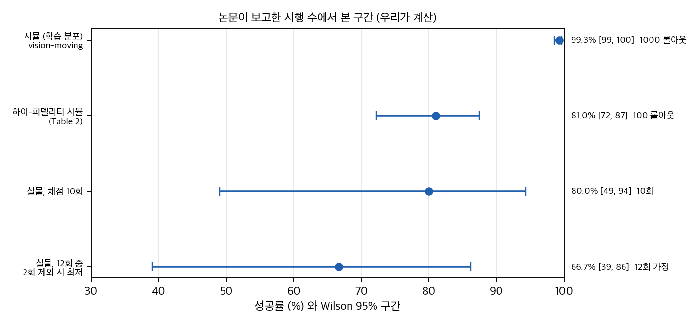
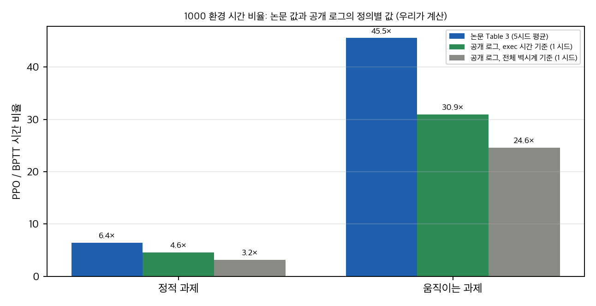
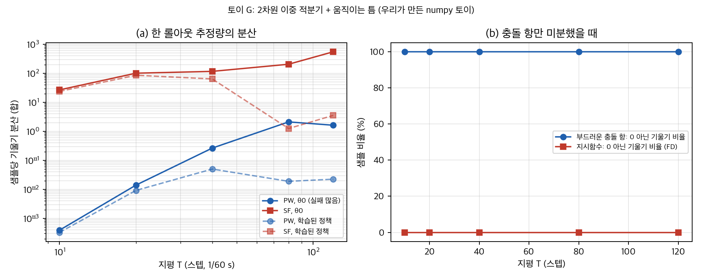
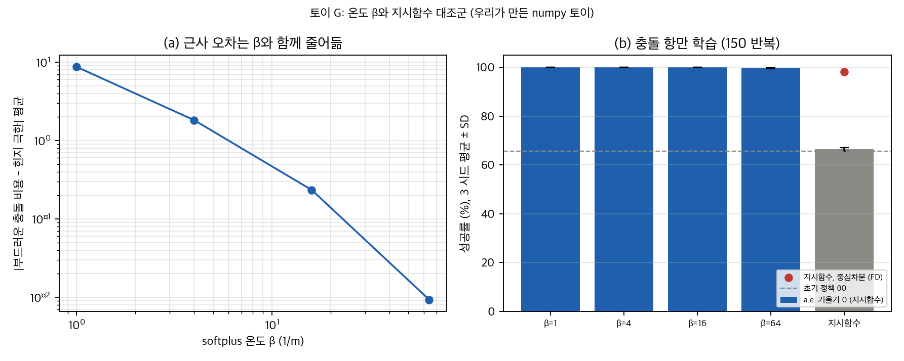

> **논문:** Riccardo Bianco, Yunfan Ren, Jiaxu Xing, Davide Scaramuzza. *Learning Visuomotor Quadrotor Flight Through Dynamic Narrow Gaps via Differentiable Simulation.* CoRL 2026 포스터, arXiv:2610.37557 (v1, 2026-10-27, 저자 소속 University of Zurich).
> 공식 코드는 `uzh-rpg/agile_narrow_gap_diffsim`(GPL-3.0)입니다. 이 글은 코드를 정적으로만 읽었고 실행하지 않았습니다. 논문 배포 라이선스는 arXiv 비독점이라 논문 그림은 싣지 않고, 우리가 만든 그래프만 씁니다.

---

## 이 논문이 묻는 것

좁은 틈을 쿼드로터가 지나가는 일은 빠른 비행의 시험입니다. 틈이 움직이면 더 어려워집니다. 통과 사건은 드물고, 성공하는 궤적은 얇은 다양체 위에만 있습니다. 보통은 틈의 위치를 특권 정보로 알고 있거나, 계획기와 교사 정책을 쓰거나, 증류를 합니다.

이 논문의 질문은 이렇습니다. 시각과 관성만 보는 정책을 교사 없이 무작위 초기화에서 학습할 수 있을까요? 그리고 그 학습 신호는 모델 없는 강화학습(PPO)보다 나은가요? 저자는 틈과의 부호 거리로 게이트한 **매끄러운 비용**을 쓰고, 경로 미분(BPTT)으로 정책을 학습합니다.

## 방법: 거리 게이트 비용

핵심은 식 (13)–(22)입니다. 틈 평면까지의 부호 거리 d로 중심 맞춤, 정렬, 충돌 항에 가중치를 주고, 희소한 통과 사건을 모든 시점에서 기울기를 주는 목적으로 바꿉니다. 충돌 항은 드론을 타원체로 보고 틈의 네 면에 대한 침범 깊이를 더합니다.

이 구조는 조작 과제에도 옮길 수 있습니다. "구멍에 끼운다"나 "물체를 잡는다"처럼 성공이 사건 하나로 정해지는 과제에서, 사건까지의 거리를 게이트로 쓰면 됩니다.

## 숫자를 다시 계산해 보았습니다

공식 저장소의 학습 로그와 평가 출력을 읽어 확인했습니다.

- **Table 1 성공률은 평가 출력과 같습니다.** 1000 롤아웃에서 100.0, 98.9, 100.0, 99.3%입니다. 교차 오차 1.0–2.4 cm도 일치합니다.
- **수렴 에폭 네 값도 공개 로그와 같습니다.** 500, 3500, 1500, 4000 에폭입니다.
- **실물은 10회 채점입니다.** 12회를 기록하고 2회를 외부 영상이 없다는 이유로 뺐습니다. 제외 처리에 따라 성공률은 67–83%입니다. 8/10의 Wilson 95% 구간은 49–94%입니다.

그래프: 시뮬 993/1000, 하이-피델리티 81/100, 실물 8/10과 12회 가정의 Wilson 95% 구간. 우리가 계산했습니다.

**시간 주장은 맞지 않았습니다.** 초록의 "몇 분"은 시각 움직임 과제인데, 공개 로그에서 수렴까지 8.8–9.2분입니다. 본문의 "0.4–5.6분"은 어떤 조합과도 맞지 않았습니다. 상태 과제는 1.0–2.4분입니다.

**Table 3의 시간 비율도 확인이 필요합니다.** BPTT의 38.3 s와 67.5 s는 실행 시간과 맞고, PPO의 246 s와 3073 s는 전체 벽시계와 맞습니다. 같은 기준으로 비교하면 비율은 정적 3.2–4.6배, 움직임 24.6–30.9배입니다. 논문의 6.4배와 45.5배보다 작습니다. 단일 시드 로그 기준이라 확정할 수 없고, 저자에게 확인할 항목입니다.

그래프: Table 3 시간 비율(6.4배, 45.5배)과 공개 로그 단일 시드의 비율(실행 기준, 벽시계 기준). 우리가 계산했습니다.

## 토이로 본 기울기 품질

우리는 같은 구조를 numpy로 옮긴 2차원 토이를 만들었습니다. 논문 코드가 아닙니다. 드론은 틈 평면을 지나고, 틈은 진자처럼 움직입니다.

- **한 롤아웃 추정량의 분산.** 같은 정책과 같은 노이즈에서 PW 추정량은 SF 추정량보다 샘플당 분산이 66배에서 7×10⁴배 작았습니다. 두 추정량의 평균은 같았습니다.
- **그러나 PW 분산은 지평과 함께 늘었습니다.** 실패하는 정책에서 기울기는 충돌 샘플에 몰리고, 지평이 길어질수록 커졌습니다. 논문의 O(T) 주장은 안정된 선형계에서 나온 결과라서, 충돌이 많은 과제에서는 성립하지 않을 수 있습니다.

그래프: 토이의 샘플당 PW와 SF 분산 대 지평 (초기 정책과 학습된 정책), 충돌 항만 미분했을 때 0 아닌 기울기 비율. 우리가 만든 numpy 토이 결과입니다.

- **부드러운 충돌 항만 학습 신호를 줍니다.** 충돌 항만 학습했을 때 부드러운 항은 100%, 기울기가 0인 지시함수는 66%(초기 정책 수준)에서 멈췄습니다.
- **지시함수를 중심차분으로 미분하면 결과가 다릅니다.** 경계 근처의 드문 큰 값 때문에 학습이 97–99%까지 올라갔습니다. 해석적 기울기는 0인데, 유한차분은 분산이 큰 경계 신호를 줍니다. 논문은 이 구분을 하지 않습니다.
- **온도는 근사를 좋게 하지만 학습 결과는 같습니다.** softplus 온도를 1에서 16까지 바꿔도 성공률은 100%로 같았습니다.

그래프: 온도 β에 따른 힌지 근사 오차(a)와 충돌 항만 학습한 성공률(b). 지시함수 행은 기울기 0과 유한차분을 함께 보여 줍니다. 우리가 만든 결과입니다.

## 공식 코드를 읽었습니다

공식 저장소는 JAX입니다. 논문의 부록 A.1은 PyTorch라고 쓰지만, 그림 3 캡션은 JAX라고 씁니다. 다음 차이를 찾았습니다.

- **학습 충돌 기준.** 학습 벌점은 틈 반폭을 드론 반축(0.19 m)으로 줄입니다. 평가는 물리 반폭(0.40 m)을 씁니다. 정렬된 드론에서 학습 벌점은 중심 치우침에 선형으로 붙습니다.
- **종료 조건.** 논문은 충돌 시 에피소드를 끝낸다고 쓰지만, 코드는 월드 박스를 벗어날 때만 끝냅니다.
- **지연.** 본문은 한 스텝 지연이라고 쓰지만, 코드는 35 ms(약 두 스텝)와 보간을 씁니다.
- **PPO 장치.** PPO에는 엔트로피 감쇠와 학습률 전환이 있는데 논문에는 없습니다. 비교 조건이 같지 않습니다.
- **재현 불가 부분.** 하이-피델리티 시뮬(Table 2의 81%)과 실물 인식 및 비행 코드는 공개되지 않았습니다.

## 이 맥에서 재현할 수 있을까

**논문 결과의 재현은 불가능합니다.** 공식 학습은 CUDA GPU를 전제합니다. 맥의 JAX는 CPU만 쓰고, 시각 과제 학습은 수 시간 이상이 걸릴 것으로 보입니다(추정).

**상태 기반 틈 과제의 PyTorch 재구현은 가능합니다.** 동역학, RK4, 비용 항, BPTT, MLP는 자동 미분으로 옮길 수 있습니다. 추정 2–3주입니다. 시각 특징과 PPO 비교까지 더하면 5–7주입니다. 측정한 값이 아니라 추정입니다.

## 남는 질문

저자에게 물을 질문은 여덟 개로 정리했습니다. 가장 중요한 것은 학습 충돌 기준의 의도, 종료 조건, 시간 정의, 시드 수입니다. 실물 2회 제외의 기준도 확인이 필요합니다.

## 출처와 범위

- **논문:** arXiv:2610.37557 v1. arXiv 비독점 배포입니다. CC 라이선스가 아니므로 논문 그림은 싣지 않았습니다.
- **공식 코드:** `uzh-rpg/agile_narrow_gap_diffsim` (GPL-3.0). 정적으로 읽었고 실행하거나 재배포하지 않았습니다.
- **그래프와 토이:** 이 글을 쓴 사람이 만들었습니다. 토이는 논문 코드가 아니라 같은 구조를 옮긴 간단한 모형입니다.
- **범위:** 쿼드로터 비행은 이 저장소의 주제가 아닙니다. 논문을 고른 이유는 미분 가능 시뮬레이션으로 학습 신호의 품질을 따지는 방법입니다.

## 자료

- [통합 리포트 PDF](report/report_public.pdf)
- [01. 논문 분석: 움직이는 좁은 틈을 미분 가능 시뮬레이션으로 학습 (arXiv:2610.37557)](analysis/01_paper_analysis.md)
- [02. 선행연구와 자료 계보 (arXiv:2610.37557)](analysis/02_prior_work.md)
- [03. 수치 재계산, 일관성 검사, 토이 G](analysis/03_analysis.md)
- [04. 공식 코드 정적 대조와 구현 가능성 (arXiv:2610.37557)](analysis/04_code_verification.md)
