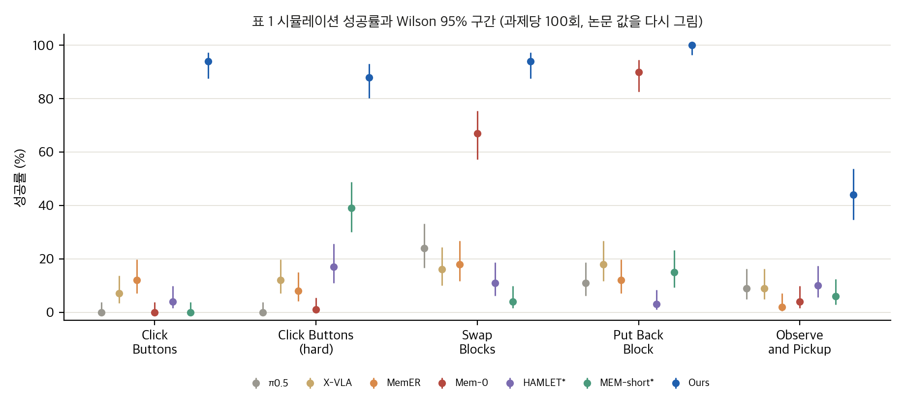
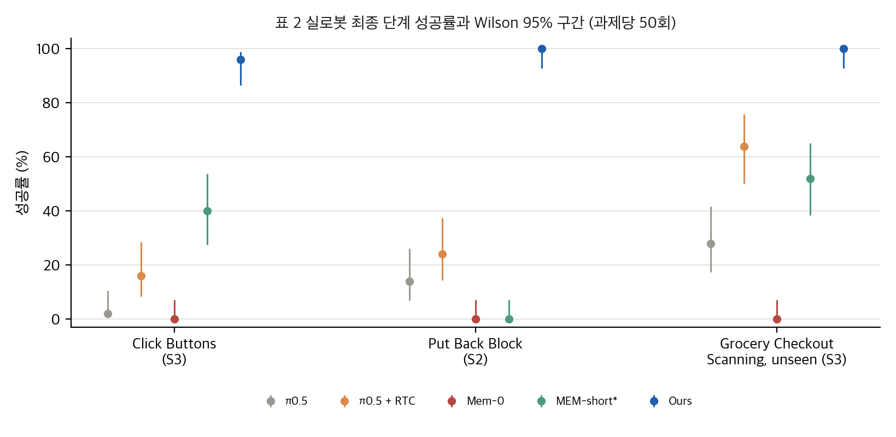
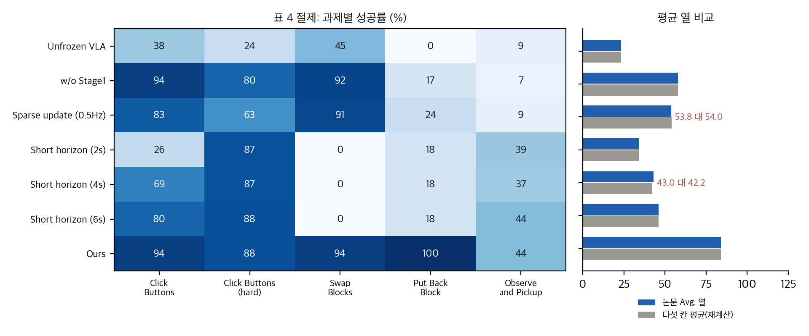
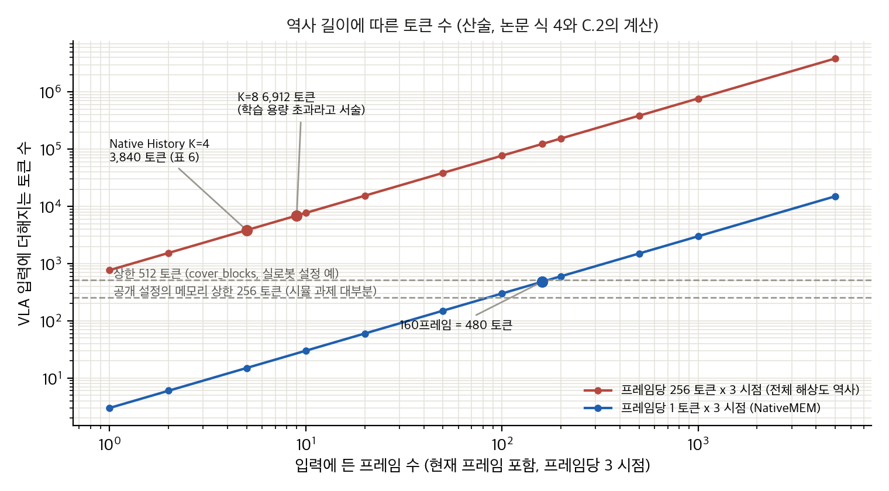

# 03. 수치 재계산과 일관성 검사

대상은 arXiv v2의 표 1–8, 그림 1, 그림 4(b)와 본문 수치입니다. 모든 계산은 `analysis/recompute.py`(수 초, numpy·scipy)가 하고 결과는 `analysis/recompute_results.json`에 있습니다. 번호 V는 재계산 항목, K는 일관성 검사, C는 주장 판정입니다. 토이 실험은 하지 않았습니다. 재계산이 중심이고, 핵심 주장(사전학습 VLA의 토큰 공간에 맞춘 압축)은 작은 모델로 대신 시험하기 어렵기 때문입니다(`04` §4).

## 0. 가정

- **시행 수.** 시뮬레이션은 과제당 100회, 실로봇은 과제당 50회입니다(Sec. 4.1 끝, 부록 C 첫 문단 "Simulation and real-world evaluations use 100 and 50 trials"). 표의 모든 값이 이 시행 수에서 정수 개수로 나옵니다(V4, V12).
- **LIBERO(표 3)의 시행 수는 논문에 없습니다.** 스위트당 500회를 가정합니다(시행 수 n = 500 가정). 표의 소수 첫째 자리가 모두 짝수(0.2 단위)이고, 이는 500회에서 정수 개수로 나오는 조건과 맞습니다(V6). 평균은 2,000회(n = 2,000 가정)입니다.
- **그림 4(b)의 막대당 시행 수는 논문에 없습니다.** RMBench 3과제 × 100회 = 300회(n = 300 가정)로 계산합니다. 막대 값은 그림에 인쇄된 정수입니다.
- **그림 4(a)는 래스터 그림**이라 곡선 값을 벡터로 읽을 수 없습니다. 값은 본문 문장의 수치만 쓰고, 곡선은 눈금 판독이라 오차가 큽니다(K7).
- 검정은 Fisher 정확 검정(양측)과 Wilson 95% 구간입니다. 과제 사이 곱셈 보정은 하지 않았고, p 값은 참고용입니다.

## 1. 표 1 시뮬레이션 (과제당 100회)

### 1.1 평균 열과 과제별 최고 (V1, V2)

- 모든 행의 평균이 일치합니다(V1): π0.5 8.8, X-VLA 12.4, MemER 10.4, Mem-0 32.4, HAMLET* 9.0, MEM-short* 12.8, Ours 84.0.
- 모든 과제에서 Ours가 최고이고 최고 기준선과의 차이가 큽니다(V2).

| 과제 | Ours | 최고 기준선 | Fisher p | Ours Wilson 95% |
|---|---|---|---|---|
| Click Buttons | 94 | MemER 12 | 4e-35 | [87.5, 97.2] |
| Click Buttons (hard) | 88 | MEM-short* 39 | 4e-13 | [80.2, 93.0] |
| Swap Blocks | 94 | Mem-0 67 | 2e-6 | [87.5, 97.2] |
| Put Back Block | 100 | Mem-0 90 | 0.0015 | [96.3, 100] |
| Observe and Pickup | 44 | HAMLET* 10 | 7e-8 | [34.7, 53.8] |

- 합산 500회(V3): Ours 420/500 = 84.0% [80.5, 87.0], Mem-0 162/500 = 32.4% [28.4, 36.6], Fisher p = 2e-64. 평균 열은 다섯 과제의 단순 평균이므로 합산 비율과 같습니다.
- 세 RMBench 과제만 평균하면 Ours 79.3, Mem-0 53.7, π0.5 14.7입니다(그림 4(b) 50개 시연 값 79, 54와 같음, V13).
- **읽는 법.** 가장 약한 칸은 Observe and Pickup 44%입니다. 초록과 서론의 "consistently outperforms"는 맞지만, 이 과제에서는 절대 성공률이 낮아 평균(84.0)이 과제별 편차를 가립니다.



*그래프 (우리가 그림). 표 1의 성공률과 Wilson 95% 구간(과제당 100회)입니다. 값은 논문 표 1을 다시 그렸습니다.*

### 1.2 기반 정책과 기준선의 순서

- 기반 정책 π0.5보다 기억 기준선이 낮은 칸이 있습니다. Swap Blocks에서 π0.5 24에 대해 MemER 18, HAMLET* 11, MEM-short* 4이고, Put Back Block에서 π0.5 11에 대해 HAMLET* 3입니다. HAMLET*와 MEM-short*는 저자의 재구현(같은 π0.5 위, 같은 시연 수)이므로 재구현 조건이 결과에 영향을 줄 수 있습니다(K9).

## 2. 표 2 실로봇 (과제당 50회)

### 2.1 평균과 정수 조건 (V4)

- 평균 열은 세 과제 최종 단계 값의 평균과 일치합니다: π0.5 14.67, π0.5 + RTC 34.67, Mem-0 0.0, MEM-short* 30.67, Ours 98.67.
- 모든 칸이 2%의 배수(50회에서 정수 개수)이고 누적 성공률은 모든 줄에서 단계가 갈수록 줄거나 같습니다.
- 150회 합산: Ours 148/150 = 98.7% [95.3, 99.6], π0.5 + RTC 52/150 = 34.7% [27.5, 42.6]. Fisher p = 4e-37.

### 2.2 최종 단계 검정 (V5)

| 과제 (단계) | Ours | 대 π0.5 + RTC | 대 MEM-short* | 대 π0.5 |
|---|---|---|---|---|
| Click Buttons (S3) | 48/50 | 8/50, p = 3e-17 | 20/50, p = 8e-10 | 1/50, p = 1e-24 |
| Put Back Block (S2) | 50/50 | 12/50, p = 4e-17 | 0/50, p = 2e-29 | 7/50, p = 5e-21 |
| Grocery (S3, unseen) | 50/50 | 32/50, p = 1e-6 | 26/50, p = 3e-9 | 14/50, p = 1e-15 |

- 방향과 크기가 일관되어 시행 수가 적어서 생기는 불확실성 문제는 없습니다. 50회의 구간 반폭은 중간 값에서 약 14%p입니다.

### 2.3 단계 간 진행률 (V5, 표 2의 조건부 읽기)

- Ours는 모든 단계 진행률이 0.98–1.0입니다. 기준선은 낮습니다. 예를 들어 Put Back Block에서 S1 성공 수는 π0.5 36/50, π0.5 + RTC 28/50, Mem-0 0/50, MEM-short* 3/50이고 S2/S1 진행률은 0.19, 0.43, 정의 안 됨, 0.0입니다.
- **MEM-short*와 Mem-0는 첫 단계(S1)에서 이미 낮습니다**(Put Back Block S1: 6%와 0%, π0.5는 72%). 두 방법의 후속 단계 실패는 기억 부족과 조작 능력 저하가 섞여 있습니다. 본문도 "MEM-short*가 제한된 실세계 데이터에서 사전학습 VLA의 조작 능력을 떨어뜨리기도 한다"고 서술합니다(Sec. 4.2).
- 같은 Mem-0가 시뮬에서는 Swap Blocks 67%, Put Back Block 90%이고 실로봇에서는 세 과제 모두 0%입니다. 이 차이의 원인은 논문에 없습니다(K10).



*그래프 (우리가 그림). 표 2의 최종 단계 성공률과 Wilson 95% 구간(과제당 50회)입니다.*

## 3. 표 3 LIBERO (V6, V7)

- 평균 열 일치: π0.5 93.4, NativeMEM128 93.9, NativeMEM512 94.0 (스위트 평균).
- 소수 첫째 자리가 모두 0.2 단위여서 스위트당 500회(n = 500 가정)와 정수 조건이 맞습니다.

| 비교 (n = 500 가정) | Spatial | Object | Goal | LIBERO-10 | 평균 (n = 2,000 가정) |
|---|---|---|---|---|---|
| NativeMEM128 − π0.5 (%p) | −3.4 (p = 0.008) | −0.4 (0.80) | +1.6 (0.37) | +4.2 (0.064) | +0.5 (0.56) |
| NativeMEM512 − π0.5 (%p) | −2.6 (p = 0.037) | −0.4 (0.80) | +2.8 (0.078) | +2.6 (0.28) | +0.6 (0.47) |

- 평균은 "비슷한 성능"이라는 서술과 맞습니다. 다만 스위트별로는 Spatial에서 π0.5보다 낮은 차이가 이 시행 수 가정에서 구분됩니다. LIBERO-10(장기 과제)의 +4.2%p는 p = 0.064입니다.
- LIBERO의 시점 수와 기억 토큰 수의 대응은 본문에 없습니다. 128/512 토큰은 3시점 가정에서 약 43/171프레임, 2시점 가정에서 64/256프레임입니다(V15).

## 4. 표 4 절제 (100회)

### 4.1 평균 열 (V8)

- 일곱 줄 중 다섯 줄은 평균이 맞습니다. **Sparse update (0.5 Hz)**는 다섯 칸 합이 270이어서 평균 54.0인데 표는 53.8입니다(합 269에 해당). **Short horizon (4 s)**는 합 211로 평균 42.2인데 표는 43.0입니다(합 215에 해당). 각 칸이 100회 중 정수라면 평균은 0.2 단위여야 하고 두 값 모두 형식은 가능하지만, 표시된 칸과는 맞지 않습니다. 칸 하나 또는 평균 열의 표기에 차이가 있을 가능성이 있어 저자 확인이 필요합니다. 평균만 읽는 결론(두 줄이 서로 및 다른 줄과의 순서)은 바뀌지 않습니다.
- Ours 줄은 표 1의 Ours와 같고(V8), v1과 v2의 절제 표 값은 같습니다.



*그래프 (우리가 그림). 왼쪽은 표 4의 칸 값, 오른쪽은 논문의 Avg. 열과 다섯 칸 평균을 비교한 막대입니다. 두 줄(Sparse update, Short horizon 4 s)의 값이 다릅니다.*

### 4.2 Ours 대비 칸별 검정 (V9)

| 변형 | Click | Hard | Swap | Put Back | Observe |
|---|---|---|---|---|---|
| Unfrozen VLA | 38 (p = 5e-18) | 24 (p = 8e-21) | 45 (p = 1e-14) | 0 (p = 2e-59) | 9 (p = 2e-08) |
| w/o Stage 1 | 94 (p = 1.0) | 80 (p = 0.18) | 92 (p = 0.78) | 17 (p = 3e-39) | 7 (p = 1e-09) |
| Sparse 0.5 Hz | 83 (p = 0.02) | 63 (p = 6e-05) | 91 (p = 0.59) | 24 (p = 6e-34) | 9 (p = 2e-08) |
| Short 2 s | 26 (p = 1e-24) | 87 (p = 1.0) | 0 (p = 4e-50) | 18 (p = 2e-38) | 39 (p = 0.57) |
| Short 4 s | 69 (p = 6e-06) | 87 (p = 1.0) | 0 (p = 4e-50) | 18 (p = 2e-38) | 37 (p = 0.39) |
| Short 6 s | 80 (p = 5e-03) | 88 (p = 1.0) | 0 (p = 4e-50) | 18 (p = 2e-38) | 44 (p = 1.0) |

(괄호 안 p는 Ours 칸과의 Fisher, 100회. 정확한 값은 json의 V9.)

- **Stage 1(행동 지도 압축 학습)의 효과는 두 과제에서만 구분됩니다.** w/o Stage 1(평균 풀링 특징)은 Click Buttons 94, Swap Blocks 92로 Ours와 구분되지 않고, Put Back Block(17 대 100)과 Observe and Pickup(7 대 44)에서만 크게 낮습니다. 본문 설명("거친 이력은 담지만 세부를 보존하지 못한다")과 맞습니다.
- **Unfrozen VLA는 모든 칸에서 크게 낮습니다.** 평균 23.2는 "VLA를 풀면 행동 손실을 VLA 자체를 바꿔서 줄이므로 기억 가지가 학습되지 않는다"는 본문 설명과 일치합니다. 이 변형에서 학습 시간과 단계 수가 같았는지는 적혀 있지 않습니다.
- **창 길이 의존은 과제마다 다릅니다.** Click Buttons (Hard)와 Observe and Pickup은 짧은 창(2–6초)에서도 Ours와 구분되지 않고(87–88, 37–44), Swap Blocks는 6초에서도 0%입니다. Put Back Block은 2–6초 모두 18%로 변하지 않습니다. 6초 창을 넘는 시간 규모의 정보가 Swap Blocks와 Put Back Block에 필요하다고 읽히지만, 창을 6초 이상으로 늘린 중간 설정(예: 10초, 20초)은 없어 필요한 최소 길이는 알 수 없습니다.
- Sparse update 0.5 Hz는 Swap Blocks에서만 Ours와 구분되지 않습니다(91 대 94).

## 5. 표 5–8과 그림 4(b)

### 5.1 표 5 처음 보는 배경·조명 (V10)

- Clean은 표 1의 Ours 세 칸과 같습니다(94, 100, 44). 평균 79.3 → 67.7(재계산 79.33, 67.67)로 일치합니다.
- 과제별 하락: Swap Blocks 94 → 85 (p = 0.063), Put Back Block 100 → 86 (p = 7e-5), Observe and Pickup 44 → 32 (p = 0.11). 합산 300회에서 하락은 구분됩니다(p = 0.0016). 본문은 "모든 과제에서 하락하지만 상당한 성능을 유지한다"고 서술하며 수치와 맞습니다. 구분되는 하락은 Put Back Block 하나입니다.

### 5.2 표 6 전체 해상도 이력 (V11)

- π0.5와 Ours 줄은 표 1과 같습니다. Native History(K = 4)는 9 / 18 / 20(Swap Blocks / Put Back Block / Observe and Pickup).
- Native History는 π0.5(24 / 11 / 9) 대비 Swap Blocks에서 낮고(p = 0.007), Observe and Pickup에서 높으며(p = 0.043), Put Back Block은 구분되지 않습니다(p = 0.23). Ours 대비는 세 과제 모두 낮습니다(p ≤ 0.0004).
- 토큰 수: 5 × 3 × 256 = 3,840과 9 × 3 × 256 = 6,912가 본문 수치와 같습니다. 같은 3시점에서 NativeMEM 160프레임은 480토큰이라 K = 4 입력의 1/8입니다.

### 5.3 표 7 식료품 스캔 난이도 (V12)

- 값이 모두 짝수(50회에서 정수)이고 Once ≤ Retry입니다(첫 시도 44/50, 34/50, 재시도 45/50, 37/50). Wilson 95%: 5개 Once [76.2, 94.4], 7개 Once [54.2, 79.2].
- 3개 항목의 100/100은 표 2의 Grocery S3 100%와 같습니다. 부록 A는 실로봇 미세조정에 100 에피소드를, C.3은 이 표의 미세조정에 50 시연을 서술합니다(K8).

### 5.4 표 8 RMBench 나머지 과제 (V14)

- Rearrange Block 98 대 Mem-0 89 (p = 0.018), Swap T 69 대 14 (p = 1e-15), Press Button 5 대 0 (p = 0.059). Press Button (easy) 32는 비교 값이 없습니다(표의 "–").
- **저자 제공 한계:** Press Button은 숫자 인식이 병목이라고 서술합니다(부록 C.5). 5%의 구간은 100회에서 [2.2, 11.2]로 넓습니다.

### 5.5 그림 4(b) 데이터 효율 (V13)

- 막대 값은 Ours 60 / 71 / 79, Mem-0 17 / 31 / 54(시연 10 / 25 / 50개). 10개에서 비율 3.53배로 본문 "3.5×"와 같습니다.
- 50개 값은 표 5 Clean 평균(79)과 표 1의 Mem-0 RMBench 3과제 평균(54)과 같습니다.
- **"학습 데이터 20%로 대등"의 근거:** Ours 시연 10개(60) 대 Mem-0 시연 50개(54). n = 300 가정에서 Fisher p = 0.16으로 두 값은 구분되지 않아 "대등"과 맞고 우위라고 읽을 수는 없습니다. 같은 시연 수에서는 모든 점에서 Ours가 높습니다(p < 1e-10).
- 이 비교는 목표 과제 시연 수만 맞춘 것입니다. Ours는 Stage 1에서 약 4,000 궤적을 따로 씁니다(§7).

## 6. 토큰·시간 산술과 증거의 범위

### 6.1 산술 (V15)

- 식 4: |M| = V·T·N·M. 30 Hz, 10스텝마다 갱신이면 3 Hz이고 160프레임 = 약 53초, 200프레임 = 약 67초, 5,000프레임 = 약 28분입니다. 3시점이면 160프레임 = 480토큰(+ BOS 1).
- 그림 1(b): 160 / 18 = 8.9, 160 / 4 = 40으로 "9× ~ 40×"와 일치합니다. 범례는 HAMLET 4프레임, MEM-short(init.) 6프레임, MEM-short(ext.) 18프레임입니다. 즉 이 배수는 각 방법의 원 논문이나 저자 설정의 기억 프레임 수 대비입니다.
- 표 4의 창: 3 Hz에서 2 s = 6프레임, 4 s = 12프레임, 6 s = 18프레임이고, 0.5 Hz 갱신은 간격 60스텝입니다.
- LIBERO 128/512 토큰 = 3시점 가정 약 43/171프레임, 2시점 가정 64/256프레임.



*그래프 (우리가 그림). 논문 식 4와 부록 C.2의 계산(프레임당 256토큰 x 3시점 대 1토큰 x 3시점)과 공개 설정의 상한입니다.*

### 6.2 성공률이 확인된 가장 긴 입력

- 성공률 결과의 입력 길이는 과제의 에피소드 길이로 정해집니다. 공개 코드에서 읽은 시뮬 설정은 단계 한도 250–1,500, 기억 간격 12에서 최대 21–126프레임(63–378토큰)이고 모두 상한 256/512토큰 안입니다(V16, `04` D8). 실로봇은 상한 512토큰(약 170프레임, 간격 10에서 약 57초) 설정이 있습니다.
- 5,000프레임(약 28분)은 그림 4(a)의 지연·VRAM 측정이고 성공률 결과는 없습니다. 160프레임을 넘는 입력에서의 성공률은 논문 표에 없습니다(C7, C10).

## 7. 비교 조건 (공정성 읽기)

| 항목 | Ours | 기준선 | 영향 |
|---|---|---|---|
| 목표 과제 시연 | 시뮬 50, 실로봇 100 에피소드 | "같은 시연 수"로 서술 (Sec. 4.1) | 같음 |
| 추가 데이터 | Stage 1 약 4,000 궤적(시뮬 + 실로봇, 표준 조작과 기억 요구 데이터 혼합, 부록 A) | 서술 없음 | 시뮬 평가 과제의 시연이 Stage 1에 포함됐는지 적혀 있지 않음 (실로봇 Grocery만 제외로 명시). 포함됐다면 기준선과 데이터 노출이 다름 |
| 학습 규모 | Stage 1 H100 4장 16시간 + Stage 2 H100 2장 5시간 | 서술 없음 | 기준선 학습량은 본문에 없음 |
| 기준선 구현 | — | HAMLET*, MEM-short*는 저자 재구현(공개 코드 없음). Mem-0는 RMBench 코드 | 재구현 충실도는 독립 확인 불가 |
| RTC | 사용 여부 서술 없음 | π0.5 + RTC 행 있음 | 실로봇 비교에서 Ours가 RTC를 썼다면 기준선 중 일부와 조건이 다름 (`04` D12) |

- 참고(가정): Stage 2는 20,000 스텝 × 배치 32 = 640,000 샘플입니다. 시연 50개가 에피소드당 300–600프레임이라면 약 21–43회 반복입니다(프레임 수는 가정). 소량 시연 미세조정의 일반적인 규모이지만, Stage 1 학습(800,000 샘플, 배치 16 기준)도 약 4,000 궤적에 대해 궤적당 약 200샘플입니다.

## 8. 일관성 검사 (K 항목)

| 번호 | 검사 | 결과 |
|---|---|---|
| K1 | 표 1 평균 열 7줄 | 모두 일치 (V1) |
| K2 | 표 2 평균 열 5줄, 2%의 배수, 단계 누적 단조 | 모두 일치 (V4) |
| K3 | 표 4 평균 열 7줄 | 5줄 일치, Sparse update 53.8 대 54.0, Short horizon 4 s 43.0 대 42.2 (V8) |
| K4 | 표 간 중복 값: 표 4 Ours = 표 1 Ours, 표 5 Clean = 표 1 Ours(RMBench 3과제), 표 6의 π0.5·Ours = 표 1, 그림 4(b) 50개 = 표 5·표 1 | 모두 일치 (V8, V10, V11, V13) |
| K5 | 표 3 평균 열과 0.2 단위 | 일치, 스위트당 500회 가정과 맞음 (V6) |
| K6 | 토큰 산술 (3,840, 6,912), 그림 1(b) 비율 (8.9, 40), 그림 4(b) 3.5배 | 일치 (V11, V13, V15) |
| K7 | 본문 "약 200프레임에서 100 ms 미만" 대 그림 4(a) 곡선 | 그림이 래스터라 값을 읽지 못함. 눈금 판독으로 Ours 곡선은 500프레임 부근에서 100 ms 안팎이어서 본문 값은 보수적인 쪽으로 보이지만 판독 오차가 큼 |
| K8 | 실로봇 미세조정 시연 수: 서론·부록 A "100", 부록 C.3 "50" | 표 7의 3개 항목 줄이 표 2의 Grocery(S3) 100%와 같음. 같은 평가인지, 시연 수가 다른 별개 평가인지 본문에 구분 없음 |
| K9 | 표 1에서 HAMLET*와 MEM-short*가 π0.5보다 낮은 칸이 있음(Swap Blocks 두 방법, Put Back Block HAMLET*) | 재구현 조건(같은 시연 수, 같은 백본) 때문일 수 있음. 비교의 의미는 재구현의 충실도에 달림 |
| K10 | Mem-0: 시뮬 67/90%, 실로봇 0/0/0% | 차이의 원인 서술 없음 |
| K11 | 초록 "32.4% → 84.0%", 결론 "34.7% → 98.7%" | 각 영역의 최고 기준선 값(시뮬 Mem-0, 실로봇 π0.5 + RTC)으로 일치. 실로봇 기준선은 기억 방법이 아니라 RTC를 붙인 π0.5 |
| K12 | v2 §3.2가 그림 7(부록)을 가리키고 본문에도 같은 그림 2가 있음 | 같은 그림이 두 번 실림 (v1은 그림 2 하나) |
| K13 | v1 Limitations 절 | v2 본문에서 삭제됨 (`01` §0) |

## 9. 주장 판정 (C 항목)

판정: **지지**(수치·검정으로 확인), **부분**(일부 조건에서만), **구분 안 됨**(검정으로 가를 수 없음), **확인 불가**(근거가 논문에 없음).

| 번호 | 주장 (위치) | 근거 | 판정 |
|---|---|---|---|
| C1 | 시뮬 평균 32.4% → 84.0% (초록, 표 1) | 평균 일치, 합산 p = 2e-64 (V1, V3) | 지지 |
| C2 | 시뮬 모든 과제에서 최고 (표 1) | 과제별 p ≤ 0.0015 (V2) | 지지 |
| C3 | 실로봇 평균 98.7%, 모든 과제 최고 (표 2) | 평균 일치, 합산 p = 4e-37, 과제별 p ≤ 1e-6 (V4, V5) | 지지 (기준선 조건은 §7) |
| C4 | LIBERO에서 π0.5와 비슷한 평균 성능 (표 3) | 평균 차 +0.5, +0.6 (p = 0.56, 0.47, n 가정) | 부분: 평균은 동등, Spatial은 낮음(p = 0.008, 0.037) |
| C5 | 9× ~ 40× 긴 이력 (그림 1) | 산술 8.9, 40 (V15) | 지지(프레임 수 기준). 성공률 비교는 아님 |
| C6 | 5,000프레임 32 GB, 약 200프레임 100 ms (그림 4(a), Sec. 4.2) | 곡선 래스터, 값 판독 불가 | 확인 불가 (방향은 맞는 것으로 보임) |
| C7 | 분 단위 이력(160+ 프레임)을 다룬다 (초록, 그림 1) | 160프레임 입력의 성공률 표 없음. 공개 설정 상한은 256–512토큰 | 부분: 용량과 지연은 서술, 성공률은 시뮬 최대 약 126프레임·실로봇 설정 약 170프레임 상한 범위 |
| C8 | 학습 데이터 20%로 대등 (그림 4(b)) | 60 대 54, p = 0.16 (n = 300 가정) | 구분 안 됨(대등과는 모순 없음). 같은 시연 수에서는 우위. Stage 1 데이터는 별도 (§7) |
| C9 | 행동 지도 압축 학습이 필수 (표 4 1–2줄) | Unfrozen 23.2는 지지. w/o Stage 1은 Click 94, Swap 92로 Ours와 구분 안 됨 | 부분: 장기 회상 과제(Put Back Block, Observe and Pickup)에서만 효과 |
| C10 | 프레임당 토큰 1개가 충분하다(M = 1) | 토큰 수(M)를 바꾼 절제가 표에 없음 | 확인 불가 |
| C11 | 밀한 갱신과 긴 지평이 모두 필요 (표 4 3–6줄) | Sparse update, Short horizon의 Ours 대비 하락은 과제마다 다름 (V9) | 부분: Click, Put Back, Swap에서 지평 의존, Hard와 Observe는 지평 의존 안 보임 |
| C12 | 전체 해상도 이력으로는 이득을 재현하지 못한다 (표 6) | 9/18/20 대 94/100/44 (V11) | 수치는 지지. 원인(압축 대 간격·길이)은 구분 안 됨 |
| C13 | 모든 방법이 같은 시연과 평가 (Sec. 4.1) | Stage 1 약 4,000 궤적의 구성이 과제별로 서술되지 않음 | 확인 불가 |
| C14 | 처음 보는 과제(실로봇 Grocery)로 전이 (표 2, 7) | Stage 1에서 제외 명시. Stage 2에서는 그 과제 시연 100(또는 50)개로 미세조정 | 지지 (Stage 1에 대해 처음 보는 과제라는 뜻) |
| C15 | 처음 보는 배경·조명에서 상당한 성능 유지 (표 5) | 79.3 → 67.7, 합산 p = 0.0016, Put Back Block 100 → 86만 구분 | 지지 (하락은 있고 크기는 과제마다 다름) |
| C16 | 시도 횟수가 아니라 성공한 결과를 기억한다 (부록 C.4) | 보충 영상의 정성 사례 | 확인 불가 (정량 근거 없음, 정성 사례는 제시됨) |

## 10. 재실행

```bash
python3 analysis/recompute.py        # 수 초. recompute_results.json 갱신
python3 analysis/plot_figures.py     # 그래프 네 장 (report/figures/own_*.png)
```
