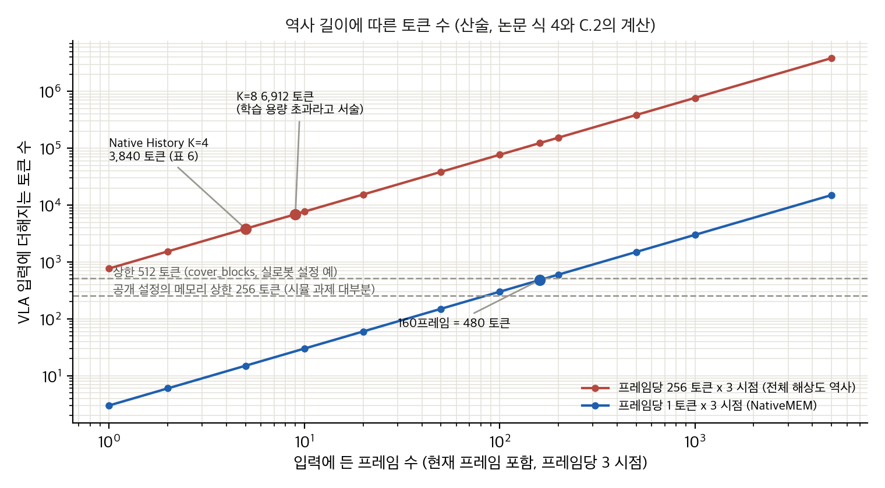
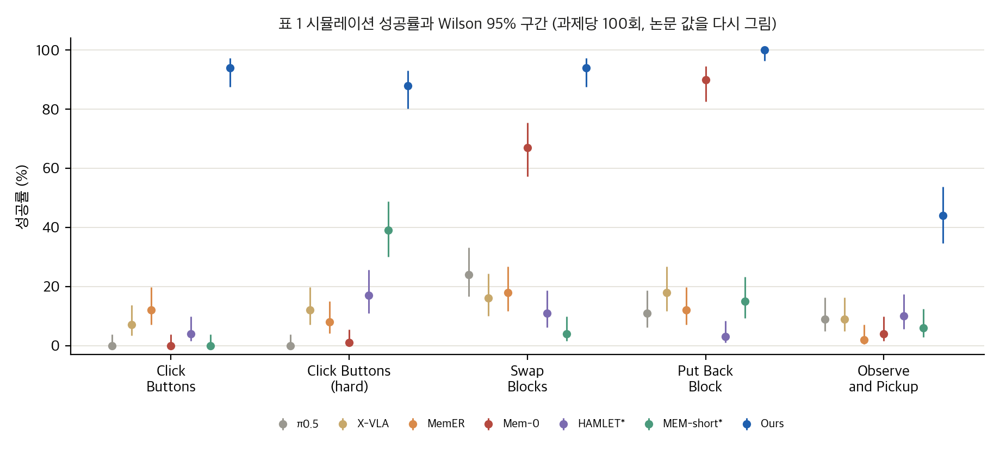
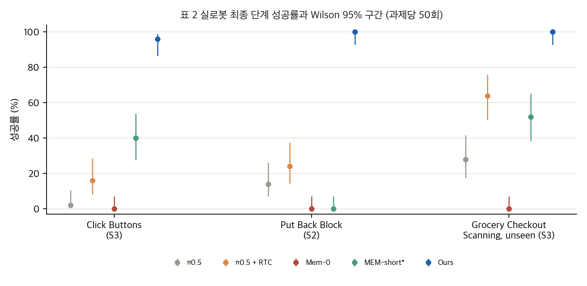
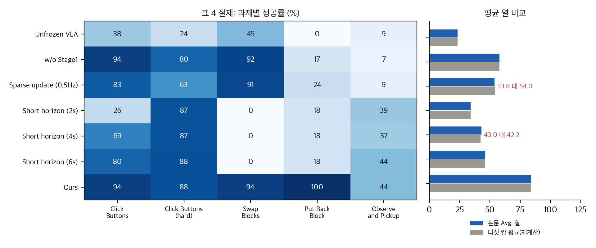
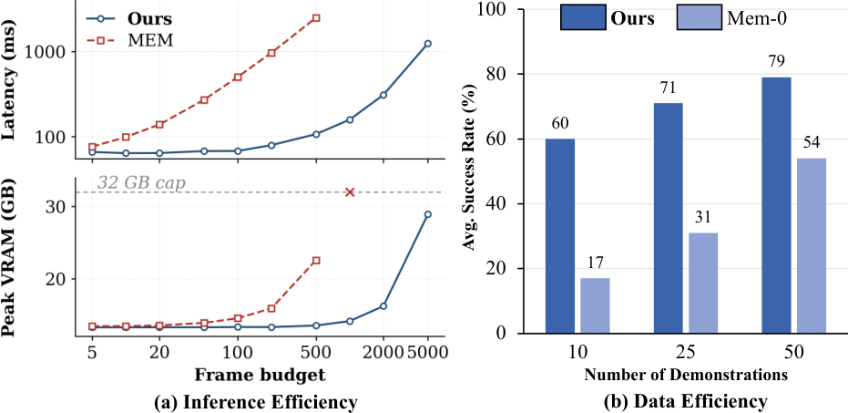

> **논문:** Ziye Wang, Modi Shi, Chaojun Ni, Jiazhi Yang, Mengdi Li, Zhizhong Su, Tianwei Lin, Hongyang Li. *NativeMEM: Native Memory Compression for Long-Horizon Robotic Manipulation.* CoRL 2026 포스터, arXiv:2607.06678 (v2, 2026-10-16).
> 공식 코드는 GitHub OpenDriveLab/NativeMEM(Apache-2.0)에 있습니다. 이 글의 그림은 논문 그림 한 장(출처 표기)과 우리가 그린 그래프입니다.

## 논문이 묻는 것

사전학습된 VLA는 대개 현재 관측 한두 장만 봅니다. "이미 눌렀는지", "블록을 처음 어디에 두었는지"처럼 과거를 알아야 하는 과제에서는 같은 장면에서도 맞는 행동이 달라집니다(논문 식 2). 기억을 붙이는 방법은 크게 두 갈래입니다. VLM이 요약 노트를 만들어 정책에 넘기거나, 정책 안에 새로 초기화한 기억 모듈을 넣습니다. 앞쪽은 텍스트로 옮기기 어려운 세부를 놓치고, 뒤쪽은 사전학습된 정책과 어긋날 위험이 있다는 것이 저자의 진단입니다.

NativeMEM의 답은 "VLA 자신의 비전 인코더를 복제해 **프레임-시점당 토큰 하나**로 과거를 요약하고, 그 토큰을 원래 입력 시퀀스 끝에 붙인다"입니다. 두 단계로 학습합니다. Stage 1에서는 π0.5를 얼리고, 복제한 SigLIP 인코더, 학습 가능한 질의 토큰, 선형 투영만 π0.5의 원래 행동 손실로 학습합니다(식 5–9). Stage 2에서는 과제 시연의 모든 프레임에 대해 이 토큰을 미리 계산해 저장하고, VLA 전체를 미세조정하면서 선택한 과거 프레임의 토큰을 입력에 붙입니다(식 10). 토큰 수가 프레임 수에 선형이라(식 4) 3시점에서 160프레임이 480토큰입니다.

*그래프 (우리가 그림). 논문 식 4와 부록 C.2의 산술입니다. 프레임당 256토큰 3시점이면 5프레임에서 3,840토큰이고, NativeMEM은 프레임당 1토큰 3시점이라 같은 프레임 수에서 256분의 1입니다. 점선은 공개 코드의 기억 토큰 상한(256, 512)입니다.*

## 이 글에서 확인한 것

**1. 기준선 대비 차이는 크게 확인됩니다.** 시뮬 평균 84.0%는 Mem-0의 32.4%보다 높습니다(합산 500회 대 500회, Fisher p = 2e-64). 5개 과제 모두에서 최고이고, 가장 가까운 칸인 Put Back Block도 100 대 90입니다(p = 0.0015). 실로봇은 3개 과제 평균 98.7%(148/150)이고 π0.5 + RTC는 34.7%(52/150)입니다(p = 4e-37). 표의 평균 열은 모두 다시 계산한 값과 일치합니다.

*그래프 (우리가 그림). 표 1의 성공률과 Wilson 95% 구간입니다(과제당 100회, 논문 값을 다시 그림). 별표(\*)는 저자가 π0.5 위에 다시 구현한 기준선입니다.*

가장 약한 칸은 Observe and Pickup 44%입니다. 평균 84.0은 과제별 편차(44에서 100)를 가립니다. 부록 C.5의 Press Button은 5%로, 기억만으로는 기반 VLA에 없는 능력이 생기지 않는다고 저자도 적었습니다.

**2. 실로봇 비교는 기준선의 첫 단계 성공률을 같이 봐야 합니다.** 표 2의 성공률은 단계별 누적입니다. MEM-short\*와 Mem-0는 Put Back Block의 첫 단계에서 이미 6%, 0%이고 π0.5는 72%입니다. 뒤 단계의 실패에 기억 부족과 조작 능력 저하가 섞여 있고, 본문도 MEM-short\*가 제한된 데이터에서 조작 능력을 떨어뜨리기도 한다고 서술합니다. Mem-0는 시뮬에서 Swap Blocks 67%, Put Back Block 90%이고 실로봇에서는 세 과제 모두 0%인데, 이 차이의 원인은 본문에 없습니다.

*그래프 (우리가 그림). 표 2의 최종 단계 성공률과 Wilson 95% 구간입니다(과제당 50회).*

**3. 행동 지도 압축 학습(Stage 1)의 효과는 두 과제에서만 구분됩니다.** 절제 표(표 4)에서 Stage 1을 건너뛰고 평균 풀링 특징을 쓰면 Click Buttons 94, Swap Blocks 92로 전체 모델(94, 94)과 구분되지 않습니다. Put Back Block 17, Observe and Pickup 7에서만 크게 낮습니다. 본문 설명("거친 이력은 담지만 세부를 보존하지 못한다")과 맞고, 효과가 "긴 이력의 세부를 되살려야 하는 과제"에서 나타난다는 쪽으로 읽힙니다. Stage 1에서 VLA를 풀면 모든 칸에서 크게 떨어집니다(평균 23.2%).

*그래프 (우리가 그림). 왼쪽은 표 4의 칸 값, 오른쪽은 논문의 Avg. 열과 다섯 칸 평균(재계산)입니다. Sparse update(0.5 Hz)는 53.8 대 54.0, Short horizon(4 s)은 43.0 대 42.2로 값이 다릅니다. 표시된 칸과 평균 열 중 어느 쪽에 차이가 있는지는 저자 확인이 필요합니다.*

창 길이 절제에서는 Click Buttons (Hard)와 Observe and Pickup이 2–6초 창에서도 전체 모델과 구분되지 않습니다(87–88, 37–44). Swap Blocks는 6초 창에서도 0%입니다. 필요한 최소 길이는 6초 이상이라는 것까지만 읽을 수 있고, 6초를 넘는 중간 설정은 표에 없습니다.

**4. 분 단위 이력의 성공률은 표에 없습니다.** 초록과 그림 1의 "160프레임 이상, 분 단위"는 30 Hz, 10스텝 간격이면 약 53초입니다. 공개 코드는 기억 토큰 수를 상한(기본 256, 일부 과제와 실로봇 설정 512)에 맞춰 패딩하거나 자릅니다. 3시점이면 256토큰이 85프레임, 512토큰이 170프레임입니다. 시뮬 과제는 단계 한도(250–1,500)와 평가 간격 12에서 최대 21–126프레임이어서 상한 안에 들어갑니다. 그림 4(a)의 5,000프레임(약 28분)은 지연과 메모리 측정이고 성공률은 보고되지 않았습니다. 상한을 넘으면 코드는 앞쪽, 곧 에피소드 첫 프레임부터 자릅니다.

*그림 4 (논문 원문). (a) 프레임 예산별 지연과 최대 VRAM, (b) 시연 수별 평균 성공률입니다. © 저자, CC BY 4.0, 출처 arXiv:2607.06678.*

그림 4(b)의 "학습 데이터 20%로 대등"은 시연 10개의 NativeMEM(60%)과 시연 50개의 Mem-0(54%)의 비교입니다. 막대당 시행 수를 300(3과제 x 100회)으로 가정하면 두 값은 구분되지 않아(Fisher p = 0.16) "대등"이라는 서술과 맞고, 같은 시연 수에서는 NativeMEM이 모든 점에서 높습니다. 다만 이 비교는 목표 과제 시연 수만 맞춘 것입니다. NativeMEM은 Stage 1에서 약 4,000 궤적을 따로 쓰는데, 시뮬 평가 과제의 시연이 여기에 포함됐는지 본문에는 적혀 있지 않습니다(실로봇 Grocery Checkout Scanning만 "Stage 1에서 보지 않음"으로 표시).

**5. LIBERO에서 평균은 π0.5와 비슷하고 Spatial은 낮습니다.** 표 3의 평균은 93.4(π0.5), 93.9, 94.0이고 차이는 구분되지 않습니다. 시행 수가 본문에 없어 스위트당 500회로 가정하면(표의 소수 첫째 자리가 모두 0.2 단위라 이 가정과 맞습니다) Spatial은 NativeMEM128이 3.4%p, NativeMEM512가 2.6%p 낮고 p = 0.008, 0.037입니다.

**6. 절제와 기준선의 조건.** 전체 해상도 과거 4프레임을 붙인 Native History(표 6)는 9/18/20%로 NativeMEM(94/100/44%)에 크게 못 미칩니다. 이 대조는 토큰 수(3,840 대 480), 시간 폭, 간격이 함께 다르므로 "압축이 필수"를 따로 가르지는 못합니다. HAMLET\*와 MEM-short\*는 저자가 같은 시연 수로 다시 구현한 것이고, 기억 기준선이 기반 정책 π0.5보다 낮은 칸이 있습니다(Swap Blocks).

## 공식 코드와 논문의 차이

공개 저장소의 구조는 논문과 맞습니다. 행동 손실만 쓰고, Stage 1에서 VLA를 얼리고(학습 가능한 묶음은 인코더, 투영, BOS 토큰), 프레임·시점당 토큰 하나를 만들어 캐시한 뒤 미세조정합니다. 다만 본문에 없거나 값이 다른 설정이 있습니다.

- **Stage 1 배치:** 이름 있는 설정은 64이고 논문은 16입니다. 4 GPU × 16이면 같은 설정일 수 있습니다.
- **Stage 1 창:** 첫 프레임 + 7개 + 현재 프레임이고 간격은 프레임마다 고정 시드로 뽑습니다. 창 폭은 최대 약 112스텝입니다. 논문 서술은 첫 프레임과 최근 8프레임입니다.
- **위치 번호:** Stage 1은 경과 시간에 비례한 위치 번호, Stage 2와 추론은 연속 번호를 씁니다. 논문에 서술이 없습니다.
- **기억 간격:** 평가 저장소의 기본값은 12(학습은 8–16 난수)이고 논문 본문은 10 제어 스텝입니다.
- **RTC:** 공개 코드에 학습 시 행동 조건화(RTC) 변형이 있고 공개 설정은 끕니다. 표 2에 π0.5 + RTC 기준선이 있는데 NativeMEM 실로봇 정책의 RTC 사용 여부는 본문으로 확인되지 않습니다.
- **공개 범위:** 학습 설정은 시뮬 ALOHA 하나이고 체크포인트는 시뮬 5개 과제입니다. 실로봇, LIBERO, 기준선, 절제 변형 코드는 없습니다.

## 이 읽기에서 열려 있는 것

- 160프레임을 넘는 입력에서의 성공률, 입력 상한을 넘을 때 첫 프레임을 잃는 영향.
- 프레임당 토큰 수(M = 1)를 바꾼 절제.
- Stage 1 데이터에서 평가 과제의 비중과 기준선 학습 조건.
- 표 4 평균 열 두 줄과 칸 값 사이의 차이, LIBERO 시행 수.

수치 재계산, 검정, 코드 대조 스크립트와 분석 문서 전체는 함께 올린 저장소에 있습니다.

## 자료

- [통합 리포트 PDF](report/report_public.pdf)
- [01. 논문 분석: NativeMEM (arXiv:2607.06678)](analysis/01_paper_analysis.md)
- [02. 선행연구와 관련 저장소](analysis/02_prior_work.md)
- [03. 수치 재계산과 일관성 검사](analysis/03_analysis.md)
- [04. 공식 코드 대조와 구현 가능성](analysis/04_code_verification.md)
