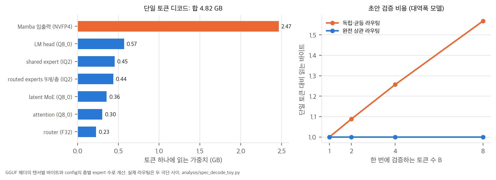
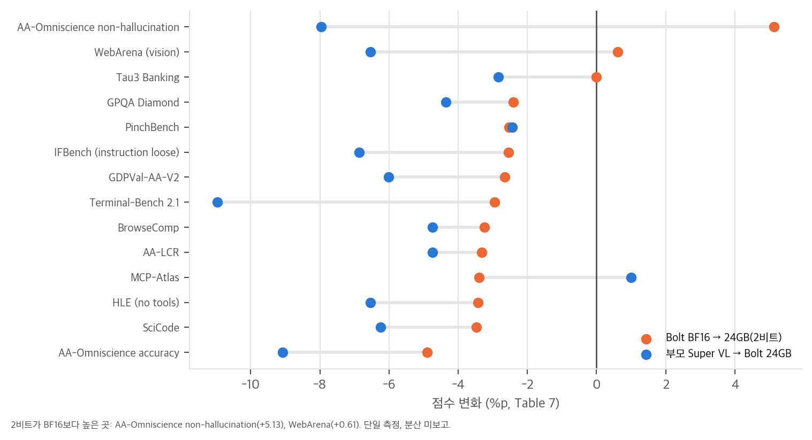
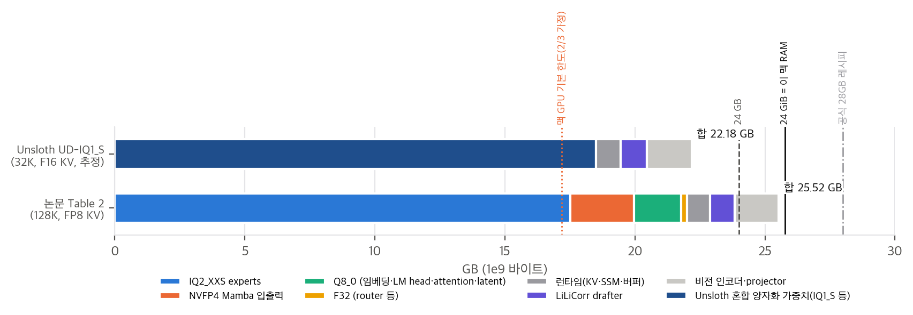

# 03. 파라미터·메모리 산술, 디코드 대역폭, 초안 검증 비용

계산 스크립트는 네 개입니다. 모두 CPU에서 몇 초 안에 끝나고, 가중치는 받지 않습니다.
- `analysis/gguf_header_check.py` → `gguf_header_results.json`: 공개 GGUF의 헤더만 HTTP Range로 받아 텐서별 형식·바이트를 집계합니다.
- `analysis/config_check.py` → `config_check_results.json`: `config.json`의 층별 블록 설정으로 파라미터, 상태 메모리, 이 맥의 메모리 여유를 계산합니다.
- `analysis/spec_decode_toy.py` → `spec_decode_results.json`: 디코드와 초안 검증의 대역폭 모델입니다.
- `analysis/table_check.py` → `table_check_results.json`: 표·본문 수치를 재계산합니다.

## 1. 파라미터와 메모리는 공개 파일과 정확히 맞는다

### 1.1 전체·활성 파라미터
config(`NemotronHPuzzle`)의 88개 블록(Mamba 40, MoE 40, attention 8)을 그대로 세면 다음과 같습니다. 근거는 Table 1과 `config_check.py`입니다.

| 구성 요소 | 식 (층 하나) | 전체 | 토큰당 활성 |
|---|---|---|---|
| routed experts | E_l × 2 × 1024 × I_l (relu², gate 없음) | 66.14B | 9/E_l만 → 1.71B |
| Mamba 입출력 | 4096 × 18560 + 8192 × 4096 | 4.38B | 4.38B |
| shared expert | 2 × 4096 × 5376 | 1.76B | 1.76B |
| 임베딩 / LM head | 131072 × 4096 (묶지 않음) | 0.54B + 0.54B | 0 + 0.54B |
| latent MoE | 2 × 4096 × 1024 | 0.34B | 0.34B |
| attention | 4096×4096×2 + 4096×256×2 | 0.29B | 0.29B |
| router 등 | 4096 × E_l | 0.06B | 0.06B |
| **합** | | **74.043B** | **9.06B** (LM head 빼면 8.52B) |

- GGUF 헤더의 `total` 74,042,720,848과 공식 계산의 차이는 4,176개(정규화 벡터 몇 개)입니다. "74B-A9B"는 정확합니다.
- 같은 식에 부모 설정(E = 512, I = 2688, top-22)을 넣으면 120.67B 전체, 12.23B 활성이 나와 "120B-A12B"와도 맞습니다.
- 압축으로 routed expert 파라미터는 부모의 58.7%만 남았고, 토큰당 활성 routed 파라미터는 35.0%로 줄었습니다. top-K 22 → 9의 효과가 큽니다.

### 1.2 Table 2를 GGUF 헤더로 대조
공개 GGUF(22,018,326,528바이트)의 텐서 843개를 형식별로 묶으면 Table 2와 구성 요소마다 0.01 GB 안에서 일치합니다.

| 구성 요소 | Table 2 | GGUF 실측 | 형식(ggml type) |
|---|---|---|---|
| routed experts | 17.05 | 17.053 | IQ2_XXS(16), 80 텐서 |
| Mamba 입출력 | 2.47 | 2.466 | **type 40 = NVFP4**, 4.5 bpw |
| 임베딩, LM head | 0.57 + 0.57 | 0.570 + 0.570 | Q8_0 |
| shared / latent / attention | 0.45 / 0.36 / 0.30 | 0.454 / 0.357 / 0.303 | IQ2_XXS / Q8_0 / Q8_0 |
| router / conv | 0.23 / 0.01 | 0.227 / 0.008 | F32 |
| **가중치 합** | **22.01** | **22.010** | |

비전 mmproj GGUF는 0.842B 파라미터(BF16 + F32), 1.734 GB로, Table 2의 1.68 GB보다 0.05 GB 큽니다.

### 1.3 런타임 상태
- **KV 캐시:** attention 8층 × K·V × KV 헤드 2 × 128차원 = 토큰당 4,096 원소입니다. FP8이면 128K에서 0.537 GB(Table 2의 0.54), llama.cpp 기본인 F16이면 1.07 GB입니다.
- **SSM 상태:** 40층 × (128 헤드 × 64 × 상태 128 + conv 상태 10,240 × 3)입니다. BF16이면 0.086 GB(Table 2의 0.08)입니다. 그런데 config의 `mamba_ssm_cache_dtype`은 `float32`이고, 이때는 0.17 GB입니다.
- Mamba 층 덕분에 문맥이 길어져도 상태가 거의 늘지 않습니다. 256K에서도 KV(F16)가 2.15 GB입니다. **메모리 한계는 문맥이 아니라 가중치가 정합니다.**

## 2. 디코드 대역폭의 절반은 Mamba 입출력이다

배치 1 디코드는 메모리 대역폭에 묶입니다. 토큰 하나를 만들 때 읽는 가중치를 GGUF 바이트와 층별 expert 수로 계산하면 다음과 같습니다(`spec_decode_toy.py`).

| 읽는 것 | GB | 비중 |
|---|---|---|
| Mamba 입출력 (NVFP4) | 2.47 | 51% |
| LM head (Q8_0) | 0.57 | 12% |
| shared expert (IQ2) | 0.45 | 9% |
| **routed experts, 층마다 9개 (IQ2)** | **0.44** | **9%** |
| latent MoE, attention, router | 0.89 | 18% |
| 합 | 4.82 | |

해석:
- **2비트 expert가 줄이는 것은 주로 용량입니다.** routed expert는 저장 용량의 77%(17.05 / 22.01)를 차지하지만, 토큰당 읽는 양은 9%뿐입니다. 2비트 양자화는 "24 GB 안에 넣기"에 결정적이지만, 속도에는 적게 기여합니다.
- **속도를 좌우하는 것은 Mamba 입출력의 4.5비트입니다.** 이 텐서들까지 2.0625비트로 내리면 토큰당 바이트가 약 28%(2.47 × (1 − 2.0625/4.5) = 1.34 GB) 줄어드는 계산이지만, 논문은 Mamba를 NVFP4에 둔 이유와 그 대가를 설명하지 않습니다.
- 대역폭 273 GB/s(DGX Spark와 M4 Pro의 공칭값으로 알고 있는 값, 확인 필요)를 넣으면, 초안 없이 토큰당 약 57 TPS가 상한입니다. 보고된 84 TPS는 초안 디코딩으로 이 상한을 넘은 값입니다.

## 3. 초안 블록 검증 비용은 라우팅에 달려 있다

Sec. 6은 "저동시성에서는 가중치 읽기가 병목이라, 초안 블록 검증 비용이 토큰 하나 생성과 거의 같다"고 씁니다. dense 모델이면 맞는 말입니다. MoE에서는 블록의 토큰마다 다른 expert를 고르면 층마다 그 **합집합**을 읽어야 합니다.

토큰 B개가 각자 E_l개 중 9개를 고를 때 기대 고유 expert 수는 E_l(1 − (1 − 9/E_l)^B)입니다(독립·균등 라우팅 가정).

| B | 독립·균등: 평균 고유 expert | 읽는 바이트 (단일 대비) | 완전 상관 |
|---|---|---|---|
| 1 | 9 | 1.00 | 1.00 |
| 2 | 17.8 | 1.09 | 1.00 |
| 4 | 34.5 | 1.26 | 1.00 |
| 8 | 65.4 | **1.57** | 1.00 |

- routed expert가 토큰당 바이트의 9%뿐이라, 최악의 경우에도 8토큰 검증은 1.57배에 그칩니다. 그래서 "거의 같다"는 주장은 이 모델에서는 대체로 맞습니다. **routed expert 비중이 큰 다른 MoE에는 그대로 옮기면 안 됩니다.**
- 대역폭만 보는 속도 향상 상한은 AL × (단일 바이트) / (검증 바이트 + 초안 0.96 GB)입니다. AL 4.18(AA AgentPerf) 기준으로 2.36배(독립)~3.49배(상관)입니다. 실제 라우팅 상관은 공개되지 않아 두 극단만 제시합니다.

## 4. 2비트의 비용 (Table 7)

- BF16 → 2비트: 14개 중 11개에서 −2.4 ~ −4.9점, 평균 −2.08점(53.17 → 51.09)입니다.
- 부모 → 2비트: 평균 −5.59점(56.68 → 51.09, 9.9%)이고, Terminal-Bench가 −10.96으로 가장 큽니다. 압축(−3.51)이 양자화(−2.08)보다 큰 손실입니다.
- AA-Omniscience non-hallucination은 BF16 56.14 → 2비트 61.27로 오히려 오릅니다. 같은 지표의 accuracy는 21.80 → 16.90으로 떨어지므로, "모르면 답하지 않는" 쪽으로 성향이 바뀐 것으로 읽힙니다(가설).

## 5. 메모리 예산 그림

- Table 2의 23.83 GB는 텍스트 전용이고, 비전을 넣으면 25.52 GB입니다. "24 GB"는 1e9 단위 기준이고, 24 GiB(= 25.77 GB) 기준이라면 비전까지 들어가지만 여유는 0.25 GB입니다.
- 모델 카드의 공식 레시피는 28 GB(65K, q8_0 KV)와 32 GB(256K)입니다. 배치 버퍼(batch 2048–4096), 비전, 초안을 모두 포함한 현실적 크기입니다.
