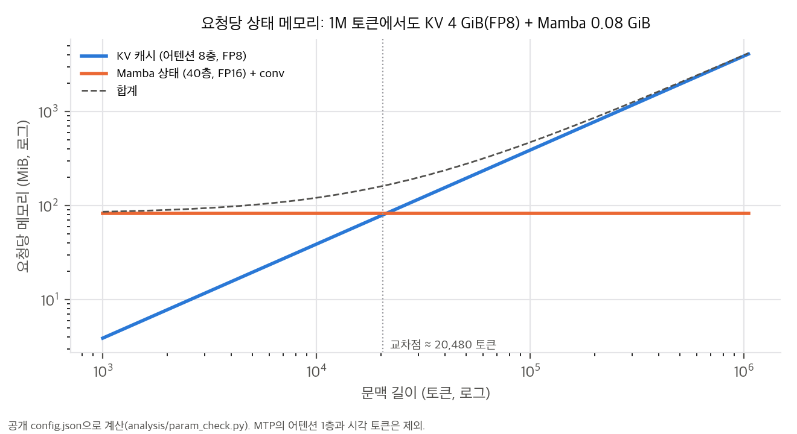
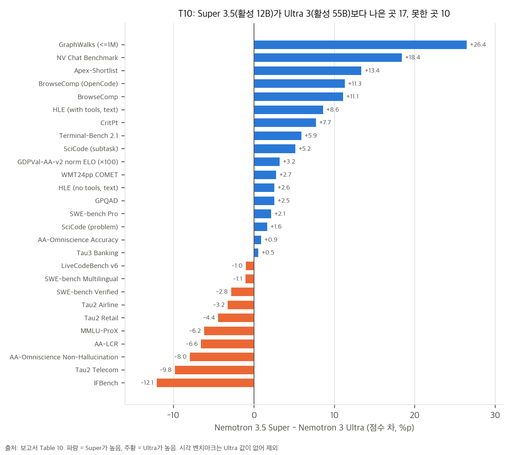
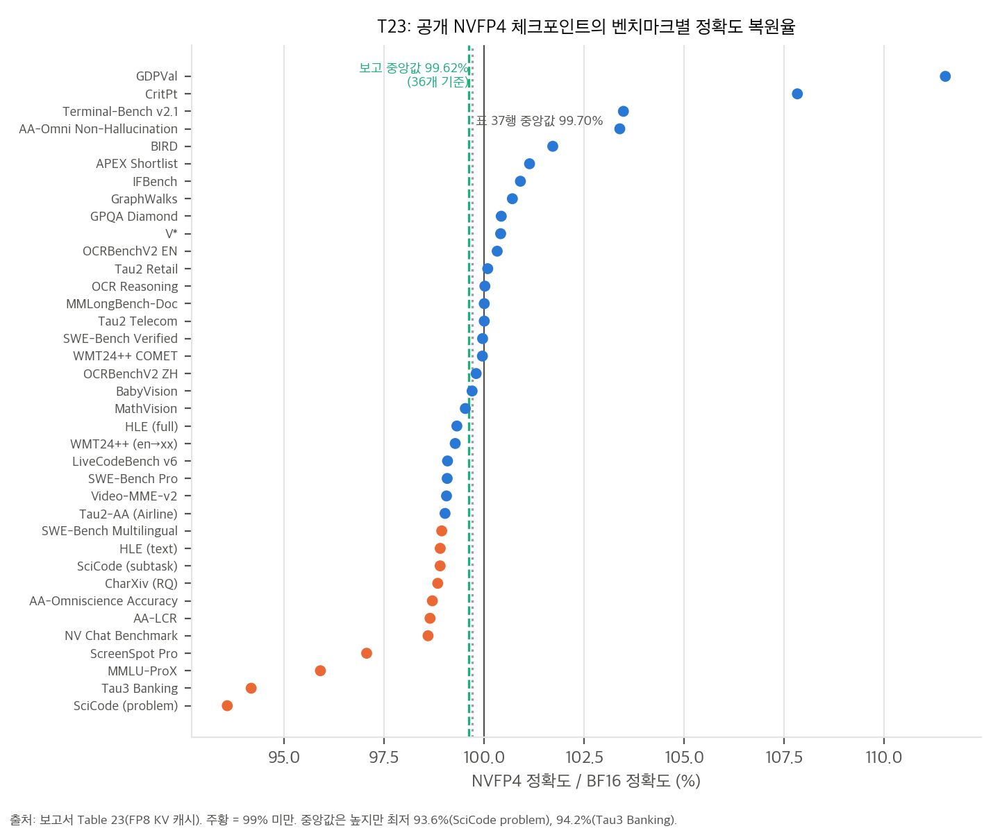
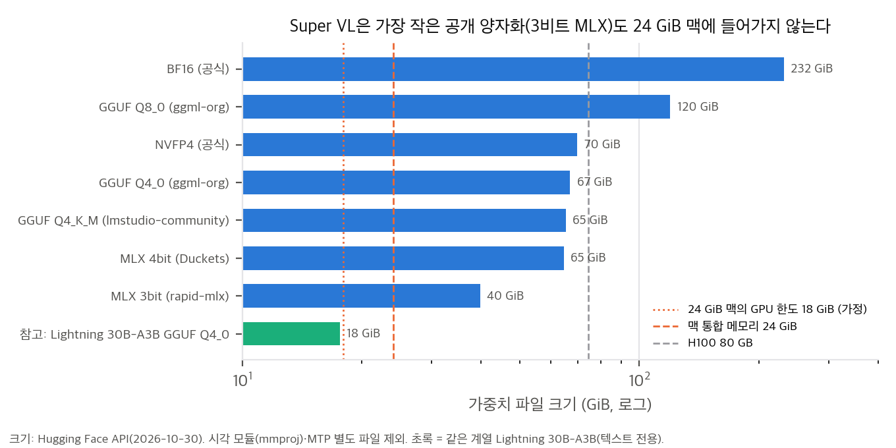

# 03. 수치 해부와 메커니즘 확인

모든 계산은 CPU, 단일 스레드 numpy로 했습니다. 구조 수치는 `analysis/param_check.py`(공개 config와 safetensors 헤더), 표 수치는 `analysis/table_check.py`, 메커니즘 toy는 `analysis/mechanism_toy.py`에서 나옵니다. 가중치는 받지 않았습니다.

## 1. "120B-A12B"의 해부

### 1.1 전체와 활성

| 구분 | 파라미터 | 비고 |
|---|---|---|
| 전체 | **124.45B** | 보고서 BPE 식의 N = 124.453B와 일치 (§4.1) |
| LLM (MTP·시각 제외) | 120.67B | 이름의 "120B" |
| MTP / 시각 / projector | 2.94B / 0.65B / 0.19B | |
| routed expert | 112.74B (전체의 90.6%) | 40층 × 512개 × (1024 × 2688 × 2) |
| **토큰당 활성 (임베딩 제외)** | **12.23B** | 이름의 "A12B". 임베딩 포함 12.77B |

활성 12.23B를 모듈별로 나누면 다음과 같습니다.

| 모듈 | 활성 (B) | 비율 | 공개 NVFP4 레시피의 정밀도 |
|---|---|---|---|
| routed expert (top-22) | 4.84 | 39.6% | NVFP4 |
| **Mamba in/out projection** | **4.38** | **35.8%** | FP8 |
| shared expert | 1.76 | 14.4% | NVFP4 |
| lm_head | 0.54 | 4.4% | FP8 |
| latent projection + 라우터 | 0.42 | 3.4% | BF16 |
| attention QKVO | 0.29 | 2.3% | FP8 |

**해석.** 전체 파라미터의 90%가 routed expert지만, 토큰 하나가 실제로 지나가는 가중치에서는 **Mamba projection이 routed expert만큼 큽니다.** attention은 2%에 불과합니다. NVFP4가 적용되는 부분(expert)은 활성 가중치의 54%뿐이고, 나머지 43%는 FP8입니다. 그래서 FP8 Mamba projection의 정밀도와 커널 성능이 decode 속도에 크게 작용합니다. 보고서가 Mamba out_proj의 FP4 민감도를 따로 분석한 이유(§4.6, 부록 B.4)와도 맞습니다.

### 1.2 배치 1 decode의 대역폭 상한

배치 1에서는 토큰마다 활성 가중치를 한 번씩 읽어야 합니다. 공개 레시피(expert 4.5비트, FP8 3종, BF16 latent)로 계산하면 **토큰당 9.76 GB**입니다. 메모리 대역폭이 273 GB/s인 DGX Spark(이 맥의 M4 Pro도 같은 273 GB/s)에서는 투기적 디코딩 없이 **최대 약 28 tok/s**입니다. 사용자당 50 tok/s 목표에 못 미칩니다. NVFP4 모델 카드가 DGX Spark에 LiLiCorr drafter(7토큰)를 "모든 경우에" 권하는 이유가 이 계산으로 설명됩니다. KV·상태 읽기를 빼고 계산했으므로 실제 값은 더 낮습니다.

## 2. 요청당 상태 메모리: KV는 늘고 Mamba 상태는 고정

우리 분석: 공개 config로 계산한 요청당 메모리. KV(attention 8층, FP8)는 문맥에 비례하고, Mamba 상태(40층, FP16)는 고정이다.

| 항목 | 값 | 계산 |
|---|---|---|
| KV / 토큰 | BF16 8,192 B, **FP8 4,096 B**, NVFP4 2,304 B | 8층 × (K, V) × KV 헤드 2 × 128 |
| 1M 토큰 KV | FP8 **4.0 GiB**, NVFP4 2.25 GiB | |
| Mamba SSM 상태 / 요청 | FP32 160 MiB, **FP16 80 MiB** | 40층 × 128헤드 × 64 × 128 |
| conv 상태 / 요청 | 2.34 MiB | |
| 교차점 | **20,480 토큰** | FP16 상태 = FP8 KV가 되는 문맥 길이 |
| Mamba 캐시 한 페이지 | **4,096 토큰분 KV** | 한 층 상태 2 MiB ÷ 한 층 KV 512 B/토큰. 보고서 "약 4K"(§5.3)와 일치 |

**해석.**
- KV 헤드가 2개뿐이고 attention이 8층뿐이라, 1M 토큰에서도 KV가 4 GiB입니다. 51K prefix + 20턴(약 112K 토큰) 부하에서 KV는 요청당 약 0.44 GiB이고, Mamba 상태 80 MiB와 같은 자릿수입니다. 보고서가 Qwen3.5·Qwen3.8보다 처리량이 높은 이유로 든 "요청당 메모리가 느리게 증가"(§5.2)의 구체적 크기가 이 정도입니다.
- 반대로 문맥이 2만 토큰보다 짧으면 **Mamba 상태가 KV보다 큽니다.** 짧은 요청이 많은 서빙에서는 상태 메모리가 동시 처리 수를 제한합니다. FP16 + stochastic rounding으로 상태를 반으로 줄인 것(T12)이 이 영역에서 의미가 있습니다.
- prefix caching이 Mamba 상태를 4,096 토큰 간격으로만 저장하는 이유도 바이트 맞춤에서 바로 나옵니다. 투기적 디코딩과 함께 쓰면 최악의 경우 4K 토큰을 다시 계산하므로, 보고서가 경계 근처에 체크포인트를 하나 더 두는 수정을 했습니다(§5.3).

## 3. ReplaySSM: 닫힌 식, 트래픽, 양자화 오차 (§5.4)

### 3.1 닫힌 식의 지수

보고서는 decode 갱신을 S_new = α S_old + kᵀv로 적고, 체크포인트에서 재구성하는 식을 `S = (∏ α_i) S_ckpt + Σ_i (∏_{j>i+1} α_j) k_iᵀ v_i`로 적었습니다(47쪽). 같은 문단의 갱신식을 펼치면 i번째 입력은 그 뒤의 감쇠 α_{i+1}, …, α_n을 모두 받으므로 곱의 범위는 **j > i**여야 합니다. numpy로 16토큰을 펼쳐 보면 다음과 같습니다.

| 곱의 범위 | 순차 갱신 대비 상대 오차 |
|---|---|
| ∏_{j>i} | 3.3 × 10⁻¹⁶ (정확) |
| ∏_{j>i+1} (본문 표기) | 4.7 × 10⁻³ |

감쇠가 1에 가까워 오차는 작지만, 본문 표기는 지수가 하나 어긋난 것으로 보입니다. 다른 색인 규약(α_i를 i번째 입력 전에 적용)을 썼을 가능성도 있지만 본문에 그런 정의는 없습니다(`04` D10).

### 3.2 상태 트래픽

공개 config 크기로 decode 한 단계, 요청 하나, Mamba 층 하나의 상태 관련 트래픽을 셌습니다. 상태는 1,048,576원소이고, 버퍼에 넣는 입력(x, B, dt)은 토큰당 9,344원소(상태의 0.89%)입니다. 버퍼 길이 L = 16(T24 설정)을 썼습니다.

| draft 길이 T | 기존 (상태 단위) | ReplaySSM | 감소 |
|---|---|---|---|
| 1 | 2.00 | 1.14 | 1.75배 |
| 3 | 4.00 | 1.16 | 3.45배 |
| 5 (T24) | 6.00 | 1.18 | **5.09배** |
| 7 | 8.00 | 1.20 | 6.69배 |

상태 트래픽은 MTP 5에서 약 5배 줄지만, 측정된 처리량 이득은 4.7–6.4%입니다(T24). 이 차이는 해당 운영점에서 decode 시간의 대부분이 가중치·KV 읽기와 expert 통신이고, Mamba 상태 쓰기는 작은 몫이라는 뜻으로 읽힙니다. 사용자당 속도 이득(최대 12.5%)이 더 큰 것은 메모리가 남아 배치와 draft 길이를 더 키울 수 있었기 때문일 가능성이 있습니다(보고서의 "enables larger batch sizes"). 둘 다 추정이며, 보고서는 단계 시간을 분해해 보여 주지 않습니다.

### 3.3 FP16 상태의 반올림 오차

상태를 FP16으로 저장할 때 매 토큰 반올림하는 경우와, ReplaySSM처럼 L = 16 토큰마다 한 번만 반올림하는 경우를 비교했습니다. 헤드 4개, 4,096토큰, iid 가우시안 입력, FP64 기준입니다.

| 상태 저장 | 출력 상대 오차, 빠른 헤드 (−log α ∈ [0.01, 0.05]) | 느린 헤드 (−log α ∈ [2e-5, 2e-4]) |
|---|---|---|
| FP16 RN, 매 토큰 | 8.4 × 10⁻⁴ | 6.1 × 10⁻³ |
| FP16 SR, 매 토큰 | 1.19 × 10⁻³ | 8.5 × 10⁻³ |
| ReplaySSM L = 16 + RN | **2.1 × 10⁻⁴** | **1.5 × 10⁻³** |
| ReplaySSM L = 16 + SR | 2.9 × 10⁻⁴ | 2.1 × 10⁻³ |

- **"덜 자주 양자화해서 오차를 줄인다"는 주장은 toy에서 성립합니다.** 오차가 3.5–4배 줄었고, 반올림 횟수가 1/16이 되면 랜덤워크 오차가 √16 = 4배 줄어드는 것과 맞습니다.
- **stochastic rounding(SR)의 이점은 이 toy에서 보이지 않습니다.** iid 입력에서는 SR이 RN보다 오차가 약 1.4배 큽니다. SR의 장점(작은 갱신이 반올림에 묻히는 stagnation 방지, 기댓값 비편향)은 갱신이 반 ulp보다 작은 경우에만 드러납니다. 보고서는 FP16+SR을 채택했지만, RN과 직접 비교한 결과는 이 보고서에 없습니다. 근거는 선행 보고서(Super 3, Ultra 3)에 있을 수 있으나 확인하지 않았습니다.

## 4. MOPD advantage의 성질 (§3.6, Eq. 1–2)

1. **reverse KL의 토큰 분해.** 학생 샘플 y ~ π_S에서 Â = log π_T(y) − log π_S(y)의 기댓값은 −D_KL(π_S ‖ π_T)입니다. 학생이 교사보다 확률을 과하게 준 토큰은 음의 신호, 덜 준 토큰은 양의 신호를 받습니다. 교사가 낮게 보는 영역을 학생이 피하게 만드는 mode-seeking 성질이라, 여러 교사의 서로 다른 모드를 평균해 흐리게 만드는 위험이 forward KL보다 작습니다.
2. **proximal teacher의 하한.** 교사를 α π_T + (1−α) π̄_S로 바꾸면 Â = log(α π_T/π̄_S + 1 − α) ≥ log(1−α)입니다. α = 0.2에서 log 0.8 = −0.2231입니다. 어휘 4,096, Dirichlet 분포 200쌍으로 확인한 최솟값은 −0.22314로 하한과 같았습니다. 같은 toy에서 KL(π_S ‖ π_T)의 중앙값 8.8이 KL(π_S ‖ mix)에서는 0.17로 줄었습니다. 2단계는 **신호를 크게 줄인 trust-region식 갱신**이고, 1단계에서 이미 교사를 흡수한 학생이 다시 크게 흔들리지 않게 하려는 장치로 읽힙니다.
3. **self-anchor는 KL 정규화입니다.** 교사가 없는 환경의 프롬프트를 학생 시작점 복사본으로 보내면, 그 도메인에서는 D(π_S ‖ π_start)를 줄이는 신호만 생깁니다. 2단계에서 에이전트·추론 교사를 은퇴시키고 그 환경을 self-anchor로 돌린 것(§3.6)은 "이미 배운 능력을 잊지 않게 묶어 두기"입니다.

## 5. 벤치마크 주장 다시 읽기

우리 분석: T10의 27개 공통 벤치마크에서 Super 3.5 − Ultra 3 점수 차.

- **"Ultra를 넘는다"의 범위.** 활성 12B 모델이 활성 55B 모델을 27개 중 17개에서 앞서는 것은 분명한 성과입니다. 그러나 Ultra가 크게 앞서는 곳(IFBench −12.1, Tau2 Telecom −9.8, AA-Omniscience 비환각 −8.0, AA-LCR −6.6, MMLU-ProX −6.2)은 지시 따르기, 대화형 도구 사용, 장문맥 이해, 다국어처럼 모델 용량이 필요한 영역입니다. 반대로 크게 앞서는 곳(GraphWalks +26.4, NV Chat +18.4, Apex +13.4, BrowseComp +11)은 3.5에서 새로 넣은 데이터(그래프 구조 장문맥, 정렬 교사, 추론 교사, 검색 에이전트)와 바로 연결됩니다. **용량보다 데이터·교사 설계가 이긴 영역**과 그렇지 않은 영역이 갈립니다.
- **SWE-bench Pro 헤드라인.** 같은 OpenCode 하네스인데 T10은 51.78%, F8은 41.04%입니다. F8의 6개 하네스 평균은 46.54%이고 최고값은 49.45%입니다. NeMo Gym 레시피(고정 커밋 `1e66890`)도 HEAD 조상 밖의 Git 기록을 지우고 부정행위 금지 문구를 넣으므로, "미래 커밋 유출" 같은 단순한 설명은 맞지 않습니다. 차이의 원인은 하네스 프롬프트(Gym 자체 vs 하네스 기본), OpenCode 버전(v1.17.11 vs v1.17.8), 조상 기록 제거 여부, 반복 횟수 중 하나 이상입니다. 보고서는 이 차이를 설명하지 않습니다(`04` C11).

우리 분석: T23의 벤치마크별 NVFP4/BF16 정확도 비율. 보고 중앙값 99.62%는 36개 기준이고, 표의 37행 전체 중앙값은 99.70%다.

- **양자화 복원율은 중앙값보다 꼬리를 봐야 합니다.** 중앙값은 99.6–99.7%이지만 SciCode problem(93.6%), Tau3 Banking(94.2%), MMLU-ProX(95.9%)는 4–6% 떨어집니다. 셋 다 긴 다단계 추론이나 다국어 지식이 필요한 과제이고, 부록 B의 "FP4 expert가 종료 판단을 흔든다"는 분석과 방향이 같습니다. 같은 공개 구성의 복원율이 99.62%(36개, 초록)와 99.52%(35개, §4.5·결론) 두 값으로 나오는 것도 기준 집합 차이입니다.
- **테스트 시간 선택의 이득은 과제마다 다릅니다.** 후보 5개인 Terminal-Bench·DeepSWE는 +9–10%p, 후보 3개인 SWE 3종은 +1–2%p입니다. 후보 수와 과제 분산 중 어느 쪽 효과인지는 분리되지 않았습니다.

## 6. 이 맥에서 돌릴 수 있는가 (요약, 자세한 판단은 `04` §4)

우리 분석: 공개 체크포인트·양자화 파일 크기와 이 맥의 메모리. 가장 작은 공개 양자화(MLX 3비트, 39.8 GiB)도 들어가지 않는다.

- 가중치만 18 GiB(Metal 기본 한도로 가정)에 넣으려면 **파라미터당 1.24비트** 이하가 필요합니다. 공개된 가장 작은 양자화는 MLX 3비트 39.8 GiB입니다. Super VL은 이 맥에서 어떤 공개 형식으로도 돌릴 수 없습니다.
- 같은 세대의 Lightning 30B-A3B(텍스트 전용)는 GGUF Q4_0 17.6 GiB라 한도에 겨우 들어갑니다. 문맥과 KV를 넣을 여유는 거의 없습니다.
