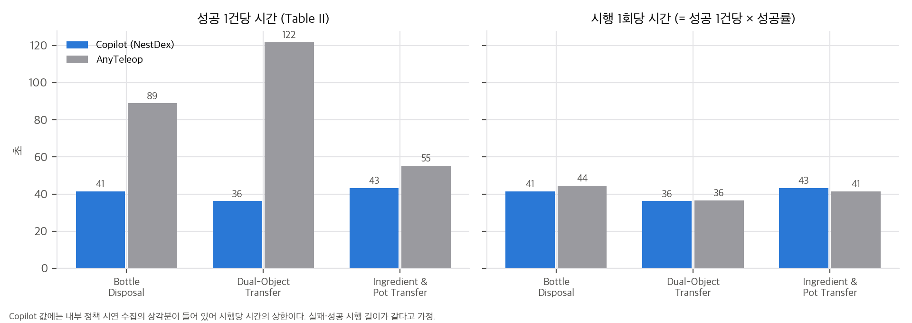
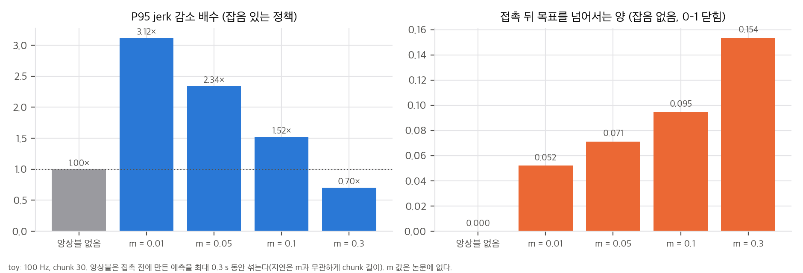
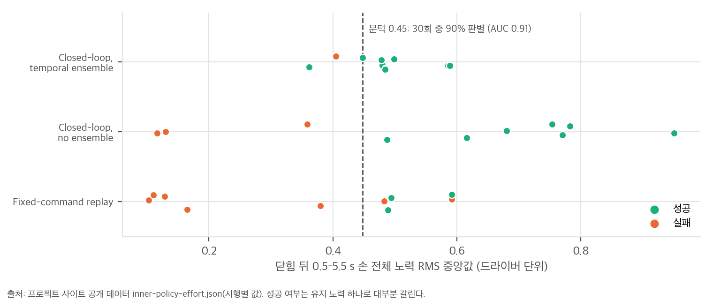
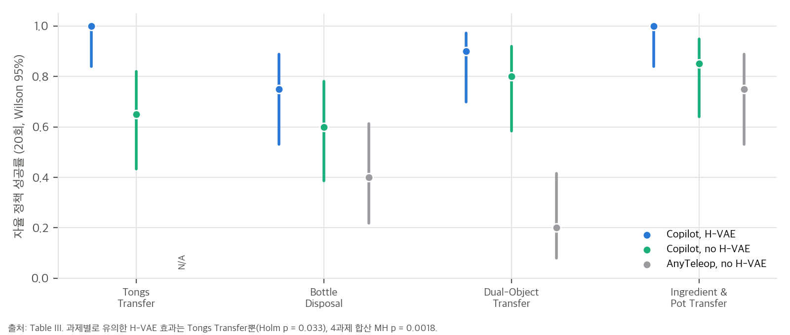

# 03. 핵심 식 해석과 재계산

스크립트는 `analysis/table_check.py`(표·공개 데이터·학습 규모, 결과 `table_check_results.json`)와 `analysis/ensemble_toy.py`(Eq. 2 toy, 결과 `ensemble_toy_results.json`)입니다. 둘 다 numpy 단일 스레드로 몇 초 안에 끝납니다.

## 1. "성공 1건당 시간"을 시행 1회당 시간으로 나누면 (Table II)

성공 1건당 시간 = 전체 시행 시간 / 성공 수이므로, 성공률 ρ를 곱하면 시행 1회당 평균 시간이 됩니다.

```
t_attempt = t_per_success × ρ
```

| 과제 | Copilot (ρ = 1) | AnyTeleop | 비 (AnyTeleop / Copilot) |
|---|---|---|---|
| Bottle Disposal | 41.37 s | 88.88 × 0.50 = **44.44 s** | 1.07 |
| Dual-Object Transfer | 36.19 s | 121.63 × 0.30 = **36.49 s** | 1.01 |
| Ingredient and Pot Transfer | 43.26 s | 55.29 × 0.75 = **41.47 s** | 0.96 |



**해석:** 한 번 시도하는 데 걸리는 시간은 두 방식이 거의 같습니다. 성공 1건당 시간 차이(1.28–3.36배)는 전부 실패 횟수에서 나옵니다. Copilot 값에는 기술 시연 수집의 상각분이 들어 있으므로, 실제 텔레옵 시행은 이보다 조금 더 짧습니다. 이 계산에는 실패 시행과 성공 시행의 길이가 같다는 가정이 필요합니다. 실패를 일찍 포기했다면 AnyTeleop 시행은 실제로 더 길었을 수 있습니다. 논문은 시행별 시간을 주지 않습니다.

## 2. 클러치 동역학 (Eq. 6–8)

- **속도 상한:** r_{t+1} = r_t + clip(s_t − r_t, −1, 1)이라 실행 index는 제어 주기마다 최대 한 칸 움직입니다. 100 Hz면 기술 하나를 끝까지 실행하는 데 **최소 T_max / 100 s**가 걸립니다. 클러치를 한 번에 끝까지 당겨도 시연보다 빨라지지 않습니다. 작업자가 할 수 있는 것은 늦추기, 멈추기, 되돌리기입니다.
- **앞뒤의 비대칭:** 앞으로 갈 때는 정책을 최신 proprio로 다시 질의하는 닫힌 루프입니다. 뒤로 갈 때는 버퍼에 저장된 명령을 그대로 재생하는 열린 루프입니다. 그래서 되돌리는 동안 접촉 상태가 바뀌어도 반응하지 않습니다.
- **T_max와 짧은 시연:** T_max는 가장 긴 시연의 길이입니다. 이보다 짧게 끝난 시연의 마지막 상태 너머로는 학습 window가 없습니다(window는 t ≤ T_n − H_in − 1). 클러치 끝 근처에서는 정책이 학습 분포 밖을 외삽하거나 정지 자세를 내야 합니다. 논문은 이 구간을 다루지 않습니다.
- **조작 차원:** 작업자는 손 20-DoF 대신 스칼라 하나(진행도)와 팔 7-DoF를 다룹니다. 대신 손 동작의 **모양**은 기술 10개 시연이 정한 범위 안에 갇힙니다.

## 3. Temporal ensembling (Eq. 2)

### 3.1 가중치와 평균 나이
예측 K개를 오래된 것부터 i = 0, …, K − 1로 놓고 w_i = exp(−m i)입니다. 가장 오래된 예측의 가중치가 가장 크고, m이 클수록 오래된 쪽에 더 쏠립니다. 본문의 "작은 m이 최근 관측 기반 예측에 상대적으로 더 큰 가중"은 맞지만, m → 0에서도 가중은 균등까지만 갑니다. **최신 예측이 가장 큰 가중을 받는 경우는 없습니다.**

K = 30(inner chunk, 100 Hz)일 때 실행되는 명령의 평균 나이는 다음과 같습니다(`ensemble_toy.py` E1).

| m | 평균 나이 | 최신 예측의 몫 | 가장 오래된 예측의 몫 |
|---|---|---|---|
| 0 (균등) | 145 ms | 3.3% | 3.3% |
| 0.01 (ACT 기본값으로 알려진 값) | 153 ms | 2.9% | 3.8% |
| 0.1 | 211 ms | 0.6% | 10.0% |
| 1.0 | 284 ms | 0.0% | 63.2% |

논문은 m을 적지 않았습니다.

### 3.2 toy: 부드러움과 반응 지연의 교환
닫기 궤적(0 → 1)을 따라가는 chunk 정책을 만들고, 1.1 s에 물체에 막혀 0.6에서 멈추게 했습니다. 정책은 접촉이 일어난 뒤의 질의에서만 그 사실을 압니다. 예측 잡음은 질의마다 독립인 오프셋 + 기울기 + 백색 잡음이고, 실제 정책의 오차 구조는 모릅니다.

| 실행 방식 | P95 jerk 감소 | 접촉 뒤 목표 초과(잡음 없음) | 정지 수준에 머물기까지(잡음 없음) | 정상 상태 흔들림 |
|---|---|---|---|---|
| 앙상블 없음(새 chunk의 첫 행동) | 1.00× | 0.000 | 80 ms | 0.021 |
| 앙상블 m = 0.01 | 3.12× | 0.052 | 300 ms | 0.006 |
| 앙상블 m = 0.05 | 2.34× | 0.071 | 300 ms | 0.008 |
| 앙상블 m = 0.1 | 1.52× | 0.095 | 300 ms | 0.010 |
| 앙상블 m = 0.3 | 0.70× | 0.154 | 300 ms | 0.018 |



**해석:**
- 앙상블은 서로 독립인 예측 오차를 평균해 jerk를 줄입니다. 논문의 2.30배와 같은 방향입니다(toy의 배수 자체는 잡음 가정에 달려 있어 비교 대상이 아닙니다).
- 대신 접촉 **전에** 만든 예측이 chunk 길이(30스텝 = 0.3 s) 동안 계속 섞입니다. 그래서 명령이 물체 너머까지 계속 닫히려 하고(목표 초과), 정지 수준으로 돌아오는 데 m과 무관하게 0.3 s가 걸립니다.
- m이 크면 오래된 예측에 거의 모든 가중을 주어, 사실상 chunk를 끝까지 열린 루프로 실행하는 것과 비슷해집니다. 이때는 jerk도 오히려 커집니다.
- 실물에서는 관절 위치 명령이 물체 너머까지 가면 더 세게 쥐게 됩니다. 그런데 공개 데이터에서는 앙상블 조건의 성공 시행이 **더 약하게** 쥡니다(§4). toy의 목표 초과가 실물에서 그대로 나타나지는 않는다는 뜻이고, 명령 제한과 손의 관절 제어기가 사이에 있기 때문으로 보입니다(가설).

## 4. 공개 데이터 재분석 (Fig. 9–10)

프로젝트 사이트의 `data/inner-policy-effort.json`에는 30회 시행 각각의 손 전체 노력 RMS 곡선(0.04 s 간격, −2–6 s)과 유지 구간(0.5–5.5 s) 중앙값이 들어 있습니다.

- **정합성:** 곡선에서 다시 낸 유지 구간 중앙값이 파일 값과 최대 0.003 차이 안에서 맞습니다. 정확 Mann–Whitney p 여섯 개(조건 안 3개, 성공끼리 3개)가 소수 넷째 자리까지 일치합니다.
- **성공은 유지 노력 하나로 대부분 갈립니다.** 30회를 합치면 유지 노력 중앙값의 성공 판별 AUC가 0.91이고, 문턱 0.45에서 30회 중 27회(90%)가 맞습니다. 실패 11회 중 9회가 문턱 아래이고, 그중 6회는 0.17 이하입니다(고정 재생 4회, 앙상블 없음 2회). 닫힌 뒤 쥐는 힘이 사라지는 시행이 실패의 대부분입니다. 다만 고정 재생 실패 중 2회(0.48, 0.59)는 성공과 같은 수준의 힘을 유지했으므로, 모든 실패가 힘 부족은 아닙니다.
- **최소 달성 가능 p:** 조건 안 비교의 p = 0.017은 성공 7, 실패 3에서 나올 수 있는 가장 작은 값입니다(완전 분리). 앙상블 조건(성공 9, 실패 1)은 가장 작아도 p = 0.2라서 원리상 유의할 수 없습니다.
- **성공끼리 비교:** 앙상블 없음 0.754 대 앙상블 0.484, p = 0.0012입니다. 본문의 "앙상블 없음이 더 큰 노력을 유지한다"는 공개 데이터로 확인됩니다.
- **진행 순서:** episode 10–44 가운데 30개가 쓰였고, 조건이 2–4회씩 블록으로 번갈아 진행됐습니다. 빠진 번호는 14, 24, 30, 31, 40입니다.



## 5. 학습 규모 산술

- **inner policy:** 시연 10개, history 30, chunk 30이면 window는 10 × (T − 59)개입니다. 20,000 step × batch 256 = 512만 표본을 봅니다. 시연이 2 / 3 / 5 / 10 s(100 Hz)면 **3,631 / 2,124 / 1,161 / 544 epoch**입니다. 같은 window를 수백–수천 번 봅니다. Fig. 3의 물체별 적응이 "학습한 접촉 조건 안"이라는 저자의 한정과 맞습니다.
- **outer policy:** 시연 20개, chunk 100, 50,000 step × batch 8 = 40만 표본입니다. 제어 주기가 적혀 있지 않아서 Bottle Disposal(성공 1건당 41 s)을 예로 계산하면 10 / 30 / 100 Hz에서 63.9 / 17.5 / 5.0 epoch입니다. 100 Hz면 chunk 100은 1 s이고, 10 Hz면 10 s입니다. chunk가 몇 초를 덮는지는 정책의 반응성을 크게 바꾸지만 논문만으로는 알 수 없습니다.

## 6. Table III 통계

| 비교 | 결과 |
|---|---|
| H-VAE 유무(Copilot, 4과제) | 합산 73/80 대 58/80, MH p = 0.0018, OR 4.3. 과제별 유의는 Tongs뿐(Holm p = 0.033), 나머지 p = 0.23–0.66 |
| 수집 방식(H-VAE 없음, 3과제) | 합산 MH p = 5.4×10⁻⁴, OR 3.9. 과제별 유의는 Dual-Object뿐(p = 3.6×10⁻⁴) |



정리하면, 효과의 방향은 모든 과제에서 같지만 과제 하나하나를 구분할 만큼 시행이 많지는 않습니다. 합산 검정은 과제별 효과가 같은 방향이라는 가정 위에서만 의미가 있습니다.

## 추가 검증 (2026-11-11)

이 절은 §2–3(클러치와 접촉 반응)과 §4(공개 노력 곡선)를 넓힌 두 가지 추가 검증입니다. 모든 스크립트는 numpy 단일 스레드로 수 초 안에 끝납니다. 결과는 `analysis/extra_*_results.json`에 있습니다.

### 추가 검증 1. 1차원 닫기 toy: 클러치 속도 상한과 chunk 길이의 접촉 반응

**목적.** §2의 두 주장을 시험합니다. (a) 실행 index는 주기마다 한 칸이라 클러치를 끝까지 당겨도 기술 하나가 최소 T_max/100 s 걸린다. (b) 앞으로 갈 때 정책을 다시 질의하므로(닫힌 루프), chunk가 길수록(열린 루프 구간이 길수록) 접촉 뒤 반응이 늦어진다. 역방향 복구의 비대칭은 이 toy에서 시험하지 않았습니다(아래 한계).

**설정.** `analysis/extra_clutch_toy.py`. 주기 0.01 s, T_max = 300(3 s). 손가락은 1차 지연 x ← x + 0.3(q − x)이고, 물체 표면 x_obj에서 막힙니다. 막혔을 때 힘 f = 50(q − x_obj)+. 시연 명령 q_demo(k) = 0.9 · smoothstep(k/(T_max − 1)). 정책(모사)은 질의할 때 H개의 명령을 내고, 접촉이 관측되면 그 chunk에 "꽉 쥐기" 보정 +0.15를 더합니다(상한 1.0). 클러치는 0–3 s 동안 0에서 1로 올라갑니다. x_obj ∈ {0.5, 0.6, 0.7}, H ∈ {1, 10, 30}(H = 1은 매 틱 질의).

**결과.**

(a) 속도 상한: 클러치를 0.5 s에 0에서 1로 한 번에 바꾸면 index가 T_max − 1에 닿는 데 2.98 s가 걸렸습니다. 한 틱당 한 칸이라는 식의 예측 2.99 s와 맞습니다.

(b) 접촉 뒤 0.5 s 동안의 힘(평균 / 최댓값), 그리고 전체 최댓값

| x_obj | H = 1 | H = 10 | H = 30 | 전체 최댓값(H와 무관) |
|---|---|---|---|---|
| 0.5 | 13.2 / 18.3 | 12.4 / 18.3 | 10.9 / 18.3 | 25 |
| 0.6 | 12.7 / 17.2 | 12.4 / 17.2 | 9.4 / 17.2 | 20 |
| 0.7 | 12.1 / 15.0 | 10.9 / 15.0 | 7.9 / 15.0 | 15 |

대조(x_obj = 0.6, H = 30, 꽉 쥐기 보정 없음): 0.5 s 평균 5.4, 최댓값 9.7, 전체 최댓값 15.

**결론.**
- (a)는 확인되었습니다. 속도 상한은 클러치 입력과 무관하게 (T_max − 1)/100 s입니다. 작업자는 기술을 더 빨리 실행할 수 없고, 늦추거나 되돌릴 수만 있습니다.
- (b)에서 chunk가 길면 접촉 뒤 힘이 늦게 오릅니다. H = 1에 비해 H = 30에서 0.5 s 평균 힘이 17–35% 낮습니다. 보정이 다음 질의 때까지 적용되지 않기 때문입니다. 전체 최댓값은 H와 무관합니다. 최댓값은 시연 끝의 명령(1.0에서 잘림)이 정하기 때문입니다.
- 방향은 보정 설계에 달려 있습니다. 보정이 없으면 0.5 s 평균 힘이 5.4 N으로 줄어, 보정이 힘을 얼마나 올리는지도 이 모형 값입니다. 실물 값을 주장하지 않습니다.
- 한계: 1차원, 손가락 하나, 힘 모형 단순, 정책 보정 +0.15는 가정. 역방향 복구(앞 질의·뒤 재생)와 T_max 너머 외삽은 시험하지 않았습니다. 이 둘은 다음 단계의 과제입니다.

### 추가 검증 2. 공개 노력 곡선의 시간 해상 판별과 블록 순서

**목적.** §4의 "유지 노력 중앙값(0.5–5.5 s)이 성공을 가른다"는 결과는 판정에 닫힌 뒤 5 s 이후 정보를 씁니다. 닫힌 뒤 몇 초의 정보만으로 성공을 예측할 수 있는지 봅니다. 또 시행 순서(블록 순서)가 노력과 성공에 영향을 주는지 봅니다.

**설정.** `analysis/extra_effort_timing.py`. 공개 자료 `paper/inner-policy-effort.json`(30회, 0.04 s 간격, 0 s = 닫힘 명령 95% 시점)만 씁니다. 시각 t마다 "t 이전 0.5 s 창의 평균 노력"(인과적)을 쓰고, 성공 대 실패의 AUC와 시행 재표본 bootstrap 95% CI(2000회, 시드 고정)를 계산합니다.

**결과.**

| t (닫힘 뒤, s) | 0.5 | 1.0 | 1.5 | 2.0 | 2.5 | 3.0 | 4.0 | 5.0 | 6.0 |
|---|---|---|---|---|---|---|---|---|---|
| AUC | 0.65 | 0.76 | 0.77 | 0.78 | 0.80 | 0.84 | 0.90 | 0.93 | 0.95 |
| 95% CI 하한 | 0.41 | 0.57 | 0.56 | 0.56 | 0.61 | 0.64 | 0.73 | 0.78 | 0.85 |

참고: 원 논문 방식(유지 중앙값, 0.5–5.5 s, 비인과)의 AUC는 0.91입니다.

블록 순서:
- 조건 안에서 노력과 에피소드 번호의 Spearman ρ: 고정 재생 −0.01(p = 0.99), 닫힌 루프 앙상블 없음 0.16(p = 0.65), 앙상블 0.16(p = 0.65). 두 ρ 값이 같은 것은 우연히 순위 구조가 같기 때문입니다(자료에서 직접 확인).
- 조건 평균을 뺀 잔차와 에피소드 번호: ρ = 0.15, p = 0.42.
- 조건 안 성공률(에피소드 앞 절반 대 뒤 절반): 모두 Fisher p ≥ 0.9.

**결론.**
- 닫힌 뒤 1–2 s 노력은 성공을 가리는 힘이 약합니다. AUC 0.76–0.78이고 신뢰구간이 0.56에서 0.94까지 넓습니다. 4 s 이후에야 AUC가 0.9 근처에 닿습니다(하한 0.73).
- 그러므로 "닫힌 뒤 곧 판정할 수 있다"는 말은 이 자료에서 지지되지 않습니다. 판정은 최소 4 s의 기록이 필요하고, 기록이 6 s에서 끝나므로 그 이후의 시점은 알 수 없습니다.
- 블록 순서 효과는 이 자료에서 보이지 않습니다. 검정력은 낮습니다(조건당 10회).
- 한계: 공개 자료 30회, 노력은 손 전체 RMS, 팔과 클러치 상태는 없음, 판정 시점의 AUC는 시간 축 끝(6 s)에서 자릅니다.


### 추가 검증 3. 자세 정책의 청크 길이와 앙상블: MuJoCo 3지 평면 손

**목적.** 청크(action chunk)를 짧게 다시 계획하는 방식, 길게 열린 루프로 실행하는 방식, 시간 앙상블(Eq. 2)을 같은 정책에서 비교합니다. 공개 데이터 없이 직접 만든 시연으로 확인합니다. 정책은 물체 반지름을 입력으로 받지 않습니다. 학습에 없던 반지름에서 열린 루프 재생과 닫힌 루프를 비교합니다.

**설정(가정).**
- 손: 3개 손가락이 평면에서 원기둥을 조입니다. 손가락마다 관절 2개(z축 힌지, 각도 단위 rad), 링크 0.05 m와 0.04 m, 밑동 반지름 0.12 m. 손바닥은 z축으로 1자유도 올라갑니다. 관절 7개는 위치 서보(손가락 kp 100, 손바닥 kp 800).
- 물체: 높이 0.08 m, 질량 0.1 kg 원기둥. 바닥 위에 놓이고, xy 위치는 ±1 cm에서 무작위로 바뀝니다.
- 시연: 10개(반지름 0.03과 0.045를 번갈아 5개씩). 스크립트 시연자는 물체 반지름을 알고 손가락을 닫는 목표 각도를 계산합니다(0.4 s 램프). 손가락 관절이 멈추면 손바닥을 0.05 m 들어 올립니다. 시연 10/10 성공.
- 정책: 최근 4개 관절 측정값을 토큰으로 넣는 작은 Transformer(d = 64, 2층, 헤드 4). 출력은 청크 길이 m개의 관절 목표. Adam, 학습률 1e-3, 전체 배치 1500 스텝, 가중치 감쇠 1e-4. 시드 3개.
- 평가: 학습에 없던 반지름 4개(0.025, 0.035, 0.045, 0.055 m) × 무작위 위치 10개 = 40 에피소드(시드마다 같은 설정). 성공 = 2 s 뒤 물체가 2 cm 이상 들림. 반지름 0.025와 0.055는 학습 범위 밖입니다.
- 비교 방식: (a) 시연 1개(반지름 0.03)의 행동 열을 피드백 없이 재생, (b) 청크 길이 1, 4, 8로 실행 후 다시 계획, (c) 길이 8 청크를 매 스텝 예측해 exp(−0.01·나이)로 가중 평균하는 시간 앙상블.
- 스크립트 시연자는 시험 반지름 4개 × 위치 10개에서 40/40 성공합니다(물체 반지름을 알 때의 상한).
- `analysis/extra_chunk_policy.py` → `analysis/extra_chunk_policy_results.json`. CPU 4스레드, 약 2–3분. 장치: CPU(작은 모델이라 MPS를 쓰지 않음). 패키지: torch 2.15.0, mujoco 4.0.0, numpy 1.26.4, Python 3.12.7.

**결과.** 성공률은 40 에피소드 평균이고, 괄호는 시드 3개의 평균 ± 표준편차입니다.

| 방식 | 전체 | 0.025 m (범위 밖) | 0.035 m | 0.045 m | 0.055 m (범위 밖) |
|---|---|---|---|---|---|
| 시연 1개 열린 루프 재생 | 0.750 | 1.00 | 1.00 | 1.00 | 0.00 |
| 청크 1 (매 스텝 다시 계획) | 0.642 ± 0.120 | 0.33 | 0.90 | 1.00 | 0.33 |
| 청크 4 | 0.933 ± 0.094 | 0.73 | 1.00 | 1.00 | 1.00 |
| 청크 8 | 0.833 ± 0.118 | 0.33 | 1.00 | 1.00 | 1.00 |
| 청크 8 + 시간 앙상블 | 0.867 ± 0.094 | 0.47 | 1.00 | 1.00 | 1.00 |

- 시드별 전체 성공률: 청크 1은 0.48, 0.70, 0.75 / 청크 4는 1.00, 1.00, 0.80 / 청크 8은 0.75, 0.75, 1.00 / 앙상블은 0.80, 0.80, 1.00.
- 최종 학습 손실은 청크 1, 4, 8에서 각각 약 0.0004, 0.0021, 0.0112입니다(길이가 길수록 큼).

**결론.**
- 열린 루프 재생은 가장 큰 미학습 반지름(0.055 m)에서 전부 실패합니다(0/10). 청크 4, 청크 8, 앙상블은 같은 반지름에서 모두 성공하고, 청크 1만 0.33입니다. 이 점에서 피드백은 도움이 됩니다.
- 그러나 반지름 0.025 m(학습 범위 밖, 작은 쪽)에서는 닫힌 루프 정책이 열린 루프 재생보다 나쁩니다(청크 1·8은 0.33, 재생은 1.00). 학습한 정책이 범위 밖 입력을 외삽하는 데 약하다는 뜻입니다. 피드백이 항상 낫다고 말할 수 없습니다.
- 청크 길이는 청크 1(0.64)과 청크 4(0.93)의 차이가 가장 큽니다. 그러나 시드 표준편차가 0.1 수준이고 시드가 3개뿐이어서, 청크 길이의 효과를 확정하기는 어렵습니다. 청크 8보다 4가 나은 이유도 이 설정으로는 말할 수 없습니다.
- 시간 앙상블(0.87)은 같은 길이 8 청크(0.83)보다 약간 높지만 차이는 시드 간 범위 안입니다. 원래 질문인 "앙상블이 자세 성공률을 3/10에서 9/10으로 올리는가"는 이 설정에서 재현되지 않았습니다. 기준선 자체가 높지 않아서 여지는 있었지만, 효과 방향이 일관되지 않았습니다.
- **한계.** 시연은 스크립트로 만들었고 사람 시연이 아닙니다. 시연자가 물체 반지름을 알고 있습니다. 손은 평면 3지이고 접촉 실패와 자세 변화를 포함하지 않습니다. 교란은 위치 ±1 cm와 반지름뿐이며, 관절 측정 잡음·물체 질량 변화는 넣지 않았습니다. 40 에피소드 × 시드 3개라서 0.025 단위 이하의 차이는 구분하지 못합니다. torch의 학습 결과는 CPU 기준입니다.

## 추가 검증 (2026-11-14): 되돌리기와 재전진의 접촉 반응

**목적.** 추가 검증 1(2026-11-11)에서 남긴 한계, 곧 역방향 복구(되돌리기 뒤 다시 전진)를 같은 1차원 toy에서 시험한다. 앞으로 갈 때는 질의하고(닫힌 루프), 뒤로 갈 때는 질의하지 않는 비대칭이 접촉 해제 시간과 재접촉 힘에 어떤 차이를 만드는지 본다.

**설정.** `analysis/extra_backoff_toy.py` → `analysis/extra_backoff_toy_results.json`. numpy, CPU 1스레드, 수 초.
- 추가 검증 1과 같은 모형: 주기 0.01 s, T_max = 300, 손가락 x ← x + 0.3(q − x), 물체 표면 x_obj = 0.6, 막혔을 때 힘 50(q − x_obj)+, 시연 명령 0.9 · smoothstep, 정책 보정 +0.15(접촉 chunk, 상한 1.0).
- 클러치: 0–3 s에 0 → 1, 3–4 s 유지, 4–5 s에 1 → c_back, 5–6 s 유지, 6–7 s에 c_back → 1(재전진), 이후 1.
- 뒤로 갈 때(실행 index가 줄 때)는 질의하지 않고 현재 index의 시연 명령 q_demo(r)을 그대로 낸다. 보정은 더하지 않는다. 버퍼는 뒤로 갈 때 비운다. 실제 chunk 버퍼를 거꾸로 되짚는 순서는 모형화하지 않았다.
- 조건: c_back ∈ {0.4, 0.2}, H ∈ {1, 30}, 그리고 c_back = 0.4, H = 30에서 보정을 끈 대조.

**결과.** (시간은 클러치 명령 시작 시점과 무관하게 물리 시각으로 적는다.)

| 조건 | 첫 접촉 0.5 s 힘 평균 / 최댓값 (N) | 되돌리기 뒤 접촉 해제 시간 (s) | 재접촉 시각 (s) | 재접촉 0.5 s 힘 평균 / 최댓값 (N) |
|---|---|---|---|---|
| c_back 0.4, H = 1 | 12.7 / 17.2 | 1.16 | 6.67 | 12.7 / 17.2 |
| c_back 0.4, H = 30 | 9.4 / 17.2 | 1.16 | 6.67 | 12.3 / 17.2 |
| c_back 0.4, H = 30, 보정 없음 | 5.4 / 9.7 | 1.16 | 6.67 | 5.4 / 9.7 |
| c_back 0.2, H = 1 | 12.7 / 17.2 | 1.16 | 7.10 | 12.7 / 17.2 |
| c_back 0.2, H = 30 | 9.4 / 17.2 | 1.16 | 7.10 | 9.6 / 17.2 |

되돌리기 직전 힘(보정 포함)은 최댓값 20이고, 되돌리기 구간 최소 index는 c_back 0.4에서 119, 0.2에서 100이었다.

**결론.**
- 접촉 해제 시간은 1.16 s로 H와 무관했다. 되돌리기는 저장된 명령을 되짚으므로 질의 주기가 해제를 늦추지 않는다. 해제는 클러치 속도(index 한 칸/틱)와 시연 명령 곡선이 정한다.
- 재접촉 시점은 되돌린 깊이로 정해진다. c_back이 0.2이면 재접촉이 0.43 s 늦다.
- 재접촉 힘은 chunk 길이에 조금 민감하다. H = 30에서 평균 힘이 H = 1보다 3–25% 낮았다(12.3 대 12.7, 9.6 대 12.7). 최댓값은 H와 무관했다. 최댓값은 시연 끝의 명령(1.0에서 잘림)이 정하기 때문이다.
- 보정 없는 대조에서는 같은 구간의 평균이 5.4 N으로 떨어진다. 보정이 힘을 만드는 것이 아니라 얼마나 세게 잡을지를 정한다. 값은 모형 가정(보정 +0.15)에 달려 있다.

**한계.**
- 1차원, 손가락 하나, 힘 모형 단순, 정책 보정 +0.15와 되돌리기 시 재생 방식은 모두 가정이다. 논문 모형이 아니다. 실제 버퍼 되짚기 순서와 정책 질의 간격 효과는 모형화하지 않았다.
- T_max 너머 외삽은 여기서도 시험하지 않았다. 이 toy의 index는 T_max − 1에서 막히고, 그 너머의 정책 명령을 정의하는 모형이 없다.
- 실물 손가락의 접촉 강성, 마찰, 힘 센서 응답은 포함하지 않는다.
