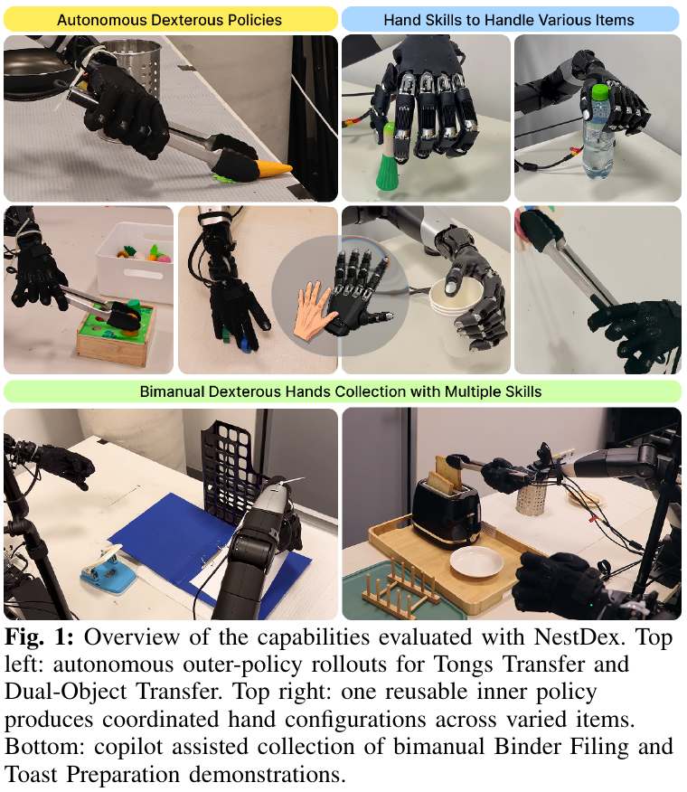
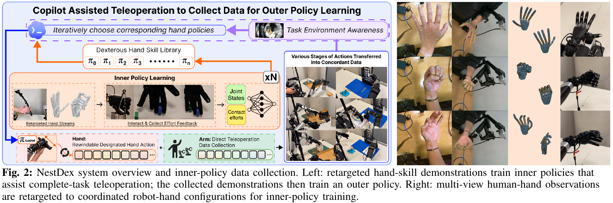
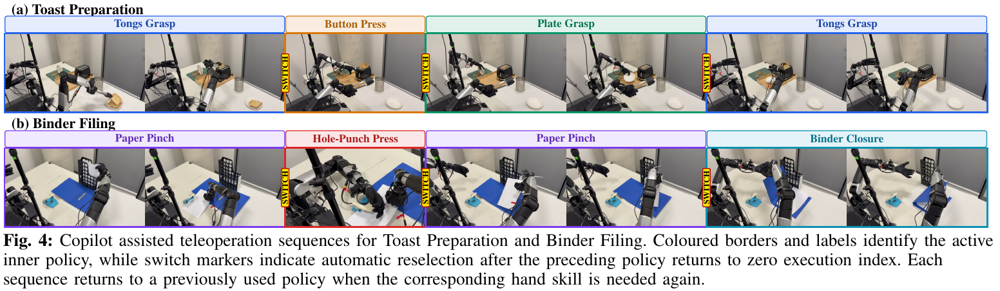
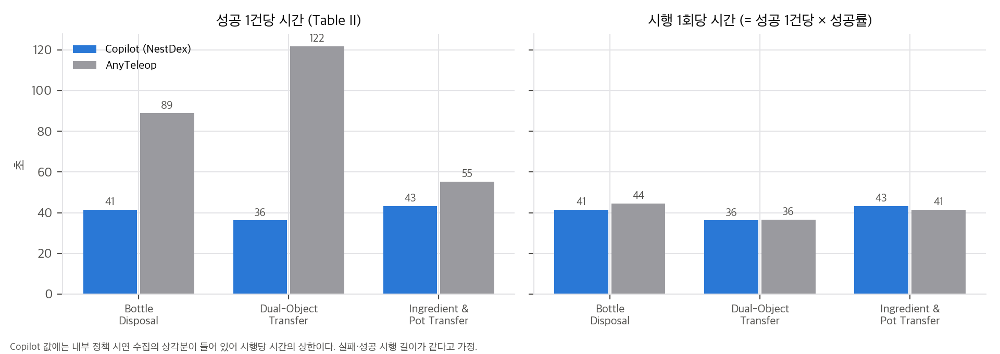
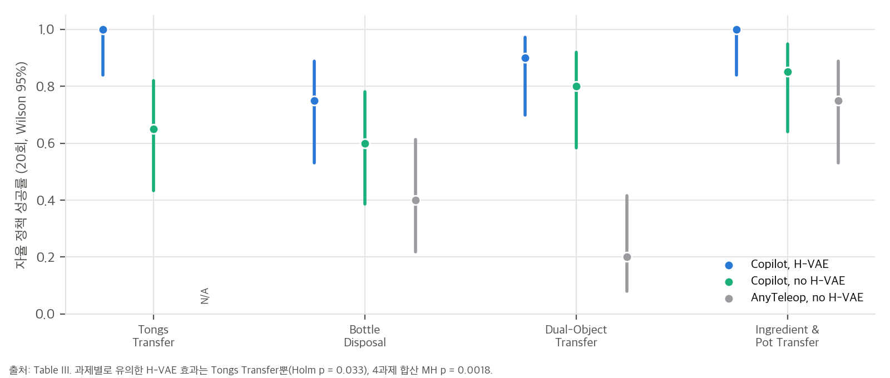
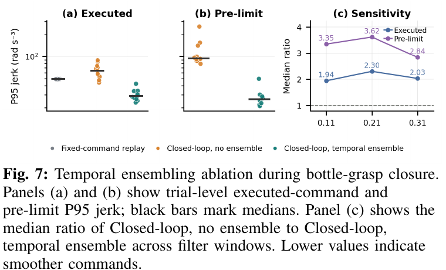
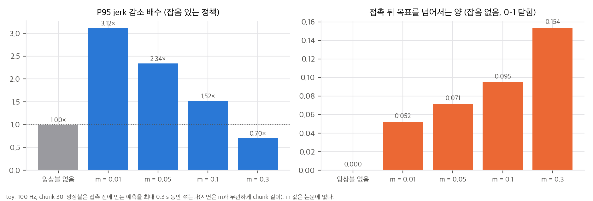
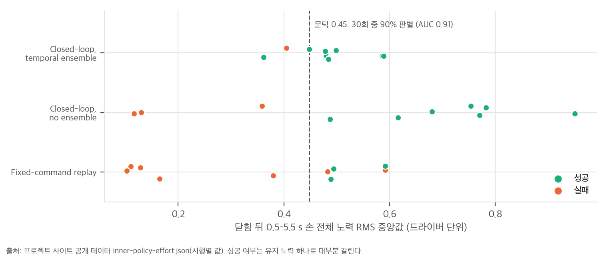

> **논문:** Zhao, Tang, Ba, Zhi. *NestDex: Nested Policy Learning with Copilot Assisted Teleoperation for Dexterous Manipulation.* arXiv:2608.13362 (2026). University of Sydney, Vanderbilt University.
> 논문 그림은 CC BY 4.0에 따라 출처를 밝히고 실었습니다(© 저자). 나머지 그래프는 논문 수치와 프로젝트 사이트의 공개 데이터로 직접 그렸습니다. 코드는 공개되지 않았습니다(2026-11-05 확인).

## 한 줄 요약

다지 손 텔레옵은 손가락 20개 관절을 사람 손 자세에서 그대로 옮기기 때문에 실패가 잦습니다. NestDex는 사람이 **팔과 1-DoF 클러치만** 조종하게 하고, 손가락은 미리 학습한 작은 **손 기술 정책(inner policy)**이 만들게 합니다. VLM이 과제 단계마다 쓸 기술을 고릅니다. 이렇게 모은 시연으로 **inner policy 없이** 팔과 손을 함께 제어하는 visuomotor 정책(outer policy)을 학습합니다. 6개 과제 모두에서 수집 성공 20/20을 기록했고, AnyTeleop은 0–15/20이었습니다(Table II).

## 1. 구조: 수집용 inner, 배포용 outer

| 구성 요소 | 내용 (Sec. IV) |
|---|---|
| inner policy | 기술마다 하나. 입력은 30스텝의 [손 관절 위치 20, 관절 effort 20], 출력은 30스텝 관절 위치 chunk. 리타겟팅 시연 10개, Huber BC, 100 Hz |
| 클러치 | 1-DoF 입력 p를 실행 index s = ⌊p(T_max − 1)⌋로 바꾸고, 실제 index r은 주기마다 한 칸씩만 따라감(Eq. 6–8) |
| VLM 선택기 | 진행도가 0일 때만 다음 기술을 고름. 모델 이름과 프롬프트는 없음 |
| outer policy | DINOv3 + Transformer, chunk 100 × [팔 7, 손 latent 10]. 손 20-DoF는 H-VAE로 10차원 압축 |

클러치에는 눈여겨볼 비대칭이 있습니다. 앞으로 갈 때는 최신 관절 상태로 정책을 다시 질의하고(닫힌 루프), 뒤로 갈 때는 버퍼에 저장된 명령을 재생합니다(열린 루프). 또 index가 주기마다 한 칸이라, 클러치를 끝까지 당겨도 시연보다 빨라지지 않습니다. 작업자가 할 수 있는 것은 늦추기, 멈추기, 되돌리기입니다.

## 2. "성공 1건당 시간"을 다시 나눠 보면

Table II의 시간은 성공 1건당 시간입니다. 성공률을 곱하면 시행 1회당 평균 시간이 됩니다.

| 과제 | NestDex (20/20) | AnyTeleop: 성공 1건당 × 성공률 | 시행 1회당 비 |
|---|---|---|---|
| Bottle Disposal | 41.37 s | 88.88 × 0.50 = 44.44 s | 1.07 |
| Dual-Object Transfer | 36.19 s | 121.63 × 0.30 = 36.49 s | 1.01 |
| Ingredient and Pot | 43.26 s | 55.29 × 0.75 = 41.47 s | 0.96 |

한 번 시도하는 데 걸리는 시간은 거의 같습니다. 1.3–3.4배의 차이는 **전부 실패 횟수**에서 나옵니다. 그래서 이 결과는 "더 빠른 텔레옵"보다 "덜 실패하는 텔레옵"으로 읽는 편이 정확합니다. 실패 시행과 성공 시행의 길이가 같다는 가정이 필요하고, 논문은 시행별 시간을 주지 않습니다. 수집 성공률 차이 자체는 확실합니다. Fisher 정확검정 p는 1.5×10⁻¹¹–0.047이고, Holm 보정 뒤에도 모두 0.05 아래입니다(Ingredient and Pot이 경계).

## 3. 자율 정책: 방향은 일관, 과제별 유의는 하나씩

| 비교 (Table III, 20 rollout) | 합산 (Mantel–Haenszel) | 과제별 유의 (Holm) |
|---|---|---|
| H-VAE 유무 (Copilot 시연, 4과제) | 73/80 vs 58/80, p = 0.0018, OR 4.3 | Tongs만 (13/20 → 20/20, p = 0.033) |
| Copilot vs AnyTeleop 시연 (3과제) | p = 5.4×10⁻⁴, OR 3.9 | Dual-Object만 (16/20 vs 4/20) |

H-VAE와 Copilot 시연 모두 효과의 방향은 모든 과제에서 같습니다. 하지만 과제 하나하나를 구분할 만큼 시행이 많지는 않습니다. AnyTeleop + H-VAE 칸이 없어서 두 요인을 따로 떼어 볼 수도 없습니다. 양팔 과제(Toast Preparation, Binder Filing)는 수집 결과만 있고 outer policy 결과가 없습니다.

## 4. temporal ensembling: 부드러움의 대가

inner policy는 ACT식 temporal ensembling(Eq. 2)으로 chunk를 잇습니다. 가중치는 w_i = exp(−m i)이고, i = 0이 **가장 오래된** 예측입니다. 그래서 m을 0으로 줄여도 가중은 균등까지만 갑니다. 최신 예측이 가장 큰 가중을 받는 경우는 없습니다. chunk 30, 100 Hz에서 실행 명령의 평균 나이는 145 ms(m = 0)에서 284 ms(m = 1)입니다. 논문은 m을 적지 않았습니다.

논문은 앙상블이 jerk를 2.30배 줄인다고 보고합니다. 이 값은 Fig. 7(c)의 0.21 s 창에서 나온 값이고, 0.11 s와 0.31 s 창에서는 1.94배와 2.03배입니다. 접촉 반응의 대가를 보려고, 1.1 s에 물체에 막혀 0.6에서 멈추는 1차원 닫기 toy를 만들었습니다.

앙상블은 서로 독립인 예측 오차를 평균해 jerk를 1.5–3.1배 줄입니다. 대신 접촉 **전에** 만든 예측이 chunk 길이(0.3 s) 동안 계속 섞입니다. 그래서 정지 수준으로 돌아오는 데 m과 무관하게 300 ms가 걸리고, 앙상블이 없으면 80 ms입니다. toy의 배수는 잡음 가정에 달려 있으니 논문 값과 직접 비교하지는 않았습니다.

## 5. 공개 데이터 다시 분석하기

프로젝트 사이트에는 Fig. 9–10의 시행별 데이터(`data/inner-policy-effort.json`)가 공개되어 있습니다. 조건 3개 × 시행 10개의 손 전체 노력 곡선과 유지 구간(0.5–5.5 s) 중앙값입니다.

- **재현:** 곡선에서 다시 낸 유지 중앙값은 파일 값과 최대 0.003 안에서 맞습니다. 정확 Mann–Whitney p 여섯 개가 소수 넷째 자리까지 일치합니다.
- **성공은 유지 노력 하나로 대부분 갈립니다.** 30회를 합치면 AUC 0.91이고, 문턱 0.45에서 27/30을 맞힙니다. 실패 11회 중 9회가 문턱 아래입니다. 다만 고정 재생 실패 중 두 번(0.48, 0.59)은 성공과 같은 수준의 힘을 유지했습니다.
- **p값의 바닥:** 조건 안 비교의 p = 0.017은 성공 7, 실패 3에서 나올 수 있는 가장 작은 값입니다. 앙상블 조건(성공 9, 실패 1)은 가장 작아도 p = 0.2라서 원리상 유의할 수 없습니다.
- **순서:** 조건이 2–4회씩 블록으로 번갈아 진행됐습니다. 무작위 순서가 아닙니다.
- **이름:** 데이터의 조건 id는 `online_rtc` / `online_no_rtc`입니다. 본문은 ACT식 평균(Eq. 2)이라고 쓰지만, id는 Real-Time Chunking을 가리키는 이름일 수 있습니다. 어느 쪽인지 확인할 수 없습니다.

## 6. 직접 구현할 수 있나

| 경로 | 판단 | 이유 |
|---|---|---|
| 공식 재현 | 불가능 | 코드, 학습된 정책, H-VAE, 시연 데이터가 없습니다. Piper Nero 7-DoF 팔(leader·follower), 1-DoF 클러치, 20-DoF WujiHand I, 손목 카메라, 기술 시연용 보정 다중 카메라가 필요합니다 |
| CPU·노트북 | 일부 가능 | 표 재계산, 공개 데이터 분석, 클러치와 앙상블 시뮬레이션은 numpy로 됩니다. inner policy(입력 30 × 40, 출력 30 × 20)와 H-VAE는 작아서 노트북에서도 학습할 만하지만 손 시연 데이터가 필요합니다 |
| 아이디어만 재구현 | 쉬움 | 클러치 index 업데이트와 앞 질의·뒤 재생은 수십 줄, proprio chunk 정책 + 앙상블은 수백 줄, 손 VAE는 수십 줄입니다 |

계산 규모는 작습니다(inner 20,000 step × batch 256, outer 50,000 step × batch 8). 장벽은 GPU가 아니라 **기술 시연을 모을 장비**와 **과제를 몇 개의 손 기술로 나눌지 정하는 설계**입니다. 시연 10개를 수백–수천 epoch 학습하므로(시연 길이 2–10 s 가정), inner policy는 학습한 접촉 조건 안에서만 적응한다고 보는 편이 맞습니다. 저자도 그렇게 한정합니다.

재현에 필요한데 논문에 없는 값도 정리해 둡니다. 앙상블 m, VLM 모델과 프롬프트, outer policy의 제어 주기(chunk 100이 1 s인지 10 s인지), 과제별 기술 수와 T_max, H-VAE 복원 오차, 작업자 수와 시행 순서입니다.

## 7. 정리

- "팔은 사람, 손가락은 기술"이라는 구조는 단순하고, 수집 성공률을 확실히 올립니다.
- 시간 이득은 시행이 빨라져서가 아니라 실패가 줄어서 생깁니다. 텔레옵 비교에서는 시행 1회당 시간, 작업자 수, 시행 순서를 함께 보고해야 합니다.
- H-VAE와 Copilot 시연의 효과는 방향이 일관되지만, 과제별로 유의한 것은 각각 하나씩입니다.
- 공개 데이터에서는 닫은 뒤 유지하는 힘이 잡기 성공을 거의 가릅니다. effort 로그만 있으면 성공 판정의 첫 필터로 쓸 수 있는 신호입니다. 다만 닫은 뒤 1–2초의 힘만으로는 AUC가 0.76–0.78이고, 판정이 0.9에 닿으려면 4초 이상의 기록이 필요합니다(인과적 계산, 30회).

분석 문서, 재계산 스크립트, 리포트 PDF는 함께 공개한 저장소에 있습니다.

## 자료

- [통합 리포트 PDF](report/report_public.pdf)
- [01. 논문 분석: NestDex (arXiv:2608.13362)](analysis/01_paper_analysis.md)
- [02. 선행연구와 계보](analysis/02_prior_work.md)
- [03. 핵심 식 해석과 재계산](analysis/03_analysis.md)
- [04. 주장 검증: 표·공개 데이터 재계산, 구현 가능성](analysis/04_claim_verification.md)
