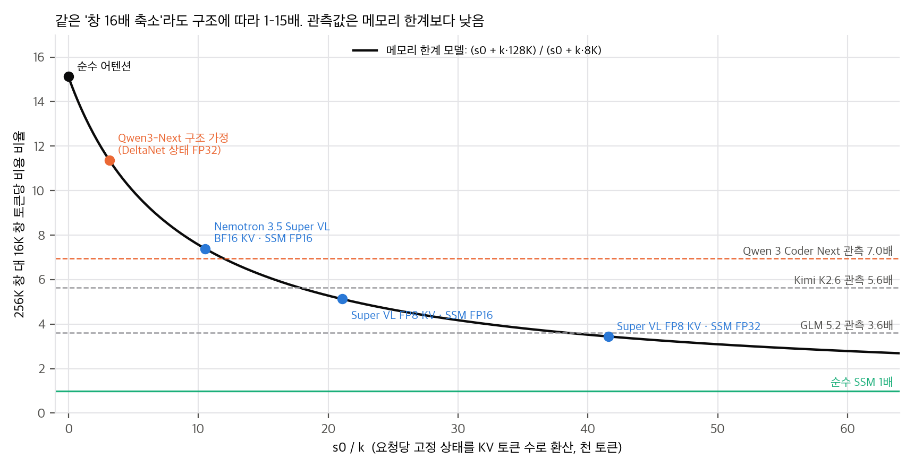
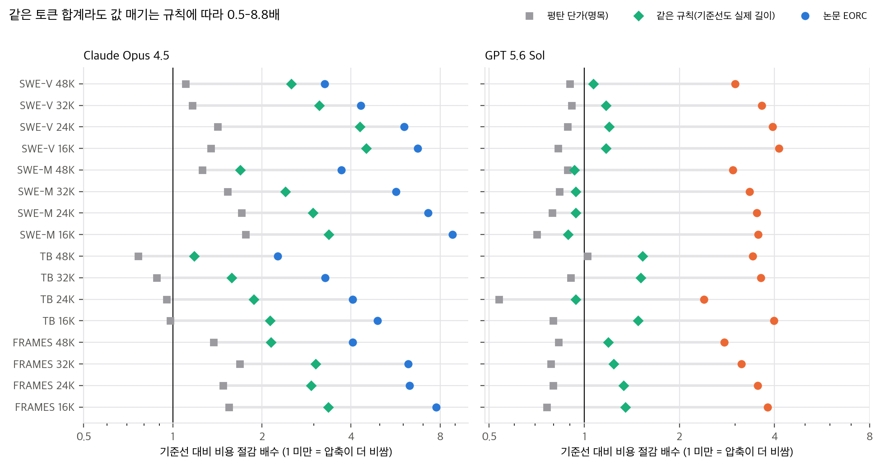
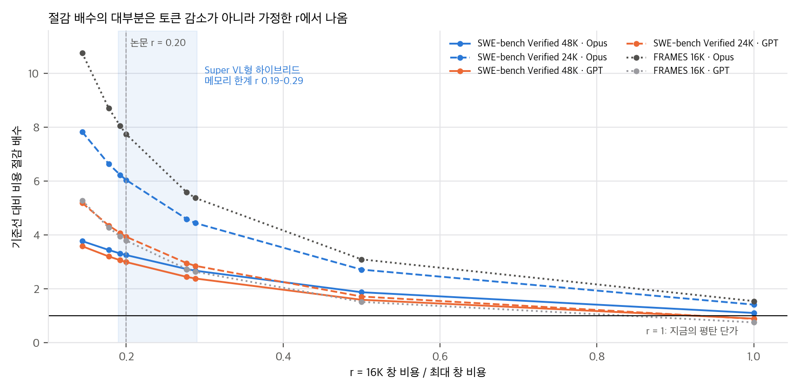
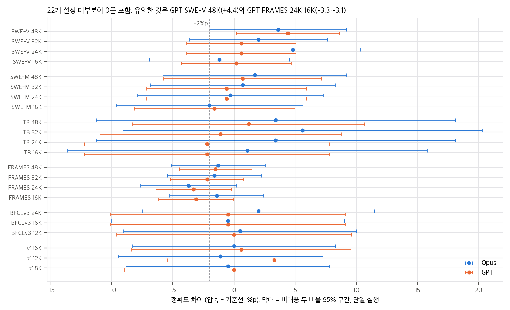

# 03. 분석: 비용 모델 재계산, 구조 의존성, 비교의 공정성

계산은 모두 `analysis/table_check.py`(표 재계산)와 `analysis/cost_model.py`(장난감 모델)에 있고, 결과는 `table_check_results.json`, `cost_model_results.json`입니다. numpy, 단일 스레드, 각각 1초 안에 끝납니다.

## 1. "7배"는 구조에 따라 달라지는가

### 1.1 무엇을 쟀나

Fig. 4와 §2.5의 측정은 **"뒤쪽 토큰 하나"의 비용이 아닙니다.** 창 크기 W로 설정한 서버에 요청 길이를 [0, W]에서 균일하게 뽑아 넣고, 포화 상태에서 낸 최대 처리량입니다. 이 규약에서 요청 하나의 평균 문맥은 약 W/2입니다(생성 중 평균 512토큰을 더함). 한편 Fig. 2는 배치 1에서 위치별 토큰 간 지연이고, 본문은 "약 2배"라고 씁니다. Abstract의 "뒤쪽 토큰이 최대 7배 비싸다"는 앞의 양(창 설정별 포화 처리량)을 뒤의 표현(위치별 비용)으로 말한 것입니다.

### 1.2 메모리 한계 모델

decode가 메모리 대역폭에 묶이고 KV 풀이 가득 찬 상태라면, 한 단계에 읽는 바이트(가중치 + 풀 전체)는 동시 요청 수와 관계없이 거의 일정합니다. 따라서 처리량은 동시 요청 수 B에 비례하고, B는 요청당 메모리에 반비례합니다.

- 요청당 메모리 = s0 + k · L̄. s0는 길이와 무관한 상태(SSM·DeltaNet 상태, conv 상태), k는 토큰당 KV 바이트, L̄ ≈ W/2 + 512.
- T(16K) / T(256K) = (s0 + k · 128.5K) / (s0 + k · 8.5K)

| 구조 | s0 / k (토큰) | 메모리 한계 비율 | 근거 |
|---|---|---|---|
| 순수 어텐션 (GQA든 MLA든) | 0 | 15.1 | k 크기와 무관. MLA는 k만 줄임 |
| Kimi K2.6 가정 (MLA, FP8 KV) | 0 | 15.1 | Kimi K2 구조 가정 |
| Qwen3-Next 구조 가정, DeltaNet 상태 FP32 | 3,144 | 11.4 | KV 24,576 B/토큰, 상태 72 MiB |
| Qwen3-Next 구조 가정, 상태 BF16 | 1,608 | 12.9 | |
| Nemotron 3.5 Super VL, BF16 KV, SSM FP16 | 10,540 | 7.4 | `nemotron35_super_vl` config 검증값 |
| Nemotron 3.5 Super VL, FP8 KV, SSM FP16 | 21,079 | 5.1 | 같은 출처. repo의 교차점 20,480토큰과 일치 |
| Nemotron 3.5 Super VL, FP8 KV, SSM FP32 | 41,559 | 3.4 | |
| 순수 SSM | ∞ | 1.0 | |

**답: 그렇습니다.** 같은 "창 16배 축소"가 순수 어텐션에서는 약 15배, Nemotron 3.5 Super VL 같은 Mamba 하이브리드에서는 3.4–7.4배, 순수 SSM에서는 1배의 비용 차이를 냅니다. 논문이 쓴 r = 0.20(5배)은 이 범위의 중간쯤에 있는 하나의 값일 뿐입니다.

### 1.3 관측값은 메모리 한계보다 낮다

| 모델 | 관측 | 메모리 한계 상한 | 비율 |
|---|---|---|---|
| GLM 5.2 | 3.61 | 구조 미확인 | — |
| Kimi K2.6 | 5.63 | 15.1 (순수 어텐션 가정) | 0.37 |
| Qwen 3 Coder Next | 6.95 | 11.4 (Qwen3-Next 구조 가정) | 0.61 |

순서가 메모리 모델과 반대입니다. 순수 어텐션인 Kimi(상한 15배)가 5.6배이고, 하이브리드인 Qwen(상한 11배)이 7배입니다. 메모리 한계 모델만으로는 이 순서를 설명할 수 없습니다. 16K 지점에서 메모리가 아닌 다른 한계(연산량, MoE 통신, 스케줄러의 동시 요청 상한)가 먼저 걸렸다는 뜻입니다. 활성 파라미터 3B인 Qwen은 16K에서 아주 많은 요청을 동시에 돌릴 수 있고, 32B급 활성 파라미터인 Kimi는 그 전에 연산에 막힌다고 보면 순서가 맞습니다. 이것은 가설이고, 논문은 동시 요청 수나 GPU 사용률을 보고하지 않아 확인할 수 없습니다.

결국 r은 구조만이 아니라 **배치 구성(GPU 수, INT4 expert, 동시성 상한)** 의 함수입니다. 세 오픈 모델의 r 평균을 구조와 서빙 방식을 모르는 Claude Opus 4.5·GPT 5.6 Sol에 그대로 적용한 것(부록 B)은 강한 가정입니다.

### 1.4 배치 1 지연 (Fig. 2에 해당)

대역폭 한계에서 토큰 하나의 시간은 (가중치 읽기 + s0 + k · L) / 대역폭입니다. 배치 1에서는 s0/k보다 **활성 가중치 읽기와 문맥 읽기의 비율**이 비율을 정합니다.

- Super VL의 repo 값(NVFP4 decode 가중치 읽기 9.76 GB/토큰, FP8 KV, SSM FP16)을 넣으면 16K 대비 64K 1.02배, 128K 1.05배, 256K 1.10배, 1M 1.43배입니다. 활성 가중치가 크고 attention 층이 88층 중 8층뿐이라 위치에 따른 차이가 작습니다. `nemotron35_bolt/` 분석의 "메모리 한계는 문맥이 아니라 가중치가 정한다"와 같은 결론입니다.
- Fig. 2(a)를 눈금으로 읽으면(±10% 정도) 0 → 약 260K에서 Qwen 3.6 27B 약 81 → 122 ms(1.5배), Qwen 3 Coder Next 약 16 → 31 ms(1.9배), Gemma 4 31B 약 120 → 252 ms(2.1배), Step 3.7 Flash 약 57 → 133 ms(2.3배)입니다. MiniMax M2.7은 약 60K에서 메모리가 넘쳐 멈춥니다.
- Qwen 3 Coder Next는 하이브리드인데도 1.9배입니다. 활성 파라미터가 3B라 NVFP4 가중치 읽기가 2 GB 안팎이고, 그래서 attention 12층의 KV 읽기가 상대적으로 커집니다. 1.3절의 "활성 파라미터가 작으면 문맥 비용 비중이 커진다"와 같은 방향입니다.

정리하면 "뒤쪽 토큰이 약 2배 느리다"는 측정한 다섯 모델에서는 대체로 맞지만, 활성 가중치가 큰 하이브리드 MoE(Super VL, Bolt)에는 맞지 않습니다.

## 2. "압축"은 무엇이고 무엇과 비교했나

- **압축:** 문맥이 임계값을 넘으면 같은 대화 안에서 "작업을 멈추고 인계 요약만 쓰라"는 사용자 메시지를 보냅니다(G.1). 모델이 쓴 요약을 과제 원문과 함께 새 대화에 넣고 이어 갑니다. 요약 형식은 6항목(목표, 확인된 사실, 적용한 변경, 검증, 막다른 길, 남은 계획)이고, 줄거리가 아니라 앞으로 필요한 것만 고른 브리핑입니다(부록 A). 별도의 압축 모델이나 학습은 없습니다.
- **장기 과제의 비교:** 같은 모델·같은 하네스에서 FHA(한도 없음)와 EoCC 4개 설정. 공정한 비교입니다. 다만 단일 실행입니다.
- **긴 입력 과제의 비교:** "문서를 작업 대화에 통째로 붙여 넣은 기준선" 대 "문서를 파일로 두고 grep·sed로 읽는 에이전트 + 압축"(부록 F). 바뀐 것이 두 가지(문맥 길이, 정확한 문자열 검색 도구)라서 효과를 나눌 수 없습니다. 같은 길이 예산의 잘린 붙여 넣기, RAG, 압축 없는 선택 읽기 같은 중간 조건이 없습니다. 실제로 RULER·Counting-Stars·NIAH·BABILong에서는 압축이 거의 일어나지 않았습니다(중앙값 0회). 긴 입력 결과는 "압축" 효과가 아니라 "선택 읽기" 효과입니다. 저자도 "selective input reading does nearly all of the context reduction"이라고 씁니다(Table 17 앞).

## 3. 비용: 명목, EORC, 같은 규칙

### 3.1 절감의 분해

EORC 절감 배수 = (명목 비용 비율) × (1 / 단가 배수). Opus SWE-bench Verified 48K/36K를 예로 들면:

- 명목 비용 420.00 → 379.85: 1.11배 (토큰 감소분)
- 단가 배수 f(48K) = 0.2 + 0.8 · (49,152 − 16,384) / (200,000 − 16,384) = 0.343: 2.92배
- 합계 3.23배 (표의 130.20 재현, K = 1,024)

장기 과제 44개 칸에서 로그 절감 중 단가 배수가 차지하는 비율의 중앙값은 1.06입니다(범위 0.72–1.71). 1을 넘는 것은 명목 비용이 오히려 늘어서입니다. **절감의 거의 전부가 토큰을 덜 써서가 아니라 "짧은 창은 싸다"는 가정에서 나옵니다.**

### 3.2 지금의 평탄한 단가로는

- 압축이 명목 비용을 늘린 설정: **GPT 22개 중 21개, Opus 22개 중 7개**(`04` C5). 예: GPT SWE-bench Verified 167.68 → 186.08–203.12, FRAMES 206.64 → 248.84–271.68.
- 이유: GPT는 기준선 문맥이 짧고(SWE-V 최종 길이 중앙값 18K) 캐시 입력이 비용에서 차지하는 비중이 작습니다(SWE-V 24%, Opus는 50%). 압축은 싼 캐시 입력을 줄이는 대신 비싼 새 입력과 출력을 늘립니다. GPT SWE-V 출력은 3.1M → 3.9–5.3M 토큰입니다.
- 본문 §3의 "토큰 증가가 절감을 지우는 일은 대체로 없었다"는 EORC 아래에서만 맞습니다. 비공식 재현 저장소도 이 점을 "평탄한 API 단가에서는 압축이 보통 명목 청구액을 올린다"고 적었습니다.

### 3.3 r에 대한 민감도

| SWE-bench Verified | r = 0.144 | 0.20 (논문) | 0.278 | 0.288 (Super VL FP32형) | 0.5 | 1.0 (평탄) |
|---|---|---|---|---|---|---|
| Opus 48K/36K | 3.78 | 3.26 | 2.74 | 2.68 | 1.88 | 1.11 |
| GPT 48K/36K | 3.59 | 3.00 | 2.45 | 2.39 | 1.60 | 0.90 |

(이 표는 K = 1,000으로 계산해서 논문의 Opus 3.23과 0.03 차이가 납니다.) Super VL 같은 하이브리드 서빙을 전제하면(r ≈ 0.19–0.29) 절감은 논문 값의 약 70–100%로, 순수 SSM이면(r = 1) 명목 비율로 떨어집니다.

### 3.4 기준선도 같은 규칙으로 매기면

부록 B는 FHA 기준선에 W = W_max, 즉 배수 1을 매깁니다. 1.1의 측정 규약에서 "창 W의 가격"은 요청 길이가 [0, W]에 균일하게 퍼진 서버의 평균 가격입니다. 그런데 FHA 요청 대부분은 짧습니다. Opus SWE-V의 최종 길이는 평균 48K, 중앙값 32K, 최댓값 200K입니다. vLLM의 paged KV는 설정 창이 아니라 실제 길이만큼 메모리를 씁니다. 그래서 기준선에 배수 1을 매기면 기준선이 실제보다 비싸게 잡힙니다.

**같은 규칙:** 요청마다 Eq. 2를 W = 2c(c = 그 요청의 문맥)로 적용합니다. 1.1의 규약과 같은 선형 모델입니다. 몬테카를로로 추정했습니다(`cost_model.py` M5).

1. 기준선 최종 길이 L을 표의 중앙값·평균에 맞춘 로그정규로 뽑고 최댓값에서 자릅니다.
2. 문맥이 3K에서 시작해 단계마다 δ씩 자란다고 보고, δ는 기준선 캐시 입력 합계가 표와 맞도록 정합니다(Opus SWE-V δ ≈ 2.3K).
3. 압축 설정은 임계값에서 3K짜리 요약으로 되돌아간다고 봅니다.
4. 캐시 입력은 문맥 길이만큼, 새 입력·출력은 단계마다 같은 양이 든다고 보고 종류별 평균 배수를 구한 뒤, 논문의 실제 토큰 합계에 곱합니다.

| | 논문 EORC 절감 | 같은 규칙 절감 | 기준선 평균 배수(캐시 입력) |
|---|---|---|---|
| Opus (SWE-V, SWE-M, TB, FRAMES 16칸) | 2.26–8.82 | 1.18–4.50 | 0.44–0.85 |
| GPT (같은 16칸) | 2.39–4.13 | 0.89–1.53 | 0.28–0.50 |

32칸 중 5칸(GPT SWE-M 4칸, GPT TB 24K)은 1 미만, 즉 압축이 더 비쌉니다. 중앙값으로 같은 규칙 절감은 논문 값의 0.42배입니다.

**이 추정의 한계:**
- 로그정규 꼬리 가정에 민감합니다. 꼬리를 최댓값에도 맞춘 변형은 GPT SWE-V만 바꿉니다(1.07–1.20 → 1.17–1.33).
- 시뮬레이션의 압축 횟수가 보고값과 다릅니다. Opus SWE-V는 시뮬레이션이 약 2배 많고(0.73 대 0.3, 3.93 대 2.1), GPT는 약 3배 적습니다(1.12 대 3.0). GPT 압축 설정의 실제 배수는 시뮬레이션보다 높을 가능성이 커서, GPT 쪽 같은 규칙 절감은 더 작을 수 있습니다.
- 그래서 가정이 가장 적은 지표도 함께 봅니다. **손익분기 기준선 배수** φ* = (압축 설정 EORC) / (기준선 명목 비용). 기준선의 실제 평균 배수가 φ*보다 크면 압축이 쌉니다. 압축 설정은 논문의 f(W)를 그대로 쓰므로 압축 쪽에 불리한 값입니다. Opus의 24K·16K처럼 φ*가 0.2(배수의 하한) 아래인 8칸은 기준선 길이 분포와 관계없이 압축이 쌉니다. GPT는 φ*가 0.24–0.42라서, 기준선의 실제 길이 분포를 알아야 판단할 수 있습니다.

**결론:** 짧은 문맥이 싸다는 방향은 맞지만, 그 크기는 "기준선이 실제로 얼마나 긴 요청을 보냈는가"에 크게 좌우됩니다. 논문은 토큰 합계만 보고하고 요청별 길이 분포는 보고하지 않아서, 논문 자료만으로는 이 차이를 닫을 수 없습니다.

## 4. 정확도 통계

- 본문 수치는 모두 재현됩니다: Opus −3.7 ~ +5.6%p, GPT −3.3 ~ +4.4%p. 2%p 넘게 잃은 설정은 Opus 1개(FRAMES 24K −3.7), GPT 5개(TB 24K·16K −2.2, FRAMES 32K −2.2, 24K −3.3, 16K −3.1)로 "5개 이하"가 맞습니다.
- 비대응 두 비율 z 검정으로 p < 0.05인 차이는 44개 중 3개입니다: GPT SWE-V 48K +4.4(p = 0.041), GPT FRAMES 24K −3.3(p = 0.035), 16K −3.1(p = 0.047). 같은 과제를 두 조건에서 풀었으므로 대응 검정이 더 정확하지만, 과제별 결과가 공개되지 않아 할 수 없습니다.
- **"최고 EoCC"의 선택 효과(Table 2):** 4개 설정 중 최댓값을 고르면, 참 정확도가 모두 같아도 기준선 대비 차이의 기대값이 양수입니다. 독립 이항 가정 시뮬레이션에서 귀무 평균(95% 분위)은 Opus SWE-V +2.1%p(6.2), GPT SWE-V +1.7(5.0), Opus TB +5.5(15.7), GPT TB +3.5(10.1)입니다. 보고된 최고 EoCC 이득(+4.8, +4.4, +5.6, +1.2)은 모두 95% 분위 안입니다. 대응 설계에서는 이 값이 더 작아지므로 이 수치는 상한입니다.
- 결론: "정확도를 거의 잃지 않는다"는 데이터와 맞습니다. "약간 좋아진다"는 주장은 이 데이터로 뒷받침되지 않습니다.

## 5. 긴 입력 기준선의 길이

| 벤치마크 | 입력 길이 (§2.2) | 기준선 과제당 평균 입력 (Opus / GPT) | Opus 창 200K | GPT 표준 창 272K |
|---|---|---|---|---|
| NIAH | 16K – 약 500K | 118K / 108K | 일부 초과 | 일부 초과 |
| RULER | 256K, 500K | 과제 수 미보고 | **전부 초과** | 500K 초과 |
| BABILong | 64K – 1M (5단계) | 131K / 126K | 일부 초과 | 일부 초과 |
| LongBench v2 | 8K – 약 200만 단어 | 다회 호출이라 비교 불가 | 일부 초과 | 일부 초과 |
| AA-LCR | 평균 약 100K | 104K / 94K | 대부분 안 | 안 |
| Counting-Stars | 4K – 128K | 49K / 49K | 안 | 안 |

- BABILong 5단계가 64K·128K·256K·512K·1M이라면 전체 입력 평균은 약 392K입니다. 표의 과제당 평균 131K는 이보다 훨씬 작습니다. NIAH도 16K–500K 격자의 평균보다 작습니다. 기준선 입력이 창에 맞게 잘렸거나 다른 방식으로 상한이 걸렸다고 보는 것이 자연스럽습니다. 논문은 이 처리를 적지 않았습니다.
- 잘렸다면 기준선은 정답 근거를 아예 못 본 문제가 있습니다. 가장 큰 이득(RULER +33%p, NIAH +40/+20%p, BABILong +25/+23%p)의 일부는 "짧은 문맥이 낫다"가 아니라 "기준선이 입력을 다 못 봤다"에서 나왔을 수 있습니다.
- LOONG과 Counting-Stars는 두 모델의 기준선 입력 토큰 합계가 0.1M 단위까지 같습니다(272.0M, 9.5M). 토크나이저가 다른 두 모델에서 같은 값이 나온 이유는 적혀 있지 않습니다.

## 6. 정리

1. 정확도 쪽 결론(압축해도 크게 잃지 않음)은 표와 맞고, 유의한 손실은 GPT FRAMES 두 칸뿐입니다.
2. 비용 쪽 결론은 r 가정과 기준선 가격 규칙에 크게 기댑니다. 오늘의 평탄한 단가로는 압축이 대부분 더 비싸고, 짧은 창 할인 단가가 생겨야 이득입니다. 그 할인 폭은 서빙 모델의 구조에 따라 1배(순수 SSM)부터 15배(순수 어텐션)까지 다릅니다.
3. 긴 입력 쪽의 큰 이득은 기준선 입력 처리 방식이 확인될 때까지 상한으로 읽어야 합니다.
