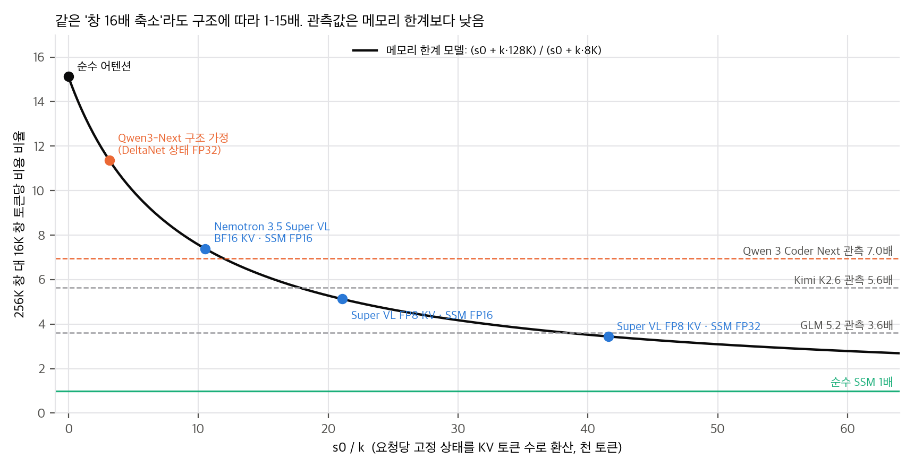
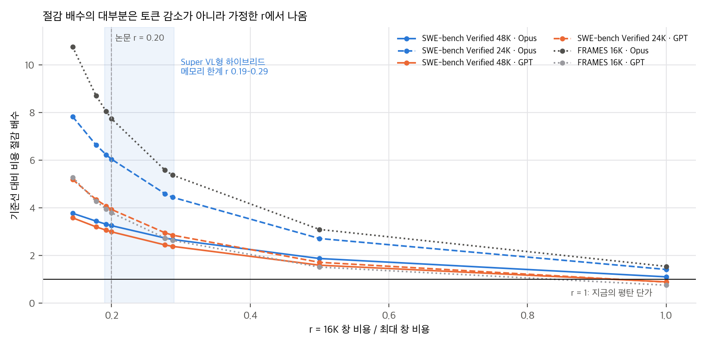
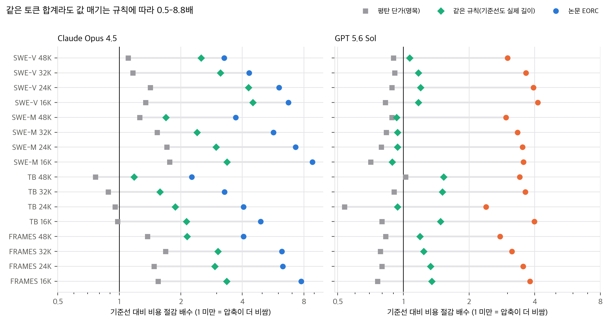
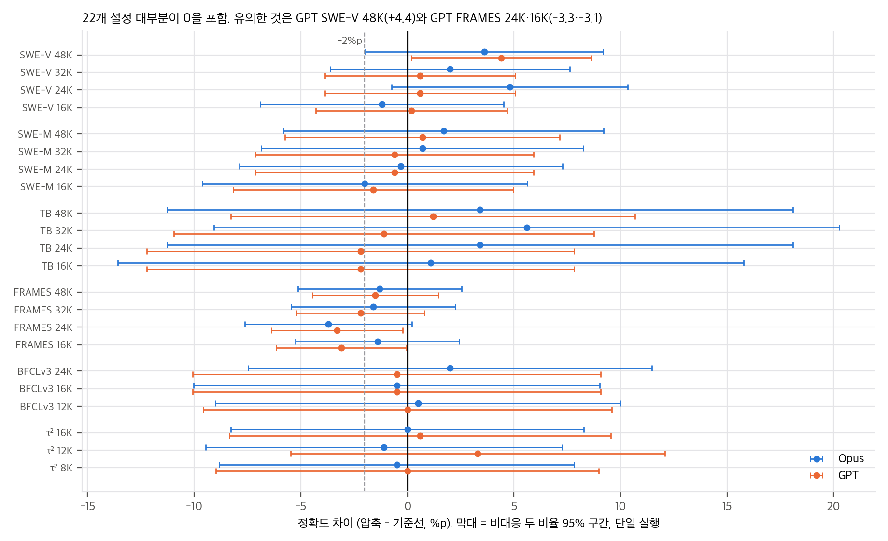

> **논문:** Belcak, Muralidharan, Jiang, Fu, Byeon, Ye, Angilly, Taghibakhshi, Liu, Ouyang, Heinrich, Molchanov. *You don't need long context.* arXiv:2611.05306v1, 2026-11-03 (NVIDIA).
> 논문 그림은 라이선스(arXiv 비독점 배포, © NVIDIA) 때문에 싣지 않았습니다. 이 글의 그래프는 논문 표의 수치와 직접 만든 비용 모델로 그렸습니다. 공식 코드는 공개되지 않았습니다(2026-11-09 확인).

## 한 줄 요약

에이전트 대화가 임계값을 넘으면 모델에게 "다음 실행을 위한 인계 브리프"를 쓰게 하고 새 대화로 이어 가는 압축(EoCC), 행동마다 압축하는 SAC, 긴 입력을 파일로 두고 grep으로 필요한 부분만 읽는 선택 읽기를 Claude Opus 4.5와 GPT 5.6 Sol로 13개 벤치마크에서 잽니다. 정확도는 거의 그대로이고, 짧은 창으로 서빙하면 비용이 2.2–8.8배 준다고 주장합니다.

## 1. 무엇을 했나

- **장기 과제(SWE-bench Verified·Multilingual, Terminal-Bench 2.1, FRAMES, BFCLv3, τ²-bench):** 이력을 계속 붙이는 기준선(FHA)과, "총 한도 / 압축 임계값" 48K/36K부터 16K/12K까지의 EoCC를 비교합니다.
- **긴 입력 과제(LongBench v2, LOONG, AA-LCR, NIAH, RULER, Counting-Stars, BABILong):** 문서를 대화에 통째로 붙여 넣은 기준선과, 문서를 파일로 두고 sed·grep으로 읽는 에이전트를 비교합니다.
- **압축 브리프:** 목표, 확인된 사실, 적용한 변경, 검증, 막다른 길, 남은 계획의 6항목입니다. 저자들은 실행 이력의 줄거리를 쓰는 요약보다, 앞으로 필요한 것만 고른 브리핑이 정확도를 더 잘 지켰다고 씁니다.
- **비용:** H100에서 vLLM으로 오픈 모델 세 개를 서빙해, 창을 256K로 설정했을 때 16K보다 출력 토큰당 3.6·5.6·7배 비싸다는 처리량 측정을 합니다. 그 평균(r = 0.20)으로 닫힌 모델의 "최적화된 소매가(EORC)"를 추정합니다.

## 2. 표는 맞다

명목 비용 90칸은 모두 정확히 재현됩니다. EORC는 84칸이 ±0.005달러 안에서 맞습니다. 나머지 6칸(SWE-bench Multilingual)은 최대 1.2% 어긋납니다. 정확도 범위(Opus −3.7 ~ +5.6%p, GPT −3.3 ~ +4.4%p)와 "22개 설정 중 2%p 넘게 잃은 것이 5개 이하"도 맞습니다. 표본 수로 나눠 정수가 되지 않는 값이 세 개 있지만 결론에 영향은 없습니다.

## 3. "뒤쪽 토큰이 7배 비싸다"는 두 양을 섞는다

Abstract는 "뒤쪽 토큰이 앞쪽보다 최대 7배 비싸다"고 씁니다. 실제로 잰 것은 **창 크기를 다르게 설정한 서버의 포화 처리량 비율**이고, 요청 길이를 [0, W]에서 균일하게 뽑은 조건입니다. 위치별 지연은 같은 논문의 Fig. 2에서 측정한 다섯 모델이 약 1.5–2.3배입니다.

이 비율은 구조에 따라 크게 달라집니다. 포화 서빙에서 KV 풀이 가득 차면 처리량은 동시 요청 수에 비례하고, 요청당 메모리는 s0 + k·W/2입니다(s0 = 요청당 SSM 상태, k = 토큰당 KV 바이트). 그래서 16K 대비 256K 비용 비율은 (s0 + k·128K) / (s0 + k·8K)입니다.

- 순수 어텐션은 약 15배, 순수 SSM은 1배입니다.
- 공개 config로 계산한 Nemotron 3.5 Super VL(Mamba 하이브리드)은 KV·상태 정밀도에 따라 3.4–7.4배입니다.
- 관측값의 순서도 메모리 모델과 반대입니다. 순수 어텐션 Kimi K2.6이 5.6배, 하이브리드 Qwen 3 Coder Next가 7배입니다. 16K에서는 메모리가 아닌 연산·동시성 한계가 먼저 걸린다는 뜻으로 읽힙니다.

즉 r은 구조와 배치 구성의 함수입니다. 논문은 이를 구조를 모르는 닫힌 모델 두 개에 그대로 적용합니다.

## 4. 비용 절감의 거의 전부는 r에서 나온다

Opus SWE-bench Verified 48K/36K를 분해하면, 토큰 감소로 명목 비용은 1.11배 줄고 단가 배수(0.343)로 2.92배 줄어 합계 3.23배입니다. 장기 과제 44칸에서 로그 절감 중 단가 배수가 차지하는 비율의 중앙값은 1.06입니다.

지금의 평탄한 API 단가(r = 1)로 계산하면 압축은 **GPT 비용을 22개 설정 중 21개에서, Opus 비용을 7개에서 늘립니다.** 압축이 싼 캐시 입력을 줄이는 대신 비싼 새 입력과 출력을 늘리기 때문입니다. GPT SWE-bench Verified의 출력 토큰은 3.1M에서 최대 5.3M으로 늘었습니다. 반대로 하네스가 프롬프트 캐시를 쓰지 못한다고 가정하면 44개 중 37개에서 압축이 쌉니다. 캐시 사용 여부가 결론을 뒤집습니다.

## 5. 기준선을 같은 규칙으로 매기면

부록 B는 기준선(FHA)에 배수 1, 즉 "요청이 창 전체에 균일하게 퍼진 서버의 가격"을 매깁니다. 그런데 FHA 문맥 대부분은 짧습니다(Opus SWE-bench Verified 최종 길이 중앙값 32K). 요청마다 같은 선형 규칙을 적용해 기준선과 압축 설정을 모두 매기는 몬테카를로 근사를 만들었습니다.

같은 규칙에서 절감은 Opus 1.2–4.5배, GPT 0.9–1.5배입니다(논문 2.3–8.8배, 2.4–4.1배). 로그정규 꼬리 가정에 민감한 근사라서, 가정이 가장 적은 지표도 함께 봤습니다. "기준선의 실제 평균 배수가 얼마 이상이어야 압축이 싼가"(손익분기)는 Opus의 빠듯한 설정 8칸에서 0.2 미만이라 길이 분포와 관계없이 압축이 쌉니다. GPT는 0.24–0.42라 실제 길이 분포를 알아야 판단할 수 있습니다.

## 6. 정확도: "같다"는 맞고 "약간 낫다"는 근거가 부족하다

모두 단일 실행입니다. 비대응 두 비율 검정에서 p < 0.05인 차이는 44개 중 3개(GPT SWE-V 48K +4.4, GPT FRAMES 24K −3.3, 16K −3.1)입니다. Table 2의 "최고 EoCC"는 4개 설정 중 최댓값이라, 참 정확도가 모두 같아도 평균 +1.7 ~ +5.5%p가 나옵니다. 보고된 최고 이득은 모두 그 95% 분위 안에 있습니다.

## 7. 긴 입력의 큰 이득은 상한으로 읽어야 한다

RULER 입력(256K·500K)은 모두 Opus 창(200K)보다 깁니다. NIAH(최대 약 500K)와 BABILong(최대 1M)도 일부가 넘습니다. 기준선의 과제당 평균 입력은 NIAH 118K, BABILong 131K로 전체 길이 평균보다 훨씬 작아서, 기준선 입력이 잘렸을 가능성이 큽니다. 그런데 넘친 입력을 어떻게 처리했는지는 적혀 있지 않습니다. RULER +33%p, NIAH +40%p 같은 이득의 일부는 "기준선이 입력을 다 못 봤다"에서 왔을 수 있습니다. 또한 비교가 "붙여 넣기 대 파일 + grep"이라서 문맥 길이 효과와 정확한 문자열 검색 효과가 섞이고, RAG 기준선도 없습니다.

## 8. 구현할 수 있나

- **방법:** 쉽습니다. 문맥 크기를 세다가 임계값에서 압축 프롬프트를 한 번 보내고, 시스템 프롬프트 + 과제 + 브리프로 대화를 다시 시작하면 됩니다. 학습이 필요 없습니다. 공식 코드는 없고, 비공식 MIT 구현([che-shr-cat/short-context-agent](https://github.com/che-shr-cat/short-context-agent))이 있습니다. 이 구현은 README에서 "방법 재현이지 결과 재현이 아니다"라고 밝힙니다.
- **비용(논문 단가 기준):** SWE-bench Verified 50과제를 FHA와 EoCC 24K/18K로 돌리면 Opus 약 $72, GPT 약 $36입니다. NIAH 125과제를 선택 읽기로 풀면 $1–4입니다. 논문 표 전체를 한 번 돌리는 비용은 약 $17,500입니다.
- **처리량 측정(Fig. 1·4):** H100 8–16장이 필요합니다.

## 정리

압축과 선택 읽기가 정확도를 크게 해치지 않는다는 결론은 표와 맞고, 실무에서 바로 쓸 만합니다. 6항목 인계 브리프는 특히 그렇습니다. 비용 결론은 세 가지 조건에 기댑니다. 첫째, 짧은 창 할인 단가가 실제로 존재해야 합니다. 둘째, 그 할인 폭은 서빙 모델의 구조에 맞는 값이어야 합니다(1–15배). 셋째, 기준선 요청의 실제 길이 분포를 같은 규칙으로 매겨야 합니다. 이 셋을 확인하기 전까지 "2.2–8.8배"는 상한으로 읽는 것이 안전합니다.

검증 스크립트(numpy, CPU 1초)와 전체 분석 문서는 함께 공개한 저장소 폴더에 있습니다.

## 자료

- [통합 리포트 PDF](report/report_public.pdf)
- [01. 논문 분석: You don't need long context](analysis/01_paper_analysis.md)
- [02. 선행연구와 관련 자료](analysis/02_prior_work.md)
- [03. 분석: 비용 모델 재계산, 구조 의존성, 비교의 공정성](analysis/03_analysis.md)
- [04. 주장 검증: 표 재계산, 비공식 구현 대조, 구현 가능성](analysis/04_claim_verification.md)
