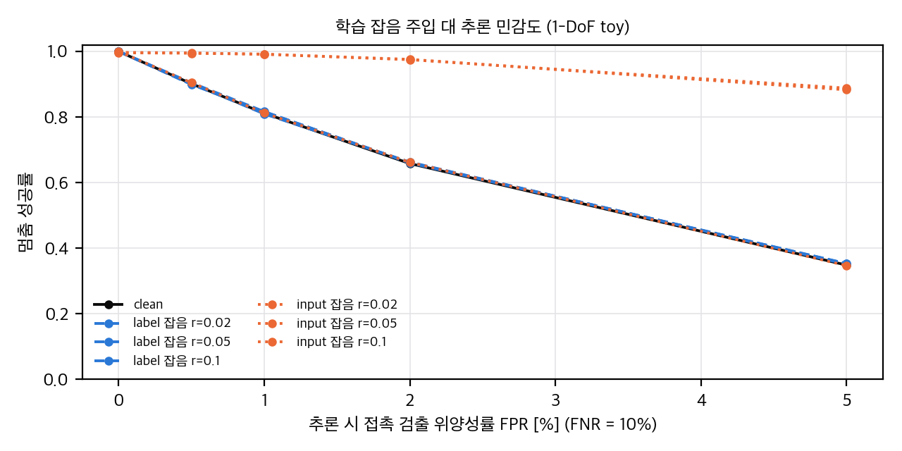
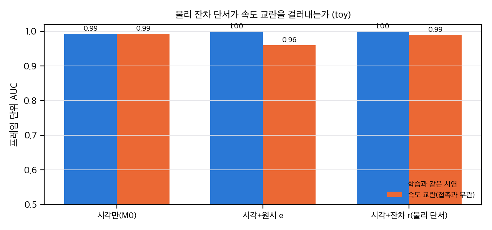

# 03. 수치 재계산, 통계 검정, 유도, toy

논문: NoContactNoWorries (arXiv:2606.24450v2, IROS 2026 채택). 원문 표는 원문 PDF의 렌더링 이미지(Table I p.5, Table II p.6, Table III p.7)에서 옮겼고, 추출 텍스트와 대조했습니다.

**계산 파일**

| 파일 | 내용 | 결과 |
|---|---|---|
| `analysis/table_check.py` | Table I–III 재계산, Welch t, Holm, 부호 검정, Table II 일관성, 검출력(MDE), ± 가정(sd/se) 민감도 | `analysis/table_check_results.json` |
| `analysis/sensing_toy.py` | 감각 toy: 관절 오차와 가려진 시각의 접촉 정보, 속도 결합 대조 | `analysis/sensing_toy_results.json` |
| `analysis/control_toy.py` | 제어 toy: 위양성·위음성과 디바운스, F1 → (P, R, FPR) 변환 | `analysis/control_toy_results.json` |
| `analysis/plot_figures.py` | 위 결과의 그래프 네 장 | `report/figures/*.png` |

**가정 (중요)**
- 표의 ± 는 표준편차(sd)이고 n = 10(10 splits, 10 trials)으로 봅니다. 논문은 ± 의 뜻을 적지 않았습니다. 표준오차(se)라면 검정이 더 약해지므로, 주요 결론 칸은 두 가정에서 모두 확인했습니다.
- 칸끼리의 독립성은 Welch 검정으로 가정합니다. 같은 split을 공유하는 칸이라 대응 검정이 더 맞을 수 있지만, 논문이 split별 값을 주지 않아 할 수 없습니다.
- 여러 칸은 Holm으로 보정했습니다.

---

## 1. Table I: F1 재계산과 검정

### 1.1 값 확인

- 시뮬레이션·실물, 9개 설정(a–g, 교란 변형, Full), 7개 물체(seen 5 + novel 2) = 126 칸을 옮겼습니다.
- 본문의 수치 주장은 모두 표와 일치합니다(§4의 C1–C3).
- 두 버전(v1, v2)의 소수 수치는 533개가 모두 같습니다(추출 텍스트 기준). 아래 재계산은 v2 기준입니다.

### 1.2 Full이 기준선보다 높은가

| 설정 | 칸 수 | Full > 모든 기준선(a–g) | Full − 최강 기준선 (pp) | Holm p (sd 가정) | Holm p (se 가정) |
|---|---|---|---|---|---|
| 시뮬레이션 | 7 | **7/7** | 9–14 | 2×10⁻¹¹ – 5×10⁻⁸ | 3×10⁻⁴ – 0.009 |
| 실물 | 7 | **7/7** | 6–12 | 2×10⁻¹¹ – 0.00065 | 0.0005 – 0.21 (Star) |

- 최강 기준선은 칸마다 다릅니다. 시뮬레이션은 (a) query-asym 또는 (f) 시간 모델 없음, 실물은 대부분 (a)입니다. Star(실물)에서는 (f)가 최강입니다.
- 실물 Star는 se 가정에서 유의하지 않습니다(p = 0.21). 나머지 실물 칸은 se 가정에서도 대체로 유의합니다(0.0005–0.04).
- 결론: 기준선보다 높다는 주장은 두 설정 모두에서 칸 단위로 지지됩니다.

### 1.3 교란된 qcom(mismatched command)

- 시뮬레이션: Full − 교란 = 2–5 pp, 7/7 양수. Holm p는 대부분 0.003 이하이고 Stairs(0.11)만 유의하지 않습니다.
- 실물: 1–6 pp, 7/7 양수. Holm 유의는 Hexagonal(0.004)과 Letter R(0.011)뿐입니다.
- 두 설정 합쳐 14칸 모두 양수입니다(양측 부호 검정 p = 2×(1/2)^14 ≈ 1×10⁻⁴).
- 해석: "qcom을 바꿔도 조금만 떨어진다"는 주장(본문 Sec. V-B(c))은 맞지만, "작은 감소"가 0이 아니라는 점도 같이 봐야 합니다. 모델이 qcom에 의존하는 정도는 작지 않습니다(칸당 2–5 pp, 시뮬 Dodecahedron과 Star는 5 pp).

### 1.4 자세 변형 순서

- F1 기준 (a) > (b) > (c)가 두 설정 모두 7/7입니다. 본문 "query-asymmetry가 symmetric과 MLP보다 낫다"는 F1에서는 맞습니다.
- 같은 주장을 downstream(Table III)에서 보면 지지되지 않습니다(§3.4).

### 1.5 novel 물체

- 시뮬레이션 Full 평균: seen 0.90, novel 0.88. 실물: seen 0.80, novel 0.77.
- novel 두 칸(Hexagonal 0.89, Letter R 0.87)은 seen 범위(0.88–0.93) 안에 있습니다. "학습에 없던 물체에도 일반화한다"는 F1 주장은 이 표 수준에서는 지지됩니다.
- 한계: novel 물체는 2개뿐이고, 그 칸의 "10 splits"가 어떻게 나뉘었는지(모델을 다시 학습했는지) 논문에 없습니다.

### 1.6 sim → real 감소

- Full의 시뮬레이션 − 실물 F1 차이: Cuboid 0.09, Pentagonal 0.07, Dodecahedron 0.09, Star 0.17, Stairs 0.09, Hexagonal 0.09, Letter R 0.13.
- 논문은 이를 "effective sim-to-real transfer"라고 부릅니다. 실물 F1은 0.71–0.84로 낮아졌고 감소폭은 칸마다 7–17 pp입니다. "효과적"이라는 표현은 과장일 수 있습니다. 실물 F1에 대한 비교 기준(예: 시뮬레이션에서만 학습한 것 대비 실물에서 무엇이 좋아졌는지)이 없습니다.

### 1.7 pose-delta(d)와 vision-only(e)

- 실물에서 pose-delta가 vision-only보다 칸마다 4–9 pp 높습니다(Holm p ≤ 0.005, 7/7).
- 본문은 "comparable"이라고 씁니다. 차이는 작지 않으므로 "벡터 하나짜리 pose-delta가 시각 전용보다 낫다"가 더 정확한 문장입니다. 시각 분기가 실물에서 가장 약하다는 것을 뜻합니다.

### 1.8 "0.9 초과" 점검

- 시뮬레이션 볼록 물체 Full: 0.93, 0.90, 0.91. Pentagonal Prism은 정확히 0.90으로 "0.9를 넘는다"는 말과 어긋납니다(사소한 문제).

---

## 2. Table II: 가림 조건별 F1

### 2.1 값 일관성

Table II는 Hexagonal Prism(시뮬레이션)에 대한 가림별 F1입니다. 가림 프레임 비율 w = 0.61(본문 Sec. V-B(a))로 가중하면 전체 F1 ≈ (1−w)·visible + w·occluded입니다.

| 모델 | visible | occluded | 가중 전체 F1 | Table I Hexagonal(시뮬) | 차이 |
|---|---|---|---|---|---|
| Kinematic depth | 0.81 | 0.54 | 0.645 | 0.65 (g) | −0.005 |
| Vision-only | 0.79 | 0.51 | 0.619 | 0.62 (e) | −0.001 |
| Pose-only (best) | 0.75 | 0.81 | 0.787 | 0.78 (a) | +0.007 |
| Full | 0.93 | 0.85 | 0.881 | 0.89 | −0.009 |

- 네 칸 모두 ±0.01 안에서 맞습니다. 표 II와 I가 같은 물체·같은 평가를 가리킨다는 뜻입니다.
- "Pose-only (best)"가 무엇인지는 논문에 없습니다. Table I의 Hexagonal(시뮬) 칸에서 가장 높은 자세 변형이 (a)이고 0.78로 맞아서, (a)일 가능성이 높습니다(추정, 확인 안 됨).
- 작은 불일치: Full만 가림 비율을 0.50으로 맞춰야 합니다. 조건부 F1은 선형으로 합쳐지지 않으므로 완전히 설명되지는 않습니다.

### 2.2 가림 조건별 F1의 기저율 문제

- 접촉 비율이 가림 조건마다 다르면 F1은 가림 조건끼리 직접 비교할 수 없습니다. 논문은 가림 조건별 접촉 비율을 보고하지 않습니다.
- 감각 toy(§6)에서 가림 프레임의 접촉 비율은 약 0.55, 보이는 프레임은 약 0.20입니다. 그 결과 toy의 시각 모델은 보이는 프레임의 AUC(0.81–0.83)가 가려진 프레임(0.75)보다 높은데도, F1은 가려진 프레임에서 더 높게 나옵니다(0.70 대 0.56).
- 따라서 Table II의 "Pose-only (best)"가 가림 프레임에서 0.81로 보이는 프레임 0.75보다 높은 것은, 자세 정보가 가림에 강하다는 증거로 읽기 어렵습니다. AUC와 접촉 비율을 함께 보고해야 합니다.

---

## 3. Table III: 실물과 시뮬레이션 downstream

### 3.1 단위 문제

- CRR(시뮬레이션, 약 80–125)과 CRA(실물, 약 9–21 rad)는 단위가 다르고, 같은 칸에서 두 설정을 함께 재지 않았습니다.
- 따라서 "performance is uniformly higher in simulation"(본문 Sec. V-C)은 이 표로 검증할 수 없습니다. 시뮬레이션과 실물의 차이는 이 표에서 직접 비교할 수 없습니다.

### 3.2 Ours와 Oracle

| 지표 | 평균 비 (Ours/Oracle, 7물체) | Ours − Oracle (볼록 3물체) | Welch p (볼록 3물체) |
|---|---|---|---|
| CRR (시뮬) | 0.966 | −1.4, −8.0, −2.6 | 0.25–0.74 |
| CRA (실물) | 1.01 | +1.14, +1.09, +0.97 | 0.06, 0.22, 0.18 |

- 실물 CRA에서 볼록 물체의 Ours > Oracle은 방향은 맞지만(+0.97–1.14 rad), 어떤 칸도 유의하지 않습니다(p ≥ 0.06).
- 나머지 4물체(Star, Stairs, Hexagonal, Letter R)에서는 Ours − Oracle이 −0.05 ~ −0.70 rad로 모두 음수입니다.
- 결론: "Oracle과 비슷하다(near-oracle)"는 말은 평균 비 1.01(CRA)과 0.97(CRR)로 맞지만, "볼록 물체에서 실물 Oracle을 넘는다"는 칸별로는 유의하지 않습니다. 설명(센서 잡음이 Oracle을 떨어뜨린다)은 가설이고 검증되지 않았습니다.

### 3.3 Ours와 Proprio only (접촉 없음)

| 지표 | 칸별 Ours − Proprio | Holm p |
|---|---|---|
| CRA (실물) | +0.78, +1.29, +0.45, +1.12, **−0.74 (Stairs)**, **−2.04 (Hexagonal)**, −0.17 (R) | 0.83–1.0 |
| CRR (시뮬) | +9.9, +4.8, +5.4, +2.8, +9.0, +1.9, +5.1 | 0.59–1.0 |

- 실물 CRA에서 Stairs, Hexagonal, Letter R의 세 칸은 Proprio only가 Ours보다 같거나 높습니다. 논문도 이 세 칸의 Proprio only 값을 굵게 표시했습니다(Table III 캡션의 "best non-oracle" 규칙). 본문의 "Removing vision leaves a persistent deficit"와 어긋납니다.
- Holm 보정 후 어떤 칸도 유의하지 않습니다. 이것은 "차이가 없다"는 증거가 아니라 검출력 부족입니다(§3.5).
- 대조: 같은 모델이 F1에서는 실물 Cuboid 0.84 대 자세 변형(a) 0.72처럼 큰 차이를 냅니다(Table I). F1의 이득이 CRA에서는 보이지 않는다는 점이 이 논문의 핵심 불일치입니다.

### 3.4 자세 query-asym (a)와 MLP (c)

- F1에서는 (a) > (c)가 7/7(두 설정)입니다.
- CRA(실물): (c)가 (a)보다 높은 칸이 Cuboid(p = 0.039), Dodecahedron(p = 0.018), Star(p = 0.004), Hexagonal(p = 0.005) 4칸이고, Star에서는 (c) 15.61이 Ours 14.37보다 높습니다(굵게 표시된 값).
- CRR(시뮬): (c)가 높은 칸이 Cuboid, Dodecahedron, Star, Hexagonal(Hex는 p = 0.002), (a)가 높은 칸이 Pentagonal, Stairs, Letter R(p < 10⁻⁴)입니다. 합치면 (a) > (c)는 14칸 중 6칸입니다(부호 검정 p = 0.79).
- 결론: "query-asymmetry가 MLP보다 낫다"는 주장은 F1에서만 지지되고, downstream에서는 지지되지 않습니다.
- 변형별 평균(7물체, 실물 CRA): 자세 query-asym 13.81, pose-delta 14.30, vision-only 14.71, MLP 14.73, Proprio only 17.65, Ours 17.75, Oracle 17.52. 시각 전용이 "가장 불안정하다"는 본문 문장과 맞지 않습니다(04 C16). 값은 `table_check_results.json`의 `variant_means_over_7_objects`입니다.

### 3.5 검출력

- n = 10, sd 중앙값에서 80% 검출력의 최소 차이(MDE, Welch, 양측 0.05):
  - F1: 0.032 (중앙 sd 0.024)
  - CRA: 2.33 rad (중앙 sd 1.76)
  - CRR: 13.5 (중앙 sd 10.2)
- Ours − Proprio의 실물 차이(최대 2.04 rad)와 Ours − Oracle 차이(최대 1.14 rad)는 모두 MDE보다 작습니다. "차이가 없다"고 쓰는 칸은 "이 실험으로는 구분할 수 없다"로 바꿔 읽어야 합니다.
- 실물 downstream은 trial 10회이고 CRA는 한 명의 관찰자가 영상으로 수동 측정했습니다(본문 Sec. V-C). 측정 잡음이 크고, 관찰자 간 일치도가 없습니다.

### 3.6 ± 가정 민감도

- CRA 칸별 Holm 결과: sd 가정과 se 가정 모두 유의한 칸이 없습니다.
- Ours − Oracle, CRR: se 가정에서 p = 0.71–0.99로 더 큽니다. 결론은 같습니다.

---

## 4. 유도: F1과 접촉 오류율

### 4.1 항등식

F1 = 2TP / (2TP + FP + FN) = 2PR/(P + R)

재현율 R과 F1을 알면 정밀도 P = F1·R / (2R − F1)입니다.

접촉 비율을 π(프레임 기준)라 하면 TP = R·π·N, 음성은 (1 − π)·N이므로

FPR = FP / ((1−π)N) = R·π·(1/P − 1) / (1 − π)

FNR = 1 − R

### 4.2 같은 F1, 다른 위양성률

π = 0.4(가정, 논문은 접촉 비율을 보고하지 않음)일 때:

| F1 | R = 0.7 | R = 0.8 | R = 0.9 | R = 0.95 |
|---|---|---|---|---|
| 0.71 (Star, 실물) | FPR 0.18 | 0.30 | 0.42 | 0.48 |
| 0.74 (Letter R, 실물) | 0.13 | 0.24 | 0.36 | 0.41 |
| 0.79 (Stairs, 실물) | 0.05 | 0.15 | 0.25 | 0.30 |
| 0.84 (Cuboid, 실물) | — | 0.07 | 0.16 | 0.21 |
| 0.93 (Cuboid, 시뮬) | — | — | 0.02 | 0.06 |

- F1 0.84라도 재현율에 따라 위양성률은 7%에서 21%까지 갈 수 있습니다. F1 하나로는 위양성률이 정해지지 않습니다.
- 접촉 비율이 바뀌면 같은 F1에서도 FPR이 달라집니다. π를 모르면 이 표를 실제 값으로 바꿀 수 없습니다. 논문이 접촉 비율을 적어야 합니다.

### 4.3 Spearman(Fig. 6)

- Fig. 6(a)의 정렬(aligned) 분포는 중앙값 약 0.3, 셔플(shuffled) 분포는 0 근처입니다(그림 눈 판독, 개수 불명).
- 본문은 "statistically significant monotonic dependence"라고 쓰지만, 검정 통계량, 표본 수, p-value가 없습니다.
- 대조 설계의 문제: 시간 셔플은 시간 정렬만 끊습니다. 명령 속도와 접촉이 함께 움직이는 경우(정책이 접촉 중에 느려지거나 빨라짐)는 셔플로 걸러지지 않습니다. §6.3에서 이것을 toy로 보입니다.

---

## 5. 유도: 관절 추종 오차와 접촉 편차

1차 추종 모델을 가정합니다. q_{t+1} = q_t + α(q^com_t − q_t) − β·c_t.

- 명령이 상수이고 접촉이 지속될 때 정상상태 편차는 e = β·c/α = δ·c입니다. 접촉 편차는 δ = β/α입니다.
- 명령이 일정한 속도 v로 움직이면 추종 지연의 정상상태 오차는 e = v(1 − α)/α입니다. 이것이 접촉과 무관하게 |e|를 키우는 항입니다.
- 따라서 |e| 하나로 접촉을 읽으려면 δ가 속도 항보다 커야 합니다. 논문은 δ와 속도 항의 비를 보고하지 않습니다.
- 가림과 관절 정보의 결합: proprioception은 δ·c + 속도 항 + 잡음을 봅니다. 가림은 시각 신호만 줄입니다.

---

## 6. 두 toy (CPU, numpy·scipy)

### 6.1 감각 toy (`analysis/sensing_toy.py`)

설정: 1 손가락, 30 Hz, 60,000 프레임, 접촉 비율 π = 0.4(가정), δ = 0.05 rad, α = 0.2, 창 8프레임, 가림 확률은 접촉 시 0.8·비접촉 시 0.45(전체 약 0.59, 논문 61%에 맞춤), 시각 점수 평균은 보이면 1.5, 가려지면 0.2. 로지스틱 회귀(앞 절반 학습, 뒤 절반 평가).

| 특징 (σ_e = 0.005 rad, 속도 결합 0) | 가려진 프레임 AUC | 보이는 프레임 AUC | 전체 AUC |
|---|---|---|---|
| 시각 (가림 인식) | 0.75 | 0.82 | 0.80 |
| 관절 \|e\| | 0.72 | 0.71 | 0.72 |
| 융합 | 0.76 | 0.82 | 0.80 |

- 가려진 프레임에서 관절 정보는 시각과 거의 같은 AUC를 냅니다(0.72 대 0.75). 융합은 가려진 프레임에서 +0.01만 더합니다.
- 해석: 이 toy에서는 관절 오차가 가림에서도 접촉 정보를 줍니다. 다만 이 결과는 δ/σ_e와 시각 신호 세기라는 가정에 달려 있습니다. 논문의 "융합이 필요하다"는 주장을 toy로 확인하려면 더 많은 가정 스윕이 필요합니다.
- σ_e = 0.02(잡음 큼)에서는 관절 AUC가 0.69로 떨어집니다. 잡음에 민감합니다.

### 6.2 속도 결합 대조 (δ = 0)

접촉이 관절 편차를 만들지 않는데(δ = 0), 정책이 접촉 중에 속도를 바꾸는 경우(κ):

| κ (접촉 중 속도 변화 비율) | Spearman ρ(\|e\|, 접촉) | 관절 AUC |
|---|---|---|
| 0 | −0.01 | 0.50 |
| −0.5 | −0.16 | 0.60 |
| +0.5 | +0.13 | 0.58 |
| −1.0 | −0.27 | 0.65 |
| +1.0 | +0.21 | 0.63 |

- 접촉이 없는데도 속도 결합만으로 ρ가 ±0.2–0.3 나오고, 관절 AUC도 0.6–0.65까지 올라갑니다. 논문 Fig. 6의 중앙값(약 0.3)과 같은 크기입니다.
- 따라서 Fig. 6의 상관은 "접촉 때문에 생긴 편차"와 "정책이 접촉과 함께 움직이는 속도"를 구분하지 못합니다. 필요한 대조는 시간 셔플이 아니라 속도(또는 명령 이력)만 넣은 기준 모델입니다.
- 본문 Sec. V-B(b)의 "control intent" 해석은 이 점에서 가능성이 있지만, 검증되지 않았습니다.

### 6.3 제어 toy (`analysis/control_toy.py`)

설정: 손가락이 20프레임(30 Hz) 동안 접근한 뒤 접촉이 시작되고, 접촉 후 0–3프레임(100 ms) 안에 멈추면 성공입니다. 검출기는 프레임마다 독립으로 오류를 냅니다. 디바운스 K는 K 프레임 연속 1일 때 멈춤.

**성공률 (20,000 에피소드, 100 ms 기준)**

| FPR | K=1 (fnr 0) | K=2 (fnr 0) | K=3 (fnr 0) | K=1 (fnr 0.1) | K=2 (fnr 0.1) | K=3 (fnr 0.1) |
|---|---|---|---|---|---|---|
| 0 | 1.00 | 1.00 | 1.00 | 1.00 | 0.97 | 0.80 |
| 0.005 | 0.90 | 1.00 | 1.00 | 0.90 | 0.97 | 0.80 |
| 0.01 | 0.82 | 1.00 | 1.00 | 0.81 | 0.97 | 0.80 |
| 0.02 | 0.67 | 0.99 | 1.00 | 0.66 | 0.96 | 0.81 |
| 0.05 | 0.36 | 0.96 | 1.00 | 0.36 | 0.93 | 0.80 |

- 디바운스 없이(K=1) 위양성률 1%면 성공이 18% 떨어집니다. 2프레임 디바운스(K=2)는 위양성 영향을 거의 없애지만, 위음성이 0.1이면 K=2는 0.97, K=3은 0.80입니다. K=3은 100 ms 안에 3프레임을 연속으로 맞추기 어려워 위음성에 더 민감합니다.
- K=5는 접촉 후 5프레임(167 ms)이 필요해 100 ms 기준을 넘으므로 항상 실패합니다. 그래서 격자에서 뺐습니다.
- 한계: 프레임 독립 가정은 위양성에 비관적입니다. 논문 모델의 인과 transformer는 오류를 시간적으로 묶으므로 실제로는 디바운스가 덜 필요할 수 있습니다. 반대로 위음성이 연속으로 나타나면 K가 큰 쪽이 더 나빠집니다.

**F1 → 제어기(π = 0.4):** F1 0.84이고 재현율 0.9이면 FPR은 0.16입니다. 이때 K=1 성공률은 0.03, K=3은 0.77입니다(`control_toy_results.json`의 T4). 같은 F1이라도 제어기 성능은 극단적으로 다릅니다.

---

## 7. 재현 가능한 설정 값 (논문에 있는 것만)

| 항목 | 값 | 출처 |
|---|---|---|
| 프레임 인코더 | 고정 RGB-D 의미 분할 백본(AsymFormer [31]) | Sec. III-A |
| 시간 창 T | 8 | Sec. IV |
| 임베딩 차원 D | 256, 어텐션 1층 1헤드 | Sec. IV |
| 학습 | AdamW, lr 1×10⁻⁴ (상수), wd 0.01, batch 128, BCE | Sec. IV |
| 시뮬레이션 데이터 | 5 학습 물체 × 10 궤적, 궤적당 15 s, 30 Hz RGB-D | Sec. IV |
| 평가 분할 | 10 splits, 물체별 2 궤적 검증(나머지 8 학습) | Sec. IV |
| 접촉 라벨 (실물) | FSR, 0.1 N 임계 | Sec. IV |
| 접촉 라벨 (시뮬레이션) | PhysX 접촉, 임계 값 없음(논문에 없음) | Sec. IV |
| 제어 주기 | 20 Hz, 추론 8 ms (RTX 4090, torch.jit) | Sec. VI remark |
| downstream | 30 s 궤적, 10 trials, CRR(시뮬) / CRA(실물, 수동 측정) | Sec. V-C |

- 논문에 없는 값: 학습 에폭, 시뮬레이션 접촉 임계, 실물 학습 데이터 양, 검증과 테스트의 구분, 가림 조건별 접촉 비율, Fig. 6의 표본 수.

---

## 8. 요약

1. Table I의 기준선 우위와 novel 일반화는 칸 단위 검정에서 지지됩니다(Full 7/7, Holm p ≤ 10⁻³ 대부분).
2. Table II는 Table I과 일관됩니다. 그러나 가림 조건별 F1은 접촉 비율 차이 때문에 직접 비교할 수 없습니다.
3. Table III의 downstream에서는 Ours와 Proprio only, Ours와 Oracle, (a)와 (c) 모두 검출력 밖입니다. 실물 CRA에서 Proprio only가 같거나 높은 칸이 3개 있어 "시각이 없으면 결손이 남는다"는 주장과 어긋납니다.
4. F1 0.84는 위양성률 7–21%에 대응할 수 있고, 위양성 1%만으로도 접촉 정지 제어기의 성공률은 K=1에서 18% 떨어집니다.
5. Fig. 6의 상관은 속도 결합만으로도 재현됩니다(toy). 논문 대조 설계가 이를 걸러내지 못합니다.

## 추가 검증 (2026-11-11)

### 추가 검증 1: 학습 시 라벨 잡음과 입력 잡음이 추론 민감도를 줄이는가

**목적.** §6.3의 제어 toy에서 위양성 1%는 디바운스가 없으면 성공률을 18%p 낮춘다. 여기서는 접촉 신호로 멈추도록 학습한 정책이 학습 중 잡음을 넣으면 추론 시 위양성에 덜 민감해지는지 본다. 논문에는 이 빈칸(학습 잡음)이 없다.

**설정.** `analysis/extra_label_noise.py` (numpy, 약 2초, 단일 스레드). 과제는 `control_toy.py`와 같다. 손가락이 20프레임 동안 접근한 뒤 접촉하고(30 Hz), 접촉 후 0–3프레임 안에 멈추면 성공이다. 프레임마다 독립으로 검출 오류가 난다.
- 정책: 최근 4프레임의 검출 d에 대한 로지스틱 회귀. 멈춤 규칙은 처음으로 P > 0.5가 된 프레임이다. K 디바운스 대신 학습된 확률 규칙을 쓴다.
- 학습 조건: clean(깨끗한 라벨·입력), label(라벨 c_t를 확률 r로 뒤집음, 즉 FPR = FNR = r), input(입력 d를 확률 r로 뒤집음, 라벨은 깨끗함). r ∈ {0.02, 0.05, 0.10}. 학습 에피소드 4000개.
- 추론 조건: FPR ∈ {0, 0.5, 1, 2, 5}%, FNR ∈ {0, 10, 20}%. 시험 에피소드 20000개. 민감도는 FNR 10%에서 FPR 0→2% 구간의 성공률 감소를 1%당 %p로 환산한 값이다.

**결과.**

| 학습 | 성공률 (FPR 1%, FNR 10%) | 성공률 (FPR 5%, FNR 10%) | 성공률 (FPR 0, FNR 20%) | 성공률 (FPR 1%, FNR 20%) | 민감도 (%p / 1%FPR) |
|---|---|---|---|---|---|
| clean | 0.812 | 0.349 | 0.999 | 0.813 | 17.1 |
| label r = 0.02 | 0.816 | 0.353 | 0.999 | 0.811 | 16.9 |
| label r = 0.05 | 0.817 | 0.353 | 0.999 | 0.810 | 17.0 |
| label r = 0.10 | 0.810 | 0.351 | 0.998 | 0.809 | 16.9 |
| input r = 0.02 | 0.812 | 0.347 | 0.999 | 0.808 | 16.9 |
| input r = 0.05 | 0.992 | 0.883 | 0.974 | 0.968 | 1.0 |
| input r = 0.10 | 0.992 | 0.888 | 0.973 | 0.968 | 1.1 |

- clean 정책의 가중치는 현재 프레임 d_t에 26.5, bias −14.5이므로, 프레임 하나만 1이어도 멈춘다. 위양성 한 번에 멈추는 것이다.
- input r = 0.05 정책은 d_t에 6.0, d_{t−1}에 3.6, bias −6.1이다. 현재 프레임 하나로는 P ≈ 0.46이라 멈추지 않고, 직전 프레임도 1이어야 멈춘다. 연속 증거 두 프레임을 요구하게 된 것이다.

직접 그림(추가 검증 1): 추론 시 FPR(FNR = 10%)에 따른 멈춤 성공률. 검은 실선은 clean, 파란 점선은 라벨 잡음, 주황 점선은 입력 잡음(r = 0.05, 0.10 포함)이다.

**결론.**
- 라벨 잡음은 민감도를 바꾸지 못했다(17.1 → 16.9–17.0%p). 라벨을 뒤집어도 정책은 여전히 현재 프레임 하나에 의존했다. 라벨 잡음만으로는 이 과제의 위양성 문제를 해결하지 못한다.
- 입력 잡음으로 학습하면 민감도가 17%p에서 1%p 안팎으로 떨어졌다(FPR 1%에서 성공 0.81 → 0.99, 5%에서 0.35 → 0.88). 대가는 위음성 쪽에 작았다(FNR 20%, FPR 0에서 0.999 → 0.974). 연속 증거를 요구하면 위양성이 걸러지고, 위음성은 D_max = 3프레임 안에서 흡수된다.
- 이 이득은 학습 잡음 수준과 맞을 때 나타났다. 학습에서 본 위양성률(5%)보다 훨씬 큰 추론 위양성이나 연속으로 나타나는 위음성에 대해서는 시험하지 않았다. 논문 모델의 인과 transformer는 오류를 시간적으로 묶으므로, 이 결과를 논문 모델에 그대로 옮기면 안 된다.
- 한계: 1-DoF를 프레임 수로 단순화했고, 프레임 독립 오류를 가정했다(위양성에 비관적인 쪽이다).

### 추가 검증 2: 물리 잔차 단서가 속도 교란을 걸러내는가

**목적.** §5(δ 모델)에서 관절 추종 오차 e = δ·c + (1−α)/α·v로 쓸 수 있다. 명령 속도 v는 기록되므로 속도 항을 빼면 접촉 항만 남는다. 이 물리 단서(잔차 r)가 접촉과 무관한 속도 교란에서 원시 추종 오차보다 접촉 추정을 잘 지키는지 본다.

**설정.** `analysis/extra_delta_cue.py` (numpy, 약 1초). 추 종 모델은 03 §5와 같다: q_{t+1} = q_t + α(q^com_t − q_t) − β·c_t, α = 0.2, β = 0.01(δ = 0.05 rad), 관절 측정 잡음 0.005 rad. 시각 검출은 FPR 1%, FNR 10%이고 정책 창은 4프레임이다. 로지스틱 회귀의 멈춤 규칙은 추가 검증 1과 같다.
- 학습 시연: 접촉 중 사람이 감속한다(v = 0.02·(1 − 0.8c)). 학습 데이터에서 v와 c의 상관은 −0.99다. 이는 03 §6.2의 κ(접촉 중 속도 변화)를 학습 데이터에 넣은 것이다.
- 시험 (matched): 학습과 같은 감속 시연. 시험 (disturbed): v = 0.02 + U(−0.01, 0.01), 접촉과 무관, 감속 없음. v와 c의 상관은 0.00이다.
- 정책 입력: M0 = 시각만, M1 = 시각 + 원시 e, M2 = 시각 + 잔차 r. 단서만 쓴 e와 r도 참고로 두었다. 에피소드 학습 4000개, 시험 6000개.

**결과.**

| 정책 | AUC matched | AUC disturbed | 성공률 matched | 성공률 disturbed |
|---|---|---|---|---|
| M0 시각만 | 0.993 | 0.994 | 0.806 | 0.814 |
| M1 시각 + 원시 e | 1.000 | 0.960 | 0.942 | 0.696 |
| M2 시각 + 잔차 r | 1.000 | 0.990 | 1.000 | 0.985 |
| e 단독 | 0.944 | 0.268 | 0.160 | 0.011 |
| r 단독 | 1.000 | 0.967 | 1.000 | 0.654 |

- M0 대비 증분(성공률): M1은 matched +0.14, disturbed −0.12. M2는 matched +0.19, disturbed +0.17이다.
- AUC 저하(matched → disturbed): M1 0.039, M2 0.010, M0 −0.001이다.

직접 그림(추가 검증 2): 시각만, 시각 + 원시 e, 시각 + 잔차 r의 프레임 단위 AUC. 파랑은 학습과 같은 시연, 주황은 접촉과 무관한 속도 교란이다.

**결론.**
- 원시 추종 오차는 학습 데이터의 감속 상관을 배우고, 교란이 들어오면 무너졌다. e 단독 AUC는 0.27까지 내려갔다(뒤집힌 순위). 시각 + 원시 e 정책은 교란에서 성공률이 0.70으로, 시각만(0.81)보다 낮아졌다. §6.2의 "속도 결합이 접촉 상관을 만든다"는 우려가 맞았다.
- 속도 항을 뺀 잔차는 교란에서도 성공률 0.985를 유지했고, 시각만보다 +0.17이었다. 물리 단서가 속도 교란을 걸러낸다는 가설은 이 toy에서 맞았다.
- 한계가 크다. 시뮬레이터가 바로 그 1차 추종 모델이므로, 잔차가 깨끗한 것은 모델이 정확하기 때문이다. 실제 관절에서는 마찰·중력·비선형 추종이 δ의 식과 어긋나며, α와 β는 알려지지 않았다고 가정해야 한다. 이 결과는 "모델이 맞으면 속도 항을 빼는 것이 유효하다"는 조건부 결론이다. 실물 데이터에서 α와 β를 추정하는 것이 다음 단계다.
