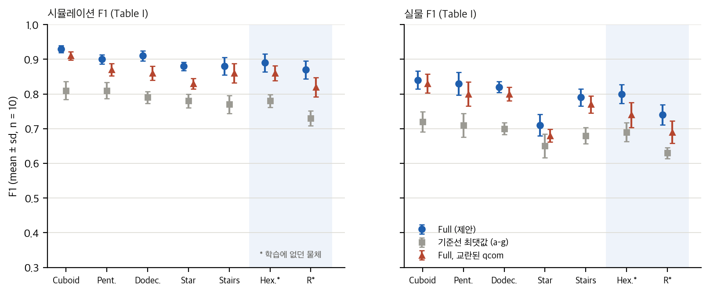
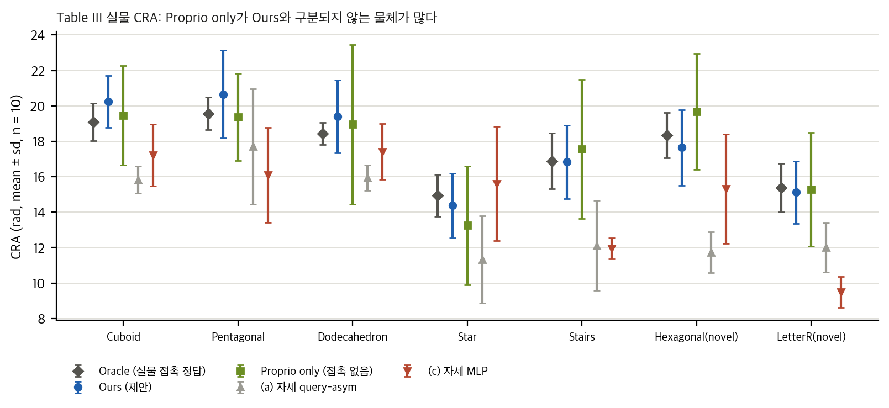
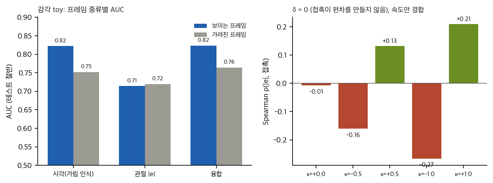
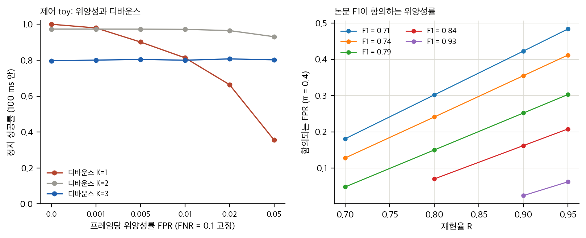

# NoContactNoWorries: 손목 영상과 관절 자세로 접촉을 맞힐 수 있는가

촉각 센서 없이 접촉을 알 수 있다면 in-hand 조작 정책이 센서 비용과 취약성을 피할 수 있습니다. NoContactNoWorries(arXiv:2606.24450v2, IROS 2026 채택)는 이 질문에 답합니다. 손목 RGB-D 특징과 관절의 현재·명령 자세를 묶어 손가락 끝 4곳의 이진 접촉을 예측하고, 그 예측을 시뮬레이션에서 학습한 회전 정책에 실제 접촉 대신 넣습니다. 이 글은 논문을 표와 검정 기준으로 다시 읽은 기록입니다.

## 방법 한 줄 요약

고정된 RGB-D 인코더(AsymFormer)의 시각 토큰을, 현재 자세 질의와 명령 자세 질의로 따로 교차 어텐션합니다. 두 출력을 이어 붙이고, 길이 8의 인과 transformer와 sigmoid 머리로 접촉을 냅니다. 손실은 BCE입니다.

## 칸별 F1 우위는 견고하다

Table I의 시뮬레이션·실물 14칸 모두에서 Full은 모든 기준선(자세 세 변형, 시각 전용, 시간 모델 없음, 운동학 깊이)보다 높습니다. Welch 검정과 Holm 보정 후에도 시뮬레이션은 p < 10⁻⁷, 실물은 p ≤ 0.00065입니다. 학습에 없던 두 물체(Hexagonal Prism, Letter R)도 seen 물체 범위 안에 있습니다.

다만 ± 는 뜻이 적혀 있지 않습니다. 표준오차로 읽으면 실물 Star 칸은 유의하지 않습니다. 10 splits 평균 한 개로 보고하고 검증과 테스트를 나누지 않았으므로, 이 수치는 모델 선택 뒤의 값일 수 있습니다.

## 가림 조건별 F1은 기저율을 함께 봐야 한다

Table II는 가림 조건별 F1을 보여 줍니다. 가림 비율 61%로 가중하면 Table I의 같은 물체 칸과 ±0.01 안에서 맞습니다. 그러나 조건별 F1은 접촉 비율이 조건마다 다르면 직접 비교할 수 없습니다. 감각 toy에서 가려진 프레임의 접촉 비율은 0.55, 보이는 프레임은 0.20이었고, F1은 가려진 쪽이 높게 나왔지만 AUC는 보이는 쪽이 높았습니다. 이 논문의 "자세 변형이 가림에서 더 낫다(0.81 대 0.75)"는 같은 이유로 해석이 어렵습니다.

## 실물 downstream에서는 주장이 흔들린다

Table III의 실물 CRA에서 접촉 없이 관절만 쓴 변형은 Stairs, Hexagonal, Letter R에서 제안 방법과 같거나 높습니다. 본문은 "시각을 빼면 결손이 남는다"고 쓰지만, 표가 굵게 표시한 칸도 그 변형입니다. 평균 CRA는 제안 방법 17.75, 접촉 없음 17.65, Oracle 17.52로 셋이 거의 같습니다.

차이를 판단하려면 검출력이 필요합니다. 시행 10회에서 CRA는 80% 검출력으로 2.3 rad 이상 차이만 잡습니다. 본문 칸의 차이(최대 2 rad)는 그보다 작아서 "차이가 없다"도 "있다"도 말할 수 없습니다. 자세 질의 비대칭은 F1에서는 14/14로 일관되지만, downstream에서는 MLP 변형이 4칸에서 더 높습니다.

## Fig. 6의 상관은 접촉 증거로 부족하다

관절 추종 오차와 접촉의 Spearman 상관(중앙값 약 0.3)은 시간 셔플 대조와 비교합니다. 그러나 셔플은 시간 정렬만 끊습니다. 접촉 편차가 전혀 없고 정책이 접촉 중에 속도만 바꾸는 toy에서도 ρ = −0.27–+0.21, 관절 AUC 0.63–0.65가 나옵니다. 접촉과 속도가 함께 움직이면 이 상관은 접촉 감지 없이도 생깁니다.

## 위양성은 정지 제어기에 치명적이다

접촉 신호로 멈추는 제어기 toy에서 디바운스가 없으면(K = 1) 프레임당 위양성률 1%에 성공률이 82%, 5%에 36%로 떨어집니다. 디바운스 K = 2는 위양성을 거의 없애지만 위음성 0.1에서 성공률 0.97, K = 3은 위음성에 0.80으로 묶입니다. 논문 Table I의 F1은 같은 값이라도 위양성률 7–21%에 대응할 수 있어서(접촉 비율 0.4 가정), F1만으로 제어 성능을 가늠하기 어렵습니다.

정책은 깨끗한 정답 접촉으로만 학습했습니다. 추론 시 접촉 오류에 얼마나 강한지는 논문에 보고되지 않았습니다.

## 구현할 수 있는가

공식 재현은 불가능합니다. 모델·학습·데이터 코드가 공개되지 않았고(프로젝트 페이지는 Coming Soon, 저장소는 웹사이트만 있음), 시뮬레이션은 NVIDIA GPU용 Isaac Gym, 실물은 LEAP Hand와 FSR 센서가 필요합니다. 아이디어의 접촉 헤드는 수백 줄로 옮길 수 있습니다. 어려운 부분은 학습 데이터입니다. 평가는 논문보다 엄격하게 다시 설계하는 것을 권합니다(가림별 AUC, 접촉 비율 보고, 속도 대조 기준 모델, 검출력 계산).

## 정리

- F1 우위는 칸별로 견고합니다. 물체 2개의 일반화는 약한 증거입니다.
- 정책 성능 주장(시각 기여, Oracle 근접, 자세 변형 순서)은 실물 downstream에서 검출 불가능하거나 표와 맞지 않습니다.
- Fig. 6 상관은 속도 결합을 걸러내지 못합니다.
- 접촉 추정기는 F1보다 위양성률과 디바운스로 평가해야 제어 결과를 예측할 수 있습니다.

분석 문서, 재계산 스크립트, toy 코드는 게시본 `git/` 폴더에 있습니다. 논문 그림은 CC BY-SA 4.0이라 게시하지 않았고, 그림은 수치로 직접 그렸습니다.

## 자료

- [통합 리포트 PDF](report/report_public.pdf)
- [01. 논문 분석: NoContactNoWorries](analysis/01_paper_analysis.md)
- [02. 선행연구와 관계](analysis/02_prior_work.md)
- [03. 수치 재계산, 통계 검정, 유도, toy](analysis/03_analysis.md)
- [04. 주장 검증과 구현 가능성](analysis/04_claim_verification.md)
