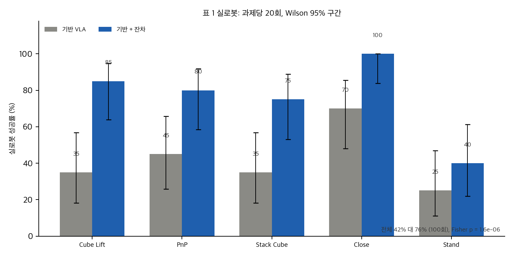
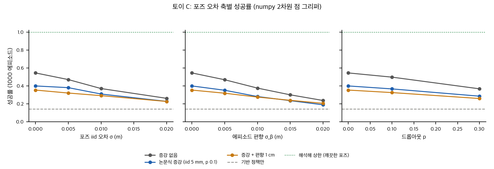
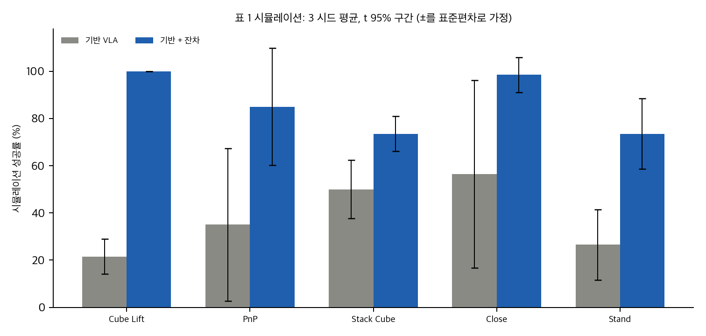

> **논문:** Kinam Kim, Namiko Saito, Heecheol Kim, Katsushi Ikeuchi, Jaegul Choo, Yasuyuki Matsushita. *Object-Centric Residual RL for Zero-Shot Sim-to-Real VLA Enhancement.* CoRL 2026 포스터, arXiv:2606.18953 (v1, 2026-06-17 제출).
> 공식 코드는 찾지 못했습니다. 논문 그림은 싣지 않고, 우리가 만든 그래프만 씁니다.

## 논문이 묻는 것

VLA는 모방학습이라서 작은 실행 오차가 쌓이면 학습 분포 밖으로 밀려납니다. 동결한 VLA 위에 보정 정책을 얹는 잔차 RL은 이 문제에 맞지만, 시뮬레이션에서 배운 잔차를 실로봇에 옮기기 어렵습니다. 논문의 답은 잔차가 보는 관측을 **물체 6자유도 포즈, 고유감각, 기반 VLA 행동**으로 줄이는 것입니다. 이미지를 보지 않으니 시각 격차가 생기지 않고, 시뮬레이션은 실물처럼 그릴 필요가 없습니다. 시뮬레이션의 VLA 짝은 같은 원격조작 행동을 재생해 만듭니다.

Franka FR3에서 과제 5개를 평가했고, 기반 VLA의 평균 성공률은 42%에서 76%로 올랐다고 보고합니다. 잔차 롤아웃으로 VLA를 다시 학습하면 성공률이 59%까지 올라간다는 결과도 있습니다.

## 이 글에서 확인한 것

- **실로봇 재계산.** 100회 합계로 42/100과 76/100을 비교하면 Fisher 정확검정 p ≈ 1.6e-6이고, 차이의 95% 구간은 21–46%p입니다. 그러나 과제당 20회이고, 5개 과제가 모두 올랐어도 부호 검정의 양측 p는 0.0625입니다. Stand Cup Up은 5/20에서 8/20으로 올랐지만 이 차이는 통계적으로 구별되지 않습니다.

그래프: 실로봇 과제별 성공률과 Wilson 95% 구간(과제당 20회). 우리가 그린 그래프입니다.

- **절제.** 포즈 탈락 장치를 빼면 성공이 76에서 58로 떨어집니다(p = 0.010). 잡음 주입을 빼면 69로 떨어지지만 이 차이는 유의하지 않습니다(p = 0.34). "잡음 주입이 허용 오차가 좁은 과제에 도움이 된다"는 서술은 Close Drawer가 20/20으로 변하지 않아서 이 표로는 확인되지 않습니다.
- **시뮬레이션과 실로봇의 구조.** 기반 VLA의 과제별 성공률은 시뮬레이션과 실로봇에서 r = 0.71입니다. 과제가 5개뿐이라 이 상관은 판단하기 어렵습니다. 같은 실패 분포라는 주장은 아직 근거가 약합니다.
- **서술과 표 값의 차이.** "거의 두 배"라는 표현은 실로봇 값으로 1.8배입니다.

## 토이로 본 포즈 오차

논문의 독립 잡음 모델이 놓치는 것을 보려고 2차원 점 그리퍼 토이를 만들었습니다. 기반 정책은 포즈와 독립인 2 cm 오차를 갖고, 잔차는 노이즈가 섞인 포즈를 보고 이를 고칩니다. 포즈에 에피소드마다 상수 편향 β가 있으면, 잔차는 물체를 o + β로 보내게 되므로 최종 오차는 |β|가 됩니다. 이론상 1 cm 허용 오차에서 성공 확률은 1 − exp(−1/2) ≈ 0.39이고, 토이의 해석해 상한은 0.404로 이 값과 맞았습니다.

그래프: 토이의 포즈 오차 축별 성공률(1000 에피소드). 학습된 잔차는 덜 수렴해 증강 효과를 판정하지 못했습니다. 우리가 그린 그래프입니다.

상수 편향은 잔차로 고칠 수 없습니다. 실제 추정기의 실패가 드리프트나 잘못된 물체라면 독립 잡음보다 이 경로에 가까울 수 있습니다. 토이는 실험 설계의 결함을 보여 주는 장치이지 과제의 성공률을 예측하지 않습니다.

## 이 맥에서 구현할 수 있는가

Apple M4 Pro와 CUDA 없는 환경에서 실로봇 평가와 VLA 자기 개선은 할 수 없습니다. 시뮬레이션 쪽은 다릅니다. MuJoCo로 5과제를 만들고 TD3로 2층 MLP 잔차를 학습하는 골격은 구현할 수 있습니다. 기반 행동을 GR00T-N1.5 대신 고정 정책으로 바꾸면 모델 다운로드도 필요 없습니다. 이 경우는 논문과 다른 실험입니다. 노력은 2–3주로 추정합니다.

그래프: 시뮬레이션 평균과 3 시드 기준 t 95% 구간. ±의 정의는 논문에 없어 표준편차로 가정했습니다. 우리가 그린 그래프입니다.

## 읽을 때 조심할 것

- 실로봇 결과는 과제당 20회입니다. 과제별 차이를 확정하려면 25–30회가 필요합니다.
- 관측 공간 대조의 베이스라인(이미지, 증류)은 학습 파이프라인이 다릅니다. 관측만의 효과로 읽으면 안 됩니다.
- 재현에 필요한 정보가 많이 빠졌습니다. 보상 식, 학습 스텝 수, FR3 모델 출처, SFT 롤아웃 수입니다.

## 정리

잔차 RL을 포즈 기반 관측으로 바꾼다는 생각은 깔끔하고, 실로봇 결과는 방향이 분명합니다. 다만 통계와 대조는 아직 얇습니다. 이 논문에서 가장 가져갈 것은 설계 체크리스트입니다. 포즈 편향은 잔차로 못 고친다는 점, 기반 행동이 물체 정보를 새는지 확인해야 한다는 점입니다.

## 자료

- [통합 리포트 PDF](report/report_public.pdf)
- [01. 논문 분석: Object-Centric Residual RL](analysis/01_paper_analysis.md)
- [02. 선행 연구와 가까운 대안](analysis/02_prior_work.md)
- [03. 수치 재계산, 통계 검정, 토이 검증](analysis/03_analysis.md)
- [04. 주장 검증과 구현 가능성](analysis/04_claim_verification.md)
