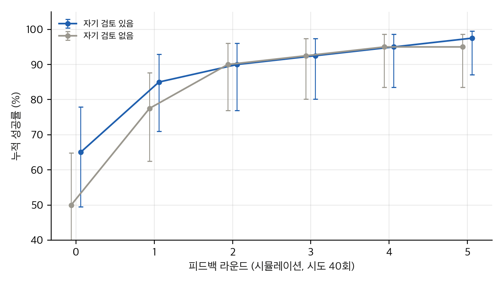
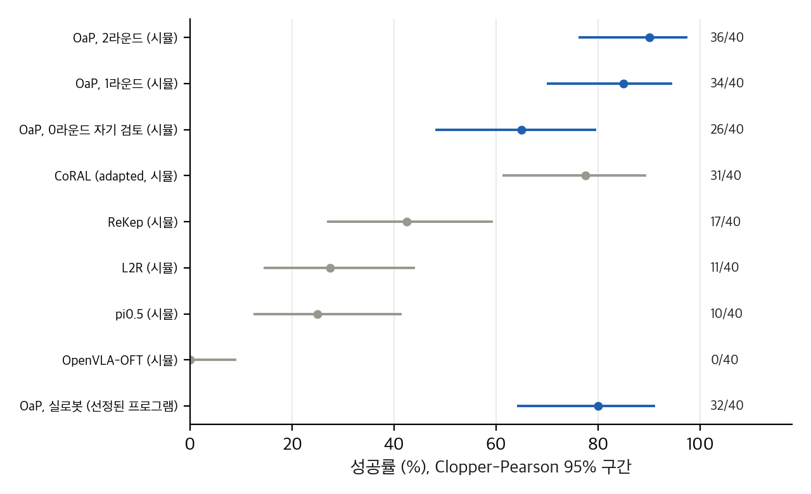

# 03. 표 재계산, 일관성 검사, 통계 검정

이 문서는 논문 표 값을 시도 수로 되돌려 합계, 비율, 신뢰구간, 검정을 다시 계산한 결과입니다. 재현 실험은 하지 않았습니다. 계산은 `analysis/recompute.py`(numpy, scipy)로 했고 결과는 `analysis/recompute_results.json`에 있습니다. 그래프 두 장은 `analysis/plot_figures.py`로 그렸습니다. 조사일 2026-11-22.

**읽는 법.** 시뮬레이션 과제당 시도는 10회이고, 전체는 40회입니다. 실로봇은 프로그램 20개 x 장면 2개 = 40회입니다. 같은 과제 안에서 시도는 짝이 없습니다. 그래서 McNemar 같은 짝 검정을 쓸 수 없고, 모든 시도를 독립으로 보는 Fisher 정확 검정을 씁니다. 이 가정은 과제 간 차이를 과대평가할 수 있습니다. 여러 기준선 비교는 Holm으로 보정합니다.

## 1. 표 합계와 일관성

| 검사 | 결과 |
|---|---|
| Table II, 자기 검토 없음: 과제별 합 → 라운드 0–5 | 20, 31, 36, 37, 38, 38. **논문 합계와 모두 일치** |
| Table II, 자기 검토 있음 | 26, 34, 36, 37, 38, 39. **논문 합계와 모두 일치** |
| 두 조건 모두 라운드에 따라 누적이 줄지 않음 | 일치 (carry-forward와 맞음) |
| Table II 0라운드 ↔ Table III 절제 행 | 자기 검토 없음 0라운드(6,4,4,6) = "라이브러리 있음, 자기 검토 없음". 자기 검토 있음 0라운드(9,4,7,6) = "라이브러리 있음, 자기 검토 있음". **두 표가 일치** |
| Table III, 기준선과 절제: 과제 합 → 전체 | 10개 행 모두 일치 (예: L2R 2+3+4+2 = 11; CoRAL 7+6+10+8 = 31; OaP 10+7+10+9 = 36) |
| Table IV, 작은 교란 17/20, 큰 교란 15/20 | 합 32/40 **일치**. 과제별 8, 7, 8, 9 / 10 **일치** |
| 초록의 90%(2라운드), 97.5%(5라운드) | Table II의 36/40, 39/40과 일치 |
| 본문 "95%(없음), 97.5%(있음)" (5라운드) | 38/40, 39/40 **일치** |
| 본문 "20/40 → 26/40" (0라운드) | Table II 일치 |
| 본문 "20% vs 50%, 35% vs 65%" | Table III 8/40, 20/40, 14/40, 26/40 **일치** |
| 시간 예산: 250 갱신 x 40 제어 x 2 ms | 20.0 s. 본문 "20 s of commanded motion"과 **일치**. 제어 주기 2 ms라는 해석을 지지합니다 |

**결론.** 표 안의 숫자는 모두 내부적으로 맞습니다. 이 검사로 잡힌 불일치는 없습니다. 불일치는 공식 코드와 논문 사이에서 나옵니다(`04`).

## 2. 검정 (Fisher 정확 검정, 양측과 단측)

| 비교 | 차이 (pp) | 양측 p | 단측 p | Holm (5개 기준선) | 판정 |
|---|---|---|---|---|---|
| 0라운드: 자기 검토 있음 26/40 vs 없음 20/40 | +15.0 | 0.258 | 0.129 | - | **검정되지 않음** |
| 0라운드, 자기 검토 없음: 라이브러리 20/40 vs 없음 8/40 | +30.0 | 0.0093 | 0.0047 | - | 유의 |
| 0라운드, 자기 검토 있음: 라이브러리 26/40 vs 없음 14/40 | +30.0 | 0.0134 | 0.0067 | - | 유의 |
| 2라운드 OaP 36/40 vs CoRAL (adapted) 31/40 | +12.5 | **0.225** | 0.112 | **0.225** | **검정되지 않음** |
| 1라운드 OaP 34/40 vs CoRAL 31/40 | +7.5 | 0.568 | 0.284 | - | 검정되지 않음 (논문은 "더 좋다"고 씀) |
| 2라운드 OaP 36/40 vs ReKep 17/40 | +47.5 | 0.00001 | 0.00001 | 0.00001 | 유의 |
| 2라운드 OaP vs L2R 11/40 | +62.5 | 0.000000 (반올림 0) | 0 | 0 | 유의 |
| 2라운드 OaP vs π0.5 10/40 | +65.0 | 0 (반올림) | 0 | 0 | 유의 |
| 2라운드 OaP vs OpenVLA-OFT 0/40 | +90.0 | 0 (반올림) | 0 | 0 | 유의 |
| 실로봇 32/40 vs 시뮬 2라운드 36/40 | -10.0 | 0.348 | 0.943 | - | **적용 불가** (아래 §5) |
| 실로봇 작은 교란 17/20 vs 큰 교란 15/20 | +10.0 | 0.695 | 0.347 | - | 차이 없음 (검정력이 낮음) |
| 5라운드: 자기 검토 있음 39/40 vs 없음 38/40 | +2.5 | 1.000 | 0.500 | - | 차이 없음 |

**무엇이 말해지는가.**
- 논문의 두 주장 중 "라이브러리가 중요하다"는 **지지됩니다**(p ≈ 0.01).
- "자기 검토가 첫 실행을 올린다"는 방향은 맞지만 **검정되지 않습니다**(p = 0.26). 논문은 이 차이를 "가장 큰 개선"이라고 쓰지만, 40 시도로는 15 pp를 구별할 수 없습니다(§4).
- "OaP가 기준선보다 낫다"는 **ReKep, L2R, π0.5, OpenVLA-OFT에는 지지됩니다**. **CoRAL 재구현에는 지지되지 않습니다**(p = 0.22). 논문 §IV-C는 "CoRAL은 가장 가깝지만 1 Hz의 잦은 LLM 갱신이 필요하다"고 쓰는데, 성공률 차이로는 근거가 없습니다.

## 3. 신뢰구간 (95%)

| 항목 | k/n | 비율 | Wilson | Clopper-Pearson |
|---|---|---|---|---|
| OaP 2라운드 (시뮬) | 36/40 | 90.0% | 76.9–96.0 | 76.3–97.2 |
| OaP 1라운드 (시뮬) | 34/40 | 85.0% | 70.9–92.9 | 70.2–94.3 |
| OaP 0라운드 자기 검토 있음 (시뮬) | 26/40 | 65.0% | 49.5–77.9 | 48.3–79.4 |
| OaP 0라운드 자기 검토 없음 (시뮬) | 20/40 | 50.0% | 35.2–64.8 | 33.8–66.2 |
| CoRAL (adapted, 시뮬) | 31/40 | 77.5% | 62.5–87.7 | 61.5–89.2 |
| ReKep (시뮬) | 17/40 | 42.5% | 28.5–57.8 | 27.0–59.1 |
| 실로봇 | 32/40 | 80.0% | 65.2–89.5 | 64.4–90.9 |
| 실로봇 작은 교란 | 17/20 | 85.0% | - | 62.1–96.8 |
| 실로봇 큰 교란 | 15/20 | 75.0% | - | 50.9–91.3 |

**해석.** 실로봇 80%의 하한은 64%입니다. OaP 2라운드(90%)의 하한은 76%입니다. CoRAL(77.5%)의 구간은 OaP 2라운드와 크게 겹칩니다. 시뮬레이션 0라운드 두 조건(65%와 50%)의 구간도 겹칩니다. ReKep(42.5%)의 상한 59%는 OaP 2라운드의 하한 76%보다 낮습니다. 즉 ReKep과의 차이는 구간이 겹치지 않습니다. 전체 `recompute_results.json`에는 모든 항목의 구간이 있습니다.

*그림: 라운드별 누적 성공률. 표 II 합계에서 그렸고, 구간은 Wilson 95%입니다. 우리가 그린 그래프입니다.*

*그림: 방법별 성공률. 표 III과 IV에서 그렸고, 구간은 Clopper-Pearson 95%입니다. 실로봇은 시뮬 성공 프로그램 선택 후 값이라 직접 비교할 수 없습니다.*

## 4. 검정력: 40 시도로 무엇을 잡을 수 있는가

정규 근사 (양측 5%, 검정력 80%, 두 집단 n = 40). 최소 검출 차이(pp)는 기준 비율에 따라 다음과 같습니다.

| 기준 성공률 | 20% | 50% | 65% | 80% | 90% |
|---|---|---|---|---|---|
| 최소 검출 차이 (pp) | 25 | 31 | 30 | 25 | 19 |

**해석.** 40 시도로 잡을 수 있는 차이는 약 20–30 pp입니다. 자기 검토 효과(15 pp), CoRAL과의 차이(12.5 pp), 5라운드 차이(2.5 pp)는 모두 이보다 작습니다. 따라서 이 실험은 "차이가 없다"는 결론도 "차이가 있다"는 결론도 내릴 수 없습니다. 논문이 세부 차이를 해석하는 것(예: "자기 검토는 첫 실행에서 가장 크다")은 이 검정력에서 과합니다.

## 5. 실로봇의 선택 편향

실로봇 프로그램 20개는 **시뮬레이션에서 성공한 프로그램**에서 골랐습니다(§IV-D). 그래서 시뮬레이션 성공은 이 프로그램들에 대해 정의상 100%입니다. 실로봇 80%는 "시뮬 성공 프로그램이 실물에서 얼마나 성공하는가"입니다. 전체 시뮬 2라운드(90%)와 직접 비교하면 안 됩니다. 두 숫자의 차이 -10 pp(p = 0.35)는 표본 선택 때문에 해석할 수 없습니다.

또한 "5개 프로그램 x 2장면"에서 프로그램 하나는 장면을 바꾼 두 번으로 평가됩니다. 즉 독립 표본은 20개 프로그램입니다. 40회를 독립으로 세면 신뢰구간이 과장됩니다. 프로그램 단위로 묶은 구간은 논문에 없습니다.

## 6. 본문과 표의 작은 차이

- §IV-C는 CoRAL "is the closest to ours"라고 쓰고, Table III은 CoRAL 31/40, ReKep 17/40으로 맞습니다. 다만 CoRAL 행의 pick-and-place 7/10은 ReKep 9/10보다 낮습니다. 이는 "가장 가깝다"가 전체 기준이라는 뜻입니다.
- Table IV 캡션은 "Real-world success of simulation-successful programs"이고 본문은 "five objective programs that succeed in simulation"입니다. 두 설명은 같습니다.
- 본문은 "perturb object locations"라고만 쓰고 "small"과 "large"의 크기를 정의하지 않습니다(`01` §7.2).
- 프로젝트 페이지의 "at most three executions per trial"은 2라운드 설정(1 + 2)과 맞습니다.

## 7. 제어기 산술 점검

- 갱신당 적용 제어 B = 40, 제어 주기 2 ms, 갱신 최대 250회: 250 x 40 x 0.002 = 20 s. 본문 "20 s"와 일치합니다.
- H = 600 물리 스텝 x 2 ms = 1.2 s의 예측 구간입니다. 이 값은 공식 코드의 `horizon_steps: 600`과 맞습니다(`04` §2).
- λ 초기값 1.0은 공식 코드의 `mppi_temperature: 1.0`과 맞습니다(`04` §2).

## 8. 맥에서의 계산 비용 (참고)

이 분석은 표 값에 대한 계산만 했습니다. 디지털 트윈과 MPC 롤아웃의 계산 비용은 측정하지 않았습니다. 논문의 MPC는 N = 1000 롤아웃, H = 600 스텝을 GPU에서 병렬로 돌립니다(§III-C). 이 맥(CUDA 없음)에서의 가능성은 `README.md`와 `04` §4에서 다룹니다.
