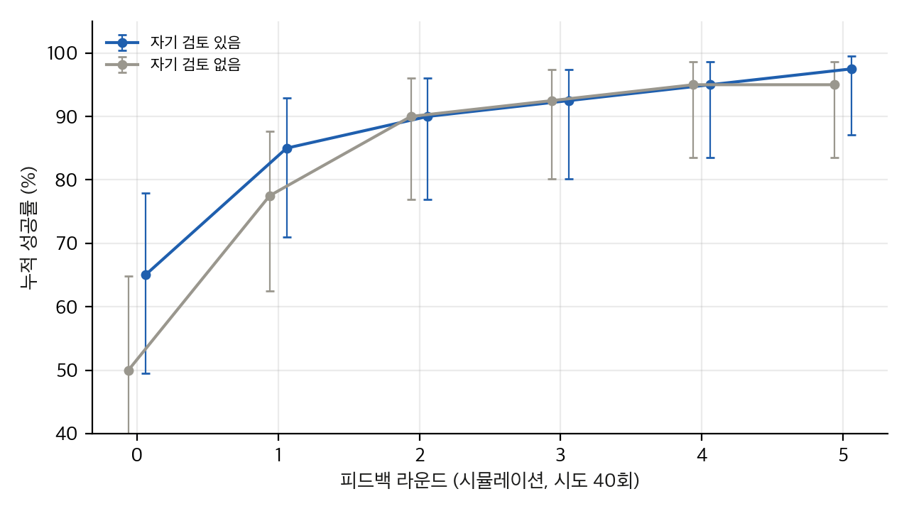
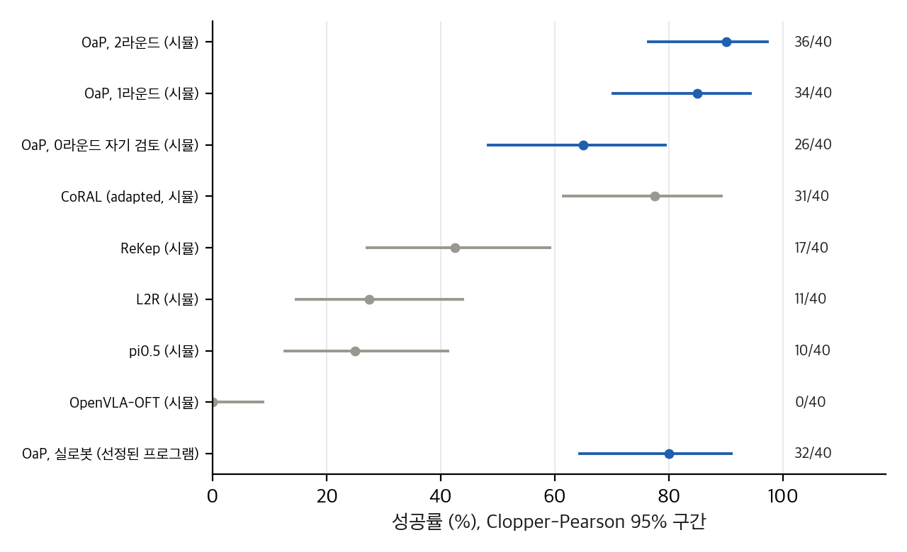

> **논문:** Zihao Lu, Trong Gia Hung Nguyen, Fuquan Wang, Yifan Zhu. *Objectives as Policies: Vision-Language Model Cost Programs for Contact-Rich Manipulation.* arXiv:2611.18298 (v1, 2026-11-13 제출). 학회 표기 없음.
> 공식 코드(Apache-2.0, ZihaoLu001/OaP)는 정적으로만 읽었고 실행하지 않았습니다. 논문 그림은 싣지 않고, 표 값에서 우리가 그린 그래프 두 장만 씁니다.

## 논문이 묻는 것

접촉이 많은 조작에서는 물리 기반 MPC가 실시간으로 잘 움직이지만, 보상과 제약을 과제마다 손으로 짜야 합니다. 반대로 VLA는 일반화하지만 물리 계획이 없습니다. OaP는 이 둘을 **편집 가능한 목표 프로그램**으로 잇습니다. VLM이 단계의 순서를 쓰고, 각 단계는 고정된 비용 라이브러리에서 고른 달리는 항과 끝 항, 그리고 완료 임계값으로 이루어집니다. 프로그램은 샘플링 MPC(MPPI)가 실행합니다.

## 방법

- **목표 프로그램.** 단계 S = (달리는 항 R, 끝 항 T, 가중치 w, 임계 τ)의 순서입니다. 잔차 r는 √(1+(r/s)²) − 1 형태로 비용이 되고, 끝 항은 임계 안에서 비용이 0입니다.
- **디지털 트윈.** 장면을 메시와 자세로 재구성해 MPC의 계산 모델로 씁니다. 실로봇에서는 자세를 계속 갱신합니다.
- **VLM 수정 루프.** 초안을 쓰고 자기 검토를 한 번 합니다. 시뮬레이션 실행이 실패하면, 실행 기록에서 6개 상태를 균등 간격으로 뽑아 VLM에 줍니다.

## 결과와 검정

논문은 과제 4개(pick-and-place, cup reorientation, direct push, push with tool)에서 시뮬레이션은 과제당 10회, 실로봇은 프로그램 20개를 두 장면에서 한 번씩 실행했습니다. 표를 시도 수로 되돌려 합계를 다시 계산했더니 모든 표가 맞았습니다. 검정은 Fisher 정확 검정을 썼습니다.

| 비교 | 결과 | 판정 |
|---|---|---|
| 라이브러리 있음 vs 없음 (자기 검토 없음, 0라운드) | 20/40 vs 8/40 | 유의 (p ≈ 0.009) |
| 자기 검토 있음 vs 없음 (0라운드) | 26/40 vs 20/40 | 검정되지 않음 (p = 0.26) |
| OaP 2라운드 vs CoRAL 재구현 | 36/40 vs 31/40 | 검정되지 않음 (p = 0.22) |
| OaP 2라운드 vs ReKep, L2R, π0.5, OpenVLA-OFT | 17, 11, 10, 0 / 40 | 유의 (p < 0.0001) |

*그림: 라운드별 누적 성공률. 표 II의 합계에서 그렸고, 구간은 Wilson 95%입니다. 우리가 그린 그래프입니다.*

*그림: 방법별 성공률. 표 III과 IV에서 그렸습니다. 실로봇 막대는 시뮬레이션에서 성공한 프로그램만 고른 뒤의 값이라 직접 비교할 수 없습니다.*

40 시도로는 약 25–30 pp보다 작은 차이를 잡을 수 없습니다. 그래서 자기 검토의 15 pp 개선과 CoRAL과의 12.5 pp 차이는 논문이 말하는 만큼 확실하지 않습니다.

## 실로봇 80%를 읽는 법

실로봇 32/40은 시뮬레이션에서 성공한 프로그램 20개를 물체 위치를 바꾼 두 장면에서 실행한 결과입니다. 시뮬레이션 성공은 이 프로그램들에서 정의상 100%이므로, 전체 시뮬레이션 2라운드 90%와 나란히 놓으면 안 됩니다. 실패는 주로 파지에서 나왔고, 저자는 VLM이 추정한 마찰과 강체 가정을 원인으로 듭니다.

## 공식 코드와 논문이 다른 곳

공식 저장소는 2026-09-29 단일 커밋입니다. 설정 파일의 VLM은 논문과 같은 GPT-5.6-sol이지만, 코드 기본값은 다른 모델입니다. 공개 파이프라인의 피드백 상한은 2라운드이고, 논문 Table II의 5라운드 97.5%는 공개 코드로 재현할 수 없습니다. 또 타입별 고정 가중치(접촉 10, 도구 매개 4)와 과제별 단계 검사가 있는데, 논문은 이를 언급하지 않습니다. 롤아웃 수 N과 접두사 B도 프로필에 따라 논문과 다른 값이 있습니다. 저자에게 확인이 필요한 항목입니다.

## 이 맥에서 할 수 있는 것

- **재현은 불가능합니다.** VLM 호출, CUDA에서 도는 MuJoCo-warp MPC, 장면 재구성, 실로봇이 모두 필요합니다.
- **표 재계산과 검정은 가능합니다.** numpy와 scipy로 끝냈습니다.
- **축소판은 조건부로 가능합니다.** CPU MuJoCo에서 비용 항과 단계 검증기, MPPI를 옮기는 작업입니다. 노력은 1–2주로 추정했고 측정하지 않았습니다.

## 한 줄 평

접촉 조작을 목표 프로그램으로 쓰는 발상은 명확합니다. 다만 공개된 증거에서 강하게 지지되는 것은 "라이브러리와 단계 구조가 도움이 된다"는 점이고, 자기 검토와 CoRAL 대비 우위는 더 많은 시도가 필요합니다.

## 자료

- [통합 리포트 PDF](report/report_public.pdf)
- [01. 논문 분석: Objectives as Policies (OaP)](analysis/01_paper_analysis.md)
- [02. 선행연구와 관련 저장소](analysis/02_prior_work.md)
- [03. 표 재계산, 일관성 검사, 통계 검정](analysis/03_analysis.md)
- [04. 논문 ↔ 공식 코드 대조 (정적 읽기)](analysis/04_code_verification.md)
