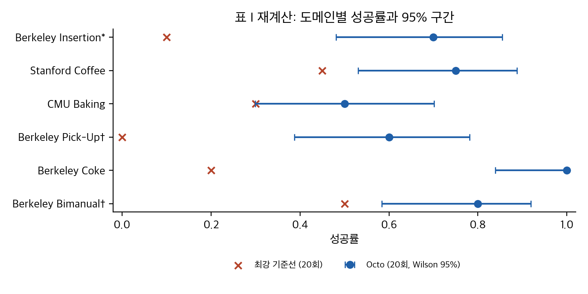
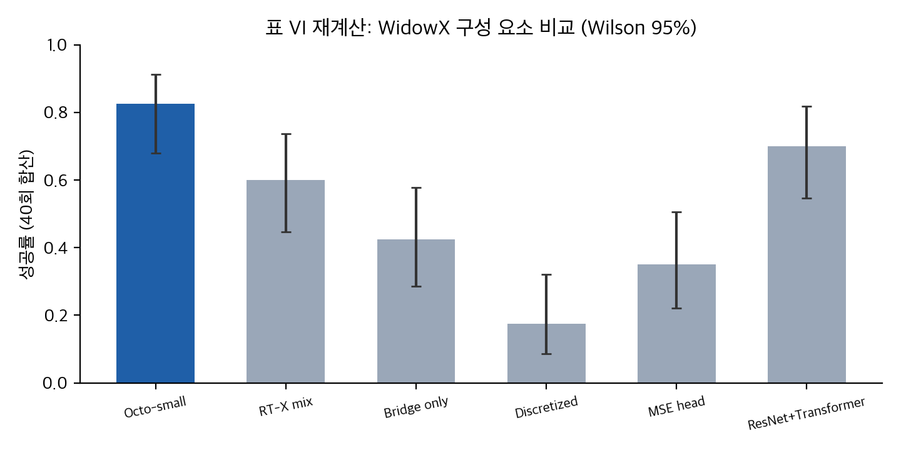

# 03. 수치 재계산과 일관성 검사 (Octo)

재계산 스크립트는 `analysis/recompute.py`, 결과는 `analysis/recompute_results.json`입니다. 입력은 논문 본문과 표에서 옮긴 값이고(`paper/paper.txt`, 레이아웃 추출로 대조), 시도별 원자료는 공개되지 않았습니다. 그래서 모든 검정은 **보고된 성공 수와 시도 수**를 기준으로 합니다. 검정은 두 집단 Fisher 정확검정(양측)이고, 신뢰구간은 Wilson 95%입니다. 다중 비교 보정은 하지 않았습니다. 필요하면 아래에 적었습니다.

## 1. 표 I 재계산 (미세조정, 6개 도메인, 도메인당 20회)

도메인별 성공 수는 보고된 백분율 × 20 / 100입니다(모든 값이 5%의 배수라서 정수로 떨어집니다).

| 도메인 | Octo | Octo 95% 구간 | 최강 기준선 | 기준선 | Fisher p (양측) |
|---|---|---|---|---|---|
| Berkeley Insertion* | 14/20 (70%) | 0.48–0.86 | 스크래치 | 2/20 | 0.0002 |
| Stanford Coffee | 15/20 (75%) | 0.53–0.89 | 스크래치 | 9/20 | 0.105 |
| CMU Baking | 10/20 (50%) | 0.30–0.70 | VC-1 | 6/20 | 0.333 |
| Berkeley Pick-Up† | 12/20 (60%) | 0.39–0.78 | 스크래치 | 0/20 | < 0.0001 |
| Berkeley Coke | 20/20 (100%) | 0.84–1.00 | 스크래치 | 4/20 | < 0.0001 |
| Berkeley Bimanual† | 16/20 (80%) | 0.58–0.92 | VC-1 | 10/20 | 0.096 |

- **Octo가 여섯 도메인 모두에서 점추정으로 최고입니다.** 그러나 도메인별로 p < 0.05인 것은 **3개뿐입니다**(Insertion, Pick-Up, Coke). 도메인마다 20회라서 검정력이 낮습니다. Bonferroni(6개, 0.05/6 = 0.0083)로 보정해도 같은 3개가 남습니다.
- 여섯 도메인의 평균 차이를 도메인 단위로 본 쌍체 t 검정은 평균 46.7 %p, t = 4.89, p = 0.0045입니다. 표본이 6개뿐이라서 참고용입니다.
- 기준선은 도메인마다 더 높은 쪽을 골랐습니다. 이것은 기준선을 낙관적으로 고른 것이므로 Octo에 불리한 비교입니다. 그래도 Octo의 우위는 유지됩니다.
- 이 도메인들의 시연 수(약 100~120)와 평가 방식은 서로 다릅니다. 도메인을 가로지르는 평균은 과제 차이를 섞습니다.

그래프: 표 I에서 우리가 재계산한 Octo 성공률과 Wilson 95% 구간, 최강 기준선(×). 우리가 그린 그래프입니다.

## 2. "52%"의 의미와 평균 검산

- 본문은 "다음으로 좋은 기준선보다 **52%** 높다"고 씁니다(§IV-B). 평균은 Octo 72.5(보고 72), 스크래치 20.0, VC-1 15.8(보고 15)입니다.
- 가장 좋은 기준선은 스크래치(20.0)입니다. 차이는 **52.5 %p**(보고값으로는 72 − 20 = 52)입니다. 상대 비율로 쓰면 약 +262%입니다.
- 결론: 52는 **백분율 포인트**입니다. 상대 비율로 읽으면 과장됩니다(V1).
- 보고 평균 15는 VC-1의 실제 평균 15.8과 맞지 않습니다. 반올림 방식(버림)이 다른 것으로 보입니다. 큰 문제는 아닙니다(V2).

## 3. 표 II = 표 VI 재계산과 구성 요소 검정 (WidowX, 과제당 10회 × 4과제 = 40회)

| 조건 | 평균 (보고) | 재계산 평균 | 40회 합산 | 95% 구간 | Octo 대비 Fisher p |
|---|---|---|---|---|---|
| Octo-Small | 83 | 82.5 | 33/40 | 0.68–0.91 | (기준) |
| RT-X 데이터 혼합 | 60 | 60.0 | 24/40 | 0.45–0.74 | 0.047 |
| ResNet+Transformer | 70 | 70.0 | 28/40 | 0.55–0.82 | **0.29** |
| Bridge 단일 데이터 | 43 | 42.5 | 17/40 | 0.29–0.58 | 0.0004 |
| MSE 헤드 | 35 | 35.0 | 14/40 | 0.22–0.51 | < 0.001 |
| 이산화 헤드 | 18 | 17.5 | 7/40 | 0.09–0.32 | < 0.001 |

- **평균 재계산은 모두 보고값과 맞습니다**(반올림 차이 0.5 이내). 과제별 값과 평균의 관계도 맞습니다.
- 확산 헤드의 우위(MSE, 이산화)는 명확합니다.
- **ViT 대 ResNet 차이는 유의하지 않습니다(p = 0.29).** 본문과 부록 E의 "ViT 구조가 낫다"는 주장은 이 표의 근거로는 약합니다. 부록 E는 ResNet이 소규모 데이터에서 낫다고도 씁니다. 그 비교(표 I의 스크래치)는 다른 설정입니다.
- 데이터 혼합(RT-X 대 Octo)은 p = 0.047로 경계선입니다. 과제 차이를 보정하지 않은 합산입니다.
- 40회 합산은 과제마다 10회인 점을 무시합니다. 과제 효과를 넣은 분석은 원자료가 있어야 합니다.

그래프: 표 VI에서 재계산한 40회 합산 성공률과 Wilson 95% 구간. 우리가 그린 그래프입니다.

## 4. 일관성 검사와 숫자 점검

| 항목 | 논문 값 | 재계산 / 점검 | 판정 |
|---|---|---|---|
| 표 III 비율 합계 | 25개 데이터셋 | 99.75% (UCSD `<0.1%`를 0.05로 넣음). 반올림 최대 ±1.25%p | 맞음 |
| 표 III 데이터셋 수 | 25 (§III-B) | 25 | 맞음 |
| 표 V 파라미터 | Small 27M, Base 93M | 트랜스포머 블록만 세면 21.2M, 84.9M (토크나이저와 헤드 제외) | 차이는 블록 밖 구성 요소로 설명 가능 (추정) |
| 사전학습 샘플 수 | 300k 스텝 × 배치 2048 = 6.1억 샘플 | 14시간 → 초당 약 1.2만 샘플, TPU 칩당 약 95 샘플/초 | 실현 가능한 범위 (추정) |
| 손목 카메라 27%, 언어 주석 56% (§V) | 본문 | 표 III는 이 정보를 주지 않음 | 검증 불가 |
| 미세조정 50k 스텝 (§IV-D) | 본문 | 공개 미세조정 설정 기본값 50000 (`scripts/configs/finetune_config.py`) | 맞음 (`04` D11) |
| 사전학습 배치 | 2048 (부록 D, 표 IV) | 공개 설정 512 | **불일치** (`04` D1) |
| 부록 F: Bimanual 시도 수 | 10회 (부록 F) | 표 I 캡션은 도메인마다 20회 | **불일치** (V3) |
| Octo-Tiny 10M | 그림 6 | 표 V와 공개 설정에 없음 | 검증 불가 (`04` D13) |

- **V3:** 부록 F(Berkeley Bimanual)는 "uncapping 과제를 10회 평가했다"고 합니다. 표 I 캡션은 "각 도메인 20회 평균"입니다. 둘 중 하나가 틀린 것입니다. 10회라면 80%는 8/10이고, 표 I의 다른 값이 모두 5%의 배수인 점은 둘 다와 맞습니다(판정 불가).
- 표 III 혼합 비율과 공개 설정의 가중치(`oxe_magic_soup`, 25개)는 표현이 다릅니다. 공개 가중치는 샘플링 가중치이고, 표 III는 균형 맞춘 뒤의 비율입니다. 데이터 크기 메타가 없어서 최종 비율을 정적으로 재현할 수 없습니다(`04` D10).

## 5. 그림이나 본문에만 있어서 재계산할 수 없는 주장

| 주장 | 위치 | 이유 |
|---|---|---|
| 평균 29% 높음 (RT-1-X 대 Octo, zero-shot) | §IV-A, 그림 5 | 막대 값이 표로 적혀 있지 않음 |
| 목표 이미지가 언어보다 25% 높음 (WidowX) | §IV-A | 같은 그림 5. 표 VI에서는 목표 과제 평균 80 대 언어 과제 85로 반대 방향입니다(과제가 다름) |
| 규모가 클수록 zero-shot이 좋아짐 | 그림 6 | 막대만 있음 |
| 데이터 27%와 56% | §V | 표 III로 검증 불가 |

## 6. 한계

- 원자료가 없어서 시도 단위 검정, 과제 효과 모형, 신뢰구간의 정확도는 제한됩니다.
- 표 I과 VI는 도메인과 과제를 합산한 값을 중심으로 씁니다. 논문의 평균 비교는 과제마다 난이도가 다르다는 점을 반영하지 않습니다.
- 그래프 두 장은 우리가 재계산한 값만 씁니다. 논문 그림은 옮기지 않았습니다.
