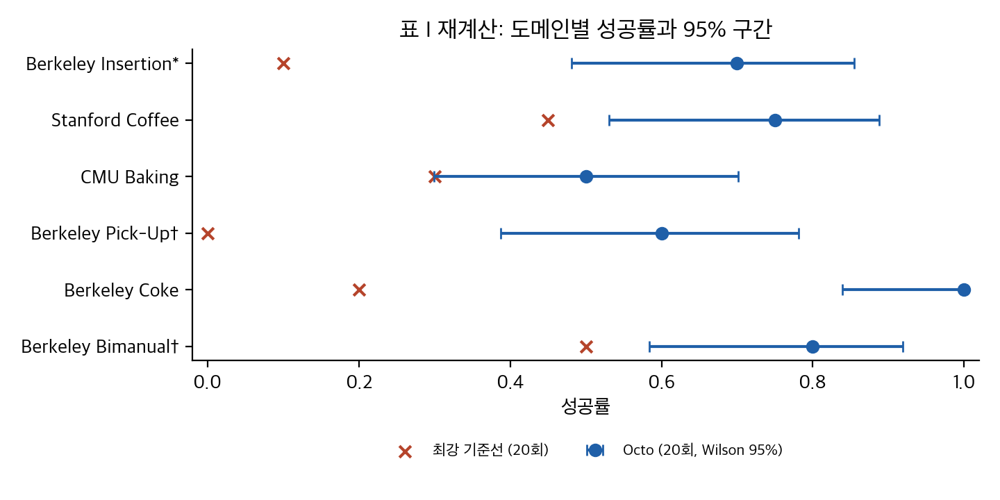
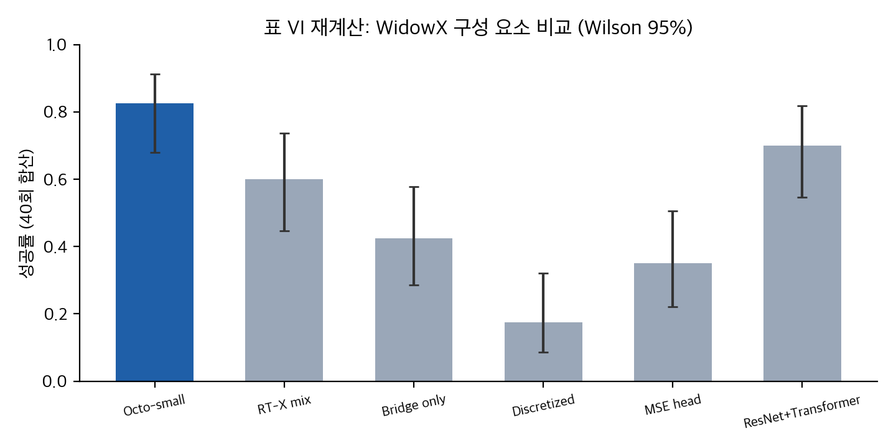

Octo는 OXE 데이터 80만 궤적으로 사전학습한 transformer 확산 정책입니다. 새 관측과 행동 공간으로 적은 데이터로 미세조정할 수 있다는 점을 강조합니다. 이 글은 논문의 표를 다시 계산하고, 공개 코드와 대조한 결과를 정리합니다.

## 한눈에

- **"52%"는 백분율 포인트입니다.** 미세조정 여섯 설정의 평균이 Octo 72.5, 스크래치 20.0이므로 차이는 52.5 %p입니다. 상대 비율로 쓰면 약 260%입니다.
- **여섯 설정 모두에서 Octo가 점추정 최고입니다.** 다만 설정마다 20회라서 p < 0.05인 것은 Insertion, Pick-Up, Coke 세 개뿐입니다.
- **확산 헤드의 우위는 뚜렷합니다.** WidowX 40회 합산에서 확산 83%, MSE 35%, 이산화 18%이고 차이는 p < 0.001입니다.
- **ViT 구조가 ResNet보다 낫다는 주장은 약합니다.** 33/40 대 28/40, p = 0.29입니다.
- **공개 사전학습 배치는 512이고, 논문은 2048입니다.** 나머지 학습 설정은 대체로 맞습니다.

## 재계산 결과

그래프: 미세조정 여섯 설정에서 Octo 성공률과 Wilson 95% 구간, 최강 기준선(×). 우리가 그린 그래프입니다.

그래프: WidowX 구성 요소별 40회 합산 성공률과 Wilson 95% 구간. 우리가 그린 그래프입니다.

## 공개 코드와 대조

공식 저장소(octo-models/octo, MIT, 커밋 241fb35)에서 학습률, 워밍업, 가중치 감쇠, 클리핑, 확산 헤드(3블록, 은닉 256, 20단계 코사인), 패치 16, 동결 T5, 300k와 50k 스텝은 논문과 맞습니다. 차이는 사전학습 배치(2048 대 512), 체크포인트 버전(`-1.5`), 본문에 없는 행동 청크 4 등입니다. 사전학습 데이터는 저자 버킷의 재처리본을 씁니다.

## 이 맥에서 할 수 있는 것

- **추론과 구조 검산은 가능합니다.** 공개 체크포인트(27M, 93M)는 CPU에서 돌릴 수 있을 것으로 보입니다. 다만 공식 코드가 JAX 기반이라 설치와 환경을 먼저 확인해야 합니다(추정).
- **미세조정과 사전학습은 불가능합니다.** 논문은 A5000 한 장에서 Base 미세조정에 약 5시간, TPU v4-128에서 사전학습에 약 14시간을 썼습니다.

자세한 분석은 저장소의 `analysis/01`–`04` 문서에 있습니다.

## 출처

- 논문: arXiv:2405.12213 (v1, v2), 라이선스 CC BY 4.0 (arXiv 초록 페이지 확인)
- RSS 2024 proceedings: roboticsproceedings.org/rss20/p090.html
- 공식 코드: github.com/octo-models/octo (MIT)

## 자료

- [통합 리포트 PDF](report/report_public.pdf)
- [01. Octo: An Open-Source Generalist Robot Policy 논문 분석](analysis/01_paper_analysis.md)
- [02. 선행연구, 구성 요소의 출처, 관련 자료 (Octo)](analysis/02_prior_work.md)
- [03. 수치 재계산과 일관성 검사 (Octo)](analysis/03_analysis.md)
- [04. 논문 ↔ 공식 코드 정적 대조 (Octo)](analysis/04_code_verification.md)
