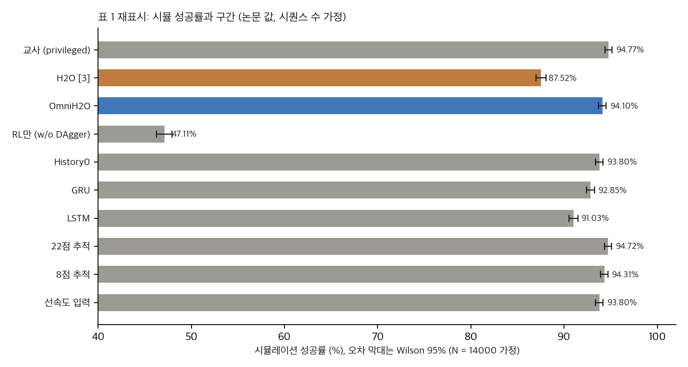
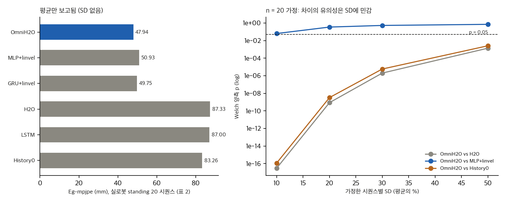
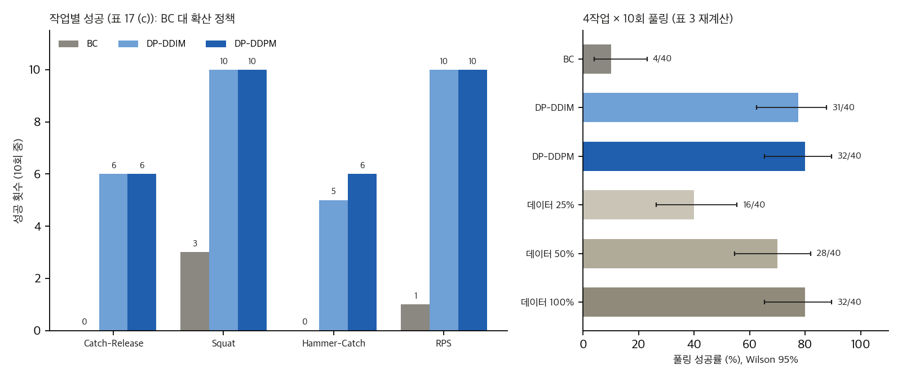

> **논문:** Tairan He, Zhengyi Luo, Xialin He, Wenli Xiao, Chong Zhang, Weinan Zhang, Kris Kitani, Changliu Liu, Guanya Shi. *OmniH2O: Universal and Dexterous Human-to-Humanoid Whole-Body Teleoperation and Learning.* CoRL 2024 (PMLR 270), arXiv:2406.08858 (v1).
> 공식 코드는 GitHub LeCAR-Lab/human2humanoid에 있습니다(H2O와 공용, README는 CC BY-NC 4.0). 이 글의 그림은 우리가 그린 그래프 세 장입니다. 논문 그림은 넣지 않았습니다(arXiv 라이선스가 비배타적 배포 허락이라 재사용 허락이 없습니다).

## 논문이 묻는 것

휴머노이드 원격조작은 하체 보행, 상체 조작, 조작 중 균형을 함께 맞춰야 합니다. 기존 H2O는 MoCap으로 얻은 전역 선속도를 입력으로 써서 이동 과제만 다룰 수 있었습니다. OmniH2O는 세 가지를 바꿉니다. 목표를 머리와 양손 3점의 키네매틱 포즈로 두고, 입력을 관절 히스토리 25스텝으로 바꾸고, 특권 정보를 가진 교사를 DAgger로 증류합니다. 그 결과 VR, RGB, 언어, GPT-4o가 같은 추적 정책을 씁니다.

## 이 글에서 확인한 것

**1. 시뮬 추적 성공률 개선은 확실합니다.** OmniH2O 94.10%, H2O 87.52%입니다. 차이는 +6.6 pp이고 95% 구간은 5.9–7.3 pp입니다. 시퀀스 수는 "14k"라고만 적혀 있어 14000으로 가정했습니다. DAgger를 빼면 47.1%로 떨어집니다.

*그림 1. 논문 표 1의 시뮬 성공률을 다시 그린 그래프입니다. 우리가 그렸습니다.*

**2. 히스토리의 시뮬 효과는 구분되지 않습니다.** 25스텝과 0스텝의 차이는 0.3 pp이고 p = 0.30입니다. 실로봇 결과는 다릅니다. 히스토리가 없으면 Eg-mpjpe가 83 mm, 있으면 48 mm입니다. 시퀀스별 변동이 평균의 50% 이하라면 p < 0.01입니다.

**3. 실로봇 결과는 표본이 작습니다.** 20 standing 시퀀스이고, 표준편차와 시드 수가 없습니다. 선속도 입력(VIO, MLP, GRU)과의 비교에서 OmniH2O가 3 mm 앞서는데, 시퀀스별 변동이 평균의 9%를 넘으면 유의하지 않습니다. 이 차이로는 "선속도가 필요 없다"고 말할 수 없습니다.

*그림 2. 표 2의 실로봇 Eg-mpjpe(왼쪽)와 시퀀스별 SD를 평균의 10–50%로 둔 Welch p값(오른쪽, n = 20 가정). 우리가 그렸습니다.*

**4. LfD에서 확산 정책이 BC보다 낫다는 결론은 확실합니다.** 작업 4개 × 10회에서 확산 정책 32/40, BC 4/40입니다(Fisher p ≈ 2e-10, 작업별 층화 검정도 같은 결론). 행동 시퀀스 예측의 효과는 약합니다(p ≈ 0.10, 층화 0.03). 논문 표 3의 두 칸은 표 17 계산과 맞지 않았습니다(50% 데이터와 Si-O-Si-A가 6.5/10으로 적혔지만 28/40이면 7.0입니다).

*그림 3. 표 17의 작업별 성공 횟수(왼쪽)와 표 3을 다시 계산한 풀링 성공률(오른쪽, Wilson 95%). 우리가 그렸습니다.*

**5. 공식 코드는 논문 설명과 다릅니다.** 논문은 "높은 걸음을 보상한다"고 설명합니다. 코드는 0.25 m보다 낮은 걸음에 벌점을 줍니다(가중치 −2500). 추적 보상의 σ도 논문 계수를 옮긴 값과 차이가 큽니다(VR 점은 약 67배 엄격). 학습 로그가 없어 어느 쪽이 실험에 쓰였는지는 판단하지 못했습니다.

**6. 코드에 없는 것.** 공식 저장소에는 학습된 정책 가중치, LfD 학습 코드, GPT-4o 연동, OmniH2O-6 데이터셋이 없습니다. 데이터셋 공개 위치도 찾지 못했습니다.

## 이 맥에서 구현할 수 있는가

**논문 수치의 재현은 불가능합니다.** 시뮬 학습에는 Isaac Gym과 CUDA가 필요하고, 실로봇에는 Unitree H1이 필요합니다. 재현하지 않고 할 수 있는 일은 세 가지입니다. 표를 다시 계산하고(완료), 보상 정의를 나란히 비교하고(numpy, 0.5–1일 추정), 학생 증류 구조를 PyTorch로 옮겨 작은 설정에서 돌려 보는 것입니다(2–4주 추정, 측정 전).

## 정리

OmniH2O의 핵심 설계, 즉 선속도 없는 히스토리 입력과 특권 교사의 DAgger 증류는 시뮬에서 확실히 효과가 있습니다. 실로봇과 LfD 주장은 표본이 작아서 방향만 믿을 만합니다. 보상 설정의 불일치는 재현 전에 정해야 할 문제입니다.

## 자료

- [통합 리포트 PDF](report/report_public.pdf)
- [OmniH2O: Universal and Dexterous Human-to-Humanoid Whole-Body Teleoperation and Learning (arXiv:2406.08858)](analysis/01_paper_analysis.md)
- [02. 선행연구, 공식 저장소, 관련 분석](analysis/02_prior_work.md)
- [03. 수치 재계산, 일관성 검사, 주장 판정 (C1–C17, K1–K8)](analysis/03_analysis.md)
- [04. 공식 코드 대조 (정적 읽기): D1–D14](analysis/04_code_verification.md)
