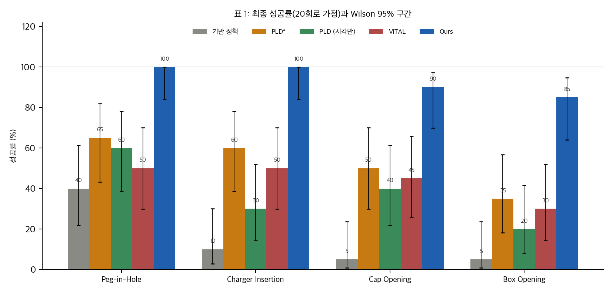
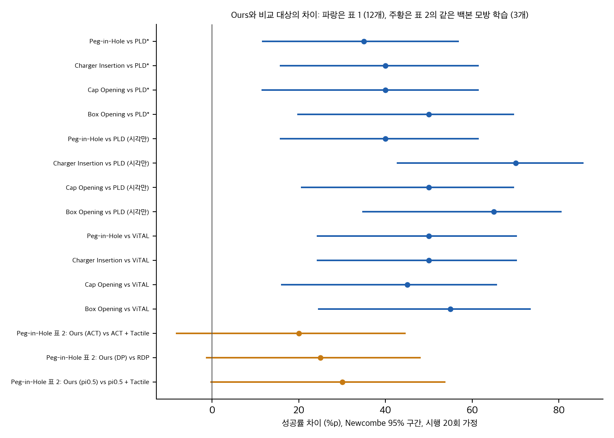
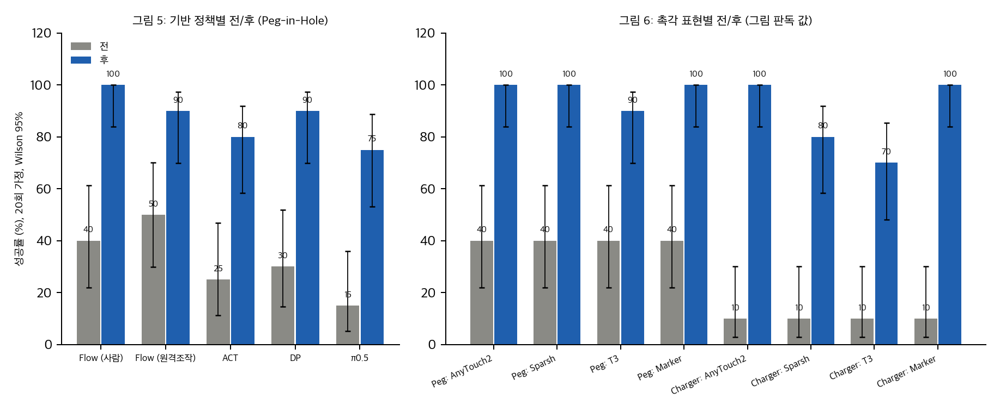

> **논문:** Kelin Yu, Haode Zhang, Harish Ravichandar, Yunhai Han, Ruohan Gao. *OmniTacTune: Policy-Agnostic Real-World RL for Tactile Residual Adaptation of Visual Policies.* CoRL 2026 포스터, arXiv:2607.03723 (v1, 2026-07-04).
> 공식 코드는 찾지 못했습니다. 논문은 arXiv 비독점 배포 라이선스(CC BY 아님)라서 이 글의 그림은 모두 우리가 계산해 그린 그래프입니다. 논문에 없는 시행 수는 20회로 가정했고, 그림에서 읽은 값은 "(그림 판독)"으로 표시했습니다.

## 논문이 묻는 것

시각 정책은 접촉 단계에서 자주 실패하고, 촉각 데이터는 적습니다. 저자들은 시각 기반 정책을 고정한 채 촉각 잔차 정책만 실로봇에서 SAC로 학습합니다. 1단계(웜스타트 12분)에서는 잔차를 0으로 두고 기반 정책을 굴려 재생 버퍼를 채우고, 이 전이로 flow-촉각 critic과 촉각 인코더를 먼저 맞춥니다(궤적당 2개의 합성 촉각 증강 포함). 2단계에서 `a = a_base + s · a_residual`을 학습하고, 잔차 크기 s는 0.05에서 0.15까지 올립니다. 보상은 접근, 파지, 생성된 객체 flow 추종의 가중합에서 안전 벌점을 뺀 값입니다. 네 과제(Peg-in-Hole, Charger Insertion, Cap Opening, Box Opening)에서 기반 정책 5–40%가 최종 85–100%가 되었고, 훈련 시간은 40–80분이라고 보고합니다.

## 우위는 분명하지만 구간은 넓습니다

표 1의 최종 평가는 과제당 20회입니다(모든 값이 5%의 배수라 이 시행 수와 맞습니다). 평균 네 개는 표와 일치합니다(93.75, 52.5, 37.5, 43.75).

*그래프: 표 1 최종 성공률과 Wilson 95% 구간(시행 20회). 우리가 그린 그래프입니다.*

Ours와 세 기준선의 12개 비교는 모두 Fisher 정확 검정으로 유의하고, Holm 보정 후에도 p < 0.02입니다. 네 과제를 합치면 75/80 대 42/80(PLD*), 30/80(PLD, 시각만), 35/80(ViTAL)이고 p는 모두 1e-8보다 작습니다. 다만 과제별 차이의 95% 구간은 +12점(Cap Opening, PLD* 대비)에서 +70점까지 넓습니다. 이 구간은 평가 시행의 변동만 반영합니다. 방법·과제당 학습 실행이 한 번이라면(논문에 반복 언급이 없습니다) 실행 간 변동은 들어 있지 않습니다.

본문의 "all baselines에 40% 넘게 앞선다"는 과제별 최선 기준선과의 격차로 보면 35, 40, 40, 50점(평균 41.25)입니다. 평균으로는 40점을 넘고 Peg-in-Hole은 35점입니다. 또 기준선 일부는 기반 정책과도 구분되지 않습니다(Peg-in-Hole 8/20 → PLD* 13, PLD 12, ViTAL 10).

## 같은 백본의 모방 학습과의 비교

표 2는 Peg-in-Hole에서 원격조작 시연 90개로 학습한 시각-촉각 모방 기준선과 비교합니다. 같은 백본에서 Ours는 +20(ACT), +25(DP), +30(π0.5)점 높습니다. 시행 20회를 가정하면 개별 p는 0.30, 0.13, 0.11이고 차이의 95% 구간은 0을 포함합니다. 세 백본을 합치면 49/60 대 34/60으로 p = 0.005입니다. 본문의 "20–30% 높다"는 점수 차로는 맞습니다. 다만 이 시행 수에서는 백본별 차이를 개별로 확정하기 어렵습니다. 비교의 투입도 다릅니다. 기준선은 시연 90개이고, Ours는 인간 시연 50개, flow 생성기 미세조정, 12분 웜스타트, 온라인 RL을 씁니다.

*그래프: Ours와 비교 대상의 성공률 차이(Newcombe 95% 구간, 시행 20회 가정). 파랑은 표 1의 12개, 주황은 표 2의 같은 백본 모방 학습 3개. 우리가 그린 그래프입니다.*

## 기반 정책과 촉각 표현

그림 5의 다섯 기반 정책은 모두 개선되고(15–50% → 75–100%), 전/후 증감 라벨 5개도 다시 계산하면 일치합니다. 4.2절 본문은 ACT 초기 20%, π0.5 초기 20%인데 그림 5와 표 2는 25%, 15%입니다. 두 값 모두 20회 평가에서 가능한 값이라 어느 쪽인지는 저자 확인이 필요합니다. 인간 flow(100%)와 원격조작 flow(90%)의 차이는 20회 가정에서 p = 0.49입니다.

그림 6(그림 판독)에서는 AnyTouch2와 마커 인코더가 모두 100%입니다. Charger Insertion에서 T3(70%)는 AnyTouch2와 p = 0.020, Sparsh(80%)는 p = 0.11입니다.

*그래프: 그림 5와 그림 6의 전/후 성공률(그림 판독 값, 시행 20회 가정, Wilson 95%). 우리가 그린 그래프입니다.*

## 절제와 "40–80분"

절제(그림 15–18)는 체크포인트당 10회입니다. 50분 끝점을 그림에서 읽어 Ours 10/10과 비교하면 16개 중 4개만 p < 0.05이고, 부품 제거로는 "No Action Scale"(50%) 하나입니다. 나머지 부품 제거는 방향은 낮은 쪽이지만(예: 웜스타트 최적화 제거 60%, p = 0.087) 10회로는 구분되지 않습니다. 10회 체크포인트의 표준오차는 최대 15.8점입니다.

"40–80분"에는 12분 웜스타트가 포함됩니다. 인간 시연 수집, flow 생성기 500 에폭 미세조정, 체크포인트 평가 시행, 사람의 리셋과 성공 라벨이 이 시간에 들어가는지는 논문에 적혀 있지 않습니다. 잔차 크기 스케줄은 500 온라인 스텝마다 올라 10 Hz에서 100초(1,000 스텝)면 최댓값 0.15에 닿습니다. 의도한 스케줄인지도 확인이 필요합니다.

## 읽으면서 남은 점

- 보상의 접근 항(식 20)이 파지 후에도 합산되는지 명시가 없습니다. 파지 후 0이면 양의 항의 최대치는 0.714이고, 본문 식 (23)의 범위(ℓ가 L까지)면 flow 보상이 1.033입니다. 부록은 L−1까지로 씁니다.
- 그림 4 끝점(그림 판독)과 표 1은 세 칸에서 다릅니다(PLD* Peg 60 대 65, Box Ours 80 대 85, PLD* Box 40 대 35). 10회 체크포인트와 20회 최종 평가의 차이로 보이지만 논문이 설명하지는 않습니다.
- 그림 16의 "ACT + Ours" 50%는 그림 5의 ACT 후 80%와 정의가 달라 보입니다.
- 정책 비의존성의 증거는 Peg-in-Hole 한 과제의 기반 정책 다섯 개입니다.
- 코드, 데이터가 공개되면 시행 수와 훈련 시간의 정의를 확인할 수 있습니다.

## 구현 가능성

실로봇 결과(xArm7, GelSight Mini, VR 장비, 사람 리셋)와 flow 생성기·촉각 증강 모델은 일반 노트북에서 재현할 수 없습니다. 방법의 골격은 소형 시뮬레이션 과제(막대·구멍, 접촉력 대용 촉각)로 옮길 수 있어 보입니다. 추정 1–2주이고 측정 전입니다. 공식 코드가 없어 보상 정규화와 스케줄은 부록 식에서 다시 구현해야 합니다.

## 정리

기준선보다 높다는 결론은 20회 평가로도 분명합니다. 반면 모방 학습과의 백본별 비교, 부품별 필요성, "40–80분"이 가리키는 비용의 범위는 이 시행 수와 설명으로는 정해지지 않습니다. 시행 수를 늘리거나 훈련 시간 정의를 밝히면 쉽게 해소될 수 있는 부분입니다.

## 자료

- [통합 리포트 PDF](report/report_public.pdf)
- [01. 논문 분석: OmniTacTune (arXiv:2607.03723)](analysis/01_paper_analysis.md)
- [02. 선행연구와 관련 자료](analysis/02_prior_work.md)
- [03. 수치 재계산과 일관성 검사](analysis/03_analysis.md)
- [04. 주장 검증과 구현 가능성 (공식 코드 없음)](analysis/04_claim_verification.md)
