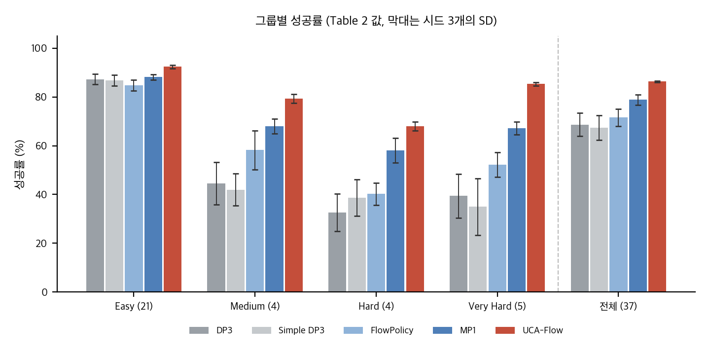
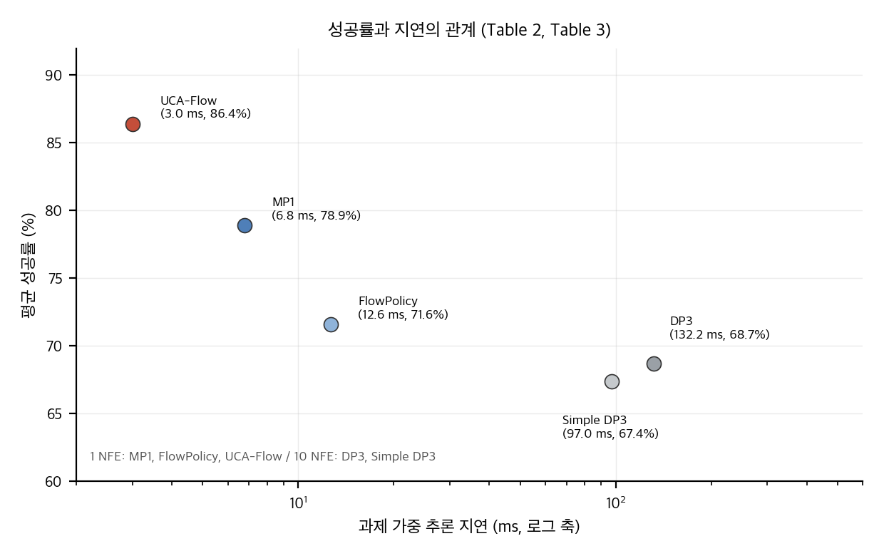
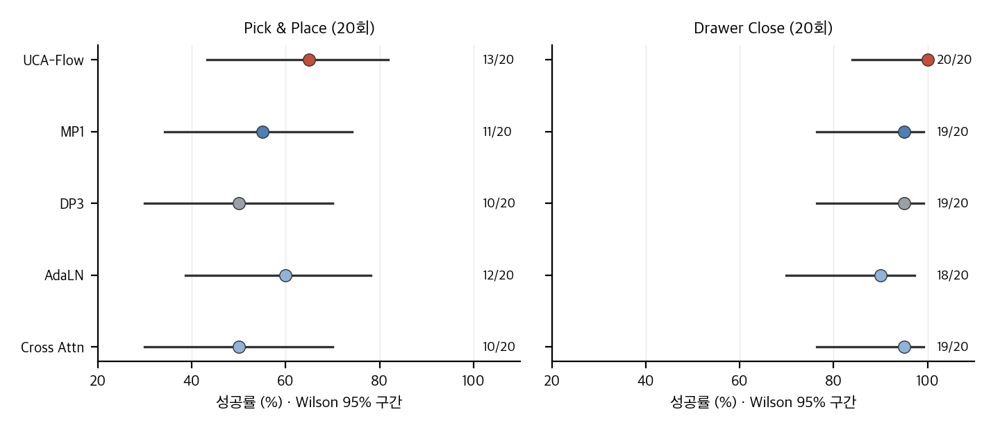

> **논문:** Xinyu Zhou, Zikun Cai, Kuangji Zuo, Gen Li, Boyu Ma, Yanshuo Lu, Yutong Song, Mingqi Yuan, Jiayu Chen, Jianfei Yang. *Unified Condition-Action Modeling for Accurate One-Step Action Generation.* arXiv:2608.16153 (v5, 2026-10-23). CoRL 2026 포스터입니다(공식 채택 목록 확인). 프로젝트 페이지는 RSS 2026으로 적었지만 RSS 2026 공식 목록에는 없습니다.
> 공식 코드는 GitHub NTUMARS/UCA-Policy(MIT)에 있습니다. 이 글의 그림은 모두 우리가 그린 그래프이며, 논문 그림은 라이선스(arXiv non-exclusive)상 싣지 않았습니다.

## 논문이 묻는 것

로봇 정책은 조건(관측, 타임스텝)을 행동 생성기에 보조 신호로 넣는 경우가 많습니다. AdaLN이나 교차 어텐션이 대표적입니다. 이 방식은 확산이나 흐름 정책에서 여러 단계를 거쳐야 할 때 흔합니다. UCA-Flow는 조건을 행동과 같은 토큰 열에 넣고 블록마다 함께 갱신합니다. 추론은 한 번입니다. 학습은 평균 속도와 순간 속도를 같이 감독합니다.

## 이 글에서 확인한 것

**1. 평균 성공률 86.4%와 기준선 대비 7.5 pp는 재계산과 맞습니다.** 37개 과제를 같은 가중치로 평균하면 86.39%입니다. 다만 시드가 3개라 차이 검정은 p ≈ 0.02 수준이고, 기준선 값은 논문이 "as reported"라고 적었습니다.

*그림 1. 그룹별 성공률 (Table 2 값). 우리가 그린 그래프입니다.*

**2. 속도 43.9배는 NFE 차이의 몫이 큽니다.** DP3는 10 스텝, UCA-Flow는 1 스텝입니다. 같은 1 스텝 기준선과 비교하면 MP1 2.2배, FlowPolicy 4.2배입니다. 절대 지연은 측정 조건(세 시드 동시 실행)에 따라 달라질 수 있습니다.

*그림 2. 성공률과 지연. 1 NFE와 10 NFE를 구분했습니다. 우리가 그린 그래프입니다.*

**3. 공개 버전 v1의 수치는 정정되었습니다.** v1은 평균 88.2%와 2.9 ms를 보고했지만, 같은 표의 행으로 계산하면 86.4%와 3.01 ms가 됩니다. v5가 이를 고쳤습니다.

**4. 조건을 토큰 열에 두는 설계의 절제 근거는 8과제 모두에서 나옵니다.** 교차 어텐션 변형과 AdaLN 변형은 전체 모델보다 낮았습니다(과제 단위 평균 차이 8.9와 23.0 pp). 다만 두 변형의 파라미터 수와 학습량이 같은지는 논문에 없습니다.

**5. 이중 속도 손실의 효과는 작습니다.** 과제 단위 평균 차이는 3.7 pp입니다. 방향은 8과제 모두 같지만, 과제 안의 검정은 모두 p ≥ 0.096입니다.

**6. 실로봇 우위는 확실하지 않습니다.** UR5e에서 과제당 20회 시험했고, 모든 차이의 Fisher p가 0.49 이상입니다. 10 pp 차이를 찾으려면 군마다 약 376회가 필요합니다.

*그림 3. 실로봇 성공률과 Wilson 95% 구간. 우리가 그린 그래프입니다.*

## 공식 코드와 논문이 다른 곳

공식 저장소는 논문 방법의 핵심(통합 토큰 열, 이중 손실, 한 스텝 추론식)을 그대로 구현합니다. 다른 점은 학습 설정입니다. 시뮬 학습은 논문 본문의 3,000 또는 1,000 에폭 대신 공식 설정 301 에폭입니다. Adroit 점군도 논문의 1024점 대신 512점입니다. 체크포인트 선택은 "상위 5개 평균"이 아니라 k = 1이고, 선택 지표가 평가 롤아웃과 같습니다. 이 차이들은 수치를 바꿀 수 있습니다.

## 이 맥에서 할 수 있는 것

- **가능.** 통합 토큰 열과 이중 손실을 PyTorch로 옮기는 일입니다. 저장소의 `ict.py`는 258줄입니다. 노력은 약 1주로 추정합니다(측정 전).
- **어려움.** 공식 코드 설치입니다. Python 3.8, torch 2.2.1 cu118, mujoco-py 2.1을 요구하고 CUDA 전제입니다.
- **불가.** 37과제 × 3시드 재현과 실로봇 재현입니다.

## 맺으며

UCA-Flow의 핵심 주장, 즉 조건을 행동과 함께 갱신하면 한 스텝 정확도가 오른다는 근거는 시뮬레이션 절제에서 가장 강합니다. 하지만 파라미터 수를 맞춘 대조, 시드 수 확대, 기준선 출처 확인이 빠져 있습니다. 실로봇 근거는 아직 약합니다.

## 자료

- [통합 리포트 PDF](report/report_public.pdf)
- [01. 논문 분석: UCA-Flow (arXiv:2608.16153)](analysis/01_paper_analysis.md)
- [02. 선행연구와 관련 저장소](analysis/02_prior_work.md)
- [03. 수치 재계산, 일관성 검사, 주장 판정](analysis/03_analysis.md)
- [04. 공식 코드 대조와 구현 가능성](analysis/04_code_verification.md)
