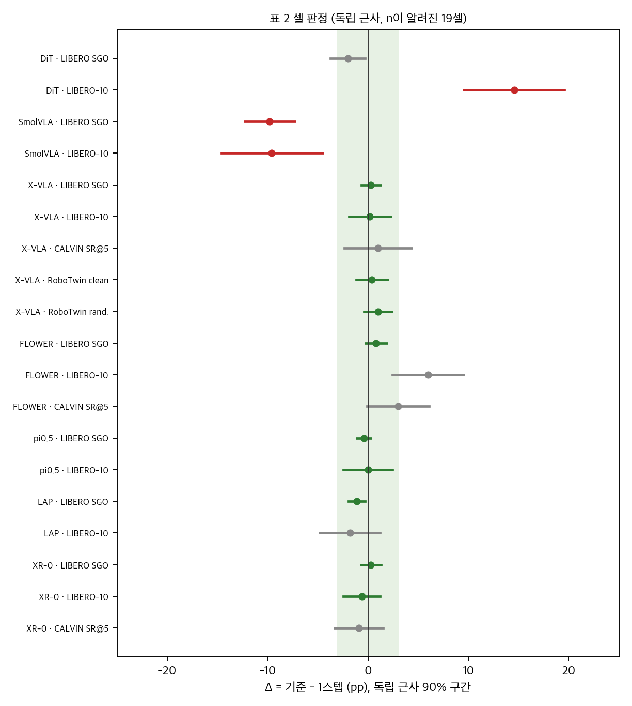
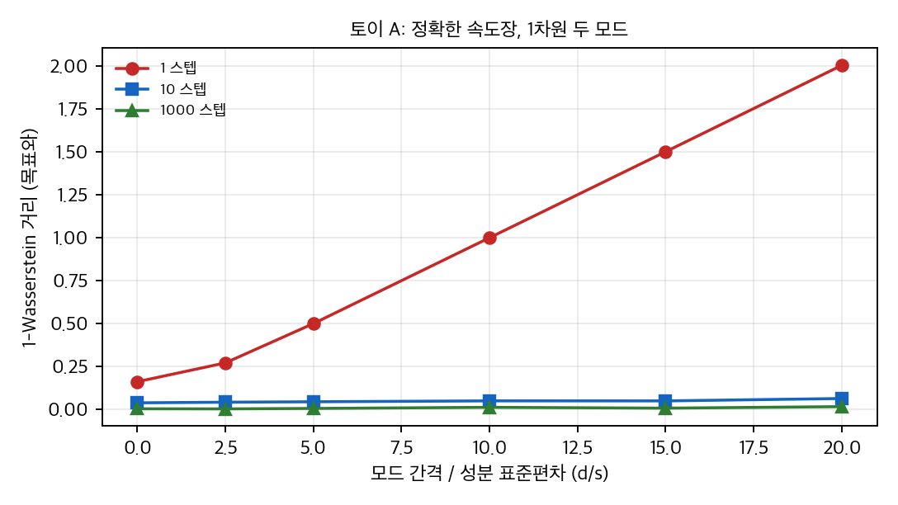
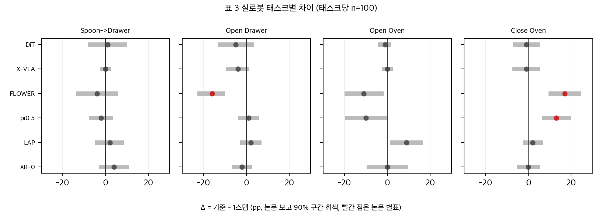

> **논문:** Shivakanth Sujit, Luca Nunziante, Rousslan Fernand Julien Dossa, Kai Arulkumaran. *When One Step Is Enough: An Empirical Study of Euler Integration in Flow-Matching Policies.* CoRL 2026 포스터, arXiv:2610.30735 (v1, 2026-10-22).
> 공식 코드는 확인되지 않았습니다. 논문 라이선스는 CC BY 4.0이지만, 이 글은 논문 그림을 싣지 않고 우리가 만든 그래프만 씁니다.

---

## 논문이 묻는 것

흐름 매칭 VLA는 행동을 만들 때 속도장을 여러 번 적분합니다. 스텝 수가 많을수록 이산화 오차는 줄지만 지연이 늘어 제어 주기를 깎아 먹습니다. 그래서 최근에는 한 스텝으로 줄이는 추가 목표나 증류가 많이 나왔습니다.

이 논문은 반대 질문을 합니다. 추가 목표 없이 정류(rectified) 목표로 학습한 대형 VLA는 정말 한 스텝이 필요 없을까요? 여섯 개 흐름 VLA(450M부터 4.7B까지)와 네 개 시뮬레이션 벤치마크, 실로봇 과제 네 개로 짝 비교를 했습니다. 결론은 "대형 모델에서는 대체로 같다"입니다.

## 이 글에서 확인한 것

- **지연은 실제로 줄어듭니다.** 표의 A100 측정으로 한 스텝은 지연을 1.6에서 4.8배 줄입니다. 이 비율은 표 값과 맞게 다시 계산됩니다.
- **동등 판정은 쌍체 정보 없이는 확인되지 않습니다.** 논문은 36개 시뮬레이션 셀 중 23개를 동등이라고 합니다. 쌍체 Newcombe 구간에 필요한 불일치쌍 수가 본문에 없어서, 독립 근사로 다시 판정하면 19개 셀 중 10개만 동등입니다. 쌍체 상관이 있으면 논문 판정이 맞을 수 있지만, 그 수치는 공개되지 않았습니다.
- **FLOWER 체크포인트 설명이 맞지 않습니다.** 본문은 공개 체크포인트를 "그대로" 평가했다고 하면서, 다른 절에서는 조기 종료 체크포인트 선택으로 격차를 설명합니다. 표 2의 FLOWER 판정을 읽을 때 이 점을 먼저 확인해야 합니다.
- **실로봇에서는 체계적 이득이 없다고만 말할 수 있습니다.** 태스크당 100회 짝 시험에서 풀링 차이는 최대 3.75 pp이고, 유의한 셀은 3개뿐입니다. 한 셀은 최소 가능 p와 같은 값으로 보고되어 원자료 확인이 필요합니다.

그래프: 표 2 셀별 Δ = 기준 − 1스텝과 독립 근사 90% 구간(n이 알려진 19셀). 초록 띠는 ±3 pp 마진입니다. 우리가 그린 그래프입니다.

## 토이로 본 한 스텝의 본질

정확한 속도장을 가진 1차원 토이를 만들었습니다. 목표는 두 모드의 혼합이고, 속도장은 학습 없이 닫힌 식으로 계산합니다.

결과는 명확합니다. 한 스텝 출력은 초기 노이즈와 무관하게 목표 평균으로 붕괴합니다. 이유는 간단합니다. 시작점에서의 속도는 E[x1] − x0이므로, 한 스텝은 조건부 평균을 내는 회귀와 같습니다. 모드 간격이 커질수록 한 스텝과 목표 분포의 거리(W1)가 선형으로 커지고, 열 스텝은 거리가 0.04–0.06 안에 머뭅니다.

그래프: 정확한 속도장 토이에서 모드 간격 d/s에 따른 1-Wasserstein 거리. 1스텝은 목표 평균으로 붕괴하고, 10스텝과 1000스텝은 목표 분포를 따라갑니다. 우리가 그린 그래프입니다.

이 토이는 성공률을 말하지 않습니다. 분포 거리와 성공률은 다른 질문입니다. 그래도 논문이 말하는 "다양성 손실"(π0.5에서 성공 전략 수가 19에서 8로 줄어듦)과 방향이 같습니다. 다중모드 목표에서 한 스텝은 모드를 지웁니다.

## 실로봇 결과를 다시 보기

그래프: 실로봇 태스크별 Δ = 기준 − 1스텝과 논문 보고 90% 구간. 빨간 점은 논문이 별표를 단 셀입니다. 우리가 그린 그래프입니다.

태스크당 100회, 풀링 400회입니다. 모델별 풀링 차이는 −3.8에서 +3.75 pp로 작습니다. 다만 열기 과제에서 FLOWER는 한 스텝이 낫고(p = 3.1e-5), 닫기 과제에서 FLOWER와 π0.5는 다스텝이 낫습니다(p = 5e-4, 2.3e-3). 방향이 양쪽이라는 점이 중요합니다. 한 스텝이 항상 손해라는 결론은 아닙니다.

## 읽을 때 조심할 것

1. **"가장 큰 네 모델"이라는 표현의 대상이 불분명합니다.** 파라미터 기준 상위 넷은 XR-0, π0.5, LAP, FLOWER입니다. 본문 흐름과 맞지 않습니다.
2. **A.2의 "3–4배 더 굽음"은 비교 대상에 따라 다릅니다.** 한 모델(SmolVLA)만 기하가 다르다는 결론은 맞지만, 배수는 비교 대상에 따라 3배에서 10배입니다.
3. **H=1 결과 문장이 표와 맞지 않습니다.** X-VLA는 H=1에서 한 스텝이 더 낫습니다.
4. **학습 시드는 없습니다.** 모든 검정이 롤아웃 표본만 반영합니다.

## 정리

한 스텝이 대형 흐름 VLA에서 **지연을 크게 줄이면서 성공률을 크게 해치지 않는다**는 결론은 설득력이 있습니다. 하지만 "동등하다"는 판정은 쌍체 정보와 체크포인트 선택에 기대고 있어서, 원자료 없이는 세기를 판단하기 어렵습니다. 자신의 과제에서 한 스텝을 쓰기 전에는 (1) 같은 시드로 짝 평가를 하고 불일치쌍을 기록하고, (2) 정책의 조건부 목표가 단봉인지 확인하는 것이 필요합니다.

---

*이 글은 논문 저자와 무관한 독립 분석입니다. 수치는 논문 표에서 옮겼고, 그래프와 토이는 직접 만들었습니다. 재계산 스크립트와 토이는 `publish/git/` 폴더에 있습니다.*

## 자료

- [통합 리포트 PDF](report/report_public.pdf)
- [01. 논문 분석: When One Step Is Enough (arXiv:2610.30735)](analysis/01_paper_analysis.md)
- [02. 선행연구와 자료 지도: When One Step Is Enough (arXiv:2610.30735)](analysis/02_prior_work.md)
- [03. 수치 재계산, 일관성 검사, 토이: When One Step Is Enough (arXiv:2610.30735)](analysis/03_analysis.md)
- [04. 주장 검증과 구현 가능성: When One Step Is Enough (arXiv:2610.30735)](analysis/04_claim_verification.md)
