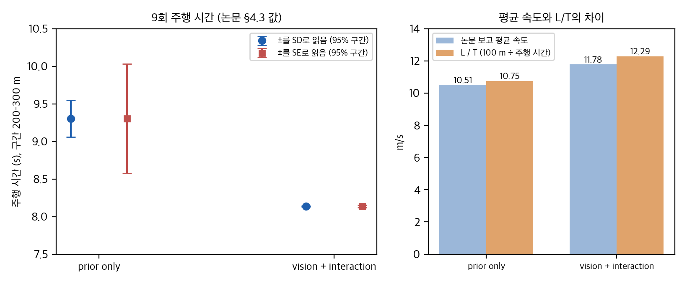
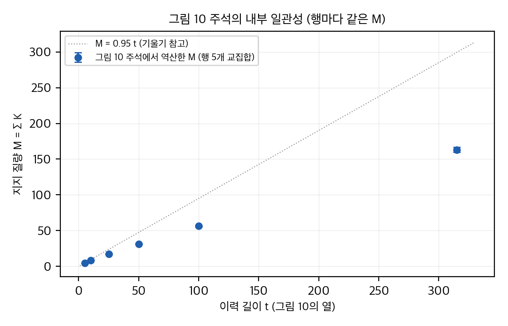
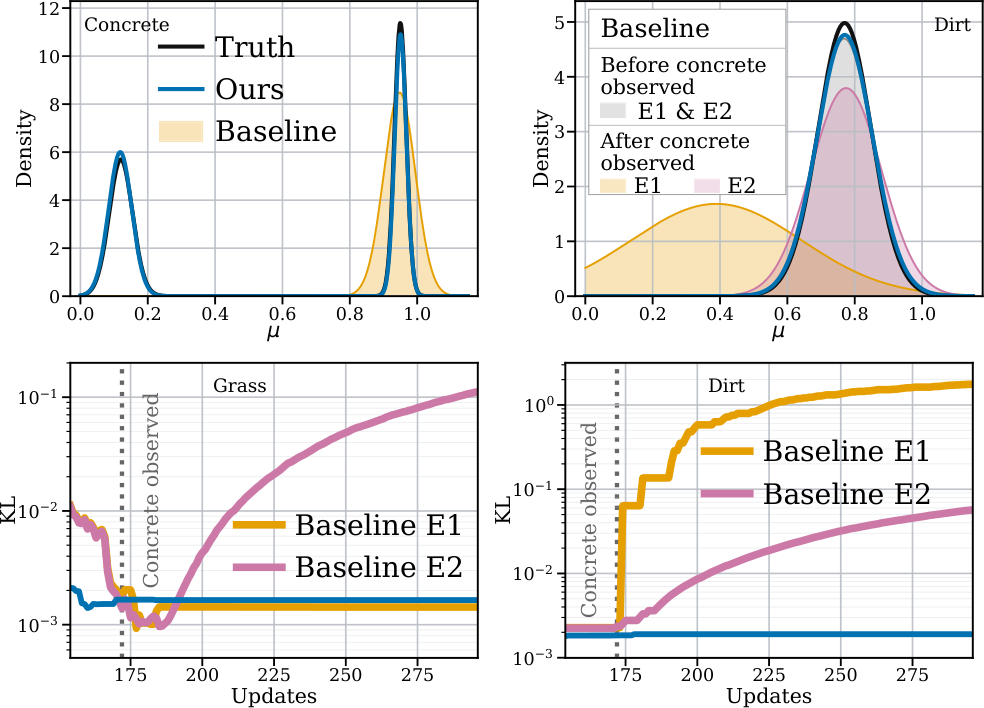
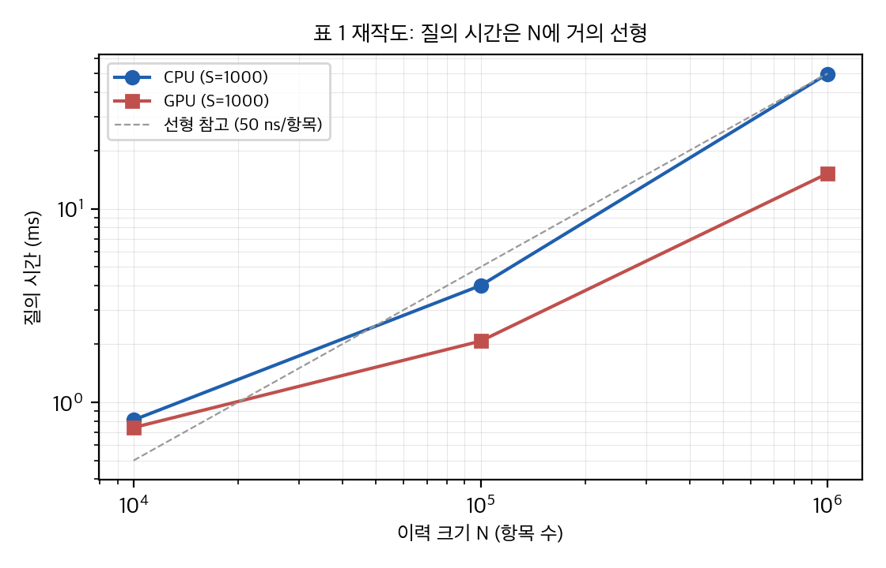

> **논문:** Alexander Borca-Tasciuc, Prayag Sharma, Franck Djeumou. *Beyond Semantic Classes: Online Physical Parameter Estimation via Embedding-Conditioned Gaussian Mixtures.* CoRL 2026 포스터, arXiv:2611.10107 (v1, 2026-11-06).
> 공식 코드와 프로젝트 페이지는 찾지 못했습니다. 논문 그림은 저자의 시뮬레이션 그래프 한 장만 출처와 함께 실었고, 나머지 그래프는 우리가 논문 수치로 다시 그린 것입니다.

## 논문이 묻는 것

접촉 전에 영상만 보면 젖은 아스팔트와 블랙아이스가 비슷하게 보이지만 마찰은 한 자릿수 이상 다릅니다. 이 논문은 접촉 후 측정으로 이런 믿음을 갱신하되, 그 믿음을 **의미 클래스(terrain label)에 묶지 않고** 시각 임베딩에 조건부로 둡니다. 과거 상호작용마다 가우시안 추정을 혼합 성분으로 저장하고, 질의 영역과 비슷한 이력의 가중치를 높이는 방식입니다.

## 이 글에서 확인한 것

- **헤드라인 계산은 맞습니다.** 얼음 구간 9회 주행에서 주행 시간이 9.304초에서 8.135초로 줄어 12.56%입니다. 실차 궤적 예측의 평균 변위 오차는 14.8%, 최종 변위 오차는 16.5% 줄었습니다. 모두 본문 값과 일치합니다.
- **통계의 정의가 빠져 있습니다.** ±가 표준편차인지 표준오차인지 적혀 있지 않습니다. 두 해석 모두에서 차이는 유의하지만, 기준선 신뢰구간 폭은 약 세 배 달라집니다. 평균 속도 10.51과 11.78 m/s도 구간 길이 100 m와 주행 시간으로 나눈 값(10.75, 12.29)보다 2–4% 작습니다.

그래프: 논문 §4.3의 9회 주행 값을 다시 그렸습니다. 왼쪽은 ±를 SD와 SE로 읽은 두 경우의 95% 구간이고, 오른쪽은 보고된 평균 속도와 L/T입니다. 우리가 그린 그래프입니다.

- **그림 10의 주석은 내부적으로 맞습니다.** 지지 기준 κ가 다른 다섯 행의 ρ를 ρ = M/(M+κ)로 거꾸로 계산하면, 열마다 같은 M과 맞습니다. M은 이력 길이 t에 대해 t^0.85쯤으로 자랍니다. 다만 그림의 γ와 c가 적혀 있지 않아, 레이싱 설정에 그대로 옮길 수는 없습니다.

그래프: 논문 그림 10의 ρ 주석에서 역산한 지지 질량 M과 이력 길이 t입니다. 구간은 두 자리 반올림 범위이고, 다섯 행의 교집합입니다. 우리가 그린 그래프입니다.

- **커널이 매우 날카롭습니다.** 레이싱 설정(γ = 100, 바닥 0.9)에서는 이웃 하나로 지지 가중치가 0.5가 되려면 코사인 유사도가 0.954 이상이어야 합니다. 사실상 가장 가까운 이웃을 찾는 방법에 가깝습니다.

## 논문 그림: 의미 클래스의 병목

논문 그림 3: 의미 클래스 병목. 위는 쌍봉 콘크리트 마찰과 흙의 밀도이고, 아래는 풀과 흙의 KL 발산입니다. 출처: Borca-Tasciuc 외, arXiv:2611.10107 v1, © 저자, CC BY 4.0.

그림 3은 이 논문의 핵심 주장을 가장 잘 보여줍니다. 기준선은 쌍봉 콘크리트의 낮은 모드를 놓치고, 어휘에서 뺀 콘크리트 측정이 흙의 믿음을 옮깁니다. 제안은 두 모드를 함께 맞추고 KL이 평평합니다. 다만 수치 표가 없어서 정성적인 확인에 머뭅니다. 영역 경계도 기준선에 정답으로 주어졌습니다.

## 질의 시간은 이력 크기에 선형

표 1은 이력 항목 수 N과 샘플 수 S에 따른 질의 시간을 보여줍니다. 10⁶ 항목에서 CPU는 49.8 ms, GPU는 15.2 ms입니다. 항목당 비용은 CPU 50 ns, GPU 15 ns입니다. 768차원 fp32 임베딩 10⁶개는 약 2.9 GiB이고, CPU 시간은 이 메모리를 한 번 훑는 속도(약 62 GB/s)와 맞습니다.

그래프: 표 1의 질의 시간을 다시 그렸습니다(S = 1000, 로그-로그). 점선은 50 ns/항목 선형 참고선입니다. 우리가 그린 그래프입니다.

다만 표 1은 질의만 잽니다. 프레임당 인코더(DINOv3)와 정제의 지연은 들어가 있지 않습니다. 추정기는 0.5 Hz로 돌고, 제어기는 20–50 Hz로 돌아갑니다. 초록의 "제어 주기에서 평가 가능"은 질의 시간에 관한 말입니다.

## 이 맥에서 구현할 수 있는가

**수식과 시뮬레이션 실험 일부는 구현할 수 있습니다. 레이싱 폐루프와 실차는 이 맥에서 재현하지 않습니다.**

- 혼합 사후분포와 지지 기반 혼합(식 2–6)은 numpy로 충분합니다. 쌍봉 콘크리트와 어휘 밖 콘크리트 실험도 같은 방법으로 시뮬레이션할 수 있습니다.
- 임베딩 정제에는 BeamNG에서 얻은 이미지 1,500장과 DINOv3 가중치가 필요합니다. DINOv3 저장소의 라이선스는 "Other"로 표시되어 있어 가중치를 쓰기 전에 확인해야 합니다.
- 레이싱 폐루프는 BeamNG.tech 실행 환경이 필요한데, 이 맥에서 실행 근거를 확인하지 못했습니다. 실차는 실차와 센서가 필요합니다.
- 노력은 추정으로 수식과 시뮬 실험 2–4일, 정제와 사전분포 1–2주, 폐루프 3–6주입니다.

## 읽을 때 조심할 것

1. **사전분포가 의도적으로 편향되어 있습니다.** 얼음 구간의 사전분포는 참 콘크리트 값에 맞춰 학습되고, 눈은 일부러 섞인 값으로 학습됩니다(부록 C.5). 이득의 크기는 이 편향에 달려 있고, 편향을 바꾼 실험은 없습니다.
2. **역모형 오차가 없습니다.** 시뮬레이션의 가우시안 믿음은 시뮬레이터가 직접 줍니다. 추정 정확도를 말할 때는 이 점을 빼고 읽으면 안 됩니다.
3. **실효 차원은 20입니다.** 본문은 21개의 파라미터를 추정한다고 쓰지만, 튜닝 벡터의 한 항목은 쓰이지 않습니다(표 3).
4. **NIG 모수 표기가 다릅니다.** 본문은 β를 쓰고 표 2는 σ를 씁니다. 변환 규칙이 없어 표만으로는 시뮬레이션을 다시 만들 수 없습니다.
5. **충돌 위험의 대비에 롤아웃 수가 없습니다.** 쌍봉 믿음은 "40% 이상", 가우시안은 "1% 미만"이 충돌합니다. 롤아웃이 100회라면 40%의 95% 구간은 31–50%입니다. 1% 미만을 95%로 보이려면 0건이 나와도 약 380회 이상이 필요합니다.
6. **레이싱 실험은 9회, 실차는 18회입니다.** 시행 분산과 신뢰구간이 없어 효과 크기를 믿기 어렵습니다.

## 정리

이 논문의 아이디어는 분명합니다. 과거 상호작용을 클래스 평균이 아니라 혼합 성분으로 남기고, 지지가 약하면 사전분포로 돌아갑니다. 그림 3이 그 장점을 잘 보여줍니다. 다만 레이싱 이득과 실차 결과는 편향된 사전분포, 시뮬레이터가 준 믿음, 적은 시행 수라는 조건 위에 있습니다. 본문 계산은 맞지만, 이득의 크기를 인용하려면 저자에게 시행별 값과 사전분포 민감도를 확인해야 합니다.

## 자료

- [통합 리포트 PDF](report/report_public.pdf)
- [01. 논문 분석: Beyond Semantic Classes (arXiv:2611.10107 v1)](analysis/01_paper_analysis.md)
- [02. 선행연구와 자료 지도: Beyond Semantic Classes (arXiv:2611.10107 v1)](analysis/02_prior_work.md)
- [03. 수치 재계산과 일관성 검사: Beyond Semantic Classes (arXiv:2611.10107 v1)](analysis/03_analysis.md)
- [04. 주장 검증과 구현 가능성: Beyond Semantic Classes (arXiv:2611.10107 v1)](analysis/04_claim_verification.md)
