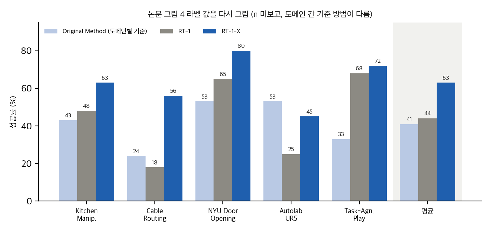
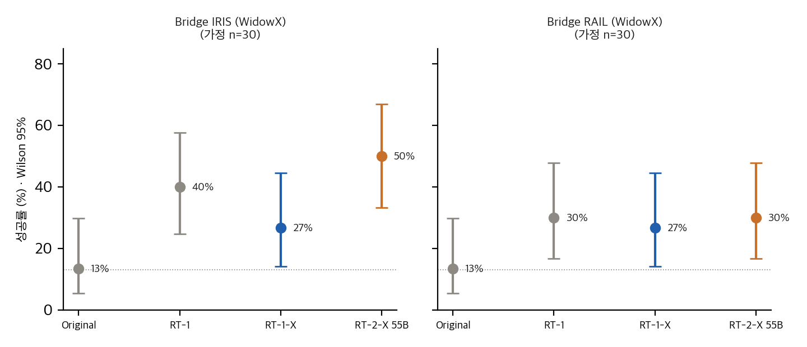
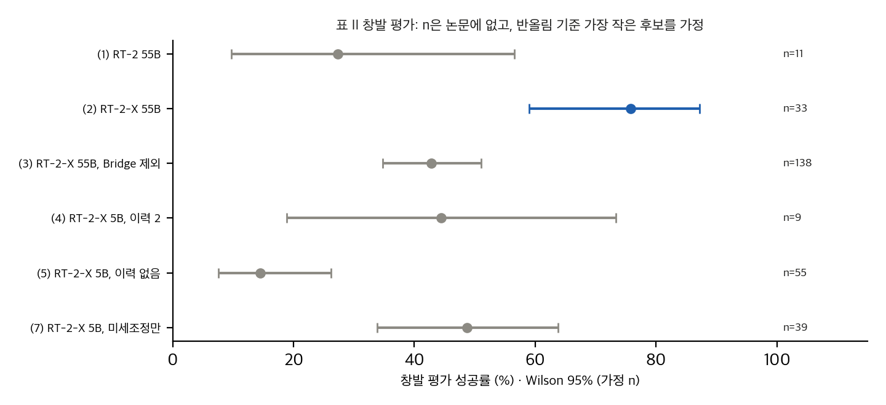
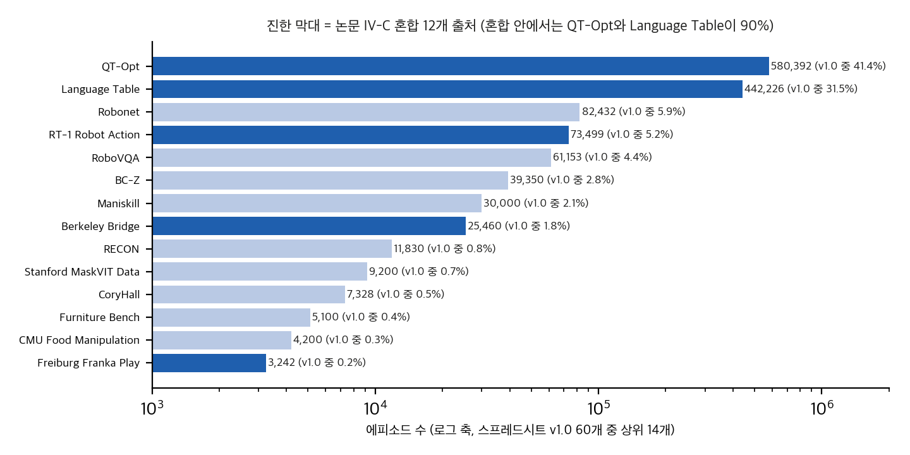

# 03. 보고 수치 재계산과 정합성 검사

재계산 스크립트: `analysis/recompute.py` → `analysis/recompute_results.json`. 그래프: `analysis/plot_figures.py`. 학습과 추론은 하지 않았습니다. 입력은 논문 보고값과 공개 메타데이터 스프레드시트 스냅샷(2026-11-22)뿐입니다.

**가장 큰 제약:** 셀별 시행 수 n이 논문 어디에도 없습니다. 따라서 "실제 시행 수로 유의성 검정"은 할 수 없습니다. 대신 (a) 보고된 백분율을 설명하는 n 후보를 찾고, (b) 후보 전체에 대해 p값의 범위를 보고, (c) 시행 수 없이 가능한 검정(부호 검정)을 씁니다. 모든 n 가정은 본문에 표시합니다.

## 1. 그림 4: 평균과 "50% 높다" (V1)

| 모델 | 5개 도메인 평균 (원자료 막대 기준) | 논문 라벨 |
|---|---|---|
| Original Method | 41.2 | 41 |
| RT-1 | 44.8 | 44 |
| RT-1-X | 63.2 | 63 |

- RT-1-X 대 Original: 라벨 기준 +53.7% (63/41), 비율 평균 기준 +53.4%. 캡션의 "50%"에 가깝습니다.
- RT-1-X 대 RT-1: 라벨 기준 +43.2% (63/44), 비율 평균 기준 +41.1%. "50%"는 RT-1에 대해서는 맞지 않습니다.
- RT-1 평균은 원자료로 44.8이고 라벨은 44입니다. 정수 라벨의 반올림 오차 범위이거나 내림 표기일 수 있습니다.
- 도메인별 비율(RT-1-X / Original): 1.47, 2.33, 1.51, 0.85, 2.18. Autolab UR5에서만 1보다 낮습니다.
- **부호 검정:** 5개 도메인 중 RT-1-X가 Original보다 높은 곳은 4개입니다. 양측 부호 검정 p = 0.375입니다. 도메인 수가 5라서 이 검정으로는 방향조차 확정할 수 없습니다.

결론: 평균 차이 +22(Original 대비)는 크지만, 도메인 수와 셀 n이 없어서 "50%"라는 배수는 캡션 수준의 근사로 읽어야 합니다.

*그림 3-1. 논문 그림 4의 막대 라벨 값을 우리가 다시 그린 것입니다. 논문 그림 자체는 싣지 않습니다. 오차막대는 없습니다. 도메인마다 Original이 다른 방법입니다.*

## 2. 표 I: 캡션과 본문의 대조 (V2)

| 비교 | Bridge IRIS | Bridge RAIL | RT-1 논문 6기술 |
|---|---|---|---|
| RT-1-X − Original | **+14** | **+14** | (Original 없음) |
| RT-1-X − RT-1 | −13 | −3 | −19 |
| RT-2-X − RT-1 | +10 | **0** | −1 |

- 캡션 "RT-1-X ... performs worse than the Original Method and RT-1": 두 Bridge 열에서 RT-1-X가 Original보다 14점 높아서 맞지 않습니다. RT-1에 대해서는 세 열 모두 낮아서 맞습니다.
- 본문 "RT-2-X outperforms both the Original Method and RT-1": IRIS 열에서만 맞습니다. RAIL은 같고, RT-1 논문 열은 RT-2-X가 1점 낮습니다.
- 두 Bridge 열의 Original Method 값이 모두 13%입니다. 복사 오류 가능성이 있습니다.

### 시행 수 가정 검사 (V4)
- 두 Bridge 열의 값(13, 40, 27, 50, 30)을 모두 설명하는 가장 작은 n은 **30**입니다(다음 후보는 60). 그래서 이 열은 셀당 30회로 가정할 수 있습니다. 가정일 뿐 보고된 값이 아닙니다.
- RT-1 논문 열(92, 73, 91)은 n=100이면 설명됩니다. 가정 n=100은 보고되지 않았습니다.

30회 가정에서의 검정(Fisher 양측, 차이는 %p):

| 비교 | 차이 | p |
|---|---|---|
| RT-1-X 대 Original (IRIS) | +13.3 | 0.33 |
| RT-1-X 대 RT-1 (IRIS) | −13.3 | 0.41 |
| RT-2-X 대 RT-1 (IRIS) | +10.0 | 0.60 |
| RT-2-X 대 Original (IRIS) | +36.7 | **0.005** |
| RT-1-X 대 Original (RAIL) | +13.3 | 0.33 |
| RT-2-X 대 RT-1 (RAIL) | 0.0 | 1.00 |

- 30회 가정에서도 "RT-1-X가 Original보다 낫다"는 유의하지 않습니다. 유일하게 유의한 것은 RT-2-X 대 Original(IRIS)입니다. 그 차이는 큰 모델의 효과와 기준 방법의 차이가 섞여 있습니다.
- 30회에서 Wilson 95% 구간의 반폭은 대략 11–18%p입니다(그림 3-2).

*그림 3-2. 표 I의 Bridge 두 열을 n=30 가정으로 그린 Wilson 95% 구간입니다. 셀 n은 보고되지 않았습니다.*

## 3. 표 II: 창발 평가 (V3, V5)

### 3.1 배수와 차이
- 창발 성공률 비율 행 2 대 행 1: 75.8 / 27.3 = **2.78배**. 본문 "∼3×"는 올림입니다. 프로젝트 페이지 "3x"도 같습니다.
- 행 2 − 행 3(Bridge 제외): 75.8 − 42.8 = 33.0%p.
- 행 4 − 행 5(이력 2 대 없음, 5B): 44.4 − 14.5 = 29.9%p.
- 행 4 − 행 7(공동 미세조정 대 미세조정): 44.4 − 48.7 = −4.3%p.

### 3.2 n 후보 (반올림 기준)

| 행 | 창발 % | 반올림으로 설명되는 가장 작은 n | 메모 |
|---|---|---|---|
| 1 RT-2 | 27.3 | 11 (3/11), 22, 33 | 반올림 일치 |
| 2 RT-2-X 55B | 75.8 | 33 (25/33), 62, 66 | 반올림 일치 |
| 3 Bridge 제외 | **42.8** | **138** (59/138) | **n ≤ 137로는 불가능** |
| 4 5B, 이력 2 | 44.4 | 9 (4/9), 18, 27 | 반올림 일치 |
| 5 5B, 이력 없음 | 14.5 | 55, 62 (9/62) | 반올림 일치 |
| 7 미세조정 | 48.7 | 39 (19/39), 76 | 반올림 일치 |

- **행 3의 42.8%는 반올림 기준으로 n ≤ 137인 어떤 k/n으로도 설명되지 않습니다.** 버림 기준이면 3/7 = 42.857이 42.8로 적힙니다. 나머지 셀은 반올림과 맞습니다. 두 가지 중 하나입니다. 그 셀의 n이 138 이상이거나(다른 셀보다 훨씬 많음), 다른 집계(예: 과제별 평균)일 수 있습니다. 어느 쪽인지 논문만으로는 알 수 없습니다. 확인할 항목입니다.
- 모든 창발 행을 동시에 설명하는 공통 n은 **없습니다**(n ≤ 200). 셀마다 시행 수가 달랐거나 집계가 달랐다는 뜻입니다.
- 일반화 열(62, 61, 54, 52, 30, 1, 47)은 정수 라벨이라 n=100 등 여러 n과 맞습니다. 셀 크기를 정하지 못합니다.

### 3.3 행 쌍 검정: n 후보 전체에 대한 p의 범위 (V5)

| 비교 | p의 범위 (후보 n 전체) | 판정 |
|---|---|---|
| 행 2 대 행 1 (RT-2-X 55B 대 RT-2 55B) | 0.000 – 0.009 | 모든 후보 n에서 유의 |
| 행 2 대 행 3 (Bridge 제외) | 0.000 – 0.001 | 모든 후보 n에서 유의 (행 3의 n ≥ 138 가정 포함) |
| 행 4 대 행 5 (이력, 5B) | 0.000 – 0.055 | 일부 n에서 경계 |
| 행 2 대 행 4 (55B 대 5B) | 0.000 – 0.107 | 이력이 섞여 있어 용량 효과로 분리되지 않음 |
| 행 4 대 행 7 (공동 미세조정 대 미세조정) | 0.52 – 1.00 | 차이가 있다고 할 근거 없음. 같다고 증명하지도 못함 |

- 중요한 한계: 각 행은 **학습 한 번**의 결과로 보입니다. 시드 분산이 없어서 이 p값은 평가 샘플링 오차만 반영합니다. 과제 묶음 사이의 상관(같은 지시문을 여러 번 씀)도 고려하지 않았습니다. 두 가지 모두 p값을 과신하게 만듭니다.
- 따라서 "Bridge를 빼면 창발 성공률이 떨어진다"는 방향은 셀 수준 통계로 지지되지만, 크기(33%p)는 시드 한 번씩의 값으로 봐야 합니다.

*그림 3-3. 표 II 창발 평가 행을 반올림 기준 가장 작은 n(가정)으로 그린 Wilson 95% 구간입니다. 행 3은 n=138을 가정했습니다.*

## 4. 데이터셋 스프레드시트 재집계 (V6)

메타데이터 시트(공개 Google Sheet를 CSV로 내려받음, 2026-11-22). 데이터셋 행 72개, 파일 크기와 에피소드 수 열.

| 항목 | 논문 | 스프레드시트 | 판정 |
|---|---|---|---|
| 데이터셋 수 (v1.0) | 60 | 60 (v1.0 구간) | 일치 |
| 에피소드 수 (v1.0) | "1M+" | 1,403,481 | 일치 |
| 임베디먼트 수 (v1.0) | 22 | 22 (Multi-Robot 제외, 원시 문자열 기준) | 일치 |
| Franka 데이터셋 수 | 가장 많음 | 23 | 일치 (60개 중 38%) |
| 시트 전체 (v1.0 + v1.1) | — | 72개, 2,419,193 에피소드, 8,964.94 GB | 현재 스냅샷. 헤더 수치와 일치 |
| 혼합 9 임베디먼트 | 9 | 9 (Franka, Google Robot, Hello Stretch, Jaco 2, Kuka iiwa, Sawyer, UR5, WidowX, xArm) | 일치 |
| 혼합 12 출처 | 목록 | 12개 모두 이름으로 찾음 (TACO play = Freiburg Franka Play) | 일치 |

### 4.1 임베디먼트별 점유 (v1.0 에피소드 기준)

| 임베디먼트 | 데이터셋 | 에피소드 | 점유 |
|---|---|---|---|
| Kuka iiwa | 2 | 583,392 | 41.6% |
| xArm (Bimanual 포함) | 7 | 444,390 | 31.7% |
| Google Robot | 3 | 174,002 | 12.4% |
| Multi-Robot (RoboNet) | 1 | 82,432 | 5.9% |
| Franka | 23 | 55,515 | 4.0% |
| WidowX | 1 | 25,460 | 1.8% |

- 상위 5개 데이터셋이 전체의 88.3%입니다.
- **그림 2(c)와의 불일치:** 논문 그림 2(c)는 xArm 조각이 가장 크게 보입니다. 스프레드시트에서는 Kuka iiwa(QT-Opt 580,392)가 1위이고 xArm은 2위입니다. 논문 캡션은 "xArm and Google Robot contribute the most"라고 씁니다. 시트 시점이 다르거나 집계 기준이 다를 수 있습니다. 논문은 집계 방법을 밝히지 않습니다.
- 그림 2(a)를 눈으로 읽은 임베디먼트별 데이터셋 수와 시트를 비교하면 합이 62로 읽힙니다(60이어야 함). Kuka iiwa 3 대 2, Sawyer 4 대 3, WidowX 2 대 1이고, 그림의 Baxter 1은 시트에 없고 시트의 ViperX Bimanual 1은 그림에 없습니다(V8). 눈으로 읽은 값이라 ±1 오차가 있을 수 있습니다.

*그림 3-4. 스프레드시트 v1.0에서 에피소드 수 상위 14개 데이터셋입니다. 진한 막대는 논문 IV-C의 혼합 12개입니다.*

## 5. 혼합 가중치의 산술 (V7)

논문은 혼합 가중치를 밝히지 않습니다. 가정 세 가지에서 점유율을 계산했습니다(학습 없음).

| 가정 | QT-Opt + Language Table | Bridge | 메모 |
|---|---|---|---|
| 에피소드 수 비례 | 90.4% (혼합 안에서) | 2.25% | 가장 치우침 |
| 데이터셋 균등 (12개) | 16.7% | 8.3% | 데이터셋 기준 |

- 에피소드 비례 샘플링이면 QT-Opt와 Language Table이 학습 샘플의 90%를 차지합니다. 이 경우 표 II에서 Bridge 데이터를 뺐을 때 생긴 창발 차이는 Bridge가 학습 신호의 2%밖에 안 되는 상황에서 나왔습니다. 이 점은 해석에 중요합니다. 실제 가중치는 논문에 없으므로 이 해석은 가정입니다.

## 6. 전체 시행 수 3600 (V9)

- 3600은 "6개 로봇에서 3600회"입니다(V 서두). 셀 수를 정하지 못해 합을 재계산할 수 없습니다.
- 보고된 셀 수로 보면 표 I 11셀(Bridge 두 열 4모델 × 2 = 8셀, RT-1 논문 열 3셀), 표 II 14셀(창발과 일반화), 그림 4 15셀(5 도메인 × 3 모델)입니다. 30회 가정을 Bridge 8셀에 쓰면 240회입니다. 나머지 3,000회 이상이 어디에 쓰였는지는 논문으로 확인할 수 없습니다.

## 7. 한 줄 요약

- 방향은 지지됩니다: 긍정 전이(그림 4), Bridge 제거에 따른 창발 하락(표 II 행 2 대 3).
- 크기는 지지되지 않습니다: "50%"는 평균 기준 Original 대비 +54%이고 RT-1 대비 +43%입니다. "3배"는 2.78배입니다.
- 캡션과 본문 일부는 표와 맞지 않습니다: 표 I의 "worse than the Original Method", "RT-2-X가 RT-1보다 낫다"(RAIL과 RT-1 논문 열).
- 확인할 항목 세 가지: 표 II 행 3의 42.8%(n ≥ 138 또는 다른 집계), 셀별 시행 수, 혼합 가중치.
