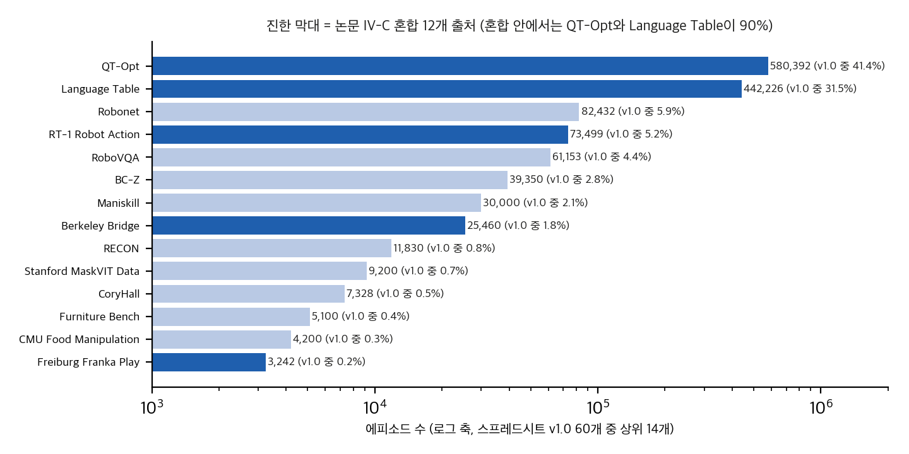
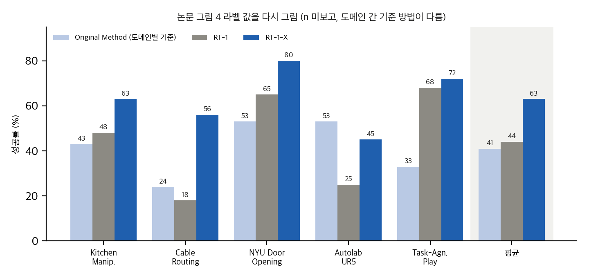
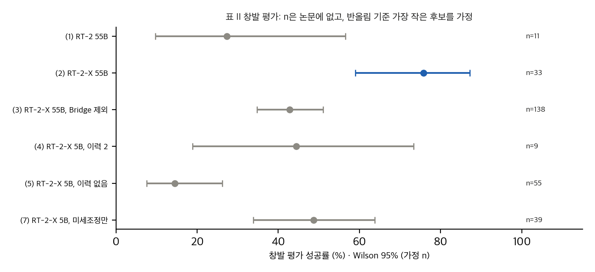
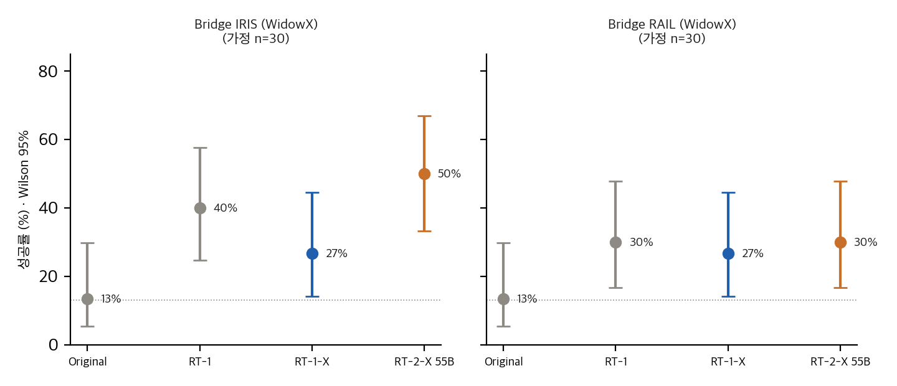

> **논문:** Open X-Embodiment Collaboration. *Open X-Embodiment: Robotic Learning Datasets and RT-X Models.* IEEE ICRA 2024, arXiv:2310.08864 (v9, 2025-05-14, CC BY 4.0).
> 이 글은 논문의 보고 수치를 다시 계산하고 공개 메타데이터와 맞춰 본 것입니다. 논문 그림은 싣지 않고, 우리가 보고 수치로 그린 그래프만 씁니다. 재현(학습, 추론 실행)은 하지 않았습니다.

---

## 한 줄 요약

60개 로봇 데이터셋을 한 형식으로 묶었고, 그 데이터로 RT-1과 RT-2를 학습하니 한 데이터셋에서만 학습한 정책보다 낫다는 방향이 보입니다. 다만 "50%"와 "3배"는 근사값이고, 셀별 시행 수와 혼합 가중치가 없어서 크기를 확인할 수 없습니다.

## 데이터: 숫자는 맞습니다

논문은 60개 데이터셋, 22개 임베디먼트, 1M+ 궤적을 씁니다. 공개 데이터셋 시트(2026-11-22 스냅샷)의 v1.0 구간을 다시 세면 60개, 1,403,481 에피소드, 임베디먼트 22개(다중 로봇 항목 제외)입니다. 데이터 규모 주장은 맞습니다.

다만 임베디먼트별 점유는 그림과 맞지 않습니다. 논문 그림 2(c)는 xArm 조각이 가장 크게 보입니다. 시트에서는 Kuka iiwa(QT-Opt, 580,392 에피소드)가 41.6%로 1위이고 xArm이 31.7%입니다. 시트 시점이 다를 수 있습니다. 논문은 집계 기준을 밝히지 않습니다.

## 혼합: 가중치가 없습니다

RT-X 실험은 9개 조작기와 12개 출처의 혼합으로 학습했습니다. 논문은 가중치와 샘플링 방식을 쓰지 않습니다. 시트로 에피소드 수를 세면 혼합의 90.4%가 QT-Opt와 Language Table입니다. Bridge는 2.25%입니다.

*그림 1. 시트 v1.0에서 에피소드 수 상위 14개 데이터셋입니다. 진한 막대는 논문 IV-C의 혼합 12개입니다. 점유율은 v1.0 전체 기준입니다.*

공식 저장소의 학습 예제에는 가중치가 있습니다. 그 예제는 QT-Opt와 Language Table을 빼고 RT-1 데이터를 55%, Bridge를 18% 줍니다. 예제는 "for example"이라고 적혀 있어서 논문 설정으로 볼 수 없습니다.

## 결과 1: 소규모 도메인에서는 우위

그림 4는 다섯 소규모 도메인의 평균을 보여 줍니다. Original Method 41, RT-1 44, RT-1-X 63입니다. 캡션은 "50% higher"라고 씁니다. 재계산하면 Original 대비 +54%, RT-1 대비 +43%입니다. 다섯 도메인 중 네 곳에서 RT-1-X가 높고 Autolab UR5에서만 낮습니다. 부호 검정으로는 p = 0.375입니다. 방향은 맞지만 배수는 근사입니다.

*그림 2. 논문 그림 4의 막대 라벨 값을 우리가 다시 그린 것입니다. 오차막대가 없습니다. 도메인마다 기준 방법이 다릅니다.*

## 결과 2: 큰 데이터 도메인에서는 캡션과 표가 다릅니다

표 I은 Bridge(WidowX) 두 실험실과 RT-1 논문의 6기술을 다룹니다. 캡션은 RT-1-X가 Original Method와 RT-1보다 "performs worse"라고 씁니다. 그런데 두 Bridge 열에서 RT-1-X(27%)는 Original(13%)보다 높습니다. 본문의 "RT-2-X가 Original과 RT-1을 모두 이긴다"도 IRIS 열에서만 맞습니다. RAIL 열은 30 대 30이고, RT-1 논문 열은 91 대 92입니다. 두 Bridge 열의 Original 값이 같은 13%인 것도 확인이 필요합니다.

## 결과 3: 창발 기술, 방향은 확실합니다

표 II는 로봇 데이터에 없던 기술을 Google Robot에서 시험합니다. RT-2 27.3%, RT-2-X 55B 75.8%입니다. 배수는 2.78배이고, 본문의 "∼3×"는 올림입니다. Bridge 데이터를 뺀 행은 42.8%입니다. 시행 수가 없어서 가능한 시행 수 전체에 대해 검정했습니다. RT-2-X와 RT-2의 차이는 모든 경우에서 p ≤ 0.009이고, Bridge 제외 하락은 p ≤ 0.001입니다.

다만 각 행이 학습 한 번씩의 결과로 보입니다. 시드 분산이 없어서 이 p값은 평가 샘플링 오차만 반영합니다. 또 42.8%는 반올림 기준으로 시행 수 137 이하의 어떤 분수로도 설명되지 않습니다. 셀의 시행 수가 138 이상이거나 다른 집계일 가능성이 있습니다.

*그림 3. 표 II 창발 행의 Wilson 95% 구간입니다. 논문에 셀 시행 수가 없어서, 반올림 기준으로 가장 작은 n을 가정했습니다. 행 3은 n=138을 가정했습니다.*

## 큰 데이터의 세 가지 확인 항목

표 I에서 Bridge 두 열의 값(13, 40, 27, 50, 30)을 모두 설명하는 가장 작은 n은 30입니다. 가정 n=30에서 RT-1-X와 Original의 차이(+13%p)는 유의하지 않습니다(p = 0.33). RT-2-X와 Original의 차이(+37%p, p = 0.005)만 유의합니다. 그 차이에는 모델 크기와 기준 방법의 차이가 함께 들어 있습니다.

*그림 4. 표 I의 Bridge 두 열을 n=30으로 가정한 Wilson 95% 구간입니다. 셀 시행 수는 보고되지 않았습니다.*

## 공식 코드와 맞춰 보기

공식 저장소(Apache-2.0)에는 RT-1-X 모델 정의와 추론 예제, 콜랩이 있습니다. RT-2-X 코드와 가중치는 없습니다. 추론 예제는 어휘 512, 층 너비 256, 행동 토큰 11개를 씁니다. 논문은 256 빈과 8차원이라고 씁니다. 두 값은 다릅니다. 이력 15장, 이미지 81 토큰, 단일 카메라는 논문과 맞습니다.

논문에 없는 것도 많습니다. 행동 정규화 범위, 학습 스텝, 배치, 학습률, 시드, 셀별 시행 수입니다. 공식 학습 예제에는 Adam(lr 1e-4)과 배치 6이 있지만 1,000 스텝짜리 예시입니다.

## 이 맥에서 할 수 있는 것

- **전체 재현은 불가능합니다.** RT-2-X 55B는 공개되지 않았습니다. 혼합 학습은 약 2.0 TB 데이터와 클러스터가 필요합니다. 실로봇 평가 3600회도 필요합니다.
- **조건부로 가능한 것:** 공개 RT-1-X 체크포인트의 추론 확인(JAX 설치와 체크포인트 다운로드 후). 작은 데이터셋 한 개(Austin VIOLA, 10.4 GB)로 오프라인 행동 예측 검사.
- **지금 가능한 것:** 이 글의 재계산과 메타데이터 재집계. 스크립트는 `analysis/`에 있습니다.

## 빠진 정보와 질문

1. 셀별 시행 수와 표 II 행 3(42.8%)의 집계 방식
2. 시드 수와 학습 한 번씩인지 여부
3. 혼합 가중치와 샘플링 방식(에피소드 기준인지, 스텝 기준인지)
4. 행동 정규화 범위와 학습 설정

## 맺음

Open X-Embodiment는 데이터를 공개하고 긍정 전이의 방향을 보여 준 첫 대규모 시도입니다. 숫자 중 데이터 규모는 맞습니다. 정량 주장(50%, 3배)은 근사이고, 표 I의 캡션과 본문 일부는 표와 맞지 않습니다. 이 논문을 인용할 때는 "방향은 지지됨, 크기는 셀 n이 없어 미확인"이라고 쓰는 것이 정확합니다.

## 자료

- [통합 리포트 PDF](report/report_public.pdf)
- [Open X-Embodiment 논문 분석 (arXiv:2310.08864)](analysis/01_paper_analysis.md)
- [선행연구와 관련 자료 (Open X-Embodiment)](analysis/02_prior_work.md)
- [03. 보고 수치 재계산과 정합성 검사](analysis/03_analysis.md)
- [04. 공식 코드와 논문 대조 (정적 읽기)](analysis/04_code_verification.md)
