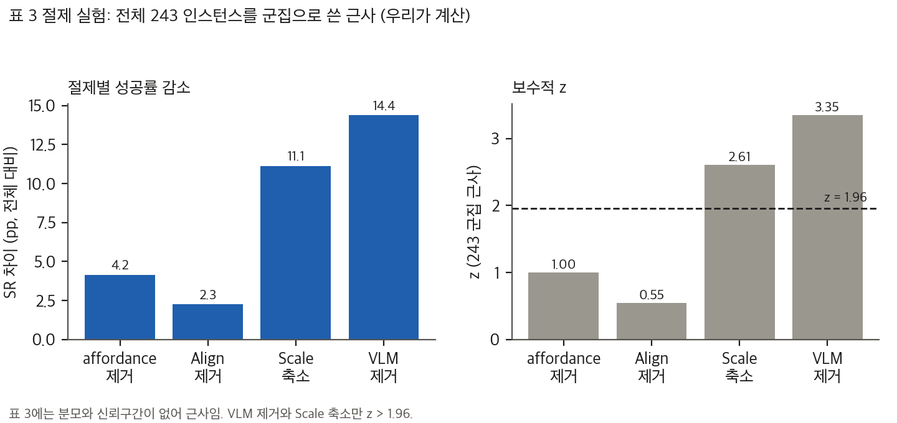
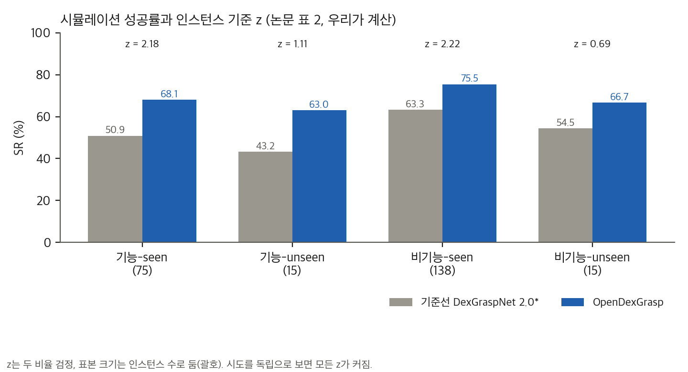
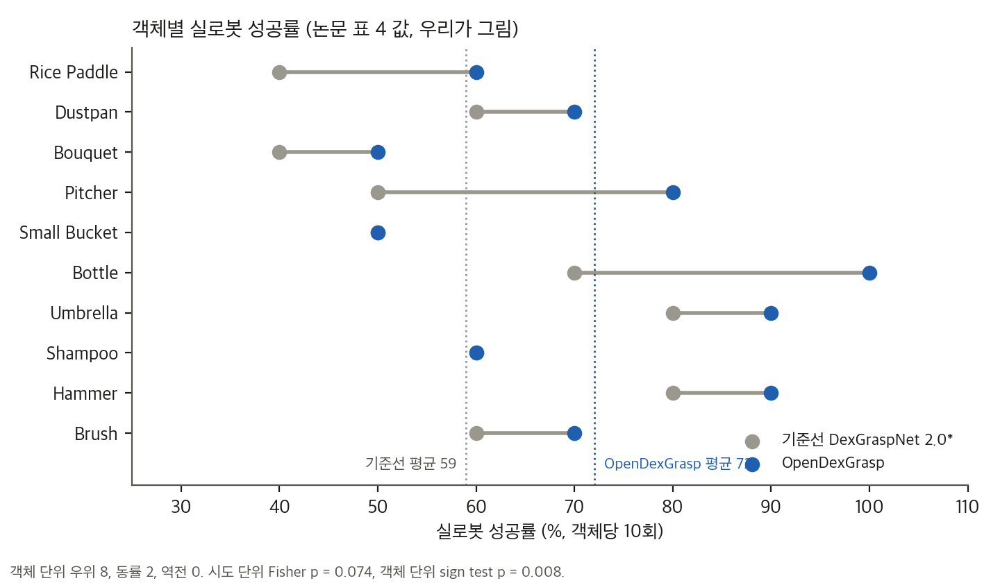

> **논문:** Jiyao Zhang, Junhan Wang, Tianyu Wang, Zeyuan Chen, Anthony Bolton, Yitong Peng, Hao Dong. *OpenDexGrasp: Open-vocabulary Task-Oriented Dexterous Grasping.* CoRL 2026 오럴, arXiv:2609.18117 (v4, 2026-11-10).
> 공식 코드 저장소는 README만 있는 상태여서 실행하거나 대조할 코드가 없었습니다. 논문 그림은 싣지 않고, 우리가 계산하고 그린 그래프만 씁니다.

## 이 논문이 묻는 것

"컵을 손잡이로 잡아라", "칼날을 피해 잡아라"처럼 **쓰임에 맞는 파지**를 자연어 지시에서 바로 만들 수 있을까요? 기존 방법은 보통 두 단계입니다. 먼저 어디를 잡을지 affordance를 예측하고, 그다음 그 자리에 맞는 손 자세를 최적화합니다. 두 번째 단계가 느리고, 첫 단계의 오류가 그대로 넘어갑니다.

OpenDexGrasp는 이 두 단계를 없앱니다. affordance는 학습할 때 쓰는 보조 신호로만 두고, 추론에서는 언어, 여러 시점 영상, 물체 점군에서 손목과 관절을 한 번에 생성합니다.

## 데이터: 많이 만들고, 조금 맞춘다

저자들은 데이터를 두 단계로 만듭니다. 이름은 Coverage-to-Alignment(C2A)입니다.

- **OpenDex-Scale (대량, 1.24M 자세):** 최적화로 파지 자세를 합성하고, 각 자세를 여섯 장의 렌더링과 접촉 정보와 함께 VLM에 보내 기능 여부와 지시문을 받습니다. 기능 자세는 약 45%입니다.
- **OpenDex-Align (소량, 27.4k 자세):** 범주 안에서 대표 물체 하나를 골라 사람이 텔레오퍼레이션으로 1,590개를 시연하고, 밀집 대응으로 같은 범주의 다른 물체에 옮깁니다. 기능 자세는 약 68%입니다.

먼저 넓게 배우고, 나중에 사람 시연으로 맞춥니다. 이 순서가 논문의 핵심 설계입니다.

## 모델

- 의미: 사전학습 비전-언어 모델(Qwen3-VL-4B)의 중간 은닉 상태. 여러 시점 영상과 지시를 함께 넣습니다.
- 기하: PointNet++로 2,048개 점의 전역 토큰을 만듭니다.
- 액션: 흐름 매칭 트랜스포머가 손목 이동, 6D 회전, 관절 22개를 생성합니다. 추론은 32 스텝입니다.
- 보조: 점마다 기능 영역 점수를 내는 헤드가 같은 잠재 표현을 지도합니다.

## 이 글에서 확인한 것

**표 값은 대체로 맞습니다.** 데이터 비율, 합계(1,590 + 25,835 = 27,425), 시뮬레이션 네 분할에서 물리 지표 우위가 표와 일치합니다. 이전 버전 v1, v2에는 "전이 grasp 27,805개"라는 문장과 합계 25,835가 함께 있었는데, v3에서 맞춰졌습니다.

**가장 확실한 효과는 사전학습 VLM입니다.** VLM을 CLIP으로 바꾼 행은 SR이 14 pp 떨어지고, 이 행의 값은 기준선과 거의 같습니다. 데이터 규모를 줄였을 때도 성공률이 떨어집니다. 반면 affordance 보조 손실과 정렬 단계의 효과는 방향만 맞고, 표만으로는 통계적으로 확인되지 않습니다.

**실로봇 결과는 방향이 일관됩니다.** 객체 10개 가운데 8개에서 우위가 있고 역전은 없습니다. 다만 시도 단위로 보면 Fisher 검정 p = 0.074입니다. 객체가 10개뿐이라 검정력도 낮습니다. 충돌하는 자세를 사람이 골라 버린 과정도 있어서, 실로봇 결과는 방향을 보여 주는 정도로 읽는 것이 맞습니다.

## 읽을 때 조심할 점

1. **기능 성공을 직접 재지 않습니다.** 시뮬레이션 성공률은 손을 예측 자세에 고정하고 2초 동안 객체가 0.2 m 넘게 움직이지 않는지만 봅니다. 물체를 들지도, 쓰임을 확인하지도 않습니다. "기능 정렬"의 근거는 GPT-5 점수와 사람 점수입니다.
2. **SR의 분모가 표와 맞지 않습니다.** 인스턴스 75개와 시도 10회라면 성공 수가 정수가 되어야 하는데 그렇지 않습니다. 저자에게 물어볼 항목입니다.
3. **unseen 일반화는 아직 판단할 수 없습니다.** unseen 분할은 범주 5개(인스턴스 15개)뿐이고, 성공률 차이는 통계적으로 유의하지 않습니다.
4. **속도 주장도 조금 과합니다.** 본문은 "a fraction of a second"라고 쓰지만 측정값은 0.93 s입니다. 기준선과의 시간 비교도 없고, 최적화 변형과만 비교했습니다.
5. **재현할 수 없습니다.** 공식 저장소는 "coming soon" 상태이고, 데이터와 모델도 공개되지 않았습니다. 학습은 2M 스텝을 전제합니다.

## 정리

OpenDexGrasp의 아이디어 가운데 쓸 만한 것은 세 가지입니다. 접촉 정보를 텍스트로 넣어 주석을 만드는 방식, 물체 크기로 나눈 쌍마다 시연을 하나만 하고 나머지는 범주 전이로 채우는 설계, 그리고 추론 때 쓰지 않는 보조 손실로 잠재 표현을 구조화하는 방식입니다. 반면 "기능 성공"과 "일반화"라는 주장은 현재 증거가 약합니다. 공식 코드와 데이터가 공개되면 이 글의 질문 목록을 기준으로 다시 확인할 수 있습니다.

## 자료

- [통합 리포트 PDF](report/report_public.pdf)
- [01. 논문 분석: OpenDexGrasp](analysis/01_paper_analysis.md)
- [02. 선행연구, 구성 요소의 출처, GitHub 자료](analysis/02_prior_work.md)
- [03. 수치 재계산과 일관성 검사](analysis/03_analysis.md)
- [04. 주장 대조 (공식 코드 없음)](analysis/04_claim_verification.md)
