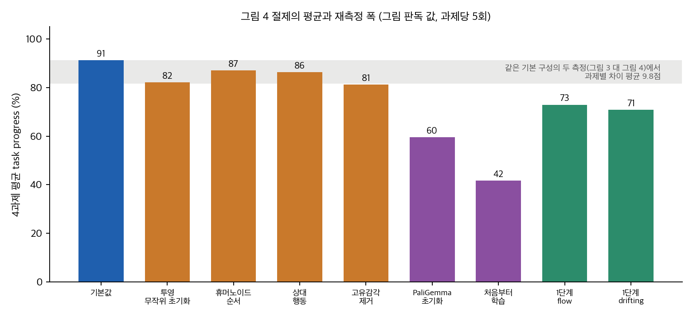
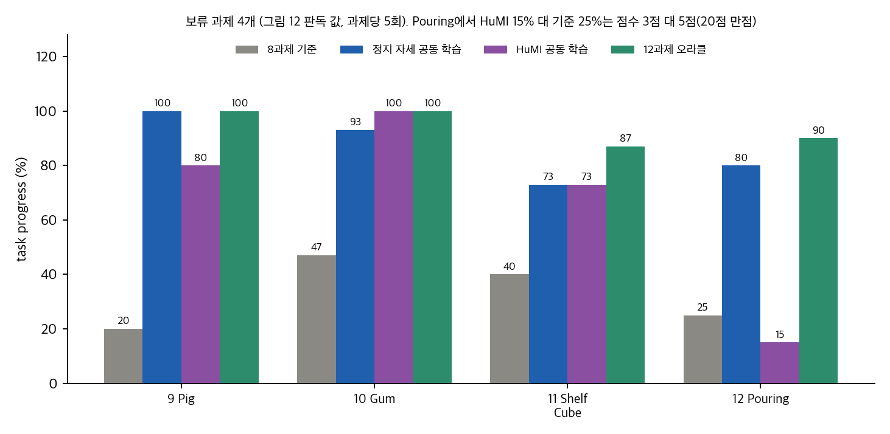
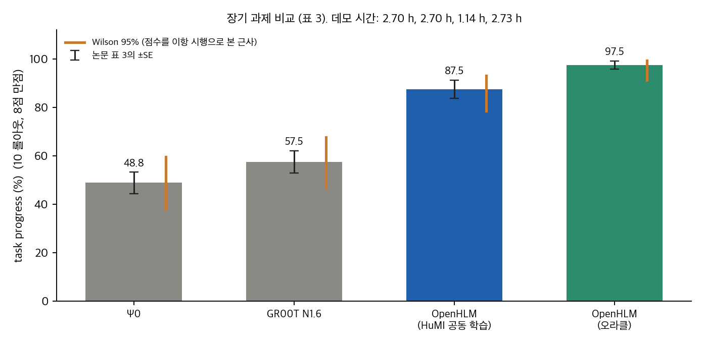

> **논문:** Yingdong Hu, Haodong Zhu, Boyuan Zheng, Yihang Hu, Tong Zhang 외, Yang Gao. *OpenHLM: An Empirical Recipe for Whole-Body Humanoid Loco-Manipulation.* CoRL 2026 스포트라이트, arXiv:2606.22174 (v2, 2026-11-02).
> 공식 코드는 GitHub OpenHLM-project/OpenHLM(Apache-2.0)에 있습니다. 이 글의 그래프는 논문의 막대 위 숫자를 읽은 값(그림 판독 값)과 표 3의 수치로 우리가 다시 그린 것입니다. 논문 그림은 arXiv 비독점 배포 라이선스라 싣지 않았습니다.

## 논문이 묻는 것

대부분의 휴머노이드 시스템은 팔은 역기구학으로, 다리는 별도의 강화학습 제어기로 움직입니다. 이 논문은 한 정책이 팔, 허리, 다리를 모두 명령하는 "전신 네이티브" VLA를 만들려면 무엇이 필요한지를 묻고, 실로봇(Unitree G1) 실험을 세 단계로 나눠 변수를 하나씩 바꿔 답합니다.

1. **원격조작 인터페이스.** 분리 제어(21-D), VR 3점(24-D), 관절 기반 전신 모션 캡처(32-D), SMPL(81-D)을 비교하고 관절 기반을 택합니다.
2. **VLA 설계.** π0.5를 행동 차원 34로 키워 초기화합니다. 행동 투영 초기화, 행동 순서, 상대 행동, 고유감각, 사전학습, 1단계 생성을 하나씩 바꿉니다.
3. **공동 학습.** 전신 원격조작을 하지 않은 새 물체와 지시문을, 정지 자세 원격조작이나 로봇 없는 HuMI 시연을 섞어 확장합니다.

평가는 과제마다 실로봇 롤아웃 5회, 루브릭 점수입니다. 루브릭 만점이 3점인 과제에서는 진행도가 0, 33, 67, 100%의 롤아웃 점수들의 평균이라, 5회 평균은 6.7%포인트 간격의 값만 가질 수 있습니다.

## 표에서 롤아웃 점수가 복원됩니다

표 1과 표 3은 평균과 표준오차(SE)를 줍니다. 5회 롤아웃에서 평균이 k/15 꼴이라는 조건과 SE를 함께 쓰면, 가능한 롤아웃 점수 조합이 거의 하나로 정해집니다. 표 1의 여섯 칸은 칸마다 한 가지 조합이 남고(예: Cola 관절 기반 13/15 → {2, 2, 3, 3, 3}), 표 3의 네 값은 1–6가지가 남습니다. 평균과 SE는 서로 일관됩니다. 아래 검정은 이렇게 복원한 점수를 쓰고 롤아웃이 독립이라고 가정했습니다.

## 관절 기반 인터페이스: 범위는 확인되고, 같은 과제의 우위는 약합니다

관절 기반 인터페이스는 분리 제어와 VR 3점이 구성상 표현하지 못하는 과제(예: 발로 페달 누르기)까지 수행하는 유일한 방식입니다. 걸음 수도 Cola에서 분리 제어 42.3, 관절 기반 12.0으로 본문의 "약 3.5배"(3.53배)와 맞습니다.

두 방식이 모두 수행하는 과제의 진행도 차이는 다음과 같습니다(복원된 점수, 5회, 독립 가정).

| 비교 | 차이 | Welch p |
|---|---|---|
| Cola 관절 대 VR 3점 | +46.7점 | 0.002 |
| Cola 관절 대 분리 제어 | +20.0점 | 0.28 |
| Shelf Cup 관절 대 분리 제어 | −13.3점 (분리 제어가 높음) | 0.41 |

이 표본 크기로는 분리 제어 대비 진행도 우위가 구분되지 않습니다. 표 1이 보여 주는 것은 "수행 가능한 과제의 범위"입니다.

## VLA 설계 절제: 큰 효과와 작은 효과의 경계

*그림 1. 그림 4의 9개 구성의 4과제 평균(그림 판독 값, 과제당 5회)과, 같은 기본 구성의 두 측정 사이 폭(회색 띠). 우리가 그린 그래프입니다.*

- **큰 효과.** π0.5 초기화(91) 대 PaliGemma 초기화(60), 처음부터(42), 그리고 1단계 생성(flow 73, drifting 71)은 기본값보다 18–50점 낮습니다. 20회 롤아웃 평균의 최소 검출 효과가 약 20점(표 1의 롤아웃 SD로 계산한 근사)이라, 사전학습 유무는 이 표본으로도 구분됩니다.
- **작은 효과.** 인터페이스 선택 네 가지(투영 초기화, 순서, 상대 행동, 고유감각)는 기본값보다 4–10점 낮고, 16개 과제 칸 중 8칸이 기본값 이상입니다. 본문은 이를 "작은 하락, 평가 잡음일 수 있다"고 서술합니다.
- **재측정 폭.** 그림 3의 관절 기반 구성(87, 80, 85, 100)과 그림 4의 기본값(100, 93, 85, 87)은 논문이 같은 "기본 구성"으로 부르는 조건입니다. 과제별 차이가 +13, +13, 0, −13점이고 4과제 평균은 88 대 91입니다. 두 측정이 별개의 학습인지 재평가인지는 논문에서 확인되지 않았습니다. 별개의 실행이라면 인터페이스 절제의 차이는 이 폭 안에 있습니다. 즉 "영향이 작다"와 "20점 미만의 영향은 구분하지 못한다"를 이 데이터로 가를 수 없습니다.

한 가지 더, 그림 4의 기본값(100, 93, 85, 87)은 그림 12의 "8-task baseline" 과제 1–4와 같은 값입니다. 절제의 기본 모델이 4과제로 학습되었는지 8과제 모델인지는 저자 확인이 필요합니다.

1단계 생성의 동기였던 지연 절감은 90 ms에서 60 ms입니다. 실행 주기는 25개 행동 / 30 Hz = 0.83 s이므로 절감은 주기의 3.6%, 제어 틱 한 칸 미만입니다.

## 공동 학습: 정지 자세는 뚜렷하고, HuMI의 동작 결론은 과제 하나에 기댑니다

*그림 2. 전신 원격조작이 닿지 않은 보류 과제 4개의 진행도(그림 12 판독 값, 과제당 5회). 우리가 그린 그래프입니다.*

- 보류 과제 4개 평균은 8과제 기준 33, 정지 자세 공동 학습 87, HuMI 67, 12과제 오라클 94입니다. 서론의 "33%에서 87%"는 정지 자세의 값입니다. 9–11 과제의 점수 합계(45점 만점)는 기준 16, 정지 자세 40, HuMI 38, 오라클 43이고, 정지 자세와 HuMI의 차이는 구분되지 않습니다(p 0.76, 루브릭 점수를 이항 시행으로 본 Fisher 근사).
- Pouring(새 그릇 기울이기 동작)에서 HuMI는 3/20점, 8과제 기준은 5/20점, 정지 자세는 16/20점입니다. HuMI와 정지 자세는 구분되고, HuMI와 기준은 구분되지 않습니다. 본문의 "HuMI는 새 의미는 주지만 새 동작은 주지 못한다"는 방향은 값과 맞지만, 동작에 대한 결론은 과제 하나, 5회 롤아웃에 기댑니다.
- 부록 E.4의 HuMI 시연 수 스케일링(42, 67, 76, 84%)은 본문 증가분(+25, +9, +8)과 같습니다. 5개 시연의 19/45점은 기준 16/45점과 구분되지 않고, 10개(30/45점)부터 구분됩니다(Fisher 근사 p 0.006). 본문의 "5개도 상당한 신호"는 이 표본에서는 기준과 구분되지 않는 크기입니다.
- 시연 시간은 40회 기준 전신 21분, 정지 자세 13분, HuMI 7분입니다(HuMI는 정지 자세의 0.54배). 장면 초기화와 과열 정지 시간은 빠진 값입니다.

## 장기 과제: 차이는 크고, 변수는 묶여 있습니다

*그림 3. 표 3의 진행도와 논문의 ±SE, 점수를 이항 시행으로 본 Wilson 95% 구간(근사). 우리가 그린 그래프입니다.*

OpenHLM(HuMI 공동 학습) 87.5%는 GR00T N1.6의 57.5%, Ψ0의 48.8%보다 높고, 복원한 점수로 낸 차이는 독립 가정에서 p < 0.001입니다(최소 검출 효과 약 15점의 두 배). 오라클 97.5%와의 10.0점 차이는 p 0.03–0.05의 경계입니다. 본문의 "오라클의 10점 이내"는 정확히 10.0점 차입니다.

해석에서 주의할 점은 비교의 변수가 묶여 있다는 것입니다(부록 D.2). OpenHLM과 기준선은 원격조작 인터페이스(관절 기반 대 분리 제어), 저수준 제어기(SONIC 대 GR00T 분리 제어 또는 AMO), 백본, 학습 스텝과 배치(30k × 128 대 50k × 32 또는 64), 데모 구성이 모두 다릅니다. "휴머노이드 데이터를 사전학습에 넣는 것만으로는 부족하다"는 결론은 이 묶음에 대한 결과이고, 같은 백본에서 휴머노이드 사전학습 유무만 바꾼 실험은 없습니다.

평가 10쌍 중 3쌍(바나나, 복숭아, 망고스틴 조합)은 전신 원격조작으로 학습한 쌍이고 7쌍은 레몬 또는 토마토가 들어간 HuMI 쌍입니다(표 5). 표 3의 87.5%는 둘을 합친 값입니다. 총점 70/80에서 학습 쌍의 최대 24점을 빼면 HuMI 쌍은 최소 46/56 = 82.1%입니다. 부분집합별 값은 저자 확인이 필요합니다.

데모 시간은 1.14 h 대 2.70 h(0.42배)이고 시연 시간 기준입니다.

## 공식 코드와 논문

공식 저장소(커밋 `4a8d4cd`)를 정적으로 읽고 논문 값과 대조했습니다.

- **표 4의 하이퍼파라미터와 일치합니다.** 최고 학습률 1e-4, 워밍업 1k, 30k 스텝, 행동 구간 50, 배치 128(README 명령 기준, 설정 파일 기본값은 256). 논문에 없는 값: 코사인 종료 학습률 1e-5, 기울기 클리핑 1.0, EMA 없음.
- **weight surgery**는 코드가 논문 서술과 같습니다. 다만 사전학습 32슬롯 중 양팔 배열은 16개이므로, 보존의 의미가 큰 것은 앞 16차원으로 보입니다(추론). 휴머노이드 순서 절제의 작은 차이와 맞는 가설이지만 확인하지 않았습니다.
- **제어 주기:** 본문 §3.1은 "high-level 보통 10 Hz"이고 부록 C.4와 코드는 30 Hz, 50개 생성, 25개 실행입니다.
- **상대 행동 목표:** 본문은 "chunk의 첫 번째 행동 기준", 부록은 "chunk의 첫 번째 상태 기준"이라고 쓰는데, 코드에는 두 변형이 모두 있고 절제에 쓴 쪽은 코드로 확인되지 않습니다.
- **고유감각 입력:** 상태가 분위수 정규화 뒤 256구간으로 이산화되어 프롬프트 텍스트로 들어갑니다. 논문은 "현재 관절 위치 벡터를 입력"이라고만 적습니다.
- **카메라:** 부록 C.1은 머리와 손목의 스테레오 RGB를 쓴다고 적지만, 정책 입력은 머리 왼쪽 영상 하나와 손목 영상 둘입니다.
- **공개 범위:** 수집, 변환, 학습, 서빙, 배포 코드와 체크포인트 6개(약 44.8 GB), 시연 데이터(약 297.5 GB)가 있습니다. 절제 모델, 기준선 학습 설정, 롤아웃별 점수는 저장소에서 확인되지 않았습니다.

## 구현 가능성

실로봇 평가(G1, PICO4U 등)와 학습(4 × A800, 약 24 시간)은 개인 환경에서 불가능합니다. 코드 정적 대조와 수치 재계산은 이 분석에서 끝냈습니다. 예시 시연(약 0.49 GB)으로 변환 파이프라인을 점검하거나 체크포인트(7.47 GB 하나)로 오프라인 행동 예측을 점검하는 일은 설치와 다운로드 뒤에 가능하지만, PyTorch 경로가 Apple GPU(MPS)에서 도는지는 시험하지 않았습니다. 시뮬 벤치마크가 없어(저장소 이슈 요청이 열려 있음) 폐루프 점검도 어렵습니다.

## 정리

- 표의 평균과 SE는 일관되고, 롤아웃 점수가 복원됩니다.
- 장기 과제의 기준선 대비 차이는 큽니다. 다만 인터페이스, 제어기, 백본, 학습 스텝이 함께 다릅니다.
- 사전학습 유무와 1단계 생성의 효과는 큽니다. 인터페이스 선택 네 가지의 효과는 같은 구성의 재측정 폭과 비슷해 이 표본으로 구분되지 않습니다.
- HuMI의 동작 결론과 "5개 시연" 서술은 표본이 작아 방향만 확인됩니다.
- 이 글의 값 중 그림에서 읽은 것은 "그림 판독 값"으로 표시했고, 롤아웃별 점수와 학습 구성(그림 3과 4의 모델, 표 1의 학습 과제 수)은 저자 확인이 필요합니다.

## 자료

- [통합 리포트 PDF](report/report_public.pdf)
- [01. 논문 분석: OpenHLM](analysis/01_paper_analysis.md)
- [02. 선행연구와 공식 저장소](analysis/02_prior_work.md)
- [03. 수치 재계산, 일관성 검사, 주장 판정](analysis/03_analysis.md)
- [04. 공식 코드 대조와 구현 가능성](analysis/04_code_verification.md)
