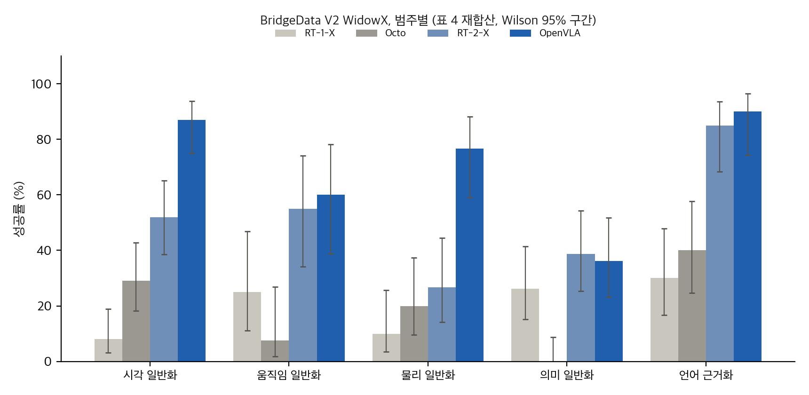
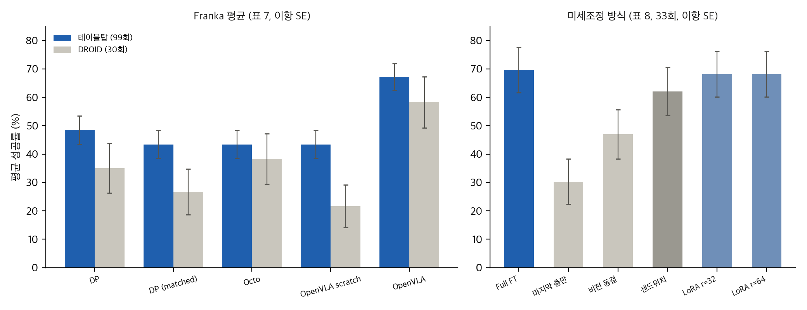
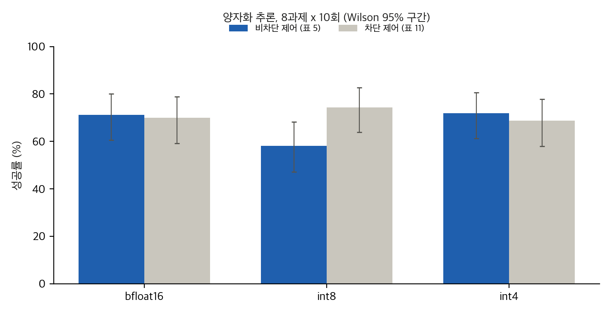

> **논문:** Moo Jin Kim, Karl Pertsch, Siddharth Karamcheti 외. *OpenVLA: An Open-Source Vision-Language-Action Model.* CoRL 2024 (PMLR 270, 포스터), arXiv:2406.09246 (v3, 2024-09-05).
> 공식 코드는 GitHub openvla/openvla(MIT)에 있습니다. 이 글의 그림 세 장은 우리가 표 값에서 다시 그린 것이고, 논문 그림은 쓰지 않았습니다.

## 논문이 묻는 것

로봇 정책은 학습 데이터 밖의 물체와 지시문에 약합니다. 인터넷 규모로 사전학습된 VLM을 행동 생성에 쓰는 VLA가 대안이지만, 가장 성능이 높은 RT-2-X(55B)는 공개되지 않았습니다. OpenVLA는 Prismatic-7B(DINOv2와 SigLIP 인코더, Llama 2 7B)를 970k 에피소드의 Open X-Embodiment 데이터로 미세조정해, 열린 가중치와 코드로 같은 방향을 택합니다.

행동은 7개 차원을 1st–99th 분위수로 정규화하고 256 빈으로 나눈 뒤, Llama 어휘의 마지막 256 토큰으로 바꿉니다. 학습은 행동 토큰의 교차 엔트로피만 계산합니다.

## 이 글에서 확인한 것

**1. BridgeData에서 RT-2-X를 이기는 차이는 확실합니다.** 17과제 × 10회에서 OpenVLA는 70.6%, RT-2-X는 50.6%입니다. 차이 20.0%p는 95% 구간 9.6–29.8이고, 과제 쌍 검정으로도 12승 3패입니다(p = 0.006). 다만 RT-2-X는 BridgeData 원본의 첫 전이(0 행동) 전처리 없이 학습되었고, 데이터 규모와 백본도 다릅니다. 차이의 원인을 한 가지로 줄일 수 없습니다. Google 로봇에서는 두 모델이 비슷합니다(85.0 대 78.3%, p = 0.35).

*그래프: 표 4 값을 범주별로 합산해 다시 그린 것입니다 (시도 수 기준 Wilson 95% 구간). 논문 그림이 아닙니다.*

**2. "Diffusion Policy보다 20.4%p"는 재현하지 못했습니다.** Franka 테이블탑 99회와 DROID 30회의 시도 가중 평균은 OpenVLA 67.2 대 DP 48.5, DROID 58.3 대 35.0입니다. 가능한 집계는 18.7에서 23.3%p 사이입니다. 방향은 맞지만 20.4라는 숫자의 근거는 찾지 못했습니다.

**3. "모든 과제에서 50% 이상을 달성한 유일한 방법"은 틀립니다.** 표 7에서 OpenVLA 자신도 당근 넣기 OOD 과제에서 5회 중 2회(40%)입니다. 어떤 방법도 모든 과제에서 50%를 넘지 못합니다.

*그래프: 표 7의 Franka 평균(테이블탑 99회, DROID 30회)과 표 8의 미세조정 방식별 평균을 다시 그린 것입니다 (이항 SE).*

**4. 양자화는 4비트에서 bf16과 같고, 8비트 감소는 약한 증거입니다.** int4는 bf16과 차이가 0.6%p입니다(p = 0.93). int8은 13.1%p 낮지만 80회 소표본이라 p = 0.08입니다(쌍 검정은 약 0.02). 차단 제어에서 8비트 감소가 사라지는 것은 추론 속도 가설과 맞습니다.

*그래프: 표 5(비차단)와 표 11(차단 제어)의 양자화 성공률과 Wilson 95% 구간입니다 (8과제 × 10회).*

**5. 같은 정책의 bf16 값이 세 표에서 다릅니다.** 표 9와 표 4의 같은 8과제 OpenVLA 열은 76.3%로 같습니다. 표 5의 bf16은 71.3%, 표 11의 차단 bf16은 70.0%입니다. 실행이 따로였을 가능성이 있지만 본문은 설명하지 않습니다. 가장 큰 차이 6.3%p는 두 값의 표준오차 합(약 7%p) 안이라, 실행 간 변동으로 설명할 수 있는 범위입니다.

**6. 절제에서는 OpenX 사전학습이 중요하고, DINOv2 추가 효과는 근거가 약합니다.** 같은 VLM을 BridgeData만으로 학습하면 76.3%에서 45.6%로 떨어집니다(30.6%p, p = 7e-5). DINOv2를 빼면 40.6%가 되는데, 차이 5.0%p는 p = 0.52입니다.

## 공식 코드와 설정: 논문과 다른 곳

공식 저장소(MIT, 커밋 c8f03f4)를 정적으로 읽었습니다. 행동 정규화, 256 토큰, 학습률 2e-5, 전역 배치 2048, 시각 인코더 미동결, LoRA r=32는 논문과 맞습니다. 다음은 맞지 않거나 빠져 있습니다.

- **에폭.** 논문은 27 에폭이라고 쓰지만, 공식 설정은 에폭을 1000으로 두고 최대 스텝을 두지 않습니다.
- **DROID 일정.** 논문은 DROID를 10%로 넣고 마지막 1/3에서 뺀다고 쓰지만, 설정 주석은 70% 동안 넣는다고 쓰고, 실제 설정에는 DROID가 없습니다.
- **미세조정 설정.** 학습률 5e-4, LoRA 알파 16, 최대 200,000 스텝은 논문에 없습니다.
- **가중치 라이선스.** 모델 카드는 MIT이지만, 코드 README는 Llama 2 라이선스가 적용될 수 있다고 씁니다.

## 이 맥에서 할 수 있는 것

Apple M4 Pro(24 GiB, MPS, CUDA 없음)에서는 표 재계산과 행동 토큰화 검사를 끝냈습니다. 7B 추론(bf16, 약 15 GB)은 메모리가 빠듯하고, 공식 코드가 CUDA를 전제하므로 포팅과 측정 뒤에 판정할 수 있는 조건부입니다. LoRA 미세조정(README 예시로 27 GB 이상), 전체 미세조정, 사전학습, 실로봇 평가는 불가능합니다. LIBERO 6,000 에피소드도 추론 호출이 약 180만 회라서 불가능하고, 한 스위트만 소표본으로 조건부입니다.

## 이 글이 말하지 않는 것

- 실로봇 성능을 재현하지 않았습니다. 표는 논문 값을 그대로 가져와 다시 셌습니다.
- 표준오차 공식은 논문이 밝히지 않아, 우리는 이항 가정으로 다시 계산했습니다. 보고된 ± 값은 이보다 8–15% 작습니다.
- 6 Hz 추론 속도와 메모리 사용량은 측정하지 않았습니다.
- 후속 연구는 찾아보지 않았습니다.

## 자료

- [통합 리포트 PDF](report/report_public.pdf)
- [01. 논문 분석: OpenVLA: An Open-Source Vision-Language-Action Model](analysis/01_paper_analysis.md)
- [02. 선행연구, 구성 요소의 출처, 공식 코드](analysis/02_prior_work.md)
- [03. 재계산, 집계 주장, 검정, 일관성 검사](analysis/03_analysis.md)
- [04. 공식 코드 대조와 구현 가능성](analysis/04_code_verification.md)
