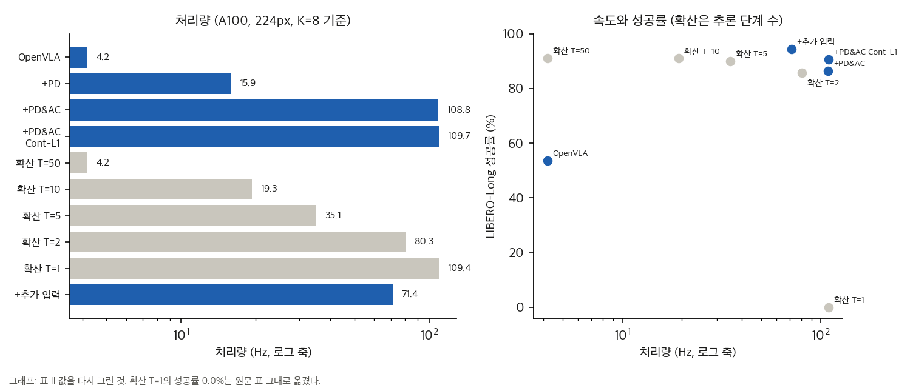
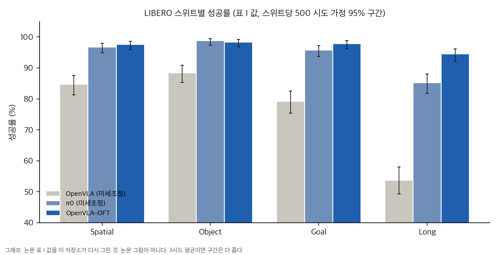
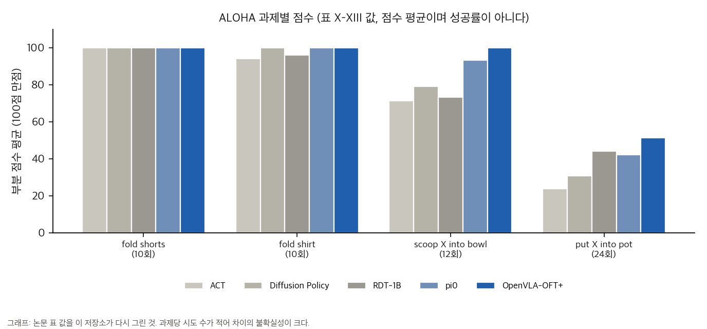

> **논문:** Moo Jin Kim, Chelsea Finn, Percy Liang. *Fine-Tuning Vision-Language-Action Models: Optimizing Speed and Success.* RSS 2025, arXiv:2502.19645 (v2, 2025-04-28).
> 공식 코드는 GitHub moojink/openvla-oft(MIT)에 있습니다. 이 글의 그래프 세 장은 논문 표 값에서 우리가 다시 그린 것이고, 논문 그림은 쓰지 않았습니다.

## 논문이 묻는 것

VLA는 VLM을 로봇 데이터로 미세조정한 정책입니다. 새 로봇에 맞출 때 많은 사람이 사전학습 레시피를 그대로 씁니다. 그런데 OpenVLA의 기본 방식은 행동 토큰을 하나씩 자기회귀로 내므로 3–5 Hz에 머뭅니다. 고주파 양손 제어에는 모자랍니다.

논문은 OpenVLA 하나를 기반으로 설계 공간을 실험합니다. 행동을 병렬로 내는지, 이산인지 연속인지, 목표 함수를 무엇으로 할지를 바꿔 봅니다. 그 결과로 세 가지를 묶은 OFT 레시피를 제안합니다. 병렬 디코딩과 청킹, 연속 행동, L1 회귀입니다.

## 이 글에서 확인한 것

**1. 처리량 26배는 표 값으로 맞습니다.** 같은 설정(A100, 224 px, 8 스텝 청크)에서 OpenVLA는 4.2 Hz이고, 병렬 디코딩과 청킹을 쓰면 108.8–109.7 Hz입니다. 청크당 지연은 0.2396초에서 0.0735초가 됩니다. 처리량은 청크 길이를 지연으로 나눈 값과 모든 행에서 맞습니다.

*그래프: 논문 표 II 값을 이 저장소가 다시 그린 것입니다. 확산 정책 T=1의 성공률 0.0%는 원문 표 그대로 옮겼고, 본문에는 설명이 없습니다.*

**2. 평균 97.1%는 맞지만, 숫자 자체가 3시드 평균으로 보입니다.** 표 I 캡션은 스위트당 500 시도라고 씁니다. 그런데 보고된 스위트별 값 24개 중 14개가 500 시도의 정수 비율이 되지 않습니다. 예를 들어 Goal의 97.9%는 500 시도에서 489.5회입니다. 1,500 시도(3시드 × 500)로 보면 모두 맞습니다. 공식 저장소의 `LIBERO.md`도 "three random seeds"라고 씁니다. 캡션 설명을 고쳐야 합니다.

**3. π0보다 높다는 것은 평균에서만 맞고, 차이는 Long에 몰려 있습니다.** 평균 차이는 2.9%p입니다(94.2 대 97.1). 스위트별로 보면 Spatial +0.8, Object −0.4, Goal +2.1은 차이가 없고, Long만 +9.3%p입니다(p ≈ 1e-6, 스위트당 500 시도 가정).

*그래프: 표 I 값을 스위트당 500 시도로 가정한 이항 95% 구간과 함께 다시 그린 것입니다. 논문 그림이 아닙니다.*

**4. ALOHA의 "최대 15%p"는 ACT 기준입니다.** 과제 네 개의 점수 평균은 OFT+ 87.8, π0 83.9, RDT-1B 78.4, Diffusion Policy 77.5, ACT 72.3입니다. 차이는 ACT에 대해 15.6, π0에 대해 4.0입니다. 또 초록은 "성공률"이라 쓰지만, 실제 지표는 단계별 부분 점수입니다. 과제당 시도는 10–24회라서 과제별 차이는 크게 흔들릴 수 있습니다.

*그래프: 표 X–XIII의 과제별 점수를 다시 그린 것입니다. 점수 평균이며 성공률이 아닙니다. 과제당 시도 수를 표시했습니다.*

**5. BridgeData에서 평균 우위는 근거가 약합니다.** 여섯 과제에서 OFT는 평균 69.2, OpenVLA는 65.8입니다. 승패는 3승 3패이고, 쌍체 t 검정 p는 0.68입니다.

**6. 확산 정책 추론 단계 수에 따른 변화는 설명이 필요합니다.** 확산 정책을 2단계로 줄이면 LIBERO-Long 85.7%이고, 1단계로 줄이면 0.0%입니다. 본문은 "성능이 떨어진다"고만 씁니다. 같은 확산 정책의 처리량은 v1에서 10.1 Hz, v2에서 4.2 Hz로 보고되었습니다.

## 구현 가능성

이 맥(M4 Pro, 24 GiB, MPS, CUDA 없음)에서는 다음과 같이 판단했습니다.

- **가능:** 표 재계산과 검정, 공식 코드 정적 대조.
- **조건부:** 공식 LIBERO 체크포인트(가중치 약 15 GB)로 추론 한 청크를 돌리는 것. 공식 코드는 장치를 CUDA 또는 CPU로만 고르므로 MPS 포팅이 필요하고, 양방향 어텐션은 외부 transformers fork에 있습니다. 포팅은 2–4일로 추정하며 측정 전 값입니다.
- **불가:** LoRA 미세조정(GPU 27 GB 이상), 전체 LIBERO 평가(추론 호출이 시드당 수만 회), 실로봇 ALOHA.

## 코드와 논문이 다른 곳

- 양방향 어텐션 구현은 이 저장소에 없고, `pyproject.toml`이 가리키는 외부 fork에 있습니다.
- LoRA의 alpha(16), 대상 모듈(all-linear), 최대 평가 스텝은 논문에 없습니다.
- 확산 정책의 처리량은 v1과 v2에서 다르게 보고되었습니다.
- 관련 연구의 "0.07 ms, 0.321 ms"는 초여야 합니다. 표 II와 III은 초로 씁니다.
- "A100에서 한 행동에 0.33초"라는 문장은 표 II의 0.2396초와 맞지 않습니다.

## 한계

- 원자료(시도별 결과, 체크포인트별 결과)가 없어서 시도 단위 검정은 하지 못했습니다. 모든 검정은 이항 근사입니다.
- 베이스라인 평가 설정(시도 수, 시드)은 원 논문에서 확인하지 않았습니다.
- 학습 수렴 속도와 언어 따르기(그림 5)를 판정할 수 있는 표가 없습니다.

## 정리

OFT의 핵심 주장인 "청크와 병렬 디코딩으로 속도를 올리면서 성능도 오른다"는 표 값으로 확인됩니다. 다만 π0 대비 우위는 Long 스위트에 몰려 있고, 실로봇 결과는 과제당 10–24회라 강하게 말하기 어렵습니다. 보고 값이 3시드 평균이라는 점과 확산 정책의 설명 누락은 논문 개정에서 고칠 만합니다.

## 자료

- [통합 리포트 PDF](report/report_public.pdf)
- [01. 논문 분석: Fine-Tuning Vision-Language-Action Models: Optimizing Speed and Success](analysis/01_paper_analysis.md)
- [02. 선행연구, 구성 요소의 출처, 공식 저장소](analysis/02_prior_work.md)
- [03. 재계산, 검정, 일관성 검사와 주장 판정](analysis/03_analysis.md)
- [04. 공식 코드 대조와 구현 가능성](analysis/04_code_verification.md)
