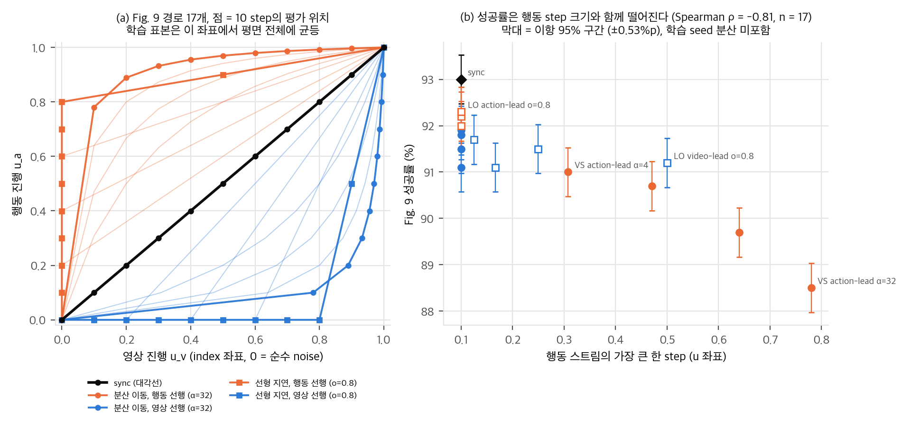
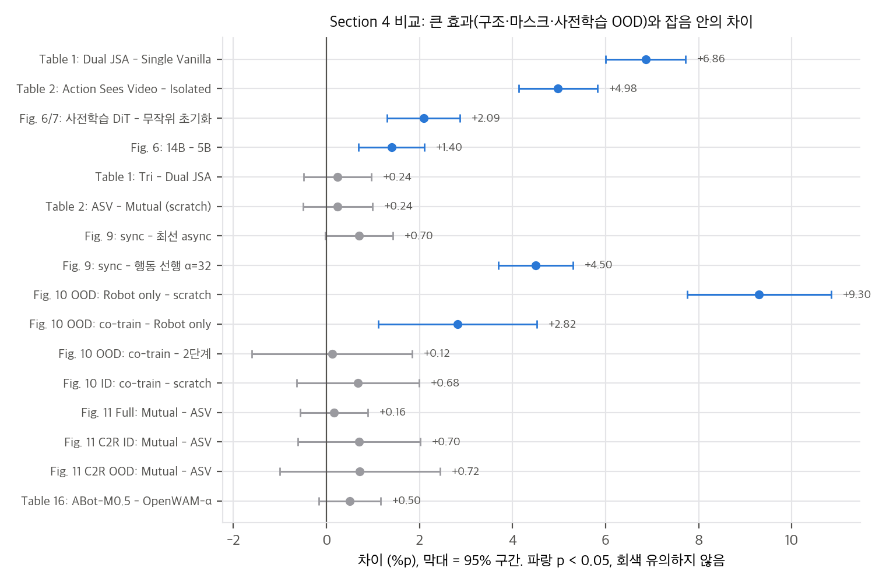
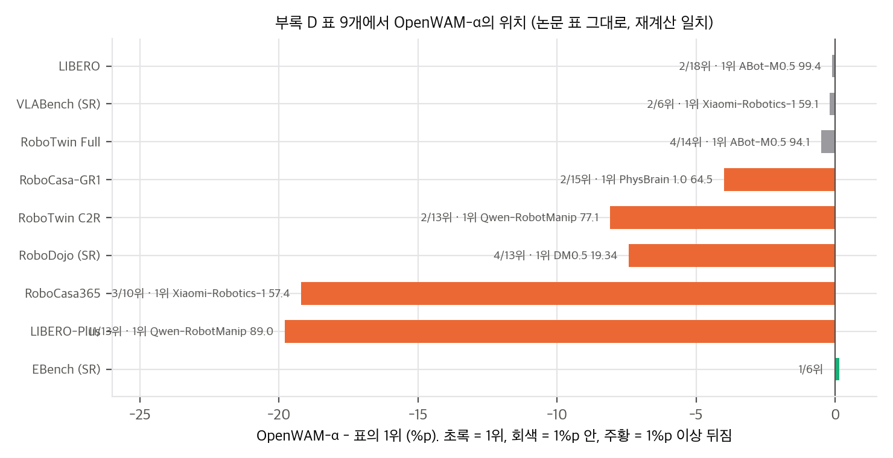

# 03. 유도와 재계산: noise 평면, 효과 크기, 데이터·연산

재계산 스크립트는 `analysis/table_check.py`(→ `table_check_results.json`)와 `analysis/noise_toy.py`(→ `noise_toy_results.json`)입니다. 둘 다 단일 스레드 numpy로 이 맥에서 각각 약 1초, 약 1분 걸립니다.

## 1. 결합 noise 평면을 코드 식으로 다시 쓰기

### 1.1 부호와 좌표

논문은 t = 0이 noise, t = 1이 데이터이고 목표 velocity가 z − ε입니다(Eq. 2). 코드는 σ = 1이 noise이고 x_σ = (1 − σ)x + σε, 목표가 ε − x입니다(`action_backbone/scheduler.py`). σ = 1 − t로 바꾸면 dx/dσ = −dx/dt라서 두 식은 같습니다.

학습 grid는 u = k/1000(k = 0…999)을 σ = f₅(1 − u)로 보낸 1000칸입니다. f_ρ(s) = ρs / (1 + (ρ − 1)s)입니다. 두 스트림은 index k를 **각자 독립으로 균등하게** 뽑습니다(`architectures/base.py` 1089, 1113행). 따라서

> index 좌표 (u_v, u_a)에서 학습 표본은 단위 정사각형 위에 균등 분포합니다.

σ 좌표로 보면 shift 5 때문에 noise 쪽이 25배 조밀합니다. 표본의 35.8%가 σ ≥ 0.9이고, σ < 0.1은 2.1%뿐입니다.

### 1.2 손실 가중치

"종 모양 가중치"(§5.1.2)의 실제 식은 다음과 같습니다(`_set_training_weight`).

w(σ) ∝ exp(−2(σ − 0.5)²) − min_grid exp(−2(σ − 0.5)²)

최솟값이 σ = 1에서 나오므로 **순수 noise에서 가중치가 정확히 0**이고, σ = 0.5에서 최대, σ → 0에서도 거의 0입니다. 표본 밀도와 곱하면 학습 신호의 65%가 σ ∈ [0.5, 0.9]에 몰립니다. σ ≥ 0.9는 표본의 36%지만 가중 손실의 10%입니다(`noise_toy_results.json` A).

### 1.3 비동기 경로의 식

Eq. 3의 선행 곡선은 진행도 s(0 = noise)에서 깨끗함 f_α(s)입니다. 코드는 σ 좌표 s' = 1 − s에서 계산하는데, 다음 항등식을 씁니다.

1 − f_α(1 − s') = 1 − α(1 − s') / (1 + (α − 1)(1 − s')) = s' / (α − (α − 1)s') = f_{1/α}(s')

그래서 `lead_sigma = f_{1/α}(s')`이고 α = 1에서 비트 단위로 동기와 같습니다. 선형 지연 h_o는 σ 좌표에서 min(s'/(1 − o), 1)입니다. 두 경로 모두 마지막에 각 스트림의 shift 5 grid를 통과합니다(`deploy/denoise_schedule.py`). 결과적으로 Fig. 9의 경로 17개는 모두 index 좌표의 단위 정사각형 안에 있고, 학습 표본 밀도는 어느 경로에서나 같습니다.

우리 분석: (a) Fig. 9 경로 17개를 코드 식 그대로 index 좌표에 그림(점 = 10 step의 평가 위치). (b) Fig. 9 성공률 대 행동 스트림의 가장 큰 한 step.

## 2. Fig. 9: 비동기 경로는 왜 나쁜가

### 2.1 "분포 밖이라서"는 아닙니다

1.1에 따라 어떤 경로도 학습 표본 밀도가 같습니다. 대각선 근처 띠(|u_v − u_a| < 0.05)의 질량은 9.75%로, 다른 경로 근처 띠와 다르지 않습니다. 논문의 "모든 경로가 분포 안" 서술(§3.2)은 표본 밀도로는 정확히 맞습니다. 따라서 비동기 경로가 나쁜 이유를 학습 표본 부족으로 설명할 수 없습니다.

### 2.2 이상적 denoiser toy: 경로 자체의 이산화 오차

`noise_toy.py` B는 (미래 영상 8차원, 행동 4차원)이 4개 봉우리의 Gaussian 혼합인 세계를 만듭니다. 영상 평균은 행동 평균의 선형 사상이라 영상이 어느 봉우리인지 알려 줍니다. 정확한 사후 평균으로 velocity를 만들어 각 경로를 10 step Euler로 적분하고, 최종 행동이 어떤 봉우리의 99% 영역 안에 들어간 비율("유효 행동")을 셉니다.

| 경로 (봉우리 폭 0.15) | 유효 행동 | Fig. 9 |
|---|---|---|
| 동기 | 0.949 | 93.0 |
| 분산 이동, 영상 선행 α = 4–32 | 0.985–0.994 | 91.1–91.9 |
| 분산 이동, 행동 선행 α = 4–32 | 0.967–0.986 | 88.5–91.0 |
| 선형 지연, 영상 선행 o = 0.2–0.8 | 0.917–0.942 | 91.1–91.7 |
| 선형 지연, 행동 선행 o = 0.2–0.8 | 0.832–0.927 | 92.0–92.3 |
| 동기 400 step (기준) | 0.993 | – |

- 모델이 완벽하면 400 step에서 모든 경로가 같은 분포에 도달합니다(동기 0.993, 행동 선행 α = 32도 0.990). 경로 차이는 10 step 이산화에서만 생깁니다.
- 이상적 모델에서는 **영상 선행이 동기보다 낫고, 행동 선행 선형 지연이 가장 나쁩니다.** 영상이 먼저 봉우리를 정해 주면 행동이 한 봉우리 안의 단봉 문제가 되기 때문입니다. Fig. 9와의 Spearman 상관은 −0.45(봉우리 폭 0.10, 0.25에서도 −0.48, −0.45)로 **순서가 반대**입니다.
- 결론: Fig. 9의 순서는 경로의 수학적 성질에서 나오지 않습니다. 학습된 네트워크가 평면의 어느 영역을 어떻게 근사하는지에서 나옵니다.

### 2.3 실제 순서를 따르는 단 하나의 경로 통계

경로별 통계 다섯 개 가운데 Fig. 9 성공률과 강하게 상관된 것은 **행동 스트림이 한 번에 건너뛰는 index 거리의 최댓값**뿐입니다(Spearman ρ = −0.82, p = 7×10⁻⁵, n = 17). 행동 선행 α가 커질수록 첫 step이 σ_a = 1 → 0.58(α = 32, u 거리 0.78)로 커지고, 성공률이 91.0 → 88.5로 떨어집니다. 행동이 갱신되는 횟수(ρ = 0.15), 행동이 절반쯤 정해질 때 영상 noise(ρ = −0.23), 손실 가중치 평균(ρ = −0.03)은 상관이 없습니다.

해석에는 주의가 필요합니다. 값이 0.1 단위로 반올림되어 있고, 16개 비동기 값 대부분이 서로 표본 오차(±0.53%p, 95%) 안이며, 상관은 사실상 행동 선행 분산 이동 계열 4점이 만듭니다. 그래도 다음 두 가지는 말할 수 있습니다.

1. **학습된 행동 denoiser는 큰 step에 약합니다.** 이상적 denoiser에서는 큰 step이 문제가 되지 않았으므로, 이것은 모델 오차의 성질입니다. N = 10을 유지하면서 경로를 바꾸려면 행동 스트림의 step 간격을 균등하게 두는 것이 안전합니다.
2. **추론 때 생성된 미래 영상은 거의 쓰이지 않습니다.** 행동 선행 선형 지연 o = 0.8은 행동 10 step 동안 영상이 σ_v = 1(9번), 0.83(1번)입니다. 즉 깨끗한 현재 프레임만 보고 행동을 끝내는데도 92.3%입니다. 동기 93.0%와의 차이 0.7%p는 p = 0.06입니다. 영상→행동 정보 경로가 학습 때는 필수(Table 2, +5.0%p)지만 추론 때는 기여가 1%p 안팎이라는 뜻입니다. 저자들의 "표현 학습 가설 지지"(§4.2.3)와 같은 결론이고, 이 경로 실험이 그보다 더 직접적인 증거입니다. 실용적으로는 추론 때 영상 스트림을 얕게 돌리거나 생략하는 가속 여지가 있습니다.

## 3. 무엇이 성능을 만드는가: 효과 크기와 잡음

RoboTwin 평가는 과제 50개 × 100 episode, seed 0 한 번입니다(공식 `benchmarks/robotwin/README.md`). 조건 하나는 N = 5,000, 두 조건 평균은 N = 10,000입니다. 92% 근처에서 평균 SE는 0.27%p, 두 실행 차이의 SE는 약 0.37%p입니다. 과제가 고정되어 있으므로 이 이항 SE는 episode 표본 오차의 상한입니다. 그러나 학습 seed 분산이 빠져 있어 실제 불확실성은 이보다 큽니다.

우리 분석: Section 4 비교의 차이와 95% 구간. 파랑은 p &lt; 0.05.

| 서열 | 효과 | 차이 | z |
|---|---|---|---|
| 1 | 사전학습의 OOD 이득 (Fig. 10, robot only − scratch) | +9.3%p | 11.8 |
| 2 | 구조 용량 (Table 1, Dual JSA − Single Vanilla) | +6.9%p | 15.5 |
| 3 | 학습 때 영상→행동 경로 (Table 2, ASV − Isolated) | +5.0%p | 11.7 |
| 4 | 추론 경로의 큰 행동 step (Fig. 9, 동기 − 행동 선행 α = 32) | +4.5%p | 11.0 |
| 5 | 사람 영상 추가의 OOD 이득 (Fig. 10, 공동학습 − robot only) | +2.8%p | 3.3 |
| 6 | 사전학습된 DiT 초기화 (Fig. 6 5B 92.39 − Fig. 7 무작위 초기화 90.30) | +2.1%p | 5.3 |
| 7 | 백본 5B → 14B (Fig. 6) | +1.4%p | 3.9 |
| – | Tri − Dual, ASV − Mutual(scratch), 공동학습 − 2단계, Mutual − ASV(사전학습 후 세 경우), 동기 − 최선 비동기 | 0.1–0.7%p | 0.1–1.9 |

여기서 보이는 것은 다음과 같습니다.
- **Finding 3의 "mutual이 일관되게 낫다"는 지지되지 않습니다.** 세 비교 모두 p > 0.29입니다. 방향이 세 번 같을 확률(1/8)을 쳐도 약합니다.
- **같은 설정의 실행 사이 차이가 이 효과들과 비슷합니다.** Dual JSA mutual 계열 값이 92.15(Table 2), 92.36(Table 1), 93.0(Fig. 9)입니다. 93.0 vs 92.15는 z = 2.3입니다. 학습 seed 분산 또는 보고되지 않은 설정 차이가 0.5–1%p 수준이라는 뜻입니다.
- **사전학습된 영상 생성 prior의 몫은 생각보다 작습니다.** 같은 5B 구조를 무작위로 초기화해도 90.30이고, 사전학습 초기화는 92.39입니다(+2.1%p). 무작위 초기화 5B는 사전학습된 Wan2.1-VACE-1.3B(90.14)와 같습니다. RoboTwin-Full처럼 학습 데이터가 많은 ID 설정에서는 "영상 생성 사전학습이 핵심"이라는 WAM의 전제가 약하게만 확인됩니다. OOD에서 같은 비교는 없습니다.
- **수치 불일치 하나:** Fig. 11의 사전학습 C2R OOD Mutual은 25.70 + 0.72 = 26.42인데, 같은 설정이어야 할 Fig. 10 공동학습 OOD는 26.62입니다(ID는 87.68로 일치).

## 4. 데이터와 연산 산술

### 4.1 Table 4

- 프레임 ÷ fps ÷ 3600이 표의 시간과 1시간 안에서 맞습니다. 예외는 RoboCOIN Full로, 104.5M / 30 fps = 967.6시간인데 표는 956시간입니다(1.2% 차이. 일부 하위 데이터셋의 fps가 30이 아닐 수 있습니다).
- 30 / 40 / 30 배분이 정확합니다. 사람 영상 30.03%, 실제 로봇 39.98%, 합성 29.99%입니다. 실제 로봇 40% 안의 배분(AgiBot 46.7%, RoboCOIN 35.8%, DROID 17.5%)은 정제 프레임 비율 그대로입니다(§5.2.1 서술과 일치).
- 공개 사전학습 config의 `total_hours`는 사람 영상과 InternData-A1이 둘 다 1439.0268시간으로 완전히 같습니다. 둘 다 30% 프레임 목표이고 30 fps라서 같은 시간이 됩니다. Table 4는 1,442와 1,440으로 적었고, 실제로 뽑힌 양이 목표보다 조금 많았던 것으로 보입니다.

### 4.2 Table 9와 학습 신호

- 155,862 iteration × 3,072 = **478.8M 클립**입니다. 창 stride가 1이고 코드상 창 수 ≈ 프레임 수이므로(에피소드 끝은 마지막 프레임 반복으로 채움), 1 epoch가 518.5M 프레임보다 7.7% 적은 이유는 설명되지 않습니다.
- 128장 × 7일 = **21,504 H200-hour**, step당 3.88초, GPU당 초당 6.2클립입니다.
- 토큰 수: 33프레임을 stride 4로 9장 → Wan2.2-VAE(시간 4배, 공간 16배) → latent 3프레임 → (1, 2, 2) patch → 12 × 10 = 120 토큰/프레임입니다. 영상 360토큰, 행동 32토큰입니다. DiT·ActionDiT 행렬곱만 세면 6 × (5B × 360 + 1B × 32) × 478.8M = 5.3×10²¹ FLOPs이고, H200 bf16 dense 989 TFLOPS 기준 MFU 약 7%입니다. 주의 연산, 매 step의 umT5 인코딩, VAE 인코딩을 빼고 센 하한입니다. 데이터 로딩과 실시간 인코딩이 비용의 상당 부분일 가능성이 큽니다.
- **행동 손실의 실효 가중치는 0.7입니다.** 사람 영상 표본은 행동 유효 칸이 없어 표본별 행동 손실이 0이지만, 배치 평균의 분모에는 들어갑니다(`base.py` 1296–1297행). 표본의 30%가 사람 영상이므로 사전학습의 실효 λ_a ≈ 0.70이고, 논문의 λ_a = 1(Table 9)과 다릅니다. SFT에서는 1입니다.
- SFT 비용도 작지 않습니다. RoboTwin-Full SFT는 118,655 step × 256 = 30.4M 클립으로, 사전학습의 6.3%입니다. RoboCasa365는 61.4M 클립(12.8%)입니다.

## 5. 벤치마크 표 읽기

우리 분석: 부록 D 표 9개에서 OpenWAM-α와 1위의 차이(논문 표 수치).

- **평균 행의 정의가 표마다 다릅니다.** LIBERO, RoboTwin, VLABench는 단순 평균입니다. RoboCasa365는 과제 수 가중(18 / 16 / 16, RMSE 0.03)이고, EBench는 과제 수 7 / 10 / 9 가중입니다. LIBERO-Plus도 가중 평균입니다(합 1 비음수 최소제곱 RMSE 0.49, 단순 평균 RMSE 1.52). OpenWAM-α의 LIBERO-Plus 단순 평균은 71.3, 가중 평균은 69.2입니다. RoboDojo Avg 11.92는 화면의 6열 평균(12.41)이 아니라, Gen-Std와 Gen-Rand를 합친 일반화 차원과 나머지 4차원을 합친 **5차원 평균**입니다. 표의 13행 모두 이 정의로 0.07 안에서 재현됩니다.
- **RoboDojo는 시드 3개 결과가 공개되어 있습니다**(`assets/robodojo_verification/`). 시드별 평균 SR은 11.80, 11.68, 12.28, SD 0.32입니다. 1위 DM0.5(19.34)와의 차이는 시드 SD의 23배라서 순위는 확실합니다. 42과제 가운데 14과제는 세 시드 모두 성공 0입니다.
- **EBench 기준선의 Score는 정수로 반올림된 리더보드 값입니다.** 계열별 값을 7 / 10 / 9로 가중하면 Qwen-RobotManip Score가 60.96이 되어, 표의 60.0과 다릅니다. "Score +4.7"은 표 값끼리의 차이이고, 계열 값으로 다시 계산하면 +3.7입니다. SR 차이(+3.8)는 재현됩니다.
- **"최상위권, 1위와 근소한 차이"(§5.3.1)는 다섯 벤치마크 중 셋에서만 맞습니다.** LIBERO −0.1, VLABench SR −0.2, RoboTwin-Full −0.5(z = 1.5, 동률 범위)는 맞고, RoboCasa-GR1 −4.0은 2위지만 근소하다고 보기 어렵습니다. RoboCasa365 −19.2는 맞지 않습니다. VLABench도 IS(intention score) 기준으로는 6개 중 5위입니다.

## 6. 실물 결과의 통계

- Franka(Table 6): 99/120 vs LingBot-VA 93/120은 Fisher p = 0.42입니다. "대부분 과제에서 확실히 앞선다"고 썼지만 6과제 중 4승 1무 1패이고, 차이는 유의하지 않습니다. π0.5(66/120)와의 차이는 확실합니다.
- RoboDojo-Real(Table 7): Embodiment 평균과 전체 평균이 재계산과 일치합니다. 과제당 10회라 과제별 SR 차이는 대부분 의미가 없고, 합치면 SR 44/180 vs π0.5 23/180(p = 0.006)입니다. Score 기준 18과제 중 13과제에서 최고(동률 포함)입니다.
- Wuji 손(Table 8): 합친 ID 27/40 vs 12/40, OOD 40/65 vs 19/65는 유의합니다. 과제별로는 8개 비교 중 2개(Put Away Clothes OOD, Twist off Bottle Cap OOD)만 p < 0.05입니다. Collect Shuttlecocks OOD는 점수 분모가 54와 57로 달라 시행 조건이 맞지 않습니다.
