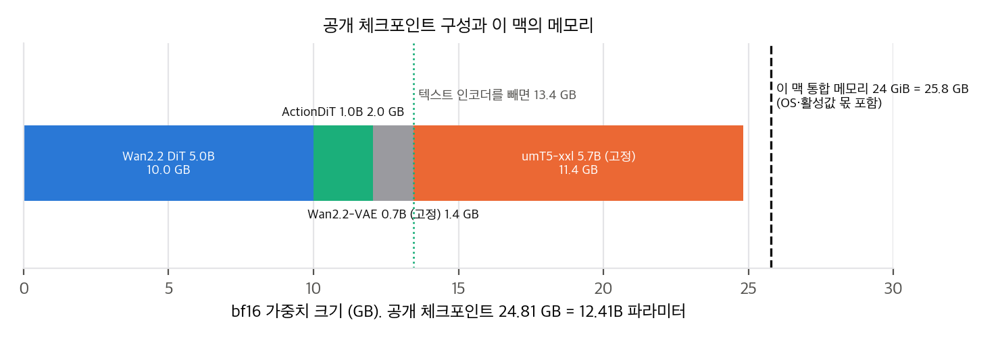

# 04. 코드 검증: 논문 ↔ 구현 대조, 수치 재계산, 구현 가능성

- **대상:** `OpenWAM-Official/OpenWAM` @ `a00c4ba` (2026-11-02, shallow clone, `third_party/cosmos-predict2.5` 서브모듈은 받지 않음). Hugging Face `OpenWAM/` 모델 46개·데이터셋 9개는 메타데이터, config, safetensors 헤더(가중치 아님)만 받았습니다. `XPolicyLab/XPolicyLab`은 API로 HEAD `6baccd5`만 확인했습니다.
- **범위:** GPU 실행, 가중치·데이터 다운로드, 패키지 설치 없이 코드 읽기, 설정 대조, CPU 재계산만 했습니다.

## 1. 모듈 매핑

| 논문 | 구현 위치 | 일치 여부 |
|---|---|---|
| C(E, S, M) 조합, 레지스트리 (§3.1) | `openwam/model/architectures/{single_system,dual_system,tri_system}/`, `configs/model/*.yaml` | ✅ 구조 7종이 모두 있습니다 |
| 백본 실행 계약 prepare / block step / finalize (§3.1) | `architectures/base.py`의 `BaseWAMArchitecture` | ✅ |
| 마스크 4종, 영상 first-frame causal (Eq. 1) | `attention_mask_mode: mutual`, `video_attention_mask_mode: first_frame_causal` (`dual_system.yaml`, 사전학습 config) | ✅ |
| 영상 백본 5종 (§3.1) | `configs/model/video_backbone/` (wan21_vace_1_3b, cosmos_predict25_2b, cosmos3_edge, wan22_ti2v_5b, wan21_i2v_14b_480p) | ✅ Cosmos3-Edge는 Fig. 6에 결과가 없지만 HF에 ablation 체크포인트가 있습니다 |
| ActionDiT 1B, 폭 1024 (§5.1.1) | `configs/model/action_backbone/separate_action_dit.yaml` (dim 1024, ffn 4096), 헤더 합계 1.021B | ✅ |
| 결합 flow matching, 독립 timestep (Eq. 2) | `base.py` 1089행(영상), 1113행(행동)에서 각자 `torch.randint` | ✅ 부호 규약은 D4 |
| 유효 마스크 m, 조건 프레임 제외 | `base.py` 1206–1215행(첫 latent 제외), 1288–1297행(행동 유효 칸 평균) | ✅ 배치 평균 방식은 D6 |
| 종 모양 가중치, shift 5 (§5.1.2) | `action_backbone/scheduler.py: _set_training_weight`, `shift_video: 5.0`, `shift_action: 5.0` | ✅ 식은 D5 |
| 동기·비동기 경로 (Eq. 3) | `openwam/deploy/denoise_schedule.py` | ✅ 항등식으로 구현(`03` §1.3) |
| 추론 모드 동기·비동기 (§3.3) | `openwam/deploy/executors/`, `inference_mode: sync` | ✅ |
| 가속 4종 (§3.3) | `configs/deploy.yaml`: prompt 캐시, `decode_video: false`, `compile.enabled: true`, `dit_cache` (cosine 0.99, 최대 3회 연속 skip) | ✅ 평가 설정은 D3 |
| WebSocket 서버, 정규화 기록 (§3.2, §3.4) | `openwam/deploy/server.py`, `policy.py`, `model_loader.py`, 체크포인트의 `normalization_stats.npy` | ✅ |
| 80D 통합 행동 공간 (Eq. 4) | `map_to_unify`(정규화 뒤 scatter), 로더별 `_unify_dst_index` | ✅ |
| 사전학습 혼합, 소스별 시간 예산 (§5.2.1) | `openwam/dataloader/mixture.py` (`weight_strategy: proportional`, `total_hours`) | ⚠️ D1 |
| 벤치마크 어댑터 8종 (§3.4) | `benchmarks/{libero,libero-plus,vlabench,robotwin,robodojo,robocasa365,ebench,robocasa_gr1}/` | ✅ RoboDojo 평가는 XPolicyLab을 거칩니다 |

## 2. 불일치와 논문에 적히지 않은 구현 요소

| # | 내용 | 영향 |
|---|---|---|
| D1 | **사전학습 혼합을 공개 코드로 만들 수 없습니다.** HF 사전학습 config는 소스 다섯 개 중 첫째를 `type: worldengine`으로 지정하는데, 데이터셋 레지스트리(`dataloader/registry.py`)에 이 타입이 없습니다. Study(§4.3)에서 쓴 EgoDex 로더도 테스트의 mock에만 있습니다. 공개 `configs/dataloader/mixture.yaml`은 로봇 소스 4개만 있고 `total_hours`가 없어 전체를 비율대로 씁니다. 소스별 `dataset_dir`는 작성자 서버의 절대 경로입니다. | 사람 영상 30% 없이는 OpenWAM-α 사전학습도, Fig. 10–11의 ego 변형 학습도 재현할 수 없습니다. 대신 Study 사전학습 변형 5개와 그 SFT 7개의 체크포인트는 공개되어 있어 **평가는 재현할 수 있습니다.** |
| D2 | 공개 사전학습 체크포인트는 `checkpoint_step_154000`이고, Table 9는 155,862 iteration(1 epoch)입니다. | 98.8% 지점의 체크포인트입니다. SFT 체크포인트 13개의 step은 Table 10과 모두 일치합니다(C4). |
| D3 | **평가 설정이 벤치마크마다 다릅니다.** RoboTwin은 `deploy.yaml` 기본값(velocity 캐시 on, compile on), 과제당 100 episode, seed 0입니다. 공식 README는 "캐시를 끄면 수치가 바뀐다"고 적었습니다. EBench는 캐시 off, compile off로 보고했습니다. LIBERO는 과제당 50회(seed 42), LIBERO-Plus는 과제당 1회, EBench는 26과제 × 20 episode(두 과제는 15), RoboDojo는 3 seed × 50 episode입니다. | 논문 §5.1.3은 동기 모드라서 결과가 "모델 자체의 성능을 가장 직접 반영한다"고 했지만, velocity 캐시는 forward를 건너뛰는 근사입니다. 캐시가 RoboTwin 점수에 주는 영향은 공개되지 않았습니다. 재현할 때 README의 벤치마크별 설정을 그대로 써야 합니다. |
| D4 | 부호 규약이 논문과 반대입니다. 코드는 σ = 1이 noise이고 목표가 ε − x, 논문은 t = 0이 noise이고 z − ε입니다. | 수학적으로 같습니다(`03` §1.1). 코드를 읽을 때만 주의하면 됩니다. |
| D5 | "종 모양 가중치"의 실제 식은 exp(−2(σ − 0.5)²)에서 grid 최솟값을 뺀 것입니다. **순수 noise(σ = 1)에서 가중치가 0**입니다. shift 5 표본추출과 합치면 표본의 36%가 σ ≥ 0.9인데 가중 손실은 10%입니다. | 논문에 식이 없습니다. 고noise 쪽에 표본을 몰아 주면서 손실은 깎는 조합이라, 다른 구현으로 옮길 때 그대로 맞춰야 합니다. |
| D6 | **사람 영상 표본도 행동 손실의 배치 평균 분모에 들어갑니다.** 표본별 행동 손실은 유효 칸 평균이고(`clamp(min=1)`), 유효 칸이 없는 사람 영상은 0이 되어 `.mean()`에 그대로 들어갑니다(`base.py` 1296–1297행). | 사전학습의 실효 λ_a ≈ 0.70입니다(표본의 30%가 사람 영상). 논문은 λ_a = 1이라고 적었습니다(Table 9). SFT는 1입니다. 사람 영상 비율을 바꾸면 행동 손실 크기도 함께 바뀝니다. |
| D7 | 비동기 경로에서 코드는 α와 o를 **동시에** 줄 수 있습니다(선행에 α, 후행에 o). 선행 곡선은 σ 좌표의 f_{1/α}로 계산합니다. | 논문은 두 계열을 따로 실험했습니다. 식은 같습니다(`03` §1.3). |
| D8 | 공개 `configs/train.yaml` 기본값은 GPU당 batch 16, 5 epoch, RoboTwin 로더, gradient checkpointing on입니다. 사전학습 config(HF)는 GPU당 24, 1 epoch, gradient checkpointing off입니다. | 사전학습 설정은 HF 체크포인트에 딸린 `config.yaml`에서 가져와야 합니다. H200(141 GB)에서 checkpointing을 끈 batch 24는 80 GB GPU에서 그대로 돌지 않을 수 있습니다. |
| D9 | **로더가 소스별 fps를 맞추지 않습니다.** 창은 원 fps 기준 33프레임, 행동은 32 step이고, 영상만 stride 4로 줄입니다(`robotwin.py`, `lerobot_v3_reader.py`). | 같은 chunk가 30 fps 소스에서는 1.07초, AgiBot(15 fps) 2.1초, DROID(10 fps) 3.2초입니다. 80D 슬롯 의미는 같아도 시간 축 의미가 소스마다 다릅니다. 논문에는 언급이 없습니다. |
| D10 | 1 epoch 정의가 맞지 않습니다. 학습 창은 매 프레임에서 시작할 수 있고(최소 창 길이 1–2, 끝은 마지막 프레임 반복) 창 수 ≈ 프레임 수입니다. 그런데 155,862 × 3,072 = 478.8M으로 518.5M 프레임보다 7.7% 적습니다. | 원인을 코드에서 찾지 못했습니다. 사람 영상 로더(비공개)의 창 규칙이 다르거나 Table 4 프레임 수 정의가 다를 수 있습니다. |
| D11 | OpenWAM-Alpha 체크포인트 14개(사전학습, SFT)가 모두 고정된 umT5-xxl(5.68B)과 VAE(0.70B)까지 담은 24.81 GB 한 파일입니다(ablation 32개의 크기는 확인하지 않음). 학습되는 부분은 6.02B입니다(C3). | 추론 메모리의 절반 가까이가 매 요청마다 쓰지 않는 텍스트 인코더입니다(prompt 캐시가 있으므로). 저메모리 기기에서 가장 먼저 덜어 낼 부분입니다(§4). |
| D12 | 실행 환경은 CUDA 중심입니다. README는 PyTorch 2.7.1 + CUDA 12.8, Docker CUDA 이미지를 권하고, 기본 장치는 `cuda:0`입니다(`--device`로 바꿀 수 있음). 주의 구현은 flash-attn 3/2, SageAttention, xformers 중 설치된 것을 쓰고, 없으면 torch SDPA로 내려갑니다. Cosmos 백본은 `transformer-engine` 컴파일(nvcc)이 필요합니다. MPS 경로는 코드에 없습니다. | 맥에서는 공식 경로로 실행할 수 없습니다. 수정 후 가능성은 §4.2에 있습니다. |
| D13 | RoboDojo 시드별 결과 파일(`assets/robodojo_verification/`)과 검증 스크립트가 공개되어 있습니다. | 이 파일로 Table 17의 OpenWAM-α 행 14칸을 정확히 재현했습니다(C8). 다른 벤치마크에는 episode 단위 결과 파일이 없습니다. |
| D14 | 사전학습 config의 소스별 `total_hours`는 사람 영상과 InternData-A1이 1439.0268로 같고, 합이 6,365.0시간입니다(Table 4는 6,369). | 30% 프레임 목표를 시간으로 바꾼 값이라 일치합니다. 표는 실제로 뽑힌 양입니다(`03` §4.1). |

## 3. 수치 재계산 (`analysis/table_check.py`, `analysis/noise_toy.py`)

| # | 주장 (출처) | 재계산 | 판정 |
|---|---|---|---|
| C1 | 518.5M 프레임, 6,369시간, 30/40/30 (Table 4, §5.2.1) | 합계 일치. 사람 30.03%, 실제 로봇 39.98%, 합성 29.99%. 프레임/fps는 RoboCOIN Full(967.6 vs 956시간)만 1.2% 어긋남 | ✅ (RoboCOIN Full 소폭 불일치) |
| C2 | 128 H200 × 7일, 155,862 iteration (Table 9) | 478.8M 클립, 21,504 GPU-h, 3.88초/step, DiT 행렬곱 기준 MFU 약 7%(하한) | 참고. 1 epoch 정의 불명(D10) |
| C3 | 5B DiT + 1B ActionDiT, umT5·VAE 고정 (§5.1) | safetensors 헤더: DiT 5.000B, Action 1.021B, umT5 5.681B, VAE 0.705B, 합 12.407B(bf16 24.81 GB) | ✅ |
| C4 | SFT 설정 (Table 10) | HF 체크포인트 파일의 step 13개가 모두 일치 | ✅ |
| C5 | Section 4 표 내부 일관성 (Table 1–2, Fig. 6, 10, 11) | Table 1–2 평균 일치. Fig. 6 5B = Table 2 ASV(92.39). Fig. 11 scratch Mutual = Table 2(92.15). Fig. 11 사전학습 C2R OOD Mutual 26.42 vs Fig. 10 공동학습 26.62 | ⚠️ 0.20 불일치 1건 |
| C6 | Finding 2–3의 비교 (Fig. 9–11) | 과제 50 × 100 episode 이항 근사: mutual vs ASV p = 0.29–0.67, 공동학습 vs 2단계 p = 0.89, 동기 vs 최선 비동기 p = 0.06. 큰 효과(구조, 마스크, 사전학습 OOD)는 z > 10 | 일부만 ✅ (`03` §3) |
| C7 | 부록 D 평균·순위, "최상위권" (§5.3.1) | 평균 재현: LIBERO·RoboTwin·VLABench 단순 평균, RoboCasa365 18/16/16, EBench 7/10/9, LIBERO-Plus 가중(RMSE 0.49), RoboDojo 5차원. 1위와 차이: LIBERO −0.1, VLABench −0.2, Full −0.5, GR1 −4.0, RoboCasa365 −19.2 | ⚠️ RoboCasa365 서술 불일치. VLABench IS 63.42 vs 표 63.5 |
| C8 | RoboDojo 11.92 / 17.18 (Table 17) | 공개 시드별 파일로 14칸 모두 재현. 시드 SD 0.32, 42과제 중 14과제 성공 0 | ✅ |
| C9 | 실물 Table 6–8 | 합계·평균 일치. Franka vs LingBot-VA p = 0.42. RoboDojo-Real SR 44/180 vs 23/180 p = 0.006. Wuji 합산 p = 0.002 / 0.0004, 과제별 8개 중 2개만 p < 0.05. Shuttlecocks OOD 분모 54 vs 57 | ✅ 수치, ⚠️ 해석 |
| C10 | 플랫폼 17개, embodiment 21개, 170 ms (§5.2, §5.1.3) | 1 + 15 + 1 = 17, + InternData 4 = 21. Fig. 4 Dual JSA 175 ms와 맞음 | ✅ |
| V1 | "모든 비동기 경로는 학습 분포 안" (§3.2) | index 좌표에서 학습 표본이 균등하므로 표본 밀도는 정확히 맞음 | ✅ (`03` §2.1) |
| V2 | "동기가 최선" (Finding 2)의 원인 | 이상적 denoiser에서는 영상 선행이 더 낫고(Spearman −0.45), 실제 순서는 행동의 최대 step과만 상관(−0.82) | 경로 성질이 아니라 학습된 모델의 성질 (`03` §2) |

## 4. 구현할 수 있는가

### 4.1 공식 코드로 논문 결과를 재현하는 경우

| 단계 | 필요한 것 | 판단 |
|---|---|---|
| 공개 SFT 체크포인트 평가 (Table 13–20) | CUDA GPU 1장(체크포인트 24.8 GB를 올리고 활성값 여유. 논문 측정은 RTX 5090 32 GB), 벤치마크별 시뮬레이터 설치, 공식 README의 평가 설정 | **가능.** 코드·체크포인트·규약이 모두 있습니다. RoboTwin 전체 평가는 README 표현으로 "모드당 여러 GPU-hour(many GPU-hours)"입니다 |
| Study ablation 재평가 (Table 1–2, Fig. 6–7, 10–11) | 위와 같고, 체크포인트 32개 × RoboTwin 조건 2개 | **가능.** 비용은 크지만 seed를 늘려 `03` §3의 "잡음 범위" 비교를 다시 가를 수 있는, 이 논문에서 가장 가치 있는 재현입니다 |
| SFT 재현 (Table 10) | 사전학습 체크포인트 + 벤치마크 데이터(HF), 80 GB GPU 8장 권장(README) | **가능.** 예: LIBERO 10,690 step × batch 256 |
| Fig. 9 경로 실험 | 공개 Dual JSA 체크포인트 + `denoise_mode: async` 설정만 바꿔 평가 | **가능.** 재학습이 필요 없습니다 |
| 사전학습 재현 (Table 4, 9) | 사람 영상 1,442시간(비공개) + 로더(비공개), 공개 로봇 데이터 약 9.5 TB, H200 약 21,500 GPU-h | **불가.** 공개 로봇 4개 소스만으로는 다른 혼합이 됩니다(D1) |

### 4.2 이 맥(Apple M4 Pro, 통합 메모리 24 GiB, MPS, CUDA 없음)

우리 분석: 공개 체크포인트 구성(safetensors 헤더 기준)과 이 맥의 메모리.

| 작업 | 가능 여부 | 근거 |
|---|---|---|
| 표·그림 재계산, 경로·학습 분포 toy | ✅ 완료 | `table_check.py`(약 1초), `noise_toy.py`(약 1분), 단일 스레드 numpy |
| 공식 코드 그대로 추론 | ❌ | CUDA 기본 경로, compile + CUDA graph, 체크포인트 24.81 GB가 통합 메모리 24 GiB(25.8 GB)를 OS와 나눠 써야 하므로 들어가지 않습니다 |
| 수정한 추론(MPS) | △ 미검증, 조건부 | 텍스트 인코더 키를 빼고 읽으면 DiT + ActionDiT + VAE가 13.4 GB입니다. prompt 임베딩은 umT5만 따로 한 번 돌려 저장하면 됩니다(서버에 prompt 캐시가 이미 있음). `--device mps`, `--compile-enabled false`, SDPA 주의로 실행 경로는 있어 보입니다. chunk 하나에 5B DiT forward 10회(토큰 약 400개)라 대략 수–수십 초로 추정합니다. LIBERO 몇 episode 확인은 할 만하지만 벤치마크 전체 평가는 비현실적입니다. torch 설치와 체크포인트 25 GB 다운로드 승인이 먼저 필요합니다 |
| 학습·SFT | ❌ | 학습되는 파라미터 6.02B에 AdamW 상태만 70 GB 이상입니다 |
| 아이디어 축소 재구현 | ✅ 가능 | 독립 timestep 결합 flow matching + 마스크 4종 + 경로 17종을 작은 MLP·transformer로 toy 데이터에서 시험하는 것은 numpy·CPU 또는 torch(MPS)로 충분합니다 |

### 4.3 판단

**구현할 수 있는가: 평가와 SFT는 공식 코드로 CUDA GPU에서 재현할 수 있고, 사전학습은 재현할 수 없습니다.** 이 저장소의 WAM 논문 가운데 공개 범위가 가장 넓습니다. 코드, 설정, 사전학습·SFT·ablation 체크포인트 46개, 벤치마크 데이터가 모두 있습니다. 하지만 사전학습 프레임의 30%인 사람 영상과 그 로더가 없고, 계산량이 H200 약 21,500 GPU-h입니다. 이 맥에서는 학습이 불가능합니다. 추론은 공식 경로로는 불가능하고, 텍스트 인코더를 덜어 내고 MPS로 돌리는 수정이 필요합니다(미검증). 이번 작업의 CPU 재계산과 toy는 끝냈습니다.
