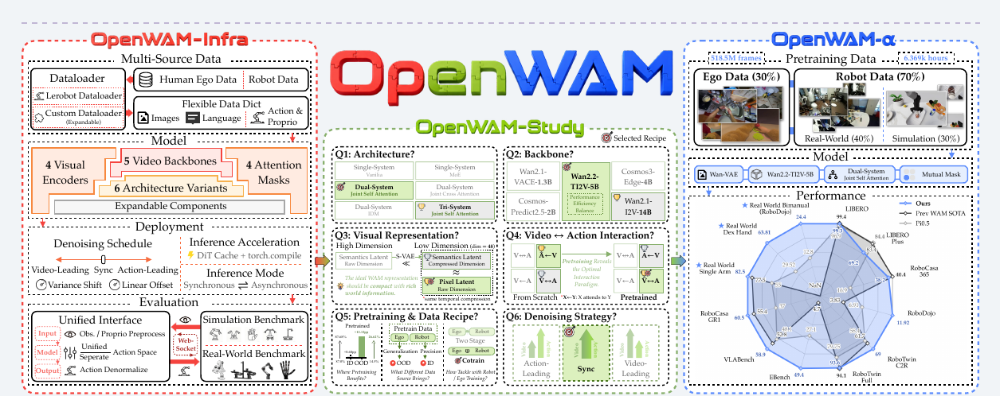
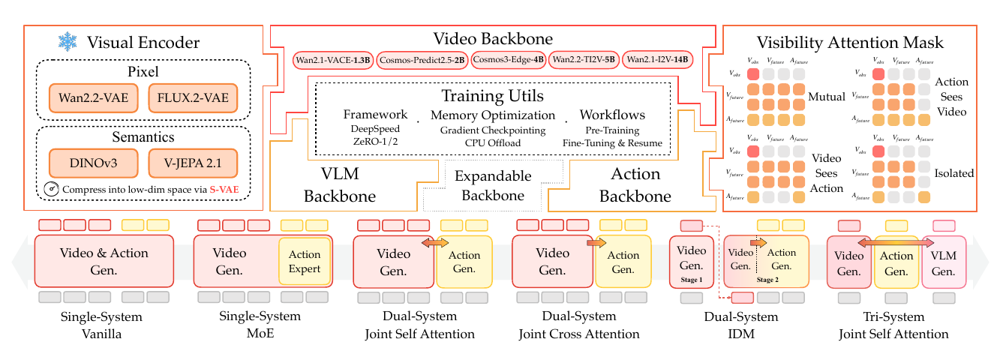
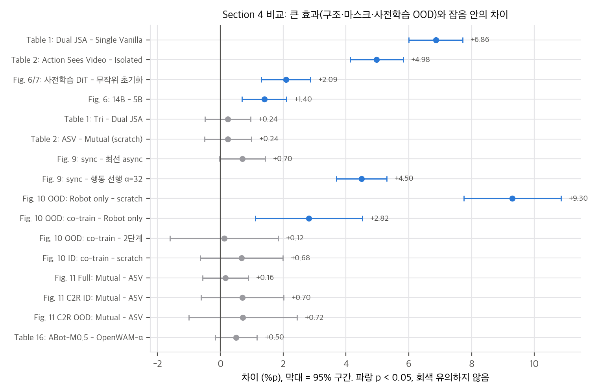
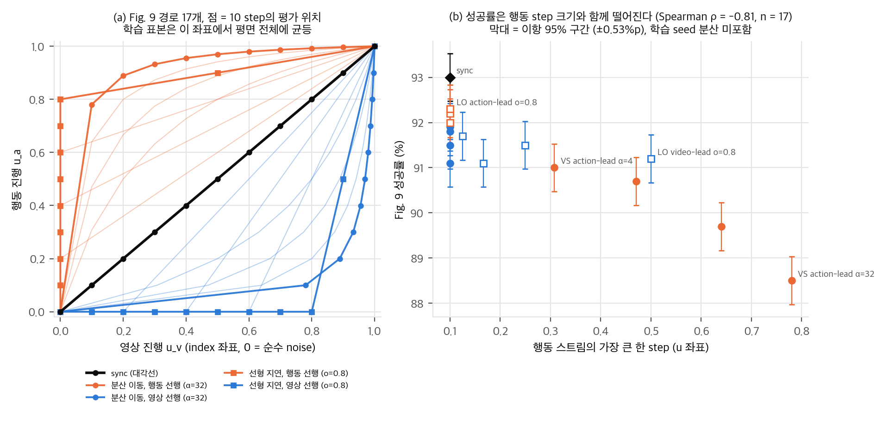
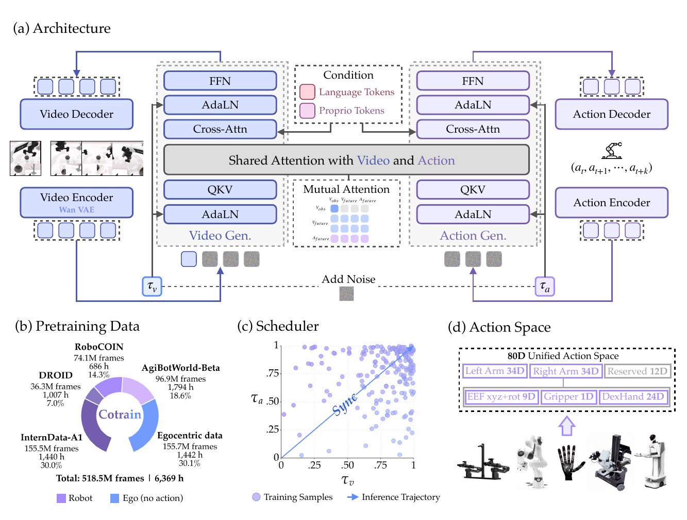
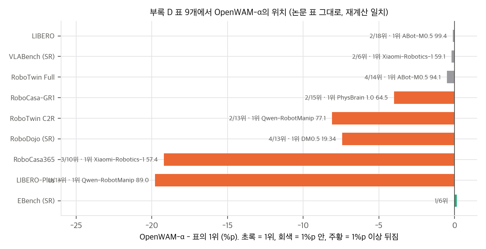
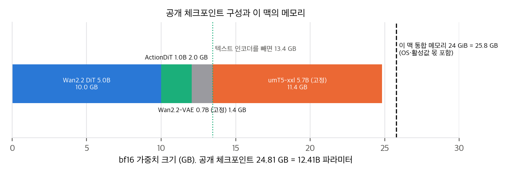

> **논문:** Wang, Huang, Li, Zhang et al. *OpenWAM: An Open, Modular Exploration Towards Systematic World–Action Model Pretraining.* arXiv:2609.07398v1 (2026). NUS, 칭화대, 베이징대, 홍콩대 외.
> 논문 그림은 CC BY 4.0에 따라 출처를 밝히고 실었습니다(© 저자). 나머지 그래프는 논문 수치, 공식 코드의 식, 공개 결과 파일로 직접 그렸습니다. 코드: [OpenWAM-Official/OpenWAM](https://github.com/OpenWAM-Official/OpenWAM) @ `a00c4ba`.

## 한 줄 요약

World–Action Model(WAM)은 영상 생성 모델을 초기값으로 삼아 미래 영상과 행동 chunk를 함께 생성하는 로봇 정책입니다. OpenWAM은 WAM의 설계 선택(시각 인코더, 스트림 백본, 가시성 마스크, denoising 경로, 사전학습 데이터)을 부품으로 쪼개 RoboTwin 2.0에서 같은 조건으로 비교했습니다. 그 결론으로 Wan2.2-TI2V-5B DiT + 1B ActionDiT를 518.5M 프레임에 사전학습했고, 코드와 체크포인트 46개를 공개했습니다.

## 1. 무엇을 만들었나

모델 하나는 세 부품의 조합 C(E, S, M)입니다. 고정된 시각 인코더 E, 영상·행동(·VLM) 스트림 백본 S, 스트림 사이 주의를 정하는 가시성 마스크 M입니다. 모든 백본이 prepare → 층별 block → finalize라는 같은 실행 계약을 따르므로, 백본 내부를 건드리지 않고 구조 7종과 마스크 4종을 바꿀 수 있습니다.

학습은 두 스트림이 **각자 독립으로 뽑은 noise 수준**으로 하는 결합 flow matching입니다(Eq. 2). 추론 때는 noise 평면 위의 경로를 고릅니다. 두 스트림이 함께 가는 동기(대각선), 한쪽을 먼저 깨끗하게 하는 분산 이동, 한쪽을 늦게 출발시키는 선형 지연입니다(Eq. 3).

## 2. 통제 실험에서 확실한 것과 아닌 것

RoboTwin 평가는 과제 50개 × 100 episode, seed 0 한 번입니다. 두 실행 차이의 표본 오차는 약 0.37%p이고, 학습 seed 분산은 여기에 들어 있지 않습니다. 이 기준으로 Section 4의 비교를 다시 보면 둘로 나뉩니다.

| 확실한 효과 | 차이 |
|---|---|
| 사전학습의 OOD 이득 (Fig. 10) | +9.3–12.1%p |
| Single-System → Dual-System (Table 1) | +6.9%p |
| 학습 때 영상→행동 정보 경로 (Table 2) | +5.0%p |
| 사전학습된 DiT 초기화 (Fig. 6 vs Fig. 7) | +2.1%p |
| 영상 백본 5B → 14B (Fig. 6) | +1.4%p |

반대로 Finding 3의 "사전학습 후에는 mutual 마스크가 일관되게 낫다"(세 비교 모두 p > 0.29), 2단계 대 1단계 공동학습(p = 0.89), "동기 denoising이 최선"(최선 비동기 대비 p = 0.06)은 이 설계로 가를 수 없습니다. 같은 설정으로 보이는 실행도 92.15, 92.36, 93.0으로 흔들립니다.

흥미로운 숫자가 하나 더 있습니다. 같은 5B 구조를 무작위로 초기화해도 RoboTwin-Full에서 90.30이고, 사전학습된 1.3B 백본(90.14)과 같습니다. 학습 데이터가 많은 ID 설정에서 영상 생성 사전학습의 몫은 +2.1%p입니다.

## 3. 추론 때 미래 영상은 얼마나 쓰이나

Fig. 9는 비동기 경로 16개가 모두 동기(93.0%)보다 나쁘다는 결과입니다. 저자들은 학습 때는 영상→행동 경로가 필요하지만 추론 때 강제할 필요는 없다고 해석합니다(표현 학습 가설). 코드의 식으로 경로를 다시 그리고 두 가지를 확인했습니다.

1. **"분포 밖이라서"가 아닙니다.** 두 스트림이 1000칸 grid의 index를 독립·균등하게 뽑으므로, index 좌표에서 학습 표본은 평면 전체에 균등합니다. 모든 경로가 같은 표본 밀도 위를 지납니다.
2. **이상적 모델이라면 순서가 반대입니다.** 미래 영상이 행동의 봉우리를 알려 주는 Gaussian 혼합 toy에서 정확한 사후 평균으로 10 step을 적분하면, 영상 선행이 동기보다 낫습니다(Fig. 9와 Spearman −0.45). 실제 순서와 강하게 상관된 경로 통계는 행동 스트림이 한 번에 건너뛰는 거리의 최댓값 하나였습니다(ρ = −0.82, n = 17). 그런데 같은 toy에서 작은 MLP를 학습해 보면 이 통계는 학습 모델의 성공 지표와 상관이 없습니다(ρ = 0.17). 학습 모델은 Fig. 9와 같은 방향의 순서를 내지만(ρ = −0.51), 큰 step 때문은 아닌 것으로 보입니다. 행동이 먼저 가는 경로가 전반적으로 약한 쪽입니다(추가 검증).

가장 눈에 띄는 점은 행동 선행 선형 지연 o = 0.8입니다. 행동 10 step 동안 영상은 σ_v = 1(9번), 0.83(1번)이라서, 사실상 현재 프레임만 보고 행동을 끝냅니다. 그런데도 92.3%로 동기와 0.7%p 차이입니다. **영상→행동 경로는 학습 때는 필수(+5.0%p)이지만, 추론 때 생성된 미래의 기여는 1%p 안팎**입니다. 배포 때 영상 스트림을 얕게 돌리거나 생략할 여지가 큽니다.

## 4. OpenWAM-α와 벤치마크

safetensors 헤더로 세면 공개 체크포인트는 12.41B 파라미터(bf16 24.81 GB)입니다. DiT 5.00B와 ActionDiT 1.02B를 학습하고, umT5 5.68B와 VAE 0.70B는 고정입니다. 사전학습은 H200 128장 × 7일(약 21,500 GPU-h), 478.8M 클립입니다. 데이터는 사람 1인칭 영상 30%, 실제 로봇 40%, 합성 30%이고 Table 4의 배분이 정확히 재현됩니다.

부록 D 표 9개의 평균은 모두 재현됩니다. 다만 평균의 정의가 표마다 다릅니다. LIBERO-Plus, RoboCasa365, EBench는 과제 수 가중이고, RoboDojo는 6열 평균이 아니라 5차원 평균입니다. RoboDojo는 공식 저장소에 시드별 결과가 있어 14칸을 정확히 재현했습니다(시드 SD 0.32). "1위와 근소한 차이의 최상위권"이라는 서술은 LIBERO(−0.1), VLABench(−0.2), RoboTwin-Full(−0.5)에서 맞고, RoboCasa-GR1(−4.0)과 RoboCasa365(−19.2)에서는 맞지 않습니다. 실물에서는 π0.5보다 확실히 높지만(RoboDojo-Real SR 44/180 vs 23/180, p = 0.006), Franka에서 LingBot-VA와의 차이(99/120 vs 93/120)는 p = 0.42입니다.

## 5. 코드와 대조해서 보인 것

- **사전학습 혼합을 공개 코드로 만들 수 없습니다.** 사전학습 config가 사람 영상 소스를 `type: worldengine`으로 지정하는데, 데이터셋 레지스트리에 이 타입이 없습니다. Study에서 쓴 EgoDex 로더도 테스트의 mock에만 있습니다. 공개 mixture 설정은 로봇 소스 4개이고, 데이터 경로는 작성자 서버의 절대 경로입니다.
- **행동 손실의 실효 가중치는 0.7입니다.** 행동이 없는 사람 영상 표본이 행동 손실 배치 평균의 분모에 0으로 들어갑니다. 논문은 λ_a = 1이라고 적었습니다.
- **소스별 fps를 맞추지 않습니다.** 같은 32-step 행동 chunk가 30 fps 소스에서는 1.07초, AgiBot(15 fps) 2.1초, DROID(10 fps) 3.2초입니다.
- **평가 설정이 벤치마크마다 다릅니다.** RoboTwin은 DiT velocity 캐시(forward를 건너뛰는 근사)를 켜고 보고했고, 공식 README는 캐시를 끄면 수치가 바뀐다고 적었습니다. EBench는 끄고 보고했습니다.
- **좋은 점도 분명합니다.** SFT 체크포인트 13개의 step이 Table 10과 모두 일치하고, Study ablation 체크포인트 32개가 모두 공개되어 있습니다.

## 6. 구현할 수 있는가

- **CUDA GPU에서는 평가와 SFT를 재현할 수 있습니다.** 공개 SFT 체크포인트 평가, ablation 32개 재평가, Fig. 9 경로 실험(재학습 불필요)이 모두 가능합니다. 비용이 들더라도 seed를 늘려 2절의 "잡음 범위" 비교를 다시 가르는 것이 이 논문에서 가장 가치 있는 재현입니다.
- **사전학습은 재현할 수 없습니다.** 사람 영상 데이터(30%)와 로더가 없고, 공개 로봇 데이터만 약 9.5 TB, 계산량이 H200 약 21,500 GPU-h입니다.
- **24 GiB 통합 메모리 맥(Apple GPU, CUDA 없음)에서는 학습이 불가능합니다.** 추론도 공식 경로로는 안 됩니다. 체크포인트 24.8 GB가 메모리를 넘고 실행 경로가 CUDA를 전제하기 때문입니다. 텍스트 인코더를 덜어 내면 13.4 GB라 MPS 추론 여지는 있지만 검증하지 않았습니다.

## 7. 정리

OpenWAM의 가장 큰 기여는 모델 자체보다 **같은 코드에서 한 변수씩 바꾼 비교와 그 체크포인트를 모두 공개한 것**입니다. 재계산하면 큰 효과(사전학습의 OOD 이득, 구조 용량, 학습 때 영상→행동 경로)는 확실하고, 마스크 방향·데이터 순서·추론 경로에 관한 세부 결론은 seed 1개로는 결론이 나지 않습니다. 그리고 경로 실험은 "WAM은 미래를 상상하고 그에 맞춰 행동한다"는 그림과 달리, **미래 예측의 이득이 대부분 학습 때 생긴다**는 쪽을 가리킵니다.

## 자료

- [통합 리포트 PDF](report/report_public.pdf)
- [01. 논문 분석: OpenWAM](analysis/01_paper_analysis.md)
- [02. 선행연구와 위치](analysis/02_prior_work.md)
- [03. 유도와 재계산: noise 평면, 효과 크기, 데이터·연산](analysis/03_analysis.md)
- [04. 코드 검증: 논문 ↔ 구현 대조, 수치 재계산, 구현 가능성](analysis/04_code_verification.md)
