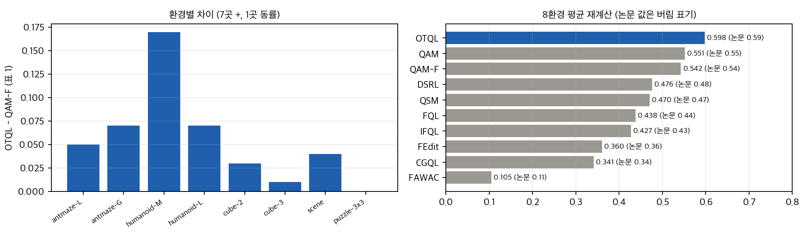
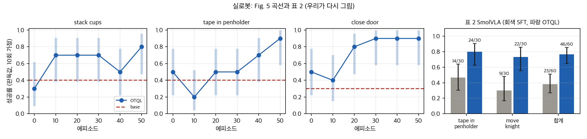
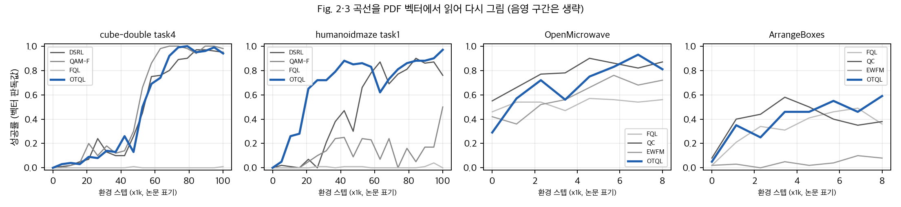
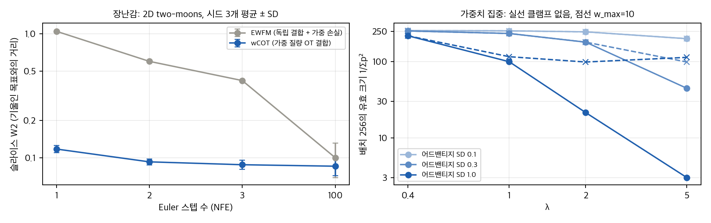

> **논문:** Andreas Sochopoulos, Esmeralda S. Whitammer, Nikolaos Tsagkas, João Moura, Michael Gienger, Sethu Vijayakumar. *Optimal Transport Q-Learning for Flow Policy Steering and Acceleration.* CoRL 2026 포스터, arXiv:2607.06262 (v1, 2026-07-07).
> 공식 코드는 공개되지 않았습니다(프로젝트 페이지 "Code (Coming Soon)", 2026-11-22 확인). 논문 라이선스가 arXiv 비독점 라이선스라 이 글에는 논문 그림을 싣지 않고 우리가 그린 그래프만 씁니다.

## 논문이 묻는 것

flow 정책은 행동 분포를 잘 표현하지만 추론에 여러 번 적분해야 하고, 시연이 부족하면 분포가 바뀔 때 실패합니다. OTQL은 로봇 자신의 경험으로 RL 후훈련을 하면서 같은 목적함수로 추론 스텝도 줄이려 합니다. 방법은 한 줄로 요약됩니다. 크리틱의 어드밴티지를 에너지로 보고 목표 분포의 질량을 `p_j ∝ e^{λA_j}`로 다시 매긴 뒤, 노이즈와 행동 사이를 미니배치 조건부 최적수송(COT) 결합으로 이어 조건부 흐름 매칭(CFM)을 학습합니다. 결합이 곧은 경로를 만들어 2–3 스텝으로 추론하고, 증류가 필요 없다는 주장입니다.

## 이 글에서 확인한 것

**1. 표 1 평균 최고는 맞지만 환경별 단독 1위는 없습니다.** 재계산한 8환경 평균은 OTQL 0.5975(논문 0.59), QAM 0.551, QAM-F 0.543입니다. 환경별 1위는 antmaze의 QSM, humanoidmaze의 IFQL, cube-double의 DSRL 등이고 OTQL은 scene에서 DSRL과 동률일 뿐입니다. QAM-F보다는 7환경에서 높고 1환경에서 같습니다(환경 단위 부호 검정 p = 0.016, 시드 변동은 반영하지 못함). 기준선 9개 × 8환경 72칸은 QAM 논문의 표와 전부 같아서 새로 돌린 값이 아니라 가져온 값이며, OTQL의 시드 수는 적혀 있지 않습니다.

*그래프 (우리가 그림). 논문 표 1의 값으로 다시 그렸습니다.*

**2. "36% → 86%"는 Fig. 5 마지막 점의 평균입니다.** PDF의 벡터 그래프에서 점을 읽으면 base는 0.4, 0.4, 0.3이고 OTQL 마지막 점은 0.8, 0.9, 0.9입니다. 평균 0.367과 0.867을 둘 다 버림해서 36%와 86%로 적은 것입니다. 곡선은 단조롭지 않고(stack cups는 40 에피소드에서 0.5로 내려감) 마지막 3점 평균은 0.756입니다. 점당 10회라고 가정하면 과제별 Fisher p는 0.17, 0.057, 0.020이고 세 과제를 합친 26/30 대 11/30은 p ≈ 1e-4입니다. base의 평가 횟수가 쓰여 있지 않아 이 가정에 의존합니다.

**3. SmolVLA 38% → 76%는 합계로는 유의하지만 비교 대상이 SFT 한 줄입니다.** 표 2는 tape 14/30 → 24/30, move knight 9/30 → 22/30입니다. 합계 23/60 → 46/60은 Fisher p < 0.001이고 과제별로 p = 0.015, 0.0017입니다. 같은 롤아웃 30개를 쓰는 다른 방법(필터링 BC, DSRL 등)과의 비교가 없고, 표 2의 분모 30과 적응에 쓴 롤아웃 30개의 관계가 설명되어 있지 않습니다. 본문의 "평균 37%"는 재계산한 +38.3 %p와 맞지 않습니다.

*그래프 (우리가 그림). Fig. 5는 PDF 벡터에서 읽은 값이며 점당 10회로 가정한 Wilson 구간입니다. 오른쪽은 표 2입니다.*

**4. 온라인 곡선의 서술은 방향이 맞고 크기가 느슨합니다.** humanoidmaze에서 OTQL은 오프라인 단계에서 0.88에 도달해 DSRL 0.47, QAM-F 0.25보다 앞서고 이 부분은 논문 서술과 맞습니다. 반면 "FQL보다 최대 성공률이 평균 15% 높다"는 판독값으로는 +23 %p이고 15는 재현되지 않습니다. OpenMicrowave에서 QC의 곡선 평균은 OTQL보다 9 %p 높습니다. ArrangeBoxes에서 EWFM은 거의 학습하지 않은 것으로 보여 기준선 구현이 의심됩니다.

*그래프 (우리가 그림). 음영 구간은 생략했습니다. 시드 수와 음영의 정의는 논문에 없습니다.*

**5. humanoidmaze 설정에서 가중은 사실상 하향 필터링입니다.** 표 4의 humanoidmaze는 λ = 5, w_max = 1입니다. 가중치를 `min(e^{λA}, 1)`로 클램프하면 어드밴티지가 양수인 표본은 모두 1이고 음수인 표본만 줄어듭니다. 표 1에서 OTQL이 가장 크게 앞선 환경이 이 설정입니다.

**6. 장난감에서 저 NFE의 이득이 재현되지만 이유가 섞입니다.** 2D two-moons에서 가중 질량 OT 결합과 가중 손실 FM을 비교하면 NFE 2에서 기울인 목표와의 슬라이스 W2가 0.599(FM) 대 0.093(OT 결합)이고, NFE 2와 100의 샘플 이동 거리는 0.725 대 0.075입니다. 다만 격차의 대부분은 OT 결합 자체가 경로를 곧게 하는 효과(OT-CFM에서 알려진 것)이고, 가중 질량의 기여는 이 장난감에서 분리하지 못했습니다. 조건 비용 증강은 시험하지 않았습니다. 배치 256의 유효 크기는 어드밴티지 SD 1.0, λ = 2에서 21로 떨어지고 w_max = 10이면 약 99로 묶입니다.

*그래프 (우리가 그림). 왼쪽은 3개 시드의 평균 ± SD, 오른쪽은 어드밴티지를 가우시안으로 가정한 이론값입니다.*

## 본문과 방법의 의심스러운 부분

- Algorithm 1은 어드밴티지용 행동을 다음 상태 `s′`에서 뽑고 평균이 아니라 합으로 씁니다. §3.2의 클램프 `min(e^{λE}, w_max)`는 식 (5)의 `e^{−λE}`와 부호가 다릅니다.
- 조건 가중 α, 엔트로피 정규화 ε, Sinkhorn 반복 수는 어떤 표에도 없습니다. 방법의 핵심 하이퍼파라미터입니다.
- 과제 이름이 문서 안에서 다릅니다(close door와 open door, tape와 pen in penholder). Fig. 2의 가로축(0–100, ×1k)은 본문의 50만 + 50만 스텝과 맞지 않습니다.
- 학습 샘플이 버퍼에서 오므로 학습되는 분포는 base 정책 밀도의 기울임이 아니라 버퍼 분포의 기울임에 가깝습니다. 큰 청크 과제에서는 N = 5 거절 샘플링이 함께 켜져 있어 OT 가중의 몫과 분리되지 않습니다.
- NFE 70% 감소는 횟수이고 지연시간(ms)은 보고되지 않았습니다. VLM 인코딩 비용이 고정이면 전체 속도 이득은 더 작습니다.

## 구현 가능성 (Apple M4 Pro, CUDA 없음)

- **실로봇과 SmolVLA 적응: 불가.** 로봇, 카메라, GPU가 필요하고 코드와 데이터가 없습니다.
- **OGBench 오프라인 전체: 사실상 불가.** 1M 스텝, 크리틱 앙상블 10이라 한 과제가 수 시간(추정, 측정 전)입니다. 한두 과제의 10만 스텝 축소는 패키지 설치와 데이터 다운로드 뒤 가능합니다.
- **MuJoCo 두 과제: 불가.** 환경과 시연 데이터가 공개되지 않았습니다.
- **알고리즘 구조 구현: 가능.** 장난감은 이미 돌렸고, 상태 기반 최소 구현은 3–5일(추정)입니다.

이 글은 재현 실험을 하지 않았습니다.

## 한계

- 공식 코드가 없어 손실, 하이퍼파라미터, 평가 프로토콜을 코드와 대조하지 못했습니다.
- Fig. 6(절제)은 래스터 이미지라 수치를 읽지 않았습니다. Fig. 2, 3, 5는 벡터에서 읽은 값이라 논문이 평활화했다면 그 평활값입니다.
- 장난감은 조건이 없는 2차원 설정이라 논문의 조건 증강과 고차원 행동 청크를 대표하지 않습니다.

## 출처와 라이선스

- 논문: arXiv:2607.06262 v1, arXiv 비독점 배포 라이선스(CC 아님). 이 글과 저장소에는 논문 그림을 넣지 않았습니다.
- 표 값과 본문 수치는 인용과 재계산을 위해 옮겼습니다. 그래프, 장난감, 분석 문서와 스크립트는 이 저장소 작성자가 만들었습니다.
- 기준선 값 대조에는 Li & Levine의 Q-learning with adjoint matching(arXiv:2601.14234)의 표를 사용했습니다.
- 공식 코드가 없고, 가중치와 데이터는 받지 않았습니다.

## 자료

- [통합 리포트 PDF](report/report_public.pdf)
- [01. 논문 분석: Optimal Transport Q-Learning for Flow Policy Steering and Acceleration](analysis/01_paper_analysis.md)
- [02. 선행연구 계보와 GitHub](analysis/02_prior_work.md)
- [03. 수치 재계산, 일관성 검사, 장난감 검증](analysis/03_analysis.md)
- [04. 주장 검증 (공식 코드 없음)](analysis/04_claim_verification.md)
