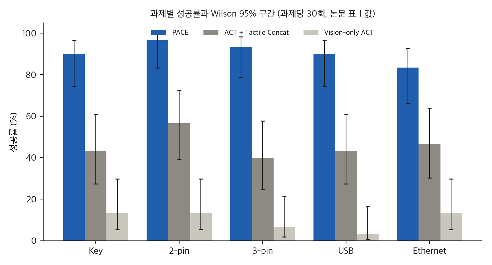
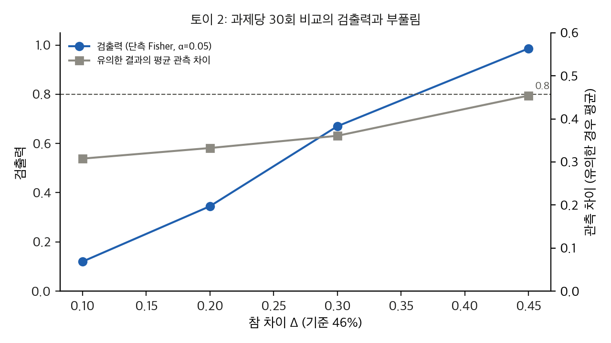
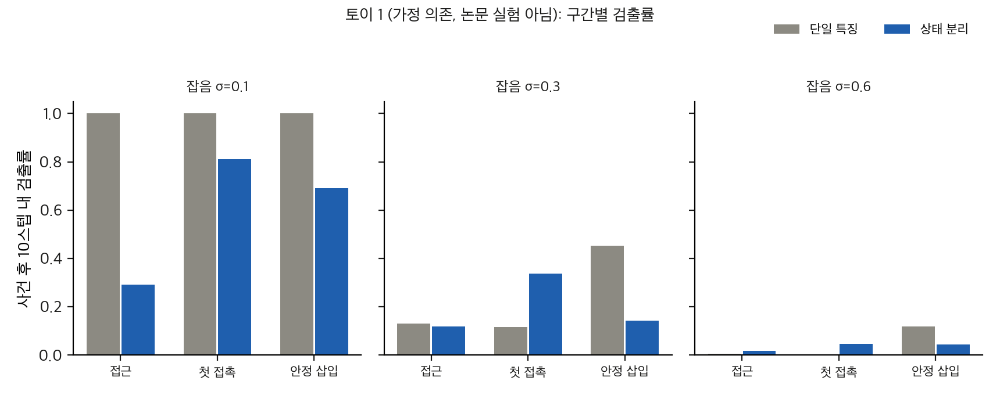

> **논문:** Chen 외 3인. *PACE: Temporal-Role Tactile Conditioning for Chunk-Based Insertion Policies.* CoRL 2026 구두 발표, arXiv:2610.16308 (v1, 2026-10-12).
> 논문 배포 조건은 arXiv non-exclusive이며 CC BY가 아닙니다. 그래서 논문 그림은 싣지 않았고, 이 글의 그래프는 논문 표의 수치와 직접 만든 토이로 그렸습니다. 공식 코드와 데이터는 공개되지 않았습니다.

---

## 논문이 묻는 것

접촉이 많은 삽입에서 촉각은 정책에 넣을 신호가 하나지만, 시간에 따라 하는 일은 여럿입니다. 느리게 바뀌는 접촉 상태는 지금 어떤 단계인지 알려 줍니다. 짧은 접촉 사건은 바로 고쳐야 할 순간을 알려 줍니다. 접촉 결과는 앞으로 무슨 일이 일어날지 알려 줍니다.

기존 시각촉각 청크 정책은 촉각을 청크를 만들 때 넣는 입력 하나로 씁니다. PACE는 같은 촉각 스트림을 세 경로로 나눕니다.

- **접촉 상태(Phase):** 촉각의 지수 이동평균으로 인코더 특징을 아핀 변조합니다.
- **접촉 사건(Event):** 짧은 촉각 변화로 게이트를 만들고, 생성된 청크의 앞 5스텝(0.25 s)에 잔차를 더합니다.
- **접촉 결과(Pred.):** 디코더 표현이 앞으로의 촉각 변화를 맞히도록 학습 때만 보조 손실을 줍니다. 추론에서는 뺍니다.

## 표를 다시 계산해 보기

실로봇 다섯 과제에서 PACE는 30회 중 27, 29, 28, 27, 25회 성공해 평균 90.7%입니다. 가장 강한 기준선인 촉각 연결(Concat)은 46.0%입니다. ManipulationNet 여섯 구성은 133/150 = 88.7%입니다. 표의 평균과 Wilson 구간은 모두 재계산과 맞습니다.

*그래프: 논문 표 1 값으로 그린 과제별 성공률과 Wilson 95% 구간.*

PACE 대 Concat의 합산 Fisher 검정은 p = 2e-17이고 Holm 보정 후에도 유의합니다. 차이가 크다는 것은 분명합니다.

## 세 역할은 각각 얼마나 기여하는가

절제 실험은 흥미로운 결과를 줍니다.

- **Event 제거:** 90.7%에서 66.7%로 떨어집니다. 보정 후에도 뚜렷합니다. 특히 3-pin과 USB에서 많이 떨어집니다.
- **Phase 제거:** 78.7%입니다. 보정 후에는 유의하지 않습니다.
- **Pred. 제거:** 85.3%입니다. 합산 p는 0.21입니다. 논문은 "작지만 일관된 감소"라고 쓰지만, 이 데이터는 그 주장을 받쳐 주지 않습니다.
- **Phase만 사용:** 60.0%입니다. 접촉 상태만으로는 부족하다는 해석은 맞습니다.

짧은 청크(H=10)에서도 성능이 49.3%로 떨어집니다. 샘플링 빈도를 높이는 것으로는 사건 보정을 대신하지 못한다는 대조 실험입니다.

## 통계가 맞지 않는 곳

논문의 기계적 분석(§4.5)은 두 가지 통계를 보고합니다. 30회 2-pin 롤아웃을 집계했다고 씁니다.

- **ANOVA:** F = 8.36, η² = 0.236, p < 1e-4
- **Pearson:** r = 0.356, p < 0.001

이 값들은 30 롤아웃으로는 나오지 않습니다. 30이면 Pearson의 p는 약 0.054입니다. p < 0.001이 되려면 n ≥ 83이 필요합니다. ANOVA에서 F와 η²가 맞으려면 총 관측 수가 집단 수에 따라 29에서 113 사이여야 하고, p < 1e-4는 집단 수 4 이상, 총 N 약 85 이상에서만 나옵니다. 관측 단위(롤아웃인지, 시간 스텝인지, 구간 수인지)를 밝히지 않은 것이 문제입니다. 이 두 값은 근거로 인용하기 어렵습니다.

## 신호를 바꾸면 얼마나 달라지는가

촉각 대신 손목 힘/토크나 관절 전류를 넣어도 성공률은 90.0%와 88.3%입니다. 촉각 93.3%와 차이는 검출되지 않습니다. 그러나 이것은 "같다"는 증명이 아닙니다. 과제당 30회, 두 과제 합산 60회로는 약 0.1 차이를 가려내는 힘이 없습니다.

30회 비교에서 참 차이 0.20을 검출할 확률은 0.35에 그칩니다. 유의하게 나온 결과는 참 차이보다 크게 나오는 경향이 있습니다.

*그래프: 토이 2(가정 설정). 30회 비교의 검출력과 부풀림. 방향 확인용입니다.*

## 토이로 본 촉각 역할 분리

토이 1은 1차원 촉각 신호를 상태(느림), 사건(빠름), 잡음으로 만들어 두 검출기를 비교합니다. 하나는 단일 차분 특징이고, 다른 하나는 상태를 빼고 상태 척도로 나눈 특징입니다.

결과는 한쪽으로 기울지 않습니다. 잡음이 상태마다 같으면 단일 특징이 거의 완벽합니다. 상태에 따라 잡음이 달라질 때만 분리 방식이 접촉 구간에서 나은 경우가 있습니다. 즉 분리의 이득은 설계 가정에 크게 기댑니다. 논문의 Event 설계를 지지하지도 반박하지도 않습니다.

*그래프: 토이 1(가정 설정). 구간별 검출률이며 논문 실험이 아닙니다.*

## 이 맥에서 구현할 수 있는가

- **구조는 구현할 수 있습니다.** PACE 모듈은 추가 0.841 M 파라미터이고, 추론에 남는 것은 0.575 M입니다. ACT 위에 붙이는 것이라 소형 검증은 CPU나 MPS로 가능합니다. 노력은 1–2주로 추정합니다.
- **논문 수치는 재현할 수 없습니다.** 공식 코드가 없습니다. 실로봇(RM75, GF225 촉각 센서, 과제당 시연 약 160개)과 힘 피드백 장치, ManipulationNet 실물이 필요합니다. 논문 설정의 ACT 학습은 10000 에폭이고 RTX 3090을 썼습니다. 이 맥에서 같은 규모는 현실적이지 않습니다.
- **DP 이식(표 4)** 은 310.5 M 파라미터에 8000 에폭이라 GPU가 필요합니다.

## 정리

PACE는 촉각을 시간 척도별로 나눈다는 설계 질문을 던집니다. 표 수치는 맞습니다. Event 제거의 손실도 뚜렷합니다. 다만 Pred.의 효과, 기계적 분석의 통계, 신호 대체의 "같음"은 지금 자료로는 확인되지 않습니다. 일반화 주장도 과제 2개와 백본 1개에 근거합니다.

공식 코드와 데이터가 공개되기 전까지는 "구조를 옮겨 보는 것"까지가 현실적인 범위입니다. 논문 수치를 같은 방식으로 재현하려면 시드, 체크포인트 선택, 성공 판정 기준 같은 세부가 먼저 필요합니다.

## 자료

- [통합 리포트 PDF](report/report_public.pdf)
- [PACE: Temporal-Role Tactile Conditioning for Chunk-Based Insertion Policies 분석 (arXiv:2610.16308)](analysis/01_paper_analysis.md)
- [선행연구와 관련 자료 (PACE, arXiv:2610.16308)](analysis/02_prior_work.md)
- [수치 재계산, 통계 검정, 토이 (PACE, arXiv:2610.16308)](analysis/03_analysis.md)
- [04. 주장 검증, 빠진 정보, 구현 가능성 (PACE, arXiv:2610.16308)](analysis/04_claim_verification.md)
