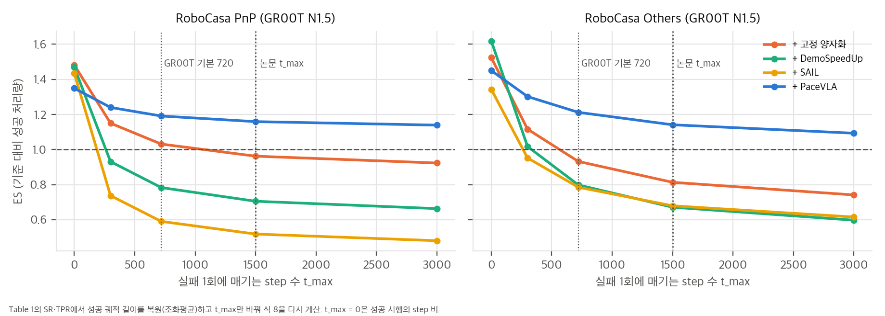
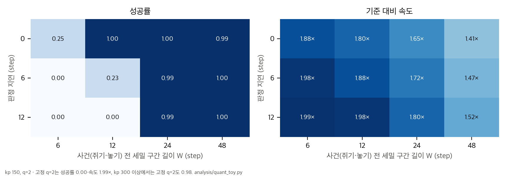
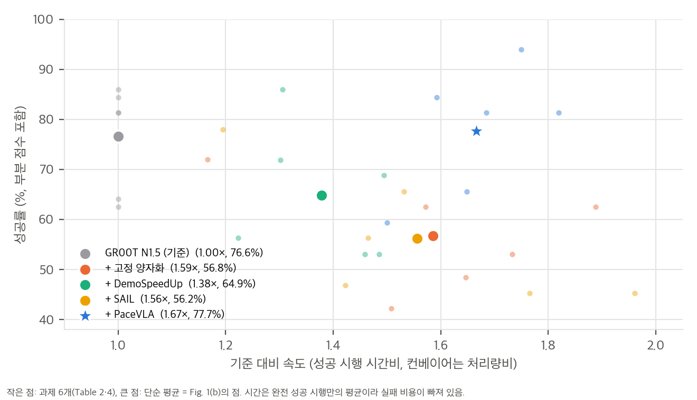

# 03. 지표 해부와 toy 검증

재계산 스크립트는 `analysis/table_check.py`(표·본문·Fig. 1(b), 결과 `table_check_results.json`)와 `analysis/quant_toy.py`(SO(3) 집계, 추적 toy, ES의 t_max 의존성, 결과 `quant_toy_results.json`)입니다. 모두 numpy·scipy 단일 스레드로 CPU에서 10초 안에 끝납니다.

## 1. TPR과 ES는 같은 시행 데이터의 두 요약이다

식 7과 8을 나란히 쓰면 다음과 같습니다(SR = s, 성공 시행의 step 수 t_i).

```
TPR = (1/N) Σ [ S_i / t_i − (1 − S_i) / t_max ] = s · E[1/t | 성공] − (1 − s)/t_max
ES  = T_base / T,   T = L + (1 − s)/s · t_max,   L = E[t | 성공]
```

첫 식에서 성공 궤적 길이의 **조화평균** L_h = s / (TPR + (1 − s)/t_max)를 복원할 수 있습니다. L 자리에 L_h를 넣어 ES를 다시 계산하면 Table 1·3의 36칸이 모두 ±0.005 안에서 맞습니다(LIBERO Short는 t_max 220·280·300의 평균으로 근사). 따라서 두 지표는 내부적으로 일관되고, 성공 시행의 길이 분산도 작다고 볼 수 있습니다.

### 1.1 ES는 무엇이 움직이나 (GR00T N1.5 + PaceVLA)

| 열 | 기준 L_h | PaceVLA L_h | 기준 T 중 실패 몫 | 성공률만 바뀐 경우 | 속도만 바뀐 경우 | 둘 다(보고 ES) |
|---|---|---|---|---|---|---|
| RoboCasa PnP | 382 | 284 | **78%** | 1.087 | 1.060 | 1.159 (1.16) |
| RoboCasa Others | 304 | 209 | 65% | 1.016 | 1.121 | 1.141 (1.14) |
| LIBERO Long | 268 | 199 | 19% | 1.000 | 1.263 | 1.263 (1.26) |
| DexJoCo | 384 | 326 | 55% | 1.031 | 1.073 | (1.11) |

- PnP에서는 성공률 +2.7%p(표본 오차 안, p = 0.48)가 ES 이득의 절반 이상을 만듭니다. Others와 LIBERO Long에서는 속도가 주된 몫입니다.
- 성공 시행만의 step 비(L_h 비)는 PnP 1.35, Others 1.45, Long 1.35, DexJoCo 1.18입니다. 이론 최대 2배와 실물 1.5–1.8배보다 작습니다.

### 1.2 t_max에 따른 순위

Table 1의 SR·TPR에서 L_h를 복원하고(원래 t_max = 1500으로), t_max만 바꿔 식 8을 다시 계산했습니다.



| RoboCasa PnP | t_max 0 | 300 | 720 | 1500 | 3000 |
|---|---|---|---|---|---|
| 고정 양자화 | **1.48** | 1.15 | 1.03 | 0.96 | 0.92 |
| DemoSpeedUp | 1.47 | 0.93 | 0.78 | 0.71 | 0.66 |
| SAIL | 1.44 | 0.74 | 0.59 | 0.52 | 0.48 |
| PaceVLA | 1.35 | **1.24** | **1.19** | **1.16** | **1.14** |

- t_max = 0(실패 비용 없음, 성공 시행끼리의 속도)에서는 PnP의 세 기준선이 모두 PaceVLA보다 빠릅니다. Others에서는 고정 양자화(1.52)와 DemoSpeedUp(1.62)이 PaceVLA(1.45)보다 빠르고, SAIL(1.34)은 느립니다.
- 순위가 뒤집히는 t_max는 PnP 고정 양자화 약 115, DemoSpeedUp 35, SAIL 14이고, Others 고정 양자화 48, DemoSpeedUp 59입니다. 즉 실패 한 번을 에피소드 하나의 일부(PnP 기준 성공 궤적 약 380 step의 30%)만큼만 쳐도 PaceVLA가 1위입니다.
- 결론: **PaceVLA의 우위는 "실패를 덜 한다"에서 나옵니다.** 실패 비용을 크게 보는 운영 환경(실패하면 사람이 개입하고 다시 시작해야 하는 경우)일수록 이 판단이 맞습니다.

## 2. 추적 toy: 세밀 구간의 길이와 판정 시점

**설정:** 2차원 손끝이 60 Hz 시연 경로(곡선 도달 → 쥐기 → 운반 → 놓기, 240 step)를 따라갑니다.
- 절대 위치 명령은 블록 끝값(식 5)으로 양자화하고, 명령 하나가 제어 한 주기입니다.
- 손끝은 임계감쇠 2차 PD(이득 kp)로 명령을 추적합니다.
- 쥐는 순간과 놓는 순간의 위치 오차가 4 mm 안이면 성공입니다. 쥐는 step이 블록 안에 묻히면 가장 가까운 명령 시점에서 판정합니다.
- 시연에는 1.5 mm 떨림을 넣었고, 조건마다 200회 반복했습니다.
- 적응형은 "사건 전 W step부터 사건 뒤 4 step까지 세밀 모드"이고, 판정 지연 d만큼 세밀 구간 시작이 늦어집니다.



| kp | 기준 q=1 | 고정 q=2 | 적응형 W=12, d=0 | W=12, d=6 | W=24, d=12 | W=48, d=0 |
|---|---|---|---|---|---|---|
| 150 | 0.995 / 1.00× | **0.00** / 1.99× | 1.00 / 1.80× | **0.23** / 1.88× | 0.995 / 1.80× | 0.995 / 1.41× |
| 300 | 0.975 / 1.00× | **0.985** / 1.99× | 0.975 / 1.80× | 0.99 / 1.88× | 0.99 / 1.80× | 0.995 / 1.41× |

(성공률 / 기준 대비 명령 수 비)

해석:
- **추적 이득이 낮으면** 고정 양자화가 완전히 실패하고, 적응형만 성공합니다. 이때 세밀 구간이 짧을수록 빠르지만 판정 시점에 민감해집니다. W = 12에서 판정이 6 step(0.1초) 늦으면 성공률이 1.00에서 0.23으로 떨어집니다. 넉넉한 구간(W = 24)은 12 step 지연에도 버티지만 속도를 내줍니다.
- **이득을 두 배로 올리면** 이 toy에서는 고정 q = 2도 성공합니다. 추적 지연이 유일한 실패 원인이라면, 적응형의 이득은 제어기 설정에 강하게 의존합니다. 논문이 가속 방법마다 과제별 k_p를 따로 조정한 것(부록 C.3)이 비교에 영향을 줄 수 있는 이유입니다.
- 실제 과제에는 접촉 역학, 물체 미끄러짐, 시각 피드백 지연처럼 이득으로 해결되지 않는 정밀도 요구가 있습니다. 논문에서 이득을 조정한 뒤에도 고정 양자화의 성공률이 떨어지는 것(Air Fryer −28.2%p)은 그런 요인 때문으로 보입니다. 이 toy는 메커니즘 하나만 보여 주는 것입니다.

## 3. delta 회전을 합칠 때 SO(3) 합성이 필요한가 (부록 A, 식 6)

스텝마다 축이 무작위인 회전 증분(크기 θ) q개를 두 방식으로 합쳐, 결과 회전의 차이를 쟀습니다. 첫째는 회전 벡터를 그냥 더하는 방식, 둘째는 순서대로 곱하는 방식(공간 증분 규약)입니다. 조건마다 400회 반복했습니다.

| q | θ = 0.01 rad | 0.03 rad | 0.1 rad |
|---|---|---|---|
| 2 | 0.0025° (0.3%) | 0.022° (0.9%) | 0.25° (3.1%) |
| 4 | 0.0046° (0.4%) | 0.040° (1.3%) | 0.46° (4.2%) |
| 8 | 0.0097° (0.7%) | 0.088° (2.1%) | 0.98° (6.6%) |

(오차 중앙값, 괄호는 합성 회전 크기 대비 비율)

- 오차는 대략 θ² · q에 비례합니다(교환자 항). q = 2이고 스텝당 회전이 수 도 이하이면 단순 합과 합성의 차이는 0.1° 미만입니다.
- 따라서 이 논문 설정(q = 2)에서 식 6은 "정확성을 위한 올바른 처리"이지만, 성능 차이를 만들 만한 요소는 아닙니다. q를 4–8로 키우거나 빠른 손목 회전을 합칠 때 중요해집니다.

## 4. 실물 결과의 구조



- **Fig. 1(b) = 6개 과제의 단순 평균**입니다. 성공률(부분 점수 포함)과 속도(다섯 과제는 완전 성공 시행의 시간비, 컨베이어는 처리량비)를 섞어 평균했습니다. 판독값과 재계산값의 차이는 성공률 ±0.1%p, 속도 +0.02×이고, 속도 쪽 편차는 다섯 점에서 같은 방향이라 판독 눈금 오차로 보입니다.
- **PaceVLA와 고정 양자화의 시간비가 0.92–1.10입니다.** PaceVLA가 세밀 모드로 돌아가는 구간이 짧다는 뜻입니다. 명령 수가 시간에 비례한다고 단순화하면 양자화 모드 비율은 Pick-and-Place 74%, Air Fryer 81%, Stack Cup 90%, Table Sweeping 67%, Pump and Scrub 79%입니다. 추론 지연과 안착 시간이 있으므로 실제 비율의 상한 추정으로 읽어야 합니다.
- **시간은 완전 성공 시행만 셉니다.** 성공률이 낮은 방법일수록 쉬운 초기 조건의 시행만 남아 시간이 짧게 측정될 수 있습니다. 실물에도 ES 같은 실패 비용 포함 지표가 있었다면 기준선들의 속도 이점은 더 줄었을 것입니다.

## 5. Table 5와 기준 모델의 24개 평균

- GR00T N1.5 + PaceVLA: Table 1에서 (8 × 55.0 + 16 × 72.9) / 24 = **66.93**, TPR (8 × 1.64 + 16 × 3.30) / 24 = **2.747**. Table 5의 66.9, 2.75와 같습니다. 같은 방식으로 풀링해 ES를 다시 계산하면 1.141로, Table 5의 1.14와 맞습니다.
- 기준 GR00T N1.5의 24개 평균은 SR 65.7, TPR 1.82입니다. Table 5의 모든 변형은 SR 63.3–66.9, ES 0.98–1.14 범위입니다. 모드별 decoder를 빼면 SR이 기준보다 낮아지고(63.3), judge를 빼면 TPR이 크게 줄어듭니다(2.01).
- 시행 수를 1,200회(24개 × 50)로 보면 full과 decoder 제거의 SR 차이는 p = 0.07입니다. 단일 시드라서 Table 5의 순서는 경향으로 읽는 것이 맞습니다.
