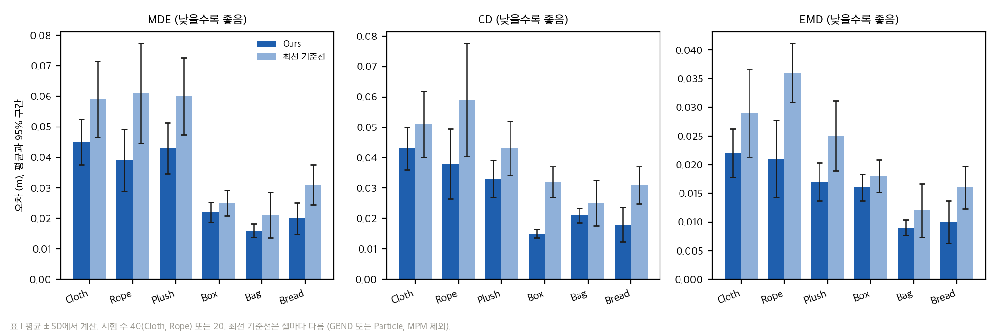
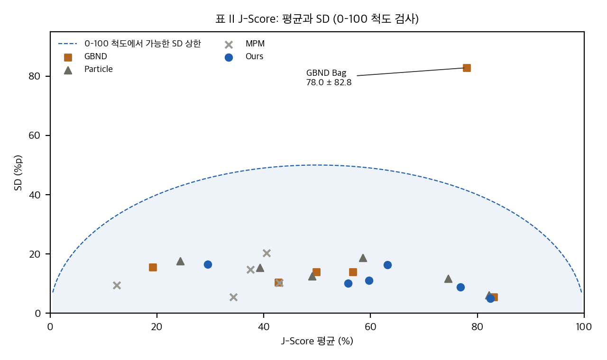

> **논문:** Kaifeng Zhang, Baoyu Li, Kris Hauser, Yunzhu Li. *Particle-Grid Neural Dynamics for Learning Deformable Object Models from RGB-D Videos.* RSS 2025, arXiv:2506.15680 (v2, 2025-11-06).
> 공식 코드는 GitHub kywind/pgnd(MIT)에 있습니다. 이 글의 그래프는 우리가 논문 표 값으로 다시 그린 것입니다. 논문 그림은 싣지 않았습니다.

## 논문이 묻는 것

끈, 천, 인형, 봉투, 상자, 빵 같은 변형체의 동역학 모델이 필요합니다. 계획, 정책 평가, 실제-시뮬 자산 생성에 쓰입니다. 물리 시뮬레이터는 물성 식별과 상태 추정이 어렵고, 비디오 예측 모델은 계산이 많고 3D 구조가 없습니다. 그래프 신경망 기반 동역학(GBND)은 그래프 연결과 메시지 전달 단계 수에 민감합니다.

PGND는 두 표현을 함께 씁니다. 물체 입자는 형상과 운동을 담고, 고정된 3차원 격자는 공간 연속성을 줍니다. 입자의 위치와 속도 히스토리를 PointNet으로 읽어 격자 속도장을 예측하고, B-spline으로 다시 입자에 보간합니다. 학습 데이터는 사람이 주석을 붙이지 않은 다시점 RGB-D 영상입니다. 분할(Grounded-SAM-2), 2D 추적(CoTracker), 깊이를 이용한 3D 추적을 거칩니다.

*그림: 표 I 값에서 우리가 다시 그린 그래프입니다. 평균 ± SD로 Welch 95% 구간을 계산했고, 최선 기준선은 셀마다 GBND 또는 Particle입니다. MPM은 상자에 없습니다.*

## 우리가 확인한 것

**1. 점 기반 오차는 여섯 범주 모두에서 방향이 일관됩니다.** 표 I에서 Ours는 MDE, CD, EMD 세 지표 모두에서 최선 기준선보다 평균이 낮습니다(18셀 중 18). 막대와 구간을 그린 그림이 위의 그래프입니다. 평균 ± SD에서 계산한 Welch 95% 구간을 썼습니다.

**2. 그러나 통계적 우위는 제한적입니다.** 최선 기준선과 비교하면 보정 전에 p < 0.05인 셀은 8/18이고, Holm 보정 후에는 3/18입니다. 상자 CD(Particle 대비), 끈 EMD(GBND 대비), 빵 CD(GBND 대비)만 남습니다. 시험 수는 천과 끈 40, 그 밖 20입니다. 이 값은 공식 저장소의 평가 구간과 데이터 매니페스트에서도 확인됩니다.

**3. 비디오 지표는 대체로 최선이지만 예외가 있습니다.** 표 II의 J-Score, F-Score, LPIPS에서 Ours는 18셀 중 15셀에서 최선입니다. 상자 J와 F, 봉투 J에서는 GBND가 높습니다. 상자 J의 차이(82.4 대 83.0)는 시험 20개에서 p = 0.72입니다.

*그림: 표 II의 J-Score를 평균 대 SD로 옮긴 우리 그래프입니다. 점선은 0–100 척도에서 가능한 SD 상한 sqrt(m(100−m))입니다. GBND 봉투 점이 상한 위에 있습니다.*

**4. 보고 오류가 하나 있습니다.** GBND의 봉투 J-Score는 78.0 ± 82.8입니다. 0–100 척도에서 평균이 78이면 SD는 최대 41.4입니다. 82.8은 가능한 값이 아닙니다. 오식이거나 다른 척도일 가능성이 큽니다. 이 셀로 비교할 수는 없습니다.

**5. 공식 코드는 논문과 다른 설정을 씁니다.** 정적으로 읽은 결과입니다. 실행하지 않았습니다.
- 상자와 빵의 학습 스크립트는 지역 반지름을 0으로 둡니다. 논문은 모든 실험에서 0.2 m라고 씁니다.
- 코드의 Chamfer 거리는 두 방향 평균의 합입니다. 논문 본문의 "평균 거리"와 정의가 다릅니다. 절댓값이 약 2배로 읽힐 수 있습니다.
- 계획의 두 팔 거리 페널티는 0.3 m입니다. 논문 부록은 0.6 m라고 씁니다.
- 계획 모듈은 정의되지 않은 클래스(`MPMStaticsBatch`)를 import합니다. 실행하면 실패할 가능성이 큽니다.

**6. 부록 설명에 모순이 있습니다.** 부록 B.1은 표 I과 II에는 천과 끈 한 종류씩만 쓰고 나머지는 범주 실험에만 쓴다고 씁니다. 그러나 표 I과 II에는 여섯 범주가 모두 나옵니다.

**7. 계획 실험은 과제당 10회입니다.** 성공 횟수가 표로 없고 그림 8의 곡선만 있습니다. 10회 대 10회의 Fisher 검정에서 p < 0.05가 되려면 8/10 대 2/10 이상의 큰 차이가 필요합니다.

## 구현 가능성

- **이 맥(Apple M4 Pro, 24 GiB, CUDA 없음)에서 학습 재현은 불가능합니다.** 공식 코드는 CUDA를 전제하고, 논문도 단일 4090에서 약 8시간이 걸린다고 적습니다.
- **공식 체크포인트 추론은 조건부입니다.** 체크포인트는 범주당 3.4 MB로 작습니다. 그러나 Warp CPU 실행과 1 GB 이상의 데이터 다운로드가 필요합니다.
- **영상 지표(J, F, LPIPS) 재현은 불가능합니다.** 3DGS 렌더링에 CUDA 래스터라이저가 필요하고, 이 래스터라이저는 비상업 라이선스입니다.
- **직접 짠 소형 구현은 가능합니다.** 격자 속도장, G2P 보간, 입자 인코더는 torch로 짤 수 있습니다. 1–2주로 추정합니다. 측정하지는 않았습니다.

## 라이선스와 공개

- **논문:** arXiv 라이선스 링크는 CC BY 4.0입니다. 원문 PDF에서 저작권 표시를 찾지 못했습니다. 다만 그림 2에 실로봇과 실제 물체 사진이 들어 있고 다른 그림의 권리 상태를 확인하지 못해, 이 글에서는 논문 그림을 싣지 않았습니다.
- **코드:** MIT입니다. 다만 LICENSE의 저작권 줄이 저자 이름이 아니라 GitHub 템플릿 문구로 보입니다.
- **제3자 렌더러:** Gaussian-Splatting License로 비상업 조건입니다.
- **데이터셋(Hugging Face):** cc-by-4.0입니다. 체크포인트는 라이선스 필드가 비어 있습니다.

## 정리

PGND의 핵심 설계(격자 속도장 + 점 인코더 + G2P)는 명확하고, 점 기반 오차 개선의 방향은 여섯 범주 모두에서 일관됩니다. 다만 보정 후 통계적으로 확실한 차이는 몇 셀에 그치고, 표 II의 SD 하나는 가능하지 않은 값입니다. 공식 코드는 논문의 몇 설정과 다르므로 재현 전에 설정을 명시적으로 고정해야 합니다.

## 자료

- [통합 리포트 PDF](report/report_public.pdf)
- [01. 논문 분석: Particle-Grid Neural Dynamics](analysis/01_paper_analysis.md)
- [02. 선행연구와 관련 자료](analysis/02_prior_work.md)
- [03. 재계산과 일관성 검사](analysis/03_analysis.md)
- [04. 공식 코드 대조 (정적 읽기)](analysis/04_code_verification.md)
