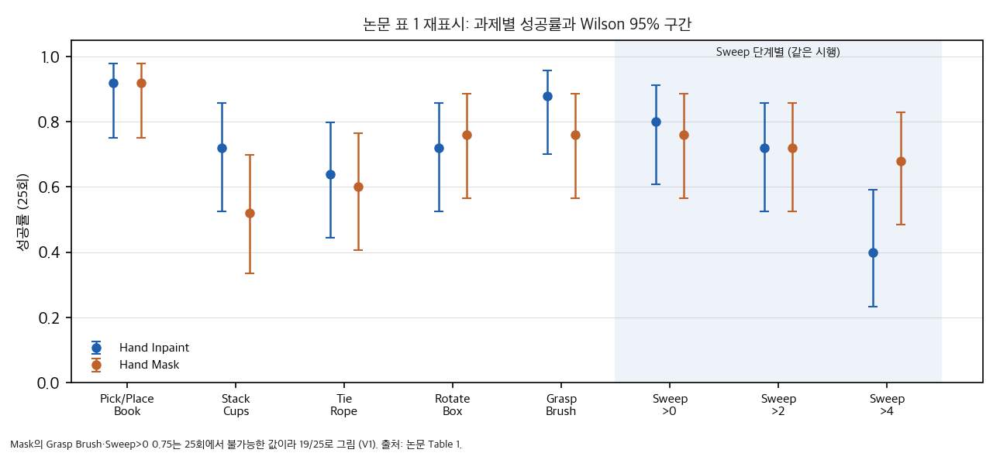
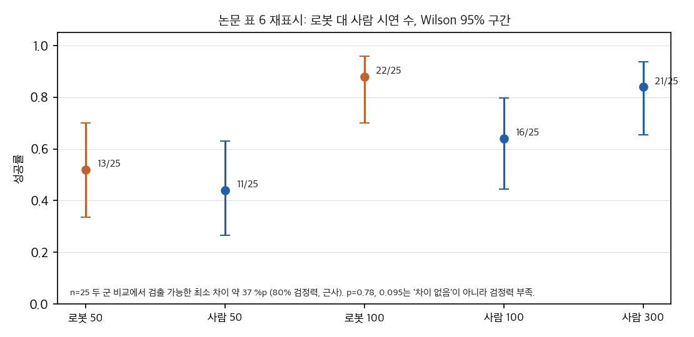

> **논문:** Marion Lepert, Jiaying Fang, Jeannette Bohg. *Phantom: Training Robots Without Robots Using Only Human Videos.* CoRL 2025 (PMLR v305), arXiv:2503.00779 (v2, 2026-05-28).
> 공식 코드는 GitHub MarionLepert/phantom(MIT)에 있습니다. 이 글의 그림은 우리가 그린 그래프 두 장이고, 논문 그림은 쓰지 않았습니다.

## 한 줄 요약

사람이 집게 잡기로 하는 영상을 찍고, 사람 팔을 지운 뒤 로봇을 그려 넣으면 로봇 데이터 없이도 정책을 학습할 수 있습니다. 논문은 초록 기준 여섯 과제에서 최대 92% 성공을 보고합니다. 다만 평가가 과제당 25회라서, 방법들 사이의 작은 차이는 확인되지 않습니다.

## 무엇을 하는가

1. **행동 레이블:** HaMeR로 손 메시를 추정하고, SAM2 마스크와 깊이 점군으로 ICP 정합을 합니다. 엄지 끝과 검지 끝의 중점을 로봇 끝점 위치로, 두 끝 사이 거리를 그리퍼 열림으로 씁니다.
2. **시각 편집:** 학습 영상에서 사람 팔을 E2FGVI로 인페인팅하고, 추정한 자세에 맞춰 가상 로봇을 깊이를 고려해 덧씌웁니다.
3. **배포:** 실제 로봇 영상에도 가상 로봇을 덧씌워 학습 영상과 분포를 맞춘 뒤 정책을 돌립니다.

그래프: 논문 표 1의 과제별 성공률과 Wilson 95% 구간을 우리가 다시 그렸습니다. Mask의 0.75 두 칸은 25회에서 나올 수 없는 값이라 19/25로 그렸습니다.

## 확실한 결과

- **시각 편집의 효과:** 가상 로봇을 덧씌운 두 방식 (Hand Inpaint, Hand Mask)은 표 1의 여덟 열(과제와 스윕 단계)에서 0.40–0.92 성공합니다. 빨간 선 방식과 편집 없음은 모두 0/25입니다 (Fisher 검정, p < 0.001).
- **공동 학습:** 한 장면에서만 학습한 로봇 정책은 새 장면에서 0/25입니다. 사람 영상 950개를 더하면 20/25입니다 (p < 0.001). 이 논문에서 가장 강한 결과입니다. 다만 한 과제, 한 로봇입니다.

## 확실하지 않은 결과

- **Hand Inpaint 대 Hand Mask:** 과제별 차이는 모두 p > 0.05입니다. 스윕 세 번째 단계에서는 Mask가 28 %p 높지만(0.68 대 0.40, p = 0.088) 논문 본문은 이를 언급하지 않습니다.
- **인페인팅 품질:** 고품질 E2FGVI 84%, 저품질 OpenCV 76%, 마스크만 60%입니다. 차이의 검정 결과는 p = 0.11 이상입니다.
- **사람 대 로봇 시연:** 시연 50개에서 52% 대 44%, 100개에서 88% 대 64%입니다. 논문은 "유의하지 않다"고 씁니다. 맞는 말이지만, 두 군 25회에서는 37 %p 이상 차이만 찾을 수 있으므로 "차이가 없다"는 근거는 아닙니다.

그래프: 논문 표 6의 성공률과 Wilson 95% 구간을 우리가 다시 그렸습니다. 두 군 25회에서 검출 가능한 최소 차이는 약 37 %p입니다.

## 공식 코드와 논문의 차이

공식 저장소는 처리 파이프라인입니다. 정책 학습 코드는 Diffusion Policy 외부에 있습니다. 대조 결과:

- 엄지의 마지막 두 관절은 논문에 1자유도 제한이 있지만 코드에는 제한이 없습니다. 검지 쪽 제한은 있으나 1자유도가 아닙니다.
- 평활화(위치와 그리퍼는 가우시안 과정, 회전은 SLERP)와 검출 실패 처리(앞 값 유지, 중립 자세)는 논문에 없는 단계입니다.
- 논문의 Hand Mask 확산 모델과 증강 코드는 저장소에서 찾지 못했습니다.
- 그리퍼 하위 20% 백분위 닫힘 규칙은 찾지 못했습니다.

## 이 맥에서 재현할 수 있나

**아니요, 논문 결과는 재현할 수 없습니다.** 실로봇 평가와 사람 영상 수백 개 수집이 필요하고, 정책 학습은 CUDA를 전제로 합니다. 손 추정과 인페인팅 파이프라인을 설치해 샘플 영상 한 개를 처리하는 것은 가능할 수 있지만 설치와 가중치 다운로드가 필요합니다. 행동 변환의 기하 검사는 CPU로 할 수 있습니다.

## 남는 질문

- 배포 카메라의 외부 파라미터를 알아야 한다는 가정은 얼마나 큰 제약인가요? v1에는 이를 완화하는 실험이 있었지만 v2에서는 빠졌습니다.
- 손 추정 오차가 정책 성능에 얼마나 전파되는지는 논문에 없습니다.
- 준정적인 핀치 잡기를 넘어 힘과 접촉이 중요한 과제에도 같은 방식이 통할까요?

자세한 수치와 검정, 주장 판정은 분석 문서 `analysis/03_analysis.md`, 코드 대조는 `analysis/04_code_verification.md`에 있습니다.

## 자료

- [통합 리포트 PDF](report/report_public.pdf)
- [Phantom: Training Robots Without Robots Using Only Human Videos (arXiv:2503.00779) 논문 분석](analysis/01_paper_analysis.md)
- [Phantom 선행연구와 구성 요소 (02)](analysis/02_prior_work.md)
- [Phantom 수치 재계산과 일관성 검사 (03)](analysis/03_analysis.md)
- [Phantom 공식 코드 대조 (04)](analysis/04_code_verification.md)
