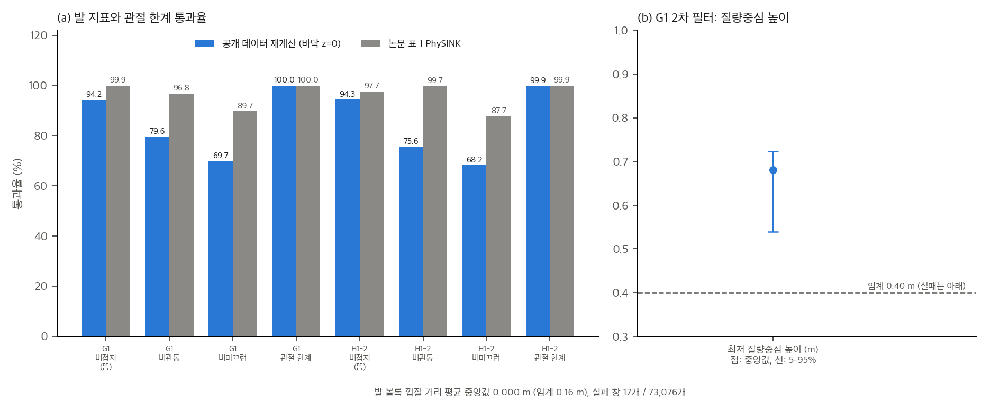

# PHUMA 수치 재계산, 통계 검정, 유도, 장난감 (03)

이 문서의 §1–§7은 논문에 실린 수치만 씁니다. 공개 데이터셋은 2026-11-12에 내려받아 끝의 "추가 검증 (2026-11-12): 공개 데이터로 지표 재계산" 절에서 따로 계산했습니다. 계산은 `analysis/table_check.py`(결과 `table_check_results.json`)와 `analysis/sensitivity_toy.py`(결과 `sensitivity_toy_results.json`)로 다시 돌릴 수 있습니다. 둘 다 numpy와 scipy만 씁니다.

## 0. 요약

1. **표 간 불일치가 하나 있습니다.** 표 4의 AMASS Unseen 총합 78.2는 표 3, 표 21, v1 논문의 70.2와 다릅니다. 이 값에 따라 PHUMA 대 AMASS 유의성이 p ≈ 0.06에서 p < 0.001로 바뀝니다.
2. **Unseen Video(504개)에서 PhySINK와 SINK의 차이(72.8 대 70.2)는 유의하지 않습니다**(z ≈ 0.9, p ≈ 0.36). PHUMA Test(7,557개)에서는 큽니다(p ≈ 10⁻⁶).
3. **실물 16.3% 감소는 표 값과 맞지만, 24개 모션의 분산이 없어 유의성을 확인할 수 없습니다.**
4. **지표 자체가 불안정합니다.** 5 mm 위치 잡음만 있어도 완벽히 붙은 발이 높이 임계 0.5 cm에서 약 15% 실패합니다. 발 미끄럼 지표는 30 Hz에서 잡음 5 mm이면 정지한 발의 36%만 통과합니다. 논문 지표를 그대로 옮기면 프레임레이트와 잡음 처리에 따라 결과가 크게 달라집니다.
5. **접촉 점수 식 (12)은 발 하나만 붙어도 통과합니다.** 한 발이 6 cm 떠 있어도 점수가 1.0입니다(장난감 E4).
6. **데이터 필터 후 남은 비율은 27.1%라고 보고하지만 62.2/231.4 = 26.9%로 계산됩니다**(차이는 작음).
7. **전체 리타게팅 계산은 단일 RTX 3090 기준 약 99 GPU 일입니다**(7.88M 프레임 ÷ 0.92 fps). 이 맥에서 직접 돌리는 것은 현실적이지 않습니다.

## 1. 표 재계산과 일치 검사

| 검사 | 계산 | 결과 |
|---|---|---|
| 표 4 대 표 21 (0.15 m, G1) | 네 데이터셋의 PHUMA Test와 Unseen | 일치, 단 **AMASS Unseen 78.2 ≠ 70.2** |
| 표 3 SINK 대 표 21 AMASS | Unseen 총합 | 70.2로 일치. 표 4만 다름 |
| 표 4 AMASS Unseen 카테고리 단순 평균 | (90.7+75.0+62.7+44.1)/4 | 68.1. 총합은 카테고리 가중 평균이라 직접 검산 불가. 70.2에 가까움 |
| 실물 감소율 (표 5) | (41.0−34.3)/41.0 | **16.3%** (본문과 일치) |
| 실물 속도·가속도 감소 | 3.20→2.69, 1.50→1.29 | 15.9%, 14.0% |
| 표 5 카테고리 단순 평균 | AMASS 41.02, PHUMA 34.32 | 총합과 일치 |
| 표 8 합계 | 클립 합 76.03K, 시간 합 72.97 h, 영상 44.78 h, mocap 28.19 h | 본문 76.0K, 73.0 h와 일치 |
| 분할 개수 | train 67,953, test 7,557, unseen 504, 합 76,014 | 본문 "76.0K", "약 7.5K (10%)" 일치. test는 전체의 9.9% |
| Humanoid-X 필터 후 비율 | 62.2/231.4, 62.2/237.2 | 26.9%, 26.2%. 본문 27.1%와 0.2%p 차이 |
| Humanoid-X 피드셔블 시간 | 표 2 "전체 62 h", 그림 2(a) "69.1 h", 표 31 원본 "237.2 h", 표 4 원본 "231.4 h" | **네 값이 서로 다름** (`04` D21) |
| H1-2 값 (표 38, 39, 21b) | 표 38 SINK 54.4, 64.3 = 표 39 AMASS 54.4, 64.3. 표 39 Humanoid-X Unseen 60.5 = 표 21(b). 표 39 PHUMA Unseen 78.6 = 표 21(b) | 일치 |
| 낙상률 비 (표 27) | 18.6/5.7 = 3.3, 13.1/4.2 = 3.1 | 본문 "약 3배"와 일치 |
| 표 2 대 표 31 (필터 단계별 시간) | 141, 123, 136, 110, 62 시간 (표 31은 141.1, 123.1, 135.7, 110.3, 62.2) | 일치 |

## 2. 통계 검정

### 2.1 설정

- **성공률 비교 (표 3, 4, 20, 21):** 평가 항목을 독립 베르누이로 가정하고 pooled 두 비율 z 검정을 씁니다. n은 PHUMA Test 7,557(분할 파일), Unseen 504(분할 파일). 실제 평가 단위(모션인지 프레임인지)는 논문에 없으므로 이 가정은 근사입니다.
- **시드 비교 (표 25, 30, 32, 35):** 3시드의 평균과 표준편차를 Welch t 검정으로 씁니다. 표준편차를 표본 표준편차로 가정합니다.
- **실물 (표 5):** 평균과 표준편차가 없어 검정하지 않습니다.

### 2.2 결과 (성공률, 독립 베르누이 가정)

| 비교 | 차이 (%p) | z | p (양측) | 판정 |
|---|---|---|---|---|
| T3 PhySINK 대 SINK, PHUMA Test (n = 7,557) | 3.3 | 4.88 | 1.0×10⁻⁶ | 유의 |
| T3 PhySINK 대 SINK, Unseen (n = 504) | 2.6 | 0.91 | 0.36 | **유의하지 않음** |
| T3 PhySINK 대 GMR, Unseen (n = 504) | 13.5 | 4.53 | 6×10⁻⁶ | 유의 |
| T9 PhySINK 대 GMR, Unseen (n = 504) | 6.5 | 2.51 | 0.012 | 유의 (표 9는 학습 데이터가 PHUMA 원천) |
| T4 PHUMA 대 AMASS, Test (n = 7,557) | 16.5 | 27.99 | ≈ 0 | 유의 |
| T4 PHUMA 대 AMASS, Unseen, **표 4 값 78.2** | 4.7 | 1.88 | 0.059 | 경계 |
| T4 PHUMA 대 AMASS, Unseen, **표 3·21 값 70.2** | 12.7 | 4.76 | 2×10⁻⁶ | 유의 |
| T21 PHUMA 대 AMASS, 0.5 m, Unseen | 1.4 | 0.87 | 0.38 | 유의하지 않음 |
| T20 PHUMA 대 AMASS, 0.5 m, Test | 6.9 | 17.39 | ≈ 0 | 유의 |

- 95% 이항 구간(Wilson): PHUMA Test 92.7 → [92.1, 93.3], PhySINK Test 79.5 → [78.6, 80.4]. Unseen(504)은 폭이 약 ±4–5%p입니다. 예: PhySINK 72.8 → [68.8, 76.5], SINK 70.2 → [66.1, 74.0].
- **결론:** Unseen Video의 방법 간 차이는 평가 표본 오차 안에 있습니다. 데이터셋 간 차이(PHUMA 대 Humanoid-X 등 40%p 이상)만 평가 표본 크기를 넘어섭니다.

### 2.3 시드 비교 (3시드, Welch)

| 비교 | 평균 차 | t | p | 비고 |
|---|---|---|---|---|
| T25 PhySINK 대 SINK, PHUMA Test (GMR 입력, 0.5 m) | 1.8 | 11.0 | 0.0004 | |
| T25 PhySINK 대 SINK, Unseen (GMR 입력, 0.5 m) | 3.9 | 9.4 | 0.0014 | |
| T30 영상 33% 추가 대 mocap만, Unseen | −5.9 | −12.4 | 0.004 | 비단조 (큰 하락) |
| T30 영상 100% 추가 대 mocap만, Unseen | 4.2 | 7.9 | 0.012 | |
| T32 발 접촉 필터 제거 대 전체, Unseen | −10.2 | −17.2 | 0.0003 | |
| T35 접지 항 제거 대 PhySINK, Unseen | −5.7 | −8.2 | 0.0013 | |
| T35 미끄럼 항 제거 대 PhySINK, PHUMA Test | −0.4 | −4.9 | 0.008 | 통계적으로 유의하지만 0.4%p |
| T35 미끄럼 항 제거 대 PhySINK, Unseen | −2.0 | −2.9 | 0.046 | |

- 시드 표준편차(0.1–0.9)는 평가 표본 오차(Test에서 약 0.3%p, Unseen에서 약 2%p)보다 작습니다. 따라서 **시드 3개의 검정은 "학습 시드 변동"만 보며, 평가 표본 변동은 포함하지 않습니다.** 시드 검정을 통과해도 평가 표본 오차를 빼면 Unseen 차이는 작을 수 있습니다.
- 3시드는 검정력이 낮습니다. 유의하다는 결과도 4번째 이상의 시드로 다시 확인해야 합니다.

### 2.4 실물 (표 5)

- 24개 모션의 카테고리별 평균만 있습니다. 표준편차가 없어 검정이 불가능합니다. 카테고리별 AMASS 대 PHUMA 차이는 Empjpe 기준 4.1(정지), 7.1(각), 7.3(수직), 8.3(수평) mm입니다. 모든 카테고리에서 PHUMA가 낮으므로 방향은 일관되지만, 6개 모션 단위의 분산이 얼마나 되는지 알 수 없습니다.

## 3. 지표 정의와 유도

### 3.1 접촉 점수 (식 12)

- 식: S = (1/T) Σₜ max(c^LH_t, c^LT_t, c^RH_t, c^RT_t), 통과 조건 S > 0.6.
- 코드(`src/utils/smpl.py`, `preprocess_smplx.py`)는 같은 식을 씁니다(`04` D4).
- **성질:** max는 발 네 영역 중 하나라도 접촉하면 1에 가깝습니다. 발 하나가 전체 클립에서 떠 있어도 다른 발이 붙어 있으면 S가 1에 가까워서 통과합니다. 장난감 E4에서 이를 확인했습니다(§4.4).
- 같은 발 안의 힐·토 중 하나만 붙으면 그 발은 "접촉"으로 셉니다. 하이힐처럼 힐만 붙은 상태와 토만 붙은 상태를 구분하지 않습니다.

### 3.2 접촉 비율 c와 격자 해상도

- 발 영역당 꼭짓점 22개(A.1.2, 표 6). 접촉 비율 c는 22개 중 접지 띠(±2.5 cm) 안의 개수를 22로 나눈 값입니다. 그림 7의 예: 17/22 = 0.77.
- 따라서 c는 1/22 ≈ 0.045 간격의 값입니다. 발이 1 cm 떠 있으면 높이 띠 안에 든 꼭짓점 수가 뭉쳐서 c가 크게 흔들립니다. 접촉 여부 판단이 격자 해상도에 묶입니다.

### 3.3 접지 높이 추정 (식 11 대 코드)

- 식 (11): 모든 프레임과 모든 발 꼭짓점에 대해 |h_fv − g| < δ(δ = 2.5 cm)를 세고, 가장 많은 g를 고릅니다.
- 코드 `find_robust_ground`: 프레임마다 발가락 최소 높이와 뒤꿈치 최소 높이 + 5 mm의 평균을 만들고, 그 값들의 창 폭 5 cm(δ의 두 배) 최빈 중앙값을 씁니다. 꼭짓점 단위가 아니라 프레임 단위 대표값을 세므로 식 (11)과 같지 않습니다(`04` D2).
- 5 mm 뒤꿈치 보정은 논문에 없습니다. 코드 기본값입니다(`04` D3).

### 3.4 골반·척추 대 BoS 거리 (표 7)

- 코드: 프레임마다 골반(관절 0)과 척추1(관절 3)의 수평 투영이 발목·발 관절 네 점의 볼록 껍질 안에 있으면 0, 아니면 가장 가까운 변까지 거리. 클립 값은 프레임 평균(`calculate_bos_distance`). 임계는 평균 6 cm, 11 cm.
- 평균을 쓰므로 한 프레임만 크게 벗어나도 임계에 걸리지 않을 수 있습니다. 논문 본문은 "CoM이 BoS에서 멀다"고 쓰지만, 실제로 잰 것은 골반과 척추1의 관절 위치입니다. 질량중심 기반이 아닙니다.

### 3.5 발 속도 지표와 잡음 (유도)

- 위치 잡음 σ (각 축 독립)에서 프레임 차분 속도의 표준편차는 √2·σ·F (F는 프레임레이트)입니다.
- 따라서 정지한 발이 속도 임계 v_th = 0.10 m/s를 넘을 확률은 2·(1 − Φ(v_th / (√2 σ F)))입니다.
- σ = 5 mm, F = 30이면 표준편차 0.21 m/s, 넘을 확률 64%입니다(toy E3). 이는 백색 잡음 가정이라 최악 경우입니다. 실제 리타게팅 출력은 관절 궤적을 6 Hz로 저역통과한 뒤 전진 운동학(FK)으로 발 위치를 만들어서 잡음이 훨씬 평활합니다. 따라서 이 숫자를 PHUMA 데이터에 그대로 적용할 수는 없습니다. 실제 값은 데이터로 확인해야 합니다.

### 3.6 관절 feasibility 지표와 클리핑

- 코드는 저장 직전에 `np.clip(dof_pos, 0.98·min, 0.98·max)`를 실행합니다(`motion_adaptation.py`). 저장된 모션의 위치는 항상 98% 한계 안에 있습니다.
- 따라서 PhySINK 출력에서 위치 기준 관절 feasibility는 정의상 100%입니다. 표 1의 PhySINK 100.0%는 최적화 결과와 클리핑 중 어느 쪽에서 왔는지 분리할 수 없습니다(`04` D11).
- 표 1의 SINK 관절 feasibility 95.9%는 저장 후 값을 기준으로 하면 이 코드 경로에서 나오지 않습니다(클리핑이 항상 적용됨). 클리핑 전 값을 쟀거나 베이스라인 구현이 달랐다는 뜻인데, 논문은 이를 설명하지 않습니다.

## 4. 장난감 실험 (`analysis/sensitivity_toy.py`)

합성 걸음 궤적(주기 0.8 s, 스윙 높이 8 cm, 보폭 30 cm, 8초). 접촉 라벨은 생성기의 입각 구간을 그대로 씁니다(이상화). 잡음은 각 축에 독립 정규분포를 더합니다. 논문 데이터가 아니므로 숫자 자체보다 민감도를 봅니다.

### 4.1 E1: 높이 임계와 오프셋 (프레임레이트 30 Hz)

| 입각 오프셋 | 잡음 0, 임계 1 cm (NF / NP) | 잡음 5 mm, 임계 1 cm (NF / NP) | 잡음 5 mm, 임계 0.5 cm (NF / NP) |
|---|---|---|---|
| −2.0 cm (관통) | 100 / 0 | 100 / 2.5 | 100 / 0 |
| −1.0 cm | 100 / 100 | 100 / 50.2 | 99.8 / 15.8 |
| 0 (정확히 붙음) | 100 / 100 | **97.7 / 97.9** | **85.6 / 83.1** |
| +1.0 cm (부유) | 100 / 100 | 50.9 / 100 | 16.2 / 99.8 |
| +2.0 cm | 0 / 100 | 2.1 / 100 | 0.2 / 100 |

- 잡음이 없어도 오프셋 ±1 cm 근처에서 임계 1 cm의 판정이 경계에 걸립니다.
- 잡음 5 mm에서는 정확히 붙은 발도 임계 1 cm에서 2%, 0.5 cm에서 15% 실패합니다. 지표가 "떠 있음"뿐 아니라 잡음을 재고 있습니다.

### 4.2 E2: 미끄럼 속도와 프레임레이트 (임계 0.10 m/s)

| 프레임레이트 | 잡음 0: 정지 / 0.12 m/s / 0.20 m/s 통과율 | 잡음 5 mm: 정지 / 0.12 m/s / 0.20 m/s 통과율 |
|---|---|---|
| 15 Hz | 95.7 / 0.0 / 0.0 | 62.9 / 33.9 / 14.0 |
| 30 Hz | 97.9 / 0.0 / 0.0 | 36.3 / 29.0 / 21.3 |
| 60 Hz | 98.9 / 0.0 / 0.0 | 17.9 / 16.7 / 16.0 |

- 잡음 0에서 0.03–0.08 m/s 미끄럼이 91.9%(30 Hz)로 통과하는 이유는 접촉 경계 프레임입니다. 입각이 끝나는 프레임의 차분 속도에 스윙 속도(0.75 m/s)가 섞입니다. 실제 데이터에서도 접촉 경계에서 같은 일이 생깁니다.
- 잡음 5 mm에서는 프레임레이트가 올라갈수록 통과율이 떨어집니다. 60 Hz에서는 미끄럼 속도 0.2 m/s도 구분되지 않습니다.
- **함의:** 논문 표 1의 "비미끄럼 89.7%"가 어떤 프레임레이트와 평활 방식에서 나왔는지 알아야 해석할 수 있습니다. 30 Hz 데이터와 잡음 처리 방식은 논문에 있지만, 발 위치의 잡음 수준은 없습니다.

### 4.3 E3: 잡음에 따른 거짓 미끄럼 (정지한 발, 임계 0.10 m/s)

| 프레임레이트 | σ 2 mm | σ 5 mm | σ 10 mm |
|---|---|---|---|
| 15 Hz | 1.8% | 34.6% | 63.7% |
| 30 Hz | 23.9% | 63.7% | 81.4% |
| 60 Hz | 55.6% | 81.4% | 90.6% |

### 4.4 E4: 접촉 점수 식 (12)의 맹점

| 시나리오 (정적 자세, 240프레임) | 접촉 점수 S | 0.6 기준 |
|---|---|---|
| 두 발 모두 붙음 | 1.000 | 통과 |
| 왼발 붙음, 오른발 6 cm 떠 있음 | 1.000 | **통과** |
| 두 발 모두 5 cm 떠 있음 | 0.000 | 실패 |
| 오른발 2 cm 관통 | 1.000 | 통과 |

- 식 (12)는 "어느 한 발이라도 붙어 있으면 통과"입니다. 공중 체류(점프)는 논문도 허용한다고 쓰지만, 한 발이 계속 떠 있는 경우는 설명하지 않습니다.
- 이 장난감은 정적 자세를 씁니다. 걷는 동작에서 생기는 경계 문제는 E2에서 따로 봅니다.

## 5. 데이터 양과 계산 비용

### 5.1 필터 비율

- 본문: Humanoid-X 필터 후 27.1% 남음(부록 E.2.1). 계산: 62.2/231.4 = 26.9%, 62.2/237.2 = 26.2%.
- 그림 2(a)는 Humanoid-X 피드셔블 69.1 h를 보고합니다. 표 2의 전체 필터 결과 62 h와 다릅니다. 필터 전 기준을 다르게 잡은 것으로 보이지만 논문에 명시되지 않았습니다(`04` D21).

### 5.2 리타게팅 계산 시간 (표 10, RTX 3090)

- 전체 프레임 7.88M(표 8), PhySINK 0.92 fps(표 10).
- 단일 GPU 직렬 실행 시 7.88×10⁶ / 0.92 ≈ 8.57×10⁶ s ≈ **99 GPU 일**(SINK는 96일).
- 실제로는 여러 GPU와 프로세스를 씁니다(README는 4 GPU × 2 프로세스 예시). 그래도 전체 재생성은 GPU 수십 장 이상이 필요한 규모입니다.
- 이 값은 "fps"를 프레임 처리율로 해석한 계산입니다. 논문이 정확히 무엇을 셌는지는 명시되지 않았습니다.

### 5.3 정책 학습 계산 (표 17, 18)

- 환경 8192개, PPO, 학습 반복 수와 총 환경 스텝은 본문에 없음. 개별 정책 학습 시간도 없음.
- IsaacSim 또는 IsaacGym 기반이고 CUDA GPU가 필요합니다. 이 맥에서는 실행할 수 없습니다.

### 5.4 저장소와 데이터 용량

- `data.zip` 3,416,370,206 바이트(3.42 GB). 처음에는 승인 기준(1 GB 미만)을 넘어 받지 않았고, 2026-11-12 승인 후 내려받았습니다(추가 검증 절).
- 원 PDF 13.9 MB(25 MB 미만이므로 gitignore 대상 아님).

## 6. 주장 검사

| ID | 주장 (논문) | 위치 | 판정 | 근거 |
|---|---|---|---|---|
| C1 | 73.0 h, 76.0K 클립, AMASS의 3.5배 | §1, §3.1, 표 8 | 일치 (73.0/20.9 = 3.49) | §1 |
| C2 | 필터 후 Humanoid-X 27.1% 남음 | 부록 E.2.1 | 대체로 일치 (26.9%) | §5.1 |
| C3 | PhySINK는 다섯 지표 모두에서 일관되게 좋음 | §3.2, 표 1 | **부분** (비관통은 GMR 100%, 충실도는 SINK와 같음) | 표 1 |
| C4 | PhySINK 관절 feasibility 100% | 표 1 | **구현에 의존** (저장 시 클리핑) | §3.6 |
| C5 | PhySINK가 Unseen에서 SINK보다 좋음 | 표 3 | **통계 불충분** (z = 0.9, p = 0.36) | §2.2 |
| C6 | PHUMA가 모든 설정에서 AMASS·Humanoid-X보다 좋음 | 표 4 | 데이터셋 차이는 유의. **Unseen의 AMASS 값 오류** (78.2 대 70.2) | §1, §2.2 |
| C7 | 0.15 m 임계가 0.5 m보다 차이를 잘 드러냄 | 부록 D.2 | **임계 선택 후 주장**. 사전 등록 없음 | 표 20, 21 |
| C8 | 실물 MPJPE 16.3% 감소 | §4.5, 표 5 | 일치 (수치), 유의성 미확인 (분산 없음) | §2.4 |
| C9 | 영상 기반 PHUMA 데이터가 mocap 기반보다 좋음 | 표 29 | 단일 시드, Unseen 차이 3.2%p (검정 안 됨) | 표 29 |
| C10 | 데이터 품질이 양보다 중요하다 (Humanoid-X 231 h < PHUMA 73 h) | §4.4 | 방향은 일관. 다만 리타게팅 방식·학습 예산이 섞임 | 02 §5 |
| C11 | 영상 데이터를 더하면 성능이 오른다 | 표 30 | **비단조** (33%에서 하락) | 표 30 |
| C12 | 떨어짐 비율: Humanoid-X가 AMASS의 약 3배 | 표 27 | 일치 (3.1–3.3배) | §1 |
| C13 | 경로 추종에서 PHUMA가 우위 | 표 36 | 단일 시드 (검정 안 됨) | 부록 F |
| C14 | 실물 정책 추적 우위 | 표 5 | 모션 24개, 시드 미기재 | §2.4 |

## 7. 데이터 검증을 하지 않은 이유

- 공개 데이터는 `data.zip` 하나(3.42 GB)뿐입니다. 처음에는 승인 기준 1 GB 미만에 맞지 않아 받지 않았고, 2026-11-12 승인 후 내려받아 추가 검증 절에서 계산했습니다.
- 작은 샘플도 없습니다. 저장소에는 `data/split/*.txt`(파일 목록)만 있고, README 예시 `example/kick.npy`는 저장소에 포함되어 있지 않습니다.
- 따라서 **논문의 지표 수치(표 1)를 PHUMA 데이터로 재계산하지 못했습니다.** 대신 지표 정의를 장난감에서 시험하고, 표 간 일치를 검사했습니다.
- 데이터를 받은 뒤의 검증 계획은 이 문서 §3.5와 §4를 기준으로 정합니다.

## 8. 재현을 막는 요인과 교란

1. **평가 표본이 작다.** Unseen 504개 기준 구간이 ±4–5%p입니다. 방법 간 차이 수 %p는 판단할 수 없습니다.
2. **시드가 적다.** 본문 표 3, 4, 2, 9, 29 모두 단일 시드입니다. 3시드는 부록 D.4, E.2 일부에만 있습니다.
3. **지표와 목적함수가 겹친다.** 접지, 미끄럼, 관절 한계를 손실과 평가에 같은 방식으로 씁니다. 표 1은 독립 평가가 아닙니다.
4. **임계가 같은 데이터에서 골라졌다.** 큐레이션 임계(표 7)는 Humanoid-X 분포에서 골랐는데, Humanoid-X가 비교 대상입니다. 떼어 놓은 검증 집합이 없습니다.
5. **성공률의 정의가 본문에 없다.** "전신 성공률, 0.15 m"만 있습니다. 프레임 단위인지 모션 단위인지, 최대 오차인지 평균인지 모릅니다.
6. **학습 예산이 같은지 알 수 없다.** 데이터 크기가 다른 정책이 같은 반복 수로 학습됐는지 명시되지 않았습니다.

## 추가 검증 (2026-11-12): 공개 데이터로 지표 재계산

§7에서 미뤘던 데이터 검증을 이 절에서 했습니다. `data.zip` 전체를 내려받아 공개 G1·H1-2 모션의 물리 지표를 CPU에서 계산했습니다. 계산은 `analysis/extra_public_data_metrics.py`로 하며, 결과는 집계값만 `analysis/extra_public_data_metrics_results.json`에 저장합니다. 모션 원자료는 저장하지 않았습니다. 압축 구조는 `analysis/extra_zip_inventory.py`(결과 `analysis/extra_zip_inventory_results.json`)로 확인했습니다. 그림은 `analysis/extra_public_data_plots.py`로 만들었습니다.

### 1. 데이터 출처

| 항목 | 값 |
|---|---|
| 파일 | Hugging Face `DAVIAN-Robotics/PHUMA`의 `data.zip` |
| 크기 | 3,416,370,206 바이트 (3.42 GB) |
| sha256 | `7bd38634f1ec075af907a2bce10616b083a5414885674ce6630664124e22e495` (응답 헤더 `x-linked-etag`와 일치) |
| 저장소 커밋 | `48b0f5982969104ab041461e594a8b8c36db8ba5` (응답 헤더 `x-repo-commit`) |
| 내려받은 날 | 2026-11-12 (응답 헤더 날짜) |
| 압축 구조 | 멤버 147,149개. `data/g1/<출처>/*.npy` 73,076개, `data/h1_2/<출처>/*.npy` 73,076개, 디렉터리 997개. 출처 폴더는 로봇마다 15개이며 humanml 21,731, fitness 19,655, idea400 9,939 순으로 많습니다. 압축 해제 합계 4.29 GB |
| 파일 형식 | 클립마다 `root_trans`(N×3), `root_ori`(N×4, xyzw), `dof_pos`(N×D), `fps`(모두 30). 피클로 감싼 numpy 객체라 제한된 피클 로더로만 읽었고, 모든 파일을 오류 없이 읽었습니다 |
| 열 수 | G1 29열 중 손목 6열은 모든 클립에서 0이어서 제거하고 23관절로 씀. H1-2는 27열 |
| 길이 | 로봇 하나당 7,529,058 프레임 = 69.7 h (30 fps). 클립 중앙값 120 프레임(4 s) |

논문의 73.0 h와 76.0K 클립은 로봇 하나 기준으로 보는 것이 자연스럽습니다. 그러면 공개본은 클립 수가 약 4% 적고 시간이 약 4.5% 적습니다. 두 로봇의 합으로 쓴 것이라면 차이는 2배입니다. 본문에는 어느 쪽인지 없습니다.

### 2. 계산 명세 (표 1 지표 명세)

논문은 다섯 지표를 "프레임 비율"로만 정의하고, 저장소에는 표 1 계산 코드가 없습니다(`04` D14). 아래 명세는 이 분석에서 실제로 쓴 것입니다. 논문 정의와 다른 부분은 오른쪽 열에 표시했습니다.

| 항목 | 이 분석의 명세 | 논문 본문 | 차이와 비고 |
|---|---|---|---|
| 순운동학 | 저장소의 정적 MJCF(`repo/asset/humanoid_model/<로봇>/scene.xml`)와 MuJoCo 순운동학 | 없음 | 로봇 모델 값은 저장소 파일 그대로 |
| 발 영역 | 발목 롤 링크의 충돌 기하 표면 점을 키포인트 x 중점으로 뒤꿈치·발끝 두 영역으로 나눔. 좌우 합쳐 4영역 | 4영역(LH, LT, RH, RT), 영역당 꼭짓점 22개 | 점 집합이 같지 않음 |
| 영역 높이 H | 영역 안 점들의 최저 z | 발 높이 | 같은 의미 |
| 영역 위치 | 영역 안 점들의 수평 평균 | 명시 없음 | 최저점 위치를 쓰면 속도 결과가 달라질 수 있음 |
| 바닥 높이 g | 주값 g = 0 (데이터 바닥). 대안으로 클립마다 최빈 높이를 쓰되 창 폭 2.5 cm, 4N개 값 기준 | 식 (11) | 주값이 데이터 바닥과 맞는지는 아래 3절에서 봄 |
| 접촉 | H ≤ 2.5 cm (주값). 5 cm, 10 cm도 계산 | "접촉 중" (정의 없음) | 결과를 크게 좌우함 |
| 분모 | 접촉 중인 영역-프레임 수 (영역 4개 × 프레임 중 접촉한 것) | "프레임 비율" | 프레임 단위인지 영역 단위인지 논문에 없음 |
| 비접지 | 접촉이면서 H > 1 cm이면 실패 | 접촉 중 발이 1 cm 이내로 떠 있음 | 같음 |
| 비관통 | 접촉이면서 H < −1 cm이면 실패 | 접촉 중 발이 1 cm 이내로 뚫지 않음 | 같음 |
| 비미끄럼 | 접촉이면서 영역 수평 위치의 속도 ≥ 0.10 m/s이면 실패. 속도는 4초 창 안의 중앙차분 | 접촉 중 수평 발 속도 < 10 cm/s | 창 경계는 편측 차분. 접촉 경계 프레임 처리 없음 |
| 관절 feasibility | 프레임에서 위치가 [0.98 min, 0.98 max] 안이고 \|q̇\| ≤ 0.98 × 속도 한계(`config.yaml`) | 위치·속도 98% 안 | 프레임 단위. 두 조건을 모두 만족해야 통과 |
| 충실도 | 계산하지 않음. 공개 데이터에 사람 기준 모션이 없음 | 관절 위치 오차 < 10 cm, 방향 < 10° | 미계산 |
| 2차 필터 (G1만) | 저장소 큐레이션과 같은 창(120프레임, 겹침 15, 최소 30). 창의 최저 질량중심 높이 < 0.40 m 또는 창 평균 BoS 거리 > 0.16 m이면 실패 | 논문에 없음 (`04` D7) | H1-2(0.6 m, 0.24 m)는 계산하지 않음 |

지표 통과율은 (접촉 영역-프레임 − 실패) ÷ 접촉 영역-프레임입니다. 전수 계산이므로 난수 시드의 영향은 없습니다(시드 20261112는 표본 옵션에만 쓰였고 이번 실행에서는 쓰지 않았습니다).

### 3. 결과: 논문 표 1과 비교

| 지표 | G1 재계산 | G1 논문 (PhySINK, 표 1) | 차이 (%p) | H1-2 재계산 | H1-2 논문 (PhySINK, 표 37) | 차이 (%p) |
|---|---|---|---|---|---|---|
| 비접지 | 94.2 | 99.9 | −5.7 | 94.3 | 97.7 | −3.4 |
| 비관통 | 79.6 | 96.8 | −17.2 | 75.6 | 99.7 | −24.1 |
| 비미끄럼 | 69.7 | 89.7 | −20.0 | 68.2 | 87.7 | −19.5 |
| 관절 feasibility | 100.0 | 100.0 | 0.0 | 99.9 | 99.9 | 0.0 |
| 충실도 | 계산 안 함 | 94.8 | — | 계산 안 함 | 93.9 | — |

관절 feasibility 값만 논문과 맞습니다. 나머지 세 발 지표는 모두 논문보다 낮습니다. 로봇별 클립 중앙값은 G1 기준 비접지 95.2%, 비관통 83.4%, 비미끄럼 71.5%, H1-2 기준 95.1%, 80.7%, 68.0%입니다.

**접촉 판정과 바닥 기준에 따른 민감도** (통과율, %)

| 설정 | G1 비접지 | G1 비관통 | G1 비미끄럼 | H1-2 비접지 | H1-2 비관통 | H1-2 비미끄럼 |
|---|---|---|---|---|---|---|
| 주값 (접촉 2.5 cm, 바닥 z = 0) | 94.2 | 79.6 | 69.7 | 94.3 | 75.6 | 68.2 |
| 접촉 5 cm | 89.5 | 80.6 | 67.4 | 89.3 | 76.9 | 65.9 |
| 접촉 10 cm | 84.5 | 81.7 | 64.8 | 83.9 | 78.3 | 63.1 |
| 클립별 최빈 바닥 (접촉 2.5 cm) | 74.9 | 70.3 | 69.1 | 77.2 | 68.5 | 67.8 |

해석은 다음과 같습니다.

1. **관절 한계 일치는 검증으로 볼 수 없습니다.** 저장 직전 클리핑(`motion_adaptation.py` 391행)이 같은 98% 한계를 씁니다. 그래서 G1의 100%는 정의상 거의 보장됩니다. H1-2에서는 7,228개 클립(9.9%)에 위치 한계를 넘는 프레임이 있습니다. 원인은 확인하지 못했습니다. 클리핑이 쓰는 한계(`motion_adaptation.py`의 `retarget.robot.joints_range`, 로봇 래퍼 쪽에서 옴. 이 분석에서는 읽지 않음)가 이 분석의 MJCF 한계와 다를 가능성이 있습니다.
2. **세 발 지표가 모두 논문보다 낮습니다.** 가장 큰 차이는 비관통입니다. 접촉 판정 대역을 2.5 cm에서 10 cm로 넓혀도 비관통은 79.6%에서 81.7%로만 올라갑니다. 따라서 대역 하나로 논문 값을 설명할 수 없습니다. 클립별 최빈 바닥을 쓰면 세 지표 모두 더 떨어집니다.
3. **공개 데이터의 바닥은 클립마다 조금씩 다릅니다.** 클립별 최빈 바닥이 z = 0의 1 cm 안에 있는 클립은 G1에서 54%, H1-2에서 57%입니다. 5–95% 범위는 −2.5 cm에서 +1.4 cm입니다. 1 cm 허용 오차 근처에서는 이 차이만으로도 떠 있음과 관통 판정이 바뀝니다.
4. **접촉 판정 대역이 1 cm보다 좁아지면 비접지는 정의상 100%에 가까워집니다.** 이 조건은 계산하지 않았습니다. 논문의 99.9%가 이런 정의에서 나왔는지는 판정할 수 없습니다.
5. **1 cm 허용 오차의 민감도는 계산하지 않았습니다.** 프레임별 높이를 저장하지 않았기 때문입니다. 다시 계산해야 합니다.
6. **비미끄럼은 속도 정의에 따라 달라질 수 있습니다.** 이 분석은 영역 평균 위치의 중앙차분을 씁니다. 발의 최저점, 평활 속도, 접촉 경계 프레임 제외는 쓰지 않았습니다. 공개 데이터는 FK 출력이라 §3.5의 잡음 효과는 작을 것으로 보이지만 확인하지 않았습니다.

**결론:** 공개 G1 데이터의 PhySINK 지표는 논문 표 1 값으로 재현되지 않았습니다. 관절 한계만 맞습니다. 이 명세의 접촉 판정, 분모, 바닥 기준이 논문과 가장 다를 가능성이 큽니다. 논문에는 이 세 가지의 정의가 없어서 불일치의 원인을 특정하지 못했습니다. 이 결과는 "이 명세에서의 값"으로만 읽어야 합니다.

### 4. G1 2차 필터 결과

| 항목 | 값 |
|---|---|
| 검사한 창 | 73,076개 (클립 하나가 창 하나. 프레임 7,529,058) |
| 질량중심 높이 < 0.40 m인 창 | 17개 (0.023%), 1,806프레임 |
| BoS 거리 > 0.16 m인 창 | 0개 |
| 최저 질량중심 높이 (창별) | 5% 0.539 m, 중앙값 0.681 m, 95% 0.723 m |
| 창 평균 BoS 거리 (창별) | 중앙값 0 m (질량중심이 발 볼록 껍질 안), 95% 0.019 m |
| 창 번호가 빈 곳 | 원본 시퀀스 36,068개 중 4,598개에서 빈 번호 6,118개 |
| 인접 창 15프레임 겹침이 정확히 같은 쌍 | 0 / 36,239 |

- 공개 G1 데이터는 2차 필터를 거의 통과합니다. 질량중심 높이 분포는 0.40 m 근처에서 잘리지 않고, 0.54 m 아래로 얇은 꼬리만 있습니다. 이 모양은 필터가 적용된 결과와 맞습니다. 다만 필터 전 분포를 보지 않았으므로 적용 여부를 확정하지는 못합니다.
- 필터가 저장소와 같은 방식으로 적용되었다면 실패한 창이 0개여야 합니다. 17개가 남은 이유는 (1) 질량중심 계산 차이, (2) 창 분할 전 클립 전체에 필터를 적용, (3) 데이터 생성 후 수정 중 하나일 수 있으나 확인하지 못했습니다.
- 빈 창 번호는 중간 창이 어떤 필터로 제거되었음을 뜻할 수 있습니다. 논문 표 7의 필터가 창 단위로 적용되었다면 이에 해당합니다. 확인하지 못했습니다.
- 인접 창 쌍에서 겹침 15프레임이 정확히 같은 경우가 한 번도 없습니다. 창이 같은 연속 동작에서 잘린 것인지, 창마다 다시 정렬된 것인지 공개 파일만으로는 알 수 없습니다. 창별 지표는 창 안에서만 계산하므로 이 점의 영향은 제한적입니다.

직접 계산(공개 데이터, CPU). (a) 주값 명세의 통과율(파란색)과 논문 표 1(G1)·표 37(H1-2) PhySINK 값(회색). 관절 한계만 맞습니다. (b) G1 창별 최저 질량중심 높이의 5–95% 범위와 중앙값, 0.40 m 임계. 임계 아래 창은 17개입니다. 논문 원 그림이 아닙니다. 논문 값은 표 1과 표 37에서 옮겼습니다.

### 5. 한계

- 논문 정의가 없어서 접촉 판정, 분모, 속도, 바닥 기준은 이 분석의 선택입니다. 다른 선택이면 값이 달라집니다.
- 충실도는 계산하지 않았습니다. 공개 데이터에 사람 기준 모션이 없습니다.
- 허용 오차 1 cm의 민감도와 H1-2의 2차 필터는 계산하지 않았습니다.
- 공개 데이터는 최종 출력만 있으므로 리타게팅 중간 상태나 손실 값은 볼 수 없습니다.
- 공개 데이터의 클립 수와 길이(로봇당 73,076개, 69.7 h)는 논문(76.0K, 73.0 h)과 다릅니다. 공개본이 논문의 평가 데이터와 같은지 확인되지 않았습니다.
- 두 로봇의 결과는 같은 명세로 계산했지만, H1-2 관절 한계 문제는 이 명세 자체의 문제인지 데이터 문제인지 구분하지 못했습니다.
- 원 데이터(`data.zip`)는 `phuma/data/zip/`에 두었고, 이 저장소에는 포함되지 않습니다(`.gitignore`). 다시 받으려면 `curl -L -o phuma/data/zip/data.zip https://huggingface.co/datasets/DAVIAN-Robotics/PHUMA/resolve/main/data.zip` 을 실행하고 sha256을 대조합니다.
