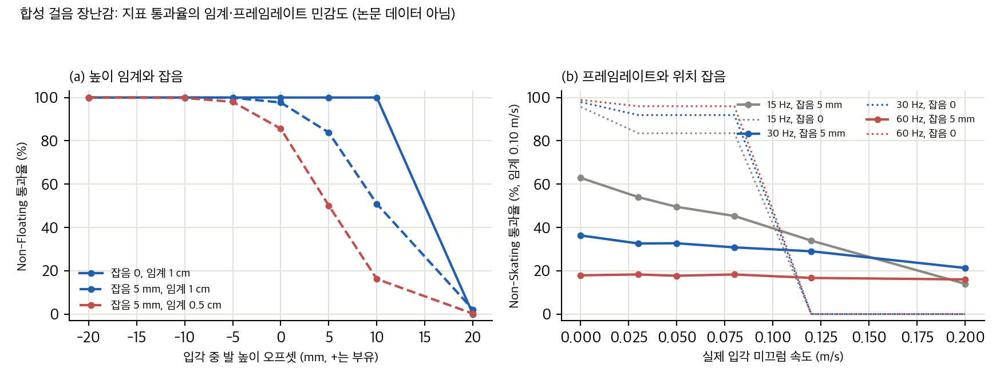
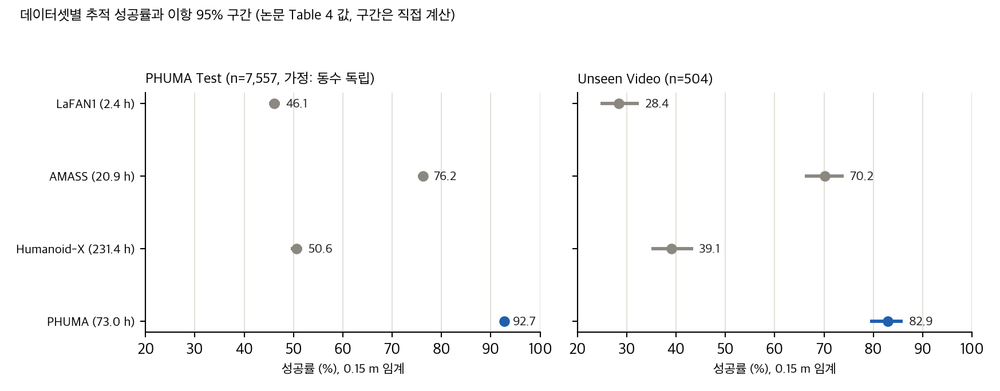
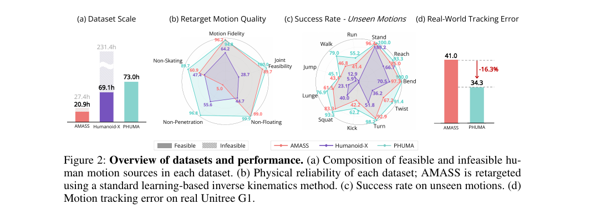
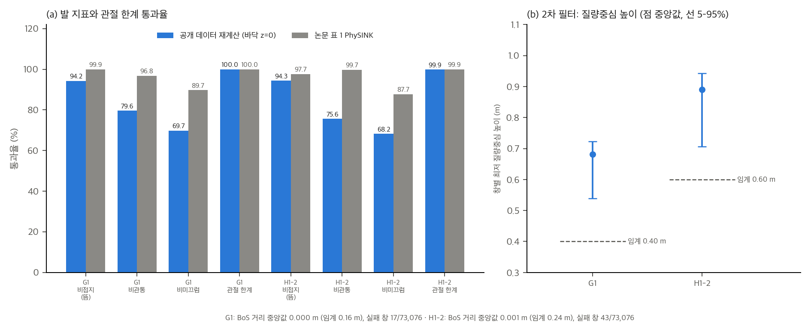

# PHUMA 분석: 물리적으로 신뢰할 수 있는 휴머노이드 보행 데이터는 얼마나 신뢰할 수 있나

영상에서 복원한 사람 동작은 발이 떠 있거나 바닥을 뚫거나 미끄러지는 경우가 많습니다. PHUMA(arXiv:2510.26236, CoRL 2026 Spotlight)는 이 문제를 두 단계로 풉니다. 먼저 물리 기준으로 클립을 거르고, 그다음 관절 한계와 접지, 미끄럼 항을 넣은 리타게팅 PhySINK로 옮깁니다. 결과는 73.0시간 G1·H1-2 모션 데이터셋입니다.

이 글은 논문을 읽고, 표의 수치를 다시 계산하고, 공개 코드를 정적으로 대조한 기록입니다. 코드를 실행하거나 데이터를 내려받지는 않았습니다.

## 한눈에 보기

- **재현 판정:** 공식 파이프라인 전체 재현은 불가능합니다. SMPL-X 모델은 웹 등록이 필요하고, 학습·테스트의 원본 사람 포즈는 비공개입니다. 리타게팅은 RTX 3090 한 장으로 약 99 GPU 일(7.88M 프레임 ÷ 0.92 fps로 계산한 추정)이 걸리고, 정책 학습은 CUDA와 Isaac 계열 시뮬레이터가 필요합니다.
- **표 오류:** v3 표 4의 AMASS Unseen 총합은 78.2입니다. 표 3과 표 21, v1 논문은 70.2입니다. 이 값에 따라 PHUMA 대 AMASS의 유의성이 p ≈ 0.06에서 p < 0.001로 바뀝니다.
- **통계:** Unseen 504개에서 PhySINK와 SINK의 차이(72.8 대 70.2)는 p ≈ 0.36으로 유의하지 않습니다. 데이터셋 간 차이(40%p 이상)만 평가 표본 오차를 넘습니다.

## 논문이 측정하는 "물리적 신뢰도"

논문은 다섯 지표를 씁니다. 모두 프레임 비율입니다.

| 지표 | 기준 |
|---|---|
| 충실도 | 관절 위치 오차 < 10 cm, 방향 오차 < 10° |
| 관절 feasibility | 위치와 속도가 한계의 98% 안 |
| 비접지 | 접촉 중 발이 1 cm 이내로 떠 있음 |
| 비관통 | 접촉 중 발이 1 cm 이내로 바닥을 뚫지 않음 |
| 비미끄럼 | 접촉 중 수평 발 속도 < 10 cm/s |

문제는 이 다섯 지표가 PhySINK 손실과 같은 양을 재고 있다는 점입니다. 접지 높이, 수평 발 속도, 관절 98% 한계가 목적함수에 들어 있으므로, 이 표에서 PhySINK가 이기는 것은 독립적인 증거가 되기 어렵습니다.

공개 코드에서는 관절 feasibility 100%가 최적화 결과가 아니라 저장 직전의 `np.clip`에서 나올 수 있습니다. 논문 본문에는 이 클리핑이 없습니다.

## 지표는 얼마나 흔들리나

논문 지표를 합성 걸음 궤적에 적용해 봤습니다(논문 데이터가 아니라 장난감입니다).

*직접 만든 장난감 실험. (a) 입각 중 발 높이 오프셋과 높이 임계, 잡음에 따른 Non-Floating 통과율. (b) 미끄럼 속도와 프레임레이트, 잡음에 따른 Non-Skating 통과율(임계 0.10 m/s). 잡음은 백색 가정이므로 최악 경우입니다.*

- 5 mm 위치 잡음만 있어도 정확히 붙은 발이 높이 임계 0.5 cm에서 15% 실패합니다.
- 30 Hz에서 잡음 5 mm이면 정지한 발의 36%만 미끄럼 기준을 통과합니다. 프레임레이트가 올라갈수록 더 나빠집니다.
- 접촉 점수 식(발 네 영역 중 최댓값의 프레임 평균)은 한 발이 6 cm 떠 있어도 1.0이 되어 통과합니다. 떠 있는 발을 거르지 못합니다.

## 통계: 방법 차이와 데이터셋 차이

논문 표 4(0.15 m 임계)의 성공률에 이항 95% 구간을 붙였습니다.

*직접 계산: 논문 표 4 값과 Wilson 95% 구간. 구간은 독립 베르누이 가정이며 학습 시드 변동은 포함하지 않습니다.*

- 리타게팅 방법 비교(표 3)의 PHUMA Test 차이는 크고(p ≈ 10⁻⁶), Unseen 차이는 작습니다(p ≈ 0.36).
- 시드 3개 실험(부록 D.4, E)에서는 PhySINK가 SINK보다 높게 나옵니다. 다만 시드 검정은 평가 표본 변동을 포함하지 않습니다.
- 실물 G1의 추적 오차 16.3% 감소는 표 값과 맞습니다. 그러나 24개 모션의 분산이 없어 유의성을 확인할 수 없습니다.

## 논문 Figure 2 (원 저자, CC BY 4.0)

*논문 Figure 2 (원 저자, CC BY 4.0, arXiv:2510.26236). PDF에서 잘라 원 캡션을 그대로 포함했습니다. © 원저자. 출처 https://arxiv.org/abs/2510.26236.*

## 공개 데이터로 다시 계산한 결과 (2026-11-12)

공개 `data.zip`에서 G1과 H1-2 모션 73,076개씩을 읽어 발 지표와 관절 한계를 CPU로 계산했습니다. 명세는 논문 본문의 정의를 따랐고, 논문에 없는 부분(접촉 판정 대역, 분모, 속도 계산)은 제가 고른 값입니다. 모든 파일을 오류 없이 읽었습니다.

| 지표 | G1 재계산 | G1 논문 (표 1) | H1-2 재계산 | H1-2 논문 (표 37) |
|---|---|---|---|---|
| 비접지 | 94.2 | 99.9 | 94.3 | 97.7 |
| 비관통 | 79.6 | 96.8 | 75.6 | 99.7 |
| 비미끄럼 | 69.7 | 89.7 | 68.2 | 87.7 |
| 관절 한계 | 100.0 | 100.0 | 99.9 | 99.9 |

- 관절 한계만 논문과 맞습니다. 다만 저장 전에 같은 98% 한계로 클리핑한 값이라 거의 정의상 맞는 값입니다.
- 세 발 지표는 모두 논문보다 낮습니다. 접촉 판정 대역을 2.5 cm에서 10 cm로 바꿔도 비관통은 75–82%에 머뭅니다. 따라서 대역 하나로 설명되지 않습니다.
- 공개 데이터의 바닥 높이는 클립마다 −2.5 cm에서 +1.4 cm까지 흔들립니다. 1 cm 허용 오차 근처에서는 이 차이만으로 판정이 바뀝니다.
- G1 2차 필터(질량중심 높이 0.40 m, BoS 0.16 m)는 창 73,076개 중 17개(0.02%)에서만 걸립니다. H1-2 필터(0.60 m, 0.24 m)도 43개(0.06%)뿐입니다. 공개 데이터가 이 필터를 거쳤는지는 확인하지 못했습니다.
- 충실도는 계산하지 않았습니다. 공개 데이터에 사람 기준 모션이 없기 때문입니다.

*직접 계산(공개 데이터, CPU). (a) 주값 명세의 통과율과 논문 PhySINK 값(G1은 표 1, H1-2는 표 37). 관절 한계만 맞습니다. (b) 로봇별 창 최저 질량중심 높이의 5–95% 범위와 중앙값, 각 임계(G1 0.40 m, H1-2 0.60 m). 논문 그림이 아니라 제가 만든 그래프입니다.*

## 데이터와 코드 확인

- 데이터셋 `data.zip`은 3.42 GB입니다. 게이트 없이 받을 수 있습니다. 처음에는 승인 기준(1 GB 미만)을 넘어 내려받지 않았지만, 2026-11-12에 내려받아 공개 로봇 모션의 지표를 다시 계산했습니다(아래 절). 카드에는 Apache-2.0이 적혀 있지만, LAFAN1과 LocoMuJoCo는 라이선스 제약으로 빠져 있고 원본 사람 포즈는 라이선스 문제로 비공개입니다. 원천 데이터의 약관은 확인하지 않았습니다.
- 코드 저장소는 Apache-2.0입니다. 큐레이션과 리타게팅 코드를 정적으로 읽었습니다.
- 논문과 코드가 다른 곳이 여럿 있습니다. 접지 추정 방식, 접촉 비율의 뒤꿈치 보정(5 mm, 논문에 없음), 미끄럼 손실의 노름(식의 제곱과 다름), 학습되는 링크 스케일, 논문에 없는 로봇 공간 2차 필터(질량중심 높이 0.4 m, 질량중심과 BoS 거리 0.16 m)입니다.
- 표 1의 지표를 계산하는 코드는 저장소에 없습니다. 정책 학습과 성공률 계산 코드도 없습니다.

## 정리

PHUMA는 "데이터 양보다 물리적 신뢰도가 중요하다"는 주장을 설득력 있게 보여 줍니다. 다만 그 근거의 상당 부분은 단일 시드, 평가 표본 크기, 손실과 같은 지표, 같은 데이터에서 고른 임계에 기대고 있습니다. 한 표의 값도 본문과 맞지 않습니다. 수치를 인용하거나 데이터를 쓸 때는 이 점을 함께 적는 것이 안전합니다.

공개 로봇 모션의 지표는 CPU에서 다시 계산했습니다(위 절). 사람 입력을 쓴 큐레이션 재현은 SMPL-X 등록이 있어야 합니다. 정책 학습과 실물 실험은 이 환경에서 불가능합니다.

## 자료

- [통합 리포트 PDF](report/report_public.pdf)
- [PHUMA: Physically Reliable Humanoid Locomotion Dataset (arXiv:2510.26236) 논문 분석](analysis/01_paper_analysis.md)
- [PHUMA 선행연구와 관련 분석 (02)](analysis/02_prior_work.md)
- [PHUMA 수치 재계산, 통계 검정, 유도, 장난감 (03)](analysis/03_analysis.md)
- [PHUMA 공개 코드 대조 (04): 논문 ↔ 코드](analysis/04_code_verification.md)
