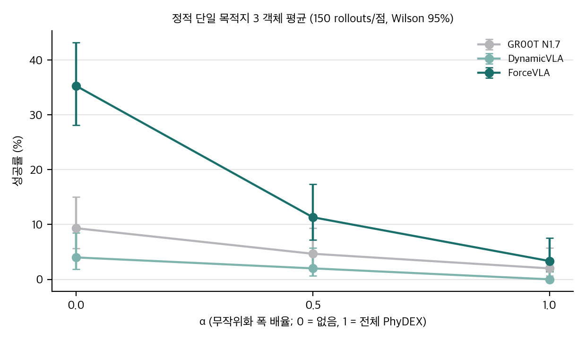
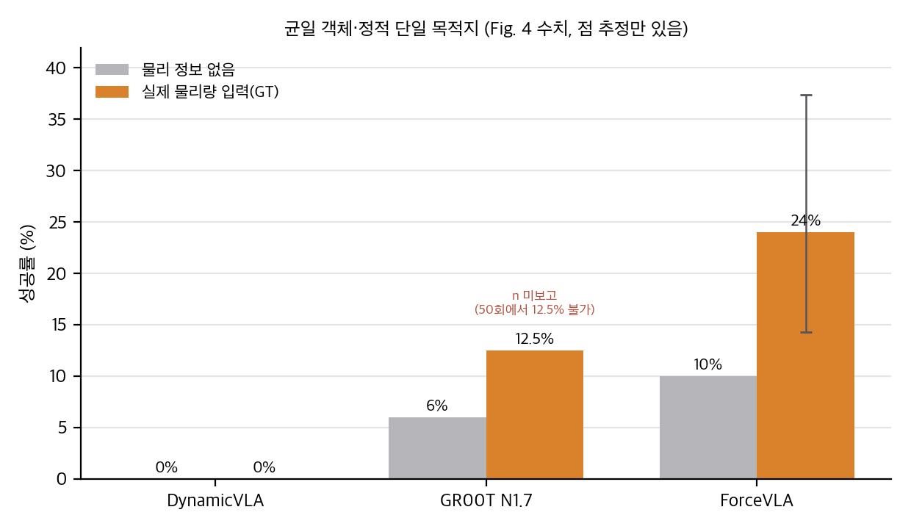
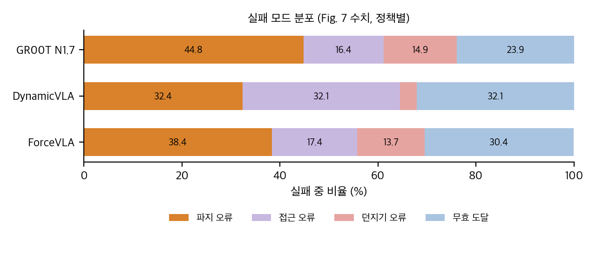
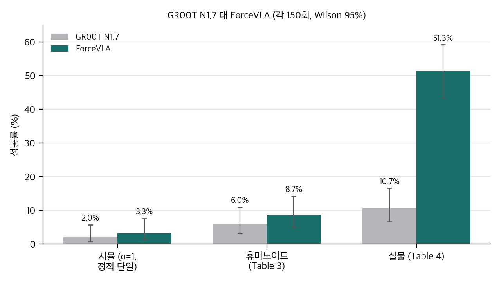
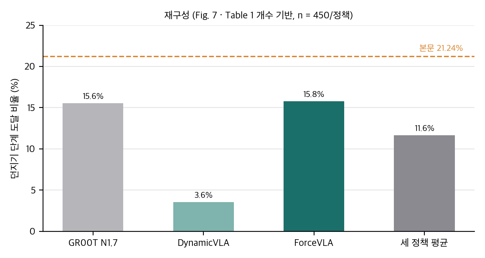

> **논문:** Vo, Hanyu, Ikebe 외. *PhyDEX: A Benchmark for Physical Reasoning in Vision-Language-Action Models via Dynamic Extrinsic Dexterity.* arXiv:2611.26565 (v1, 2026-11-19). 학회 표기는 확인할 수 없습니다.
> 이 글은 논문의 표 수치를 다시 계산하고, 본문과 그림을 맞춰 본 분석입니다. 논문 그림은 싣지 않았습니다. 그래프는 논문 표와 그림의 수치로 우리가 직접 그렸습니다. 공식 코드와 데이터는 공개되지 않았습니다.

## 한 줄 요약

물리 추론을 VLA에 묻는 방법으로 **던지기**를 골랐습니다. 로봇은 물체의 질량과 무게중심, 마찰을 추정해서, 자기 작업공간 밖의 목적지에 물체를 넣어야 합니다. 세 VLA의 성공률은 0.2–2.4%였고, 표 수치는 모두 맞습니다. 다만 본문의 두 수치와 한 문장은 그림과 맞지 않습니다.

## 1. 왜 던지기인가

대부분의 VLA 벤치마크는 집기, 열기, 삽입처럼 **접촉**을 평가합니다. 중력, 마찰, 관성, 질량 분포는 거의 보지 않습니다. 그래서 정책이 물리를 이해하는지, 학습 데이터를 보간하는지 구분하기 어렵습니다.

던지기는 이 질문에 맞습니다. 목적지가 작업공간 밖에 있으면 손으로 옮길 수 없습니다. 물체가 어디로 날아갈지는 질량, CoM, 릴리스 속도에 달려 있습니다. 실패가 운동학 오차인지 물리 추정 오차인지 나눌 수 있습니다.

## 2. 데이터: 35K 궤적, 9과제

- 과제 = 객체 3종 × 목적지 3종. 객체는 균일, 불균일, 동적 질량이고, 목적지는 정적 단일, 정적 다중, 이동 단일입니다.
- 35,357 에피소드, 143.2시간, 10 Hz. RoboCasa 주방 100개와 자산 107개.
- 물리 무작위화: 질량 ×[0.5, 2], CoM ±15 mm, 마찰 ×[0.8, 1.2].
- 생성은 자동입니다. 파지 후보를 고르고, cuRobo로 접근 계획을 만들고, SLSQP로 던지기 궤적을 최적화합니다.

**주의할 점 하나:** 던지기 계획식 (2)에는 질량이 없습니다. 드래그 없는 탄도 비행으로 계획된 릴리스 상태는 질량과 무관합니다. 질량은 추종 오차와 슬립으로만 영향을 줍니다. 그래서 "질량을 추정해야 한다"는 말은 실제로 "추종 오차를 보정해야 한다"와 같습니다. 논문은 이 구분을 하지 않습니다.

## 3. 결과: 세 VLA 모두 3% 아래

| 정책 | 전체 성공률 (논문) | 재계산 (450회) |
|---|---|---|
| GR00T N1.7 | 0.9% | 4 / 450 |
| DynamicVLA | 0.2% | 1 / 450 |
| ForceVLA | 2.4% | 11 / 450 |

모든 셀은 셀당 50회의 정수 개수로 설명됩니다. 세 정책 합계 1.19%도 본문의 "약 1.2%"와 맞습니다.

### 무작위화를 줄이면 성공률이 올라갑니다

논문은 무작위화 폭 α를 0에서 1까지 바꿨습니다. ForceVLA는 α = 1에서 3.3%, α = 0에서 35.3%입니다. 두 조건의 차이는 Fisher 검정으로 p ≈ 3 × 10⁻¹³입니다. 이 논문에서 가장 튼튼한 결과입니다.

논문 Table 2의 수치로 그린 그래프. 정적 단일 목적지, 3 객체 평균, 150회/점, Wilson 95% 구간.

### "실제 물리량을 주면 두 배"는 점 추정입니다

초록은 실제 물리량을 입력으로 주면 성공률이 "대략 두 배"가 된다고 씁니다. 그림 4는 균일 객체, 정적 단일 목적지에서 GR00T 6% → 12.5%, ForceVLA 10% → 24%를 보여 줍니다.

그런데 본문은 이 값을 **증가**라고 씁니다. 실제 증가는 +6.5, +14%p입니다. ForceVLA의 차이는 Fisher p = 0.11로 유의하지 않습니다. GR00T의 12.5%는 50회에서 나올 수 없는 값입니다. 시행 수가 보고되지 않았습니다.

논문 Fig. 4의 수치를 다시 그림. 사후 값의 구간은 n = 50을 가정했고, GR00T의 n은 보고되지 않았습니다.

### 실패는 던지기 전에 일어납니다

실패의 약 89%는 던지기 이전에 일어납니다. 파지 오류 38.5%, 접근 오류 22.0%, 도달 실패 28.8%입니다. 던지기 오류는 10.6%입니다. 이 결과는 재계산과 맞습니다.

논문 Fig. 7의 수치를 다시 그림. 정책별 실패 모드 비율.

## 4. 실물에서는 차이가 커지는데, 이유가 불분명합니다

실물 실험(UR10e, 큐브 세 개)에서 ForceVLA는 51.3%, GR00T는 10.7%, DynamicVLA는 0%입니다. 저자는 이 차이를 힘-토크 입력 탓으로 봅니다.

그런데 같은 두 정책을 시뮬에서 비교하면 ForceVLA 3.3%, GR00T 2.0%입니다. 차이는 p = 0.72로 없습니다. 실물은 고정된 셋업에서 큐브당 시연 300회로 학습했습니다. 시뮬은 과제마다 따로 학습했고, 시연 수는 보고되지 않았습니다. 힘-토크 입력과 데이터 조건이 섞여 있어서 원인을 나눌 수 없습니다.

GR00T N1.7과 ForceVLA의 성공률을 세 환경에서 비교. 각 150회, Wilson 95% 구간.

## 5. 본문의 21.24%는 그림과 맞지 않습니다

본문은 21.24%를 두 번 씁니다. 한 번은 "파지에 성공한 궤적 비율"이고, 한 번은 "던지기 단계에 도달한 궤적 비율"입니다. 같은 값을 두 뜻으로 씁니다.

Fig. 7의 실패 비율과 Table 1의 개수로 던지기 단계 도달을 역산하면 정책별로 15.6%, 3.6%, 15.8%이고 평균은 11.6%입니다. DynamicVLA의 3.6%는 본문의 "파지 3.57%"와 맞습니다. 그러나 다른 두 정책은 21.24%와 맞지 않습니다. 던지기 성공률 "5.6%"도 21.24%에서 유도된 값이라서, 재구성하면 10.2%입니다.

Fig. 7 실패 비율과 Table 1 개수로 역산한 던지기 단계 도달 비율과 본문의 21.24%.

정의가 다르거나 오타일 수 있습니다. 논문만으로는 구분할 수 없습니다.

## 6. 구현할 수 있을까

**논문 그대로는 재현할 수 없습니다.** 데이터, 코드, 체크포인트가 공개되지 않았습니다. 프로젝트 페이지는 404입니다. 데이터 생성에는 Isaac Sim과 CUDA GPU가 필요하고, 미세조정에는 A100급 여러 장이 필요하며, 실물 실험에는 로봇과 F/T 센서가 필요합니다.

**일부는 CPU로 됩니다.** 던지기 계획식과 SLSQP 최적화를 작게 옮기면 질량과 CoM 오차가 착지 오차에 주는 영향을 볼 수 있습니다. 1–2주 정도로 추정합니다(측정하지 않은 추정). 논문과 비교할 기준이 없으므로, 결과는 "이 모델에서 어떤가"에 머뭅니다.

## 7. 이 글에서 가져갈 것

1. **셀당 50회, 시드 수를 밝히지 않은 표는 검정력이 낮습니다.** 시뮬 정책 간 차이는 20%p 안팎이어야 보입니다.
2. **무작위화 강도 곡선은 좋은 진단 도구입니다.** "분포 밖이라서 실패하는가"를 빠르게 봅니다.
3. **"물리를 안다"는 주장은 원인을 나눠야 합니다.** 추종 오차, 슬립, 물체 추정을 따로 봐야 합니다.
4. **점 추정을 인용할 때는 구간과 시행 수를 함께 씁니다.** 이 논문은 증가 값을 잘못 쓰고 있습니다.

## 자료

- 원문: https://arxiv.org/abs/2611.26565 (CC BY 4.0)
- 프로젝트 페이지: https://uark-aicv.github.io/PhyDEX/ (2026-11-21 접근 시 404)
- 공식 코드: 없음 (논문에 코드 공개 문장 없음, 저자 조직 저장소에 PhyDEX 없음)
- 분석 노트 전체(표 재계산, 검정, 일관성 검사)는 `publish/git/`에 있습니다.

## 자료

- [통합 리포트 PDF](report/report_public.pdf)
- [01. 논문 분석: PhyDEX (arXiv:2611.26565)](analysis/01_paper_analysis.md)
- [02. 선행연구와 계보](analysis/02_prior_work.md)
- [03. 수치 재계산, 검정, 일관성 검사](analysis/03_analysis.md)
- [04. 주장 검증 (공식 코드 없음)](analysis/04_claim_verification.md)
