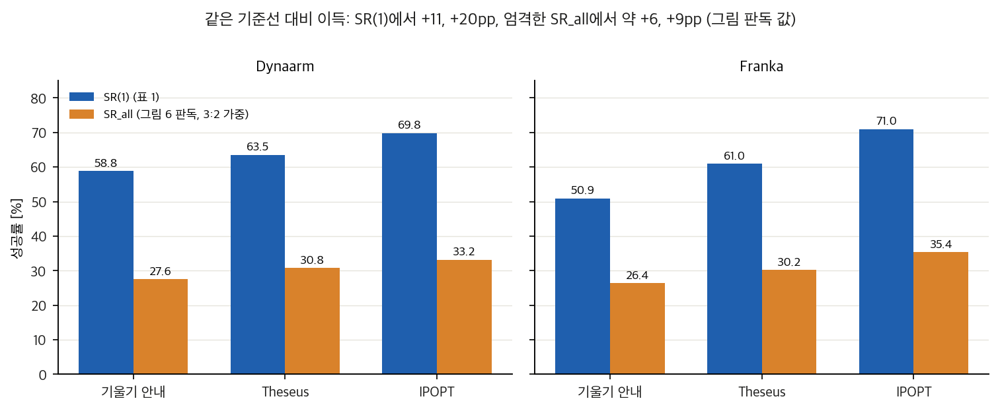
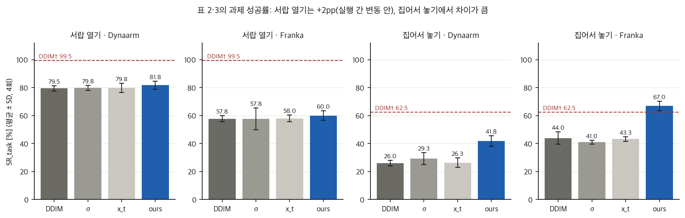
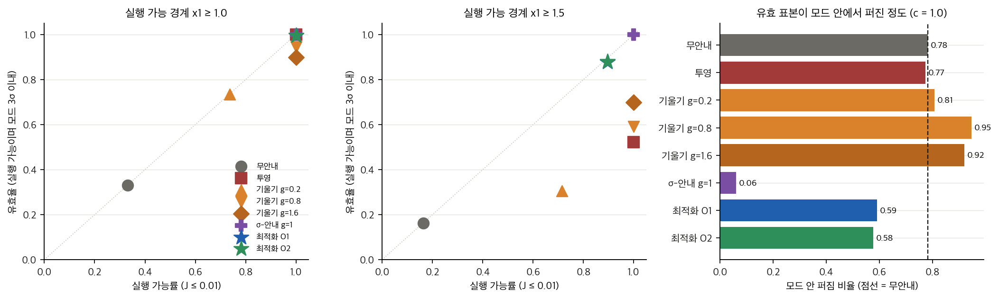

# 03. 수치 재계산과 해석

논문 표(표 1–5, 부록 8.5.0, 그림 6)를 옮겨 일관성을 검사하고, 시행 수에 따른 검정을 계산했습니다. 코드는 `analysis/table_check.py`(결과 `table_check_results.json`), 토이는 `analysis/toy_guidance.py`(결과 `toy_guidance_results.json`)입니다. 둘 다 CPU에서 수 초에서 1분 안에 끝납니다. 검사 번호는 V1–V14입니다. 재현(학습, 시뮬레이션)은 하지 않았습니다.

**읽는 법.** 논문에 없는 시행 수는 문장 안에 "(시행 수 n 가정)"으로 밝혔고, 그림에서 읽은 값은 "(그림 판독 값)"으로 표시했습니다. 표에 적힌 수치 자체를 바꾼 곳은 없습니다.

## 0. 한눈에 보기

| 번호 | 대상 | 결과 |
|---|---|---|
| V1 | 표 1 SR(1)의 정수 가능성 | 시행 수 n = 1200은 모든 값이 가능하고, n = 150(30 물체 × 5 자세)은 SR(1) 11개 값이 모두 불가능합니다 |
| V2 | 부록 쉬움/어려움 값 대 표 1 | 쉬움 3 : 어려움 2 가중으로 8개 값이 표 1과 최대 0.4점 안에서 맞습니다 (그림 판독 값 아님, 본문 정수) |
| V3 | 실행 시간 배수 | 46배, 69배 모두 맞습니다 (45.8, 69.0) |
| V4 | "최대 +20pp, +23pp" | 맞습니다 (20.1, 23.0). 23점의 기준선은 무안내 DDIM입니다 |
| V5 | 표 2와 표 3의 같은 칸 | 2칸이 0.1 다릅니다 (63.3 대 63.2). 같은 값의 반올림 방향 차이로 읽힙니다 |
| V6 | 4회 × 100 에피소드로 (평균, SD) 가능성 | 평균은 모두 0.25의 배수이고 SD는 표본 표준편차(n − 1)로 모두 가능합니다 |
| V7 | 시각운동 검정 | 서랍 4칸은 모두 유의하지 않고, 집어서 놓기 Dynaarm +12.5점과 Franka +23.0점은 유의합니다 |
| V8 | 표 1 검정 | Franka는 n에 관계없이 IPOPT가 기울기 안내보다 높고, Dynaarm은 n = 150이면 경계(p = 0.047)입니다 |
| V9 | 표 5 | 시행 수는 40이 아니라 160으로 읽히고(1/160 격자, 28.37 한 값만 어긋남), 12개 값은 반올림이 아니라 절단 표기입니다 |
| V10 | 대리망 파라미터 수 | 218,384와 218,513으로 본문 "≈218k, ≈219k"와 맞습니다 |
| V11 | DDIM† "상한" | 집어서 놓기 Franka에서 제안(67.0)이 DDIM†(62.5)보다 높습니다 |
| V12 | 본문 Q1 문장 | "≤ 7.1 대 ≥ 14"는 맞습니다 |
| V13 | 그림 6의 엄격한 SR_all | IPOPT와 기울기 안내의 차이가 SR(1)의 절반 안팎입니다 (그림 판독 값) |
| V14 | 식 (25)의 상자 제약 | N(0, I) 표본이 [−1, 1]^21 안에 있을 확률은 3.3×10⁻⁴입니다 (정규화 가정) |
| 토이 | 2차원 혼합에서 네 안내 비교 | §6 |

## 1. 파지: 표 1과 부록 8.5.3

### V1. SR(1)의 단위

5.1절은 "SR(1)은 (물체, 자세)별 성공률"이라고 쓰고, 부록 8.6은 "한 파지가 세 축 중 한 축 이상에서 안정"으로 정의합니다. 그림 6 캡션은 "자세별 SR(1)과 파지별 SR_all"이라 씁니다. 표 1의 값이 어느 단위의 비율인지 정수 가능성으로 구분했습니다.

| 가정 단위 | 시행 수 n | SR(1) 11개 값 중 정수로 만들 수 있는 값 |
|---|---|---|
| 파지(30 × 8 × 5) | 1200 | 11개 모두 |
| (물체, 자세) (30 × 5) | 150 | 0개 |

소수 첫째 자리까지 반올림된 값이므로 n = 1200은 어떤 값이든 가능한 해상도이고, n = 150은 1/150 = 0.667%포인트 격자라서 우연히 맞을 확률이 값마다 약 15%입니다. 11개가 모두 맞지 않으므로 **표 1의 SR(1)은 150개 단위의 비율이 아니고**, 파지 1200개를 분모로 읽는 해석과 맞습니다(시행 수 n = 1200 가정). 다른 단위일 가능성은 남습니다. 저자 확인이 필요합니다. SR_IK는 1200 가정에서 모두 가능하고 99.9%(Dynaarm 투영 안내)는 n = 150에서 불가능합니다(1199/1200 = 99.92%).

### V2. 부록의 쉬움/어려움 값과 표 1

본문 8.5.3절의 정수값(쉬움 대 어려움)을 3 : 2로 가중하면 표 1의 평균과 맞습니다(베이스 자세 5개 중 어려움이 2개, 8.5.3절과 그림 6 캡션의 자세 이름으로 읽은 구성).

| 팔 | 방법 | 쉬움 → 어려움 | 3 : 2 가중 | 표 1 |
|---|---|---|---|---|
| Franka | 기울기 | 70 → 23 | 51.2 | 50.9 |
| Franka | 투영 | 57 → 9 | 37.8 | 37.4 |
| Franka | IPOPT | 72 → 70 | 71.2 | 71.0 |
| Franka | Theseus | 65 → 56 | 61.4 | 61.0 |
| Dynaarm | 기울기 | 59 → 58 | 58.6 | 58.8 |
| Dynaarm | 투영 | 28 → 17 | 23.6 | 23.7 |
| Dynaarm | IPOPT | 71 → 68 | 69.8 | 69.8 |
| Dynaarm | Theseus | 61 → 67 | 63.4 | 63.5 |

최대 차이는 0.4점입니다. 표 1과 부록의 값이 서로 정합적이라는 뜻입니다. 그림 5는 "더 작은 물체 부분집합"이라고 쓰는데도 결과가 표 1과 이만큼 맞으므로, 같은 평가에서 나온 값으로 읽힙니다.

### V3, V4. 시간 배수와 본문 문장

- Theseus 3.63 s / DDIM 79.3 ms = 45.8배, IPOPT 5.47 s / 79.3 ms = 69.0배. 본문의 "46배, 69배"와 같습니다.
- 기울기 안내와 투영 안내의 추가 시간은 6%입니다(84.2, 84.1 ms 대 79.3 ms).
- IPOPT − 기울기 안내: Dynaarm 69.8 − 58.8 = 11.0점, Franka 71.0 − 50.9 = 20.1점. 본문 "최대 11점, 20점"과 같고, 초록의 "최대 20pp"는 이 값을 가리킵니다.

### V8. 표 1의 검정 (독립 비율 근사)

같은 물체와 자세를 공유하므로 쌍을 이룬 검정이 더 맞지만, 쌍 자료가 없어 독립 근사로 계산했습니다(시행 수 n 가정).

| 비교 | 차이 | p (n = 150) | p (n = 1200) |
|---|---|---|---|
| Dynaarm IPOPT − 기울기 | +11.0 | 0.047 | 1.9×10⁻⁸ |
| Dynaarm Theseus − 기울기 | +4.7 | 0.40 | 0.018 |
| Dynaarm IPOPT − Theseus | +6.3 | 0.25 | 0.001 |
| Franka IPOPT − 기울기 | +20.1 | 3.6×10⁻⁴ | < 10⁻⁹ |
| Franka Theseus − 기울기 | +10.1 | 0.078 | 6.3×10⁻⁷ |
| Franka IPOPT − Theseus | +10.0 | 0.068 | 2.3×10⁻⁷ |

n = 1200이면 Dynaarm Theseus 대 기울기 안내(+4.7점)도 유의합니다. 그러나 같은 물체의 8개 파지는 독립이 아니므로(30 물체가 군집 단위) 1200은 유효 시행 수의 상한입니다. V1에서 n = 150이 맞지 않으므로 유효 시행 수는 150과 1200 사이로 보는 것이 안전합니다. Dynaarm IPOPT의 Wilson 95% 구간(n = 150 가정)은 62.2–76.8%, 기울기 안내는 50.7–66.2%로 겹칩니다.

### V13. 엄격한 지표 SR_all (그림 판독 값)

그림 6에는 SR(1)(바깥)과 SR_all(안쪽, 세 축 모두 안정)이 함께 있습니다. SR_all을 그림에서 읽어(정수 라벨, ±1) 같은 3 : 2 가중으로 평균하면 다음과 같습니다(그림 판독 값).

| 팔 | 방법 | SR(1) 표 1 | SR_all (그림 판독, 가중) |
|---|---|---|---|
| Dynaarm | 기울기 안내 | 58.8 | 27.6 |
| Dynaarm | Theseus | 63.5 | 30.8 |
| Dynaarm | IPOPT | 69.8 | 33.2 |
| Franka | 기울기 안내 | 50.9 | 26.4 |
| Franka | Theseus | 61.0 | 30.2 |
| Franka | IPOPT | 71.0 | 35.4 |
| 두 팔 | DDIM† (팔 없음) | 75.0 | 약 40 |

IPOPT와 기울기 안내의 차이는 SR(1)에서 +11.0, +20.1점이고 SR_all(그림 판독 값)에서 +5.6, +9.0점입니다. 같은 방향이고 절반 안팎으로 줄어듭니다. 쉬움 자세만 보면 Franka(Panda)에서 기울기 안내 36, IPOPT 37, Theseus 33으로 순서가 섞입니다(그림 6). 그림 6 캡션의 "제안 변형이 모든 (팔, 난이도) 구간을 압도한다"는 서술은 SR(1)로는 Franka 쉬움에서 기울기 안내(70)가 Theseus(65)보다 높고(본문 8.5.3절도 이를 인정), SR_all로는 Franka 쉬움에서 기울기 안내가 Theseus보다 높다는 점에서 약간 좁게 읽어야 합니다. 표 1의 대표 지표 SR(1)은 세 축 중 한 축만 통과하면 성공이라서(8.6절) DDIM† 기준으로도 75% 대 41%(SR_all)로 크게 다릅니다.

DDIM†는 팔이 없는 기준인데 그림 6에서 Dynaarm 75/41, Panda 76/40으로 1점 안에서 다릅니다(그림 판독 값). 같은 모델이므로 평가 표본 차이로 보입니다.

## 2. 시각운동: 표 2와 표 3

### V5. 표 2와 표 3의 일치

40개 값 쌍을 대조해 평균과 SD가 모두 같음을 확인했습니다. 예외는 집어서 놓기 Dynaarm의 SR_sub 두 칸(DDIM, x_t 밀기)으로 표 2는 63.3, 표 3은 63.2입니다. V6에서 보듯 평균이 0.25의 배수라 63.25가 반올림 방향에 따라 둘로 적힌 것으로 읽힙니다. 실질적 차이는 없습니다.

### V6. 평균과 표준편차의 정수 가능성

표 2는 "100개 환경, 4회 실행"입니다. 한 실행의 성공률이 k/100(k는 정수)이라고 가정하면(시행 수 n 가정) 네 실행 평균은 0.25 단위입니다. 표의 40개 평균은 모두 0.25의 배수 ± 0.05 안에 있습니다. 표준편차를 네 개의 정수 k로부터 만들 수 있는지 전수 조사했습니다.

| SD 정의 | 만들 수 없는 칸 수 (40칸 중) |
|---|---|
| 표본 표준편차 (n − 1) | 0 |
| 모집단 표준편차 (n) | 8 (예: DDIM† 서랍 99.5 ± 1.0) |

표의 SD는 n − 1로 계산한 값과 맞습니다. 이는 4회 × 100 에피소드 가정과 일관됩니다. 네 실행이 같은 100개 환경을 반복했는지는 논문에서 확인되지 않습니다.

### V7. 검정

두 가지 해석으로 계산했습니다. (a) 네 실행 평균의 Welch 검정(n = 4). (b) 에피소드를 합쳐 400개로 보는 두 비율 검정(시행 수 n = 400 가정; 환경이 같으므로 독립 가정은 느슨).

| 과제 / 팔 | 제안 대 가장 높은 기준선 | 차이 | p (a) | p (b) |
|---|---|---|---|---|
| 서랍 / Dynaarm | 81.8 대 79.8 (σ) | +2.0 | 0.29 | 0.47 |
| 서랍 / Franka | 60.0 대 58.0 (x_t) | +2.0 | 0.38 | 0.57 |
| 집어서 놓기 / Dynaarm | 41.8 대 29.3 (σ) | +12.5 | 0.005 | 2×10⁻⁴ |
| 집어서 놓기 / Franka | 67.0 대 44.0 (DDIM) | +23.0 | 3×10⁻⁴ | 6×10⁻¹¹ |

SR_sub(부분 과제)는 집어서 놓기 Dynaarm에서 제안(66.0)이 σ-안내(69.3)보다 −3.3점 낮습니다(p = 0.30). 본문 5.2절은 이 칸을 "하위 과제 성공이 Franka에서 상한에 가깝다"는 문장으로 다루고 Dynaarm의 SR_sub는 따로 언급하지 않습니다. "23pp"의 기준선(44.0)은 기울기 안내가 아니라 무안내 DDIM이고, 기울기 안내 두 변형은 41.0과 43.3입니다.

### V11. DDIM†는 상한인가

5.2절과 표 3 캡션은 DDIM†(팔 없는 떠 있는 그리퍼)를 "비구현 상한"이라고 부릅니다. 집어서 놓기 Franka에서 제안 67.0 ± 3.4가 DDIM† 62.5 ± 6.2보다 높고(Welch p = 0.26), SR_sub 98.3 ± 1.3이 95.3 ± 2.1보다 높습니다(p = 0.059). 본문은 98.3%를 "상한에 접근"한다고 서술합니다. 수치로는 상한을 넘습니다. 팔이 붙으면 재파지나 접근 방식 등이 달라져 떠 있는 그리퍼보다 쉬워질 수 있다는 가능성이 있고, 그렇다면 DDIM†는 엄밀한 상한이 아니라 기준점입니다(표 3 캡션은 "상한 기준점"이라고도 부릅니다). 논문이 이유를 설명하지 않습니다.

## 3. 충돌 환경: 표 5

### V9. 시행 수와 표기

캡션은 "4 물체 × 파지 10개"이므로 칸당 40개입니다. 그러나 160개 값 중 60개가 1/40 격자에 맞지 않습니다(예: 4.37, 33.12, 51.24). 1/160 격자(0.625점)에는 0.02점 허용으로 159개가 맞고 1개(Dynaarm Theseus Clutter의 SR(1) 28.37, 45.39/160)만 어긋납니다. 따라서 칸당 분모는 40이 아니라 160(예: 4 자세나 4 실행을 곱한 값)으로 읽힙니다(시행 수 n = 160 가정). 12개 값(예: 4.37 = 7/160 = 4.375, 33.12 = 53/160 = 33.125)은 반올림이 아니라 절단으로 적혀 있고, 다른 14개는 격자에서 0.02점 이내로 어긋납니다(68.73 대 68.75 등, 표기 정밀도 차이로 읽힘). 28.37은 저자 확인이 필요한 값입니다.

정합성: SR_Tot ≤ SR(1)과 SR_Tot ≤ 100 − CR이 모든 칸에서 성립합니다(충돌 파지는 성공에서 뺀다는 8.6절의 정의와 맞음).

본문 8.7절의 서술과 표를 대조했습니다.

| 서술 | 표 5 | 판정 |
|---|---|---|
| Franka에서 IPOPT가 네 환경 SR_Tot 최고 (65.62, 60.62, 55.63, 61.88) | 같음 | 일치 |
| Dynaarm: Floor는 IPOPT(46.88), Walls는 Theseus(35.63) | 같음 | 일치 |
| Dynaarm Tunnels는 기울기 안내가 최고 | 30.63 (Theseus 24.37, IPOPT 23.75) | 일치 |
| 투영 안내는 Clutter에서 충돌 0%, 성공도 0% | 두 팔 모두 0.0, 0.0 | 일치 |
| 기울기 안내는 Dynaarm 여러 환경에서 충돌 0% | Floor, Clutter, Tunnels 0.0 | 일치 |

환경 평균 SR_Tot (4개 환경 평균): Dynaarm에서 IPOPT 31.1, Theseus 30.0, 기울기 안내 27.3, 투영 안내 8.6, DDIM 3.0. Franka에서 IPOPT 60.9, Theseus 43.8, 투영 안내 36.6, 기울기 안내 21.1, DDIM 8.9. Dynaarm에서 IPOPT와 기울기 안내의 차이는 평균 약 3.8점입니다.

환경별 최고 제안 대 최고 기준선(두 비율 검정, 시행 수 n = 160 가정, 40 그대로면 p가 훨씬 큽니다).

| 팔 / 환경 | 제안 | 기준선 | 차이 | p (n = 160) | p (n = 40) |
|---|---|---|---|---|---|
| Dynaarm / Floor | IPOPT 46.88 | 기울기 33.12 | +13.8 | 0.012 | 0.21 |
| Dynaarm / Walls | Theseus 35.63 | 기울기 17.5 | +18.1 | 0.0002 | 0.066 |
| Dynaarm / Clutter | IPOPT 31.25 | 기울기 28.12 | +3.1 | 0.54 | 0.76 |
| Dynaarm / Tunnels | Theseus 24.37 | 기울기 30.63 | −6.3 | 0.21 | 0.53 |
| Franka / Floor | IPOPT 65.62 | 투영 58.13 | +7.5 | 0.17 | 0.49 |
| Franka / Walls | IPOPT 60.62 | 투영 43.13 | +17.5 | 0.002 | 0.12 |
| Franka / Clutter | IPOPT 55.63 | 기울기 23.13 | +32.5 | 3×10⁻⁹ | 0.003 |
| Franka / Tunnels | IPOPT 61.88 | 투영 45.00 | +16.9 | 0.002 | 0.13 |

8개 칸 중 4칸이 n = 160에서 p < 0.01입니다. 어느 시행 수를 쓰든 Franka Clutter(+32.5점)가 가장 강한 증거입니다. 표 5의 기준선은 환경마다 최고값을 골랐으므로 "최고 기준선"은 비교 편향(고르기)을 포함합니다.

표 5의 SR_IK는 DDIM이 Dynaarm에서 모든 환경 32.5%, Franka에서 100%이고(표 1의 54.6, 83.7과 다름), 8.7절이 설명하듯 다른 데이터로 다시 학습한 모델입니다. Theseus와 IPOPT의 SR_IK는 Dynaarm에서 52.5–82.5%로 기준선(100%)보다 낮습니다. 즉 이 환경에서 "feasibility를 기준선 수준으로 맞춘다"는 초록 문장은 성립하지 않습니다(`04` C1).

## 4. 대리망: 표 4와 부록 8.5.0

### V10. 파라미터 수

알고리즘 1의 구조(임베딩 9→256, 은닉 256→256 둘, 관절 머리 256→128→dof, 도달 머리 256→64→1, 보정 머리 256→128→9)로 센 파라미터 수는 6 자유도 218,384, 7 자유도 218,513입니다. 본문 "Dynaarm 약 218k, Franka 약 219k, 전체 약 2.2×10⁵"와 맞습니다.

### 허용오차와 대리망 오차의 크기

표 4의 RMSE는 Franka 2.9 mm, Dynaarm 5.2 mm입니다. 판정 임계는 ε_IK = 0.01(IPOPT, 단위는 미기재, 미터라면 10 mm)과 ε = 0.005(Theseus 힌지, 5 mm)입니다. 대리망 오차가 허용오차와 같은 크기이므로 Ĵ_IK ≤ ε로 판정한 "도달 가능"의 경계가 흐려집니다. 표 1에서 제안 방법의 SR_IK가 96% 안팎이고 100%가 아닌 것(Dynaarm 95.8, 96.4)과 일치하는 방향이지만, 원인이 대리망 오차인지 IPOPT 수렴 실패인지는 논문에서 구분되지 않습니다(저자는 6절에서 수렴 실패를 언급). 학습 목표의 위치 상자 [−2, 2]³ m는 Franka의 도달 반경(약 0.85 m)보다 훨씬 커서 도달 불가 표본이 대부분일 것입니다. 클래스 비율은 논문에 없습니다.

또한 알고리즘 1에서 epochs = 5(상수 줄), 반복문 "for epoch = 1 to 50", 본문 "2−5 epochs"가 서로 다릅니다.

## 5. 식과 설정의 점검

### V14. 식 (25)의 상자 제약

IPOPT 문제는 −1 ≤ x_K ≤ 1, −1 ≤ δ_k ≤ 1을 둡니다. 확산 모델이 N(0, I) 공간에서 도는 표준 구성이라고 가정하면(논문은 정규화를 밝히지 않음) 좌표당 P(|z| ≤ 1) = 0.683이고, 21차원 x_K가 [−1, 1]^21 안에 있을 확률은 0.683²¹ = 3.3×10⁻⁴입니다(손목 6D 회전 9차원이라면 0.032). 매 단계 δ_k도 같습니다. 곧 **일반 표본 경로는 이 상자에 들어가지 않고**, 상자는 4.1절의 기본 X_init = R^d와 맞지 않습니다. IPOPT가 표본이 아닌 다른 점에서 시작하거나 상자가 다른 척도의 변수에 걸려 있을 가능성이 있습니다. 논문만으로는 구분할 수 없습니다.

### σ_1과 마지막 섭동

식 (11)에서 σ_k² = (1 − ᾱ_{k−1}) / (1 − ᾱ_k) × (1 − ᾱ_k / ᾱ_{k−1})입니다. k = 0이 깨끗한 쪽이고 ᾱ_0 = 1이라면 σ_1 = 0이라서, 마지막 단계의 δ_1은 x_0에 영향을 주지 못합니다. 식 (30)이 이 단계에만 가중치 50을 따로 두고 "x_0를 앞 상태에 더 단단히 묶는다"고 쓰는 것과 같은 방향입니다. 스케줄과 단계 수 K가 없어서 σ_1 = 0 여부는 확인할 수 없습니다. 같은 이유로 η = 0(결정적 DDIM)이면 모든 σ_k = 0이라 δ가 아무 일도 못 하므로, 이 방법은 σ_k > 0인 확률적 샘플러(부록 식 11, 즉 η = 1)를 전제합니다. 본문은 "DDIM"이라 부르고 부록 8.2.2는 "σ_k > 0일 때"를 명시합니다.

### MAP 해석의 두 가지 빠진 항

부록 식 (20)은 −log p(x_K)를 남기는데 식 (4)에는 x_K의 사전항이 없고 x_K를 자유 변수로 둡니다. 또 δ_k의 사전분포 N(0, I)는 평균이 0인 δ를 선호하므로(식 19), 이 규제가 당기는 것은 표본 잡음 ω_k가 아니라 δ = 0, 곧 σ를 지운 결정적 경로입니다. 따라서 풀이는 사전분포의 **표본**이 아니라 사후분포의 **최빈값 쪽**으로 갑니다. 아래 토이는 이 영향을 직접 봅니다.

## 6. 토이: 2차원 혼합에서의 안내 비교

논문의 구조적 주장("섭동 슬롯을 최적화하면 같은 실행 가능률에서 사전분포를 더 잘 보존한다")을 가장 작은 설정에서 검사했습니다. `analysis/toy_guidance.py`, CPU 약 1분(3 시드).

**설정(우리가 정한 값, 논문 값이 아님):** 반지름 2의 원 위 6개 가우시안(표준편차 0.15)이 데이터입니다. 점수는 해석적이라 학습이 없습니다. 역방향은 η = 1의 DDIM(식 11), K = 30, 코사인 스케줄입니다. 실행 가능 집합은 x1 ≥ c이고 J = max(0, c − x1), 허용오차 0.01입니다. c = 1.0은 두 모드의 중앙을 가르고, c = 1.5는 모드 하나만 안쪽에 둡니다. 비교: 무안내(U), 투영(P, 매 단계 x1 ≥ √ᾱ c), 기울기 안내(G, 코사인 창, 강도 g), σ-안내(S, ω를 −g ∇J로 대체), 최적화(O1: x_K 자유, O2: x_K에 ½‖x_K‖² 추가). O는 Adam 500회로 샘플러를 펼쳐 푼 직접 슈팅이고(논문 L-BFGS 변형처럼), IPOPT가 아닙니다. 비용은 k ≤ 5 상태에 두었습니다. 표본 1000개, 3 시드 평균입니다.

지표: 실행 가능률, 유효율(실행 가능이면서 가장 가까운 모드 중심에서 3σ 이내), 모드 퍼짐 비율(유효 표본의 중심 대비 RMS 거리를 σ√2로 나눈 값, 사전분포 표본은 이 설정에서 약 0.78), 모드 분포와 조건부 사전분포의 총변동거리(TV).

| c | 방법 | 실행 가능 | 유효 | 퍼짐 비율 | TV |
|---|---|---|---|---|---|
| 1.0 | 무안내 | 0.331 | 0.331 | 0.78 | 0.044 |
| 1.0 | 투영 | 1.000 | 0.999 | 0.77 | 0.092 |
| 1.0 | 기울기 g = 0.2 | 0.737 | 0.735 | 0.81 | 0.133 |
| 1.0 | 기울기 g = 0.8 | 1.000 | 0.946 | 0.95 | 0.020 |
| 1.0 | 기울기 g = 1.6 | 1.000 | 0.898 | 0.92 | 0.095 |
| 1.0 | σ-안내 g = 1 | 1.000 | 1.000 | 0.06 | 0.500 |
| 1.0 | 최적화 O1 | 1.000 | 0.995 | 0.59 | 0.047 |
| 1.0 | 최적화 O2 | 1.000 | 0.996 | 0.58 | 0.017 |
| 1.5 | 무안내 | 0.163 | 0.163 | 0.80 | - |
| 1.5 | 투영 | 1.000 | 0.522 | 0.79 | - |
| 1.5 | 기울기 g = 0.8 | 1.000 | 0.591 | 0.81 | - |
| 1.5 | 기울기 g = 1.6 | 1.000 | 0.700 | 0.84 | - |
| 1.5 | σ-안내 g = 1 | 1.000 | 1.000 | 0.02 | - |
| 1.5 | 최적화 O1 | 0.895 | 0.878 | 0.77 | - |
| 1.5 | 최적화 O2 | 0.896 | 0.879 | 0.78 | - |

(c = 1.5에서 실행 가능 모드가 하나뿐이라 TV는 정의상 0.001 안쪽이라 생략. 시드 간 유효율 범위는 모두 0.03 이내. 실행 가능 모드로 점프해야 하는 c = 1.5가 더 어려운 설정.)

**읽을 수 있는 것.**

1. 이 토이에서 투영은 c = 1.0에서 매우 잘합니다(유효 0.999). 경계가 모드를 가르는 단순한 반공간이라 투영이 해롭지 않습니다. 투영이 무너지는 것은 c = 1.5처럼 가장 가까운 실행 가능 점이 모드 사이의 빈 곳일 때입니다(유효 0.52). 논문 5.1절은 중간 노이즈 상태의 투영이 표본을 파지 다양체 밖으로 끌고 간다는 우려를 말하고, 표 1에서 Dynaarm 투영 안내의 SR(1)이 23.7%로 DDIM†(75.0%)의 3분의 1 이하인 것과 같은 방향의 현상입니다. 다만 로봇 수치와 직접 연결되는 것은 아닙니다.
2. 최적화 안내(O1, O2)는 c = 1.0에서 기울기 안내의 가장 좋은 설정(g = 0.8, 유효 0.946)보다 유효율이 높고(0.995), c = 1.5에서는 가장 좋은 기울기 설정(g = 1.6, 0.700)보다 높습니다(0.878). 논문의 구조적 주장과 같은 방향입니다. 기울기 안내는 g를 훑어 최고 값을 골랐으므로 기준선에 유리하게 잡은 비교입니다.
3. 최적화 안내는 c = 1.5에서 실행 가능률 0.895로 100%에 못 미칩니다(Adam 500회, 벌점 1000). 논문의 하드 제약 변형도 SR_IK < 100%입니다(표 1).
4. **모드 안 퍼짐이 줄어듭니다.** 최적화 안내의 퍼짐 비율은 c = 1.0에서 0.58–0.59로 무안내(0.78)보다 작습니다. δ의 평균 크기가 표본 잡음의 약 0.8에서 0.22로 줄었습니다. σ-안내는 잡음을 아예 지워 퍼짐이 0.02–0.07로 거의 모드 중심의 점이 됩니다. 이는 §5의 "δ = 0 쪽으로 당기는" 구조의 결과로 읽힙니다. 논문이 `파지 다양성`을 보고하지 않아서 실제 파지에서 같은 현상이 있는지는 알 수 없습니다. 논문의 L-BFGS 변형이 ‖δ‖² 규제를 쓰는지도 미기재입니다.
5. 비용: O는 1샘플당 샘플러 전개와 역전파 500회라 한 번 통과하는 U, P, G보다 수백 배의 계산이 듭니다(논문의 46–69배와 같은 방향).

**한계.** 2차원, 해석적 점수, 반공간 제약, 단일 비용입니다. 최적화기는 논문의 IPOPT, Theseus, L-BFGS가 아닙니다. 기울기 안내는 g 몇 개만 시험했고 코사인 창을 단순화했습니다. 로봇 파지, 역기구학, 제어기 비용에는 적용되지 않습니다. 이 결과로 논문 수치를 대신 확인할 수는 없고, 구조적 주장의 타당성(최적화가 투영과 기울기보다 사전 보존에 유리할 수 있다는 점)과 그 대가(퍼짐 감소, 계산량)를 보여 줍니다.

## 7. 이 분석이 하지 않은 것

- 표 1, 2, 3, 5의 재현(학습, 시뮬레이션, 파지 평가)은 하지 않았습니다. 필요한 자원은 `04` §4에 있습니다.
- 그림 6의 값은 정수 라벨을 읽은 것이라 ±1점의 오차가 있습니다.
- 표 2, 3의 4회 실행이 무엇인지 알 수 없어, 검정 두 가지(n = 4와 n = 400)를 상한과 하한으로 함께 적었습니다.
