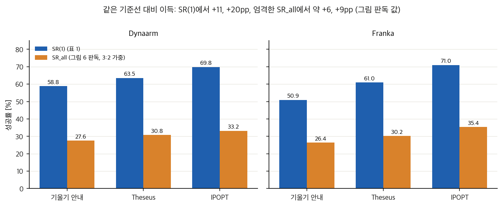
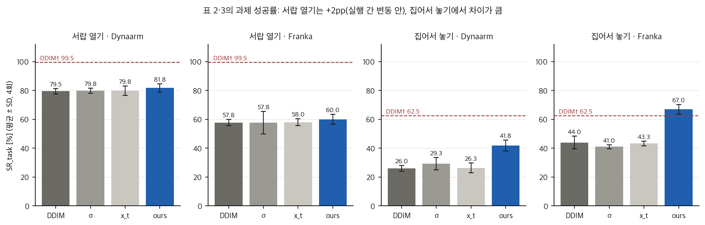
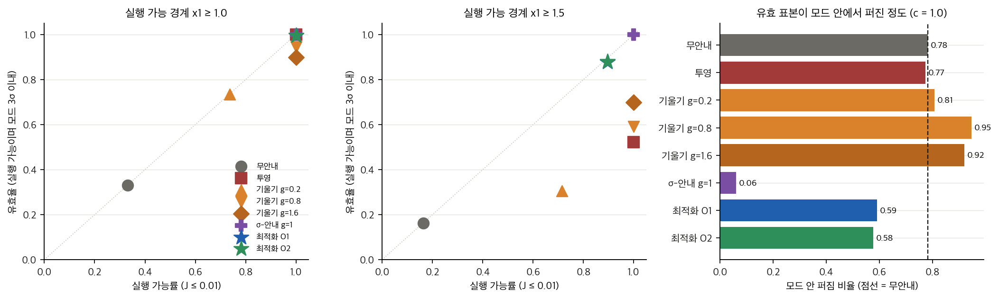

> **논문:** Sabrina Bodmer, René Zurbrügg, Tifanny Portela, Hao Ma, Alexandre Didier, Marco Hutter, Colin Jones, Melanie Zeilinger. *Grounding Generative Policies in Physics: Optimization-Guided Diffusion for Robot Control.* CoRL 2026 포스터, arXiv:2606.24208 (v1, 2026-06-23).
> 공식 코드와 프로젝트 페이지는 2026-11-26 기준 확인하지 못했습니다. 논문의 라이선스(arXiv non-exclusive) 때문에 논문 그림은 싣지 않고, 우리가 그린 그래프만 씁니다.

## 논문이 묻는 것

확산 정책이 작업 공간에서 내는 출력(파지, 경유점, 궤적)은 학습 분포에는 맞아도 특정 로봇에서는 도달할 수 없거나 충돌하거나 제어기가 따라가지 못할 수 있습니다. 기존 방법은 비용 기울기를 샘플링 중에 더하거나(기울기 안내), 각 단계를 실행 가능 집합에 투영하거나(투영 안내), 출력 뒤에 가장 가까운 실행 가능 점으로 옮깁니다.

이 논문은 DDIM의 역방향 갱신 x_{k-1} = μ_θ(x_k, k) + σ_k ω에서 확률적 섭동 ω를 **최적화 변수 δ_k로 바꿉니다**. δ_k의 크기를 규제하고 실행 가능성 비용 J를 최소화하는 문제(식 4)를 풀므로, 확산 모델은 다시 학습하지 않습니다. 초기 잡음 x_K도 변수입니다. 같은 사전분포를 Franka와 Dynaarm 두 팔에 쓰려고 바꾸는 것은 비용 J(도달 가능성, 충돌, 제어기 추종)뿐이라는 구성입니다.

## 이 글에서 확인한 것

공식 코드가 없어서 논문의 표와 식을 직접 대조했습니다. 계산은 모두 CPU에서 수 초에서 1분이 걸립니다.

**표 1과 부록 그림 5–6은 서로 맞습니다.** 부록의 쉬움과 어려움 자세별 성공률을 3 : 2로 가중하면 표 1의 평균과 최대 0.4점 안에서 일치합니다. 표 2와 표 3도 같은 실험의 값이고, 2칸에서 마지막 자리가 0.1 다를 뿐입니다(63.3 대 63.2, 같은 값의 반올림 방향 차이로 읽힙니다).

**SR(1)의 단위가 서술마다 다릅니다.** 5.1절은 "(물체, 자세)별", 부록 8.6은 "파지별, 세 축 중 한 축 이상에서 안정", 그림 6은 "자세별 SR(1)과 파지별 SR_all"이라고 씁니다. 표 1의 SR(1) 11개 값은 150개(물체 × 자세)를 분모로는 정수 성공 수가 되지 못하고, 파지 1200개를 분모로 하면 모두 가능합니다(시행 수 n 가정). 어느 단위인지는 저자 확인이 필요합니다.

**엄격한 지표에서는 이득이 절반 정도입니다.** SR(1)은 세 축 중 한 축만 통과하면 성공입니다. 그림 6에서 세 축 모두를 요구하는 SR_all을 읽어(그림 판독 값, ±1) 같은 가중으로 평균하면, IPOPT와 기울기 안내의 차이는 SR(1)의 +11.0, +20.1점에서 약 +5.6, +9.0점으로 줄어듭니다. 방향은 같습니다.

**시각운동은 과제에 따라 다릅니다.** 서랍 열기에서 제안은 +2.0점(두 팔)이고 4회 실행의 평균으로 한 Welch 검정은 p = 0.29, 0.38입니다. 저자도 이 과제에서는 실행 간 변동 안이라고 씁니다. 집어서 놓기는 Dynaarm에서 +12.5점(p = 0.005), Franka에서 +23.0점(p = 3×10⁻⁴)입니다. 초록의 "최대 23pp"는 이 Franka 칸이고 비교 기준선은 무안내 DDIM(44.0%)입니다. 기울기 안내 두 변형은 41.0%와 43.3%입니다.

**DDIM†를 넘는 칸이 있습니다.** 논문은 팔이 없는 DDIM†를 비구현 상한으로 서술합니다. 집어서 놓기 Franka에서는 제안의 SR_task 67.0%와 SR_sub 98.3%가 DDIM†의 62.5%, 95.3%보다 높습니다(Welch p = 0.26, 0.059로 차이는 유의하지 않거나 경계). 팔이 붙으면 오히려 쉬워지는 요소가 있을 가능성이 있고, 그렇다면 DDIM†는 상한이라기보다 기준점입니다.

**표 5의 시행 수는 캡션과 다르게 읽힙니다.** 캡션은 "4 물체 × 파지 10개"(칸당 40)인데 값 160개 중 60개가 1/40 격자에 맞지 않고, 1/160 격자에는 159개가 맞습니다(시행 수 n = 160 가정). 12개 값은 반올림이 아니라 절단으로 적혀 있습니다. 환경별로 가장 좋은 제안과 가장 좋은 기준선을 비교하면 Franka Clutter(+32.5점)가 가장 강한 차이이고, Dynaarm Tunnels에서는 기울기 안내가 더 높습니다(−6.3점).

**식과 설정에서 저자 확인이 필요한 곳이 있습니다.**

- 식 (25)의 IPOPT 문제는 −1 ≤ x_K ≤ 1, −1 ≤ δ_k ≤ 1을 둡니다. 확산 모델이 N(0, I) 공간에서 돈다고 가정하면(논문은 정규화를 밝히지 않음) 21차원 표본이 이 상자에 들어갈 확률은 3.3×10⁻⁴입니다.
- 확산 단계 수 K, 노이즈 스케줄, η가 없습니다. 식 (11)에서 ᾱ_0 = 1이면 σ_1 = 0이라 마지막 단계의 δ_1은 x_0에 영향을 주지 못합니다.
- 부록 8.2의 MAP 해석(식 20)은 x_K의 사전항을 뺀 형태이고, δ의 사전분포는 δ = 0, 곧 σ를 지운 결정적 경로 쪽으로 당깁니다.
- L-BFGS 변형(시각운동)이 ‖δ‖² 규제를 쓰는지, 가중치는 얼마인지 적혀 있지 않습니다.
- 대리망 학습의 epochs가 5(상수 줄), 50(반복문), "2−5"(본문)로 다르게 적혀 있습니다.

## 토이: 최적화 안내는 정말 사전분포를 더 잘 지키나

논문의 구조적 주장(섭동 슬롯을 최적화하면 같은 실행 가능률에서 사전분포를 더 잘 보존한다)을 가장 작은 설정에서 보았습니다. 반지름 2의 원 위 6개 가우시안 혼합(해석적 점수, 학습 없음)에서 η = 1의 DDIM 30단계로 표본을 만들고, 실행 가능 집합은 x1 ≥ c입니다. 투영, 기울기 안내(강도 g를 훑음), σ-안내, 최적화 안내(Adam 500회 직접 슈팅, IPOPT가 아님)를 3 시드, 표본 1000개로 비교했습니다. 표본 수와 설정은 우리가 정한 값입니다.

- 최적화 안내는 유효율(실행 가능이면서 모드 중심 3σ 이내)이 c = 1.0에서 0.995, c = 1.5에서 0.878입니다. 가장 좋은 g를 고른 기울기 안내는 0.946과 0.700입니다. 논문의 주장과 같은 방향입니다.
- 투영은 c = 1.0에서 거의 완벽(0.999)하고 c = 1.5처럼 가장 가까운 실행 가능 점이 모드 사이의 빈 곳일 때 0.52로 떨어집니다.
- 대가도 있습니다. 모드 안 퍼짐 비율이 무안내 0.78에서 0.58로 줄었고, σ-안내는 0.02–0.07로 거의 점이 되었습니다. δ를 0 쪽으로 당기는 규제의 영향으로 읽힙니다. 최적화 안내는 표본당 샘플러를 500번 펼쳐 푸는 계산이라 한 번 통과하는 방법보다 수백 배의 계산이 듭니다.

2차원, 해석적 점수, 반공간 제약이라 로봇 수치와는 무관합니다. 논문의 주장을 대신 확인하는 것이 아니라 구조적 타당성과 그 대가를 보는 용도입니다.

## 구현 가능성

논문 수치의 재현은 맥 한 대(Apple M4 Pro, 약 24 GiB, MPS, CUDA 없음)로는 불가능합니다. 공식 코드가 없고, 파지 평가(cuRobo, 파지 시뮬레이터)와 시각운동(DiT 학습, 시뮬레이션)이 CUDA와 시뮬레이터를 요구하며 실로봇 실험이 있습니다. 반면 식 (3)–(4)의 핵심 아이디어는 소형 재구현이 가능하고(위 토이가 그 일부), 저차원 학습형 확산 모델, 도달 가능성 대리망(약 218k 파라미터), 제어기 롤아웃을 torch와 mujoco로 각각 3–5일(추정, 측정 아님)에 구현할 수 있다고 봅니다.

## 한계

- 이 글의 재계산은 논문 v1의 표와 본문에 대한 것이고, 코드나 데이터는 보지 못했습니다.
- 그림 6의 값은 정수 라벨을 읽은 것이라 ±1점의 오차가 있습니다.
- 표 2·3의 "4회 실행"이 무엇을 바꾼 것인지 논문에 없어서, 검정은 두 가지 해석(n = 4 평균, n = 400 합산)으로 계산했고 본문에는 실행 평균 기준을 적었습니다.
- 저자에게 확인하면 좋은 질문은 SR(1)의 분모, 표 5의 시행 수, K·스케줄·η, 식 (25)의 정규화 공간, L-BFGS 변형의 목적함수, 실로봇의 시행·성공 수입니다.

분석 문서(01–04)와 계산 스크립트는 같은 노트 폴더에 함께 있습니다.

## 자료

- [통합 리포트 PDF](report/report_public.pdf)
- [01. 논문 분석: Grounding Generative Policies in Physics (arXiv:2606.24208)](analysis/01_paper_analysis.md)
- [02. 선행연구, 가까운 대안, 자료](analysis/02_prior_work.md)
- [03. 수치 재계산과 해석](analysis/03_analysis.md)
- [04. 주장 검증과 구현 가능성](analysis/04_claim_verification.md)
