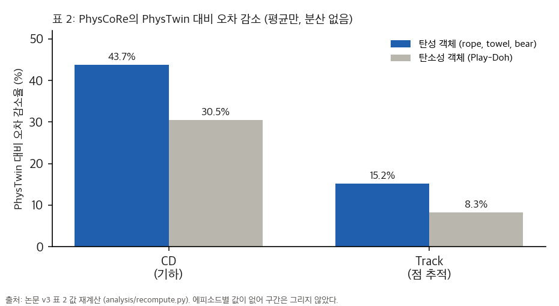
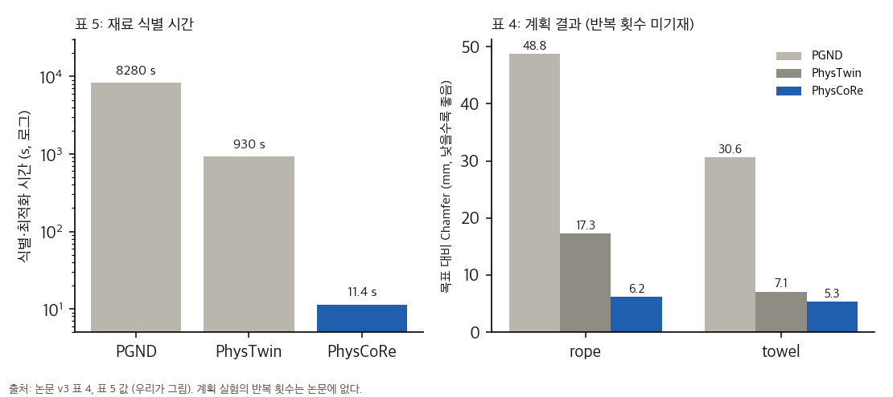

> **논문:** Haocheng Yin, Shuohan Tao, Yongsheng Chen, Lu Gan. *PhysCoRe: Physics-Corrected Residual World Models for Material-Aware Deformable Dynamics.* CoRL 2026 (포스터), arXiv:2607.20653 (v3, 2026-10-09).
> 공식 코드는 GitHub `lunarlab-gatech/PhysCoRe`에 있습니다. 이 글은 논문과 코드를 읽고 표 수치를 다시 계산한 기록입니다. 학습이나 재현은 하지 않았습니다.

## 논문이 묻는 것

변형체는 같은 손동작에도 재료에 따라 다르게 움직입니다. 탄성계수와 소성은 RGB-D에서 바로 읽히지 않습니다. 기존 방법은 두 갈래입니다. 물리 시뮬레이터는 물리 구조를 지키지만 객체마다 재료를 최적화해야 해서 느리고, 학습 모델은 빠르지만 데이터를 많이 먹고 물리 구조를 어깁니다.

PhysCoRe는 **미분 가능한 MLS-MPM 시뮬레이터를 중심에 두고** 두 모듈을 붙입니다.

- **MfM (Material from Motion):** 10 프레임 관측 창에서 파티클마다 `(log E, ν)`와 신뢰도를 한 번의 전방 계산으로 냅니다.
- **RfD (Residual from Dynamics):** 격자 속도에 보정량을 더합니다. 보정은 `δ_max · tanh`로 묶고, 출력층을 0으로 초기화해서 처음에는 시뮬레이터와 같습니다.

학습은 두 단계입니다. 먼저 원본 PhysTwin 에피소드 14개를 재료만 바꿔 1,120개로 늘리고 MfM을 학습합니다. 그다음 실제 에피소드 12개의 앞 절반으로 RfD를 학습합니다.

## 이 글에서 확인한 것

**1. PhysTwin 대비 기하 오차 감소는 재계산과 맞습니다.** 표 2에서 Chamfer 거리는 탄성 객체 43.7%, 탄소성 객체 30.5% 줄었습니다. 추적 손실은 15.2%, 8.3%입니다. 본문의 네 수치 모두 표에서 다시 계산한 값과 맞습니다.

*우리가 표 2 값으로 그린 그래프입니다. 평균만 있어서 구간은 그리지 않았습니다.*

**2. 탄성 객체의 시각 지표에서는 PhysTwin이 더 높습니다.** IoU는 70.5 대 68.2, SSIM은 0.309 대 0.302입니다. 초록의 "예측 정확도에서 SOTA를 이긴다"는 기하 지표와 탄소성에서 맞지만, 탄성 시각 지표까지 포함하면 맞지 않습니다.

**3. 통계 검정은 공개 자료로 할 수 없습니다.** 표 2는 평균만 있습니다. 에피소드별 값이 없습니다. 평가 에피소드가 12개라고 해도 탄성과 탄소성으로 나뉘어서 n은 더 작습니다. p < 0.05가 되려면 에피소드별 차이의 표준편차가 탄소성 추적 손실 평균의 13% 이하여야 합니다. 이 정도의 일관성이 있는지는 알 수 없습니다.

**4. RfD 절제 효과는 CD 13.1%와 17.8%입니다.** 그런데 공식 코드를 읽어 보면, 검증 스크립트는 식별 구간에서 관측을 따라가는 PID 보정을 기본으로 돌립니다. 이 보정은 RfD와 무관하게 실행됩니다. 따라서 "MfM만" 조건에도 관측 의존 항이 남아 있을 가능성이 큽니다. 논문은 이 점을 밝히지 않았습니다.

**5. 식별은 빠르고, 테스트 롤아웃은 그렇지 않습니다.** 식별 시간은 PhysTwin 930 s, PhysCoRe 11.4 s입니다. 약 81배입니다. 하지만 테스트 롤아웃은 PhysCoRe 8.5 s, PhysTwin 7.6 s로 PhysCoRe가 약 12% 느립니다. 본문은 이 점을 적지 않았습니다.

*우리가 표 4와 표 5 값으로 그린 그래프입니다. 계획 실험의 반복 횟수는 논문에 없습니다.*

**6. 공식 코드는 논문의 시간 이산화와 다른 경로를 탑니다.** 논문 표 6은 서브스텝 ∆t = 6.66e-4 s, 프레임당 50 서브스텝이라고 적습니다. 코드의 실제 에피소드 경로는 프레임당 25 서브스텝, ∆t ≈ 1.33e-3입니다. 프레임 시간은 같지만 명시적 MPM의 수치 조건은 다릅니다. 추적 과정을 코드 설정에서 따라간 결과이고, 실행으로 확인하지는 않았습니다.

**7. 평가 프로토콜에 확인할 점이 있습니다.** RfD는 같은 에피소드의 앞 절반으로 학습합니다. 체크포인트는 뒤 절반 (평가 구간) 손실이 가장 낮은 것으로 고릅니다. 평가 구간 점수로 고르면 표 2의 값이 낙관적일 수 있습니다. 논문은 선택 기준을 적지 않았습니다.

## 구현 가능성 (CUDA 없는 맥 기준)

- **공식 코드 실행: 불가.** spconv, gsplat, PyTorch3D, CUDA 확장을 전제합니다.
- **학습: 불가.** GPU 여러 시간 이상이 필요하다고 보입니다 (추정, 측정 없음).
- **기준선 (PhysTwin, PGND), 계획 (KUKA), 시각 지표: 재현 불가.** 공개 코드에 측정 스크립트가 없습니다.
- **체크포인트 추론 (MfM 5.7 MB, RfD 7.0 MB): 조건부.** RfD의 희소 3D 합성곱을 밀집 합성곱으로 바꾸고 데이터 4.2 GB를 받아야 합니다.
- **2D MLS-MPM 토이: 가능.** 잔차 보정과 신뢰도 헤드의 기본 성질을 확인할 수 있습니다. 노력은 1–2주로 추정합니다.

## 공개 범위와 권리

- 논문은 arXiv에 CC BY 4.0으로 공개되어 있습니다. PDF에서 저작권 표시는 찾지 못했습니다.
- 논문 그림은 데이터셋 프레임과 실로봇 장면이라서 이 글에 싣지 않았습니다. 여기 있는 그래프는 모두 표 값으로 우리가 그렸습니다.
- 공식 코드의 LICENSE는 MIT에 제3자 저작권 줄을 더한 형태입니다. GitHub는 라이선스를 인식하지 못해 `NOASSERTION`으로 보고합니다.
- 데이터셋 `GeorgiaTech/PhysCoRe`는 혼합 라이선스입니다. PhysTwin 원천 14개는 MIT 재배포이고 저작권 표시를 유지해야 합니다. 실제 12개는 CC BY 4.0입니다.

## 정리

PhysCoRe는 물리 시뮬레이터에 학습된 재료 추정과 잔차 보정을 붙여 기하 오차를 줄입니다. 방향은 설득력이 있습니다. 다만 근거를 보면 세 가지가 부족합니다. 에피소드별 값과 분산이 없고, 탄성 시각 지표에서 우위가 없으며, 평가 구간을 체크포인트 선택에 쓴 것으로 보입니다. 저자에게 확인할 질문은 에피소드별 값, 체크포인트 선택 기준, 절제 조건의 PID 여부, 측정 조건입니다.

## 자료

- [통합 리포트 PDF](report/report_public.pdf)
- [01. 논문 분석: PhysCoRe](analysis/01_paper_analysis.md)
- [02. 선행연구와 관련 저장소](analysis/02_prior_work.md)
- [03. 수치 재계산과 일관성 검사](analysis/03_analysis.md)
- [04. 공식 코드 대조: PhysCoRe](analysis/04_code_verification.md)
